# Architecture Specification

Baseline: commit `3d43b1d`.

## 1. System Overview

`zigBrowser` v1 is a static-HTML browser pipeline centered on `Page.navigate` in `src/page.zig`.

Core execution path:
- URL ingestion and normalization: `src/net/url.zig`
- Network fetch (curl subprocess): `src/net/fetch.zig`
- HTML tokenization/tree build to DOM: `src/html/tokenizer.zig`, `src/html/tree_builder.zig`, `src/html/dom.zig`
- CSS parsing to CSSOM: `src/css/tokenizer.zig`, `src/css/parser.zig`, `src/css/cssom.zig`
- Cascade to `ComputedStyle`: `src/css/cascade.zig`
- Layout primitives (block/inline/float): `src/layout/block.zig`, `src/layout/inline.zig`, `src/layout/float.zig`, `src/layout/box.zig`
- Paint command construction and raster: `src/paint/display_list.zig`, `src/paint/raster.zig`, `src/paint/text.zig`
- Window/platform interaction and event turn loop: `src/platform/window.zig`, `src/platform/event_loop.zig`

## 2. End-to-End Flow

```mermaid
flowchart LR
    A[URL] --> B[fetch\nnet/fetch.zig]
    B --> C[HTML tokenize/tree-build\nhtml/tokenizer.zig + html/tree_builder.zig]
    C --> D[DOM\nhtml/dom.zig]

    D --> E[collect <style> text\npage.collectStyleSources]
    E --> F[CSS parse\ncss/parser.zig]
    F --> G[CSSOM\ncss/cssom.zig]

    G --> H[cascade\ncss/cascade.zig]
    H --> I[ComputedStyle]

    I --> J[layout block/inline/float\nlayout/block.zig + inline.zig + float.zig]
    J --> K[box tree\nlayout/box.zig]

    K --> L[paint\npage.buildRenderPipeline]
    L --> M[display-list\npaint/display_list.zig]
    M --> N[raster\npaint/raster.zig]
    N --> O[framebuffer]
    O --> P[window/platform\nplatform/window.zig]
```

Notes for current v1 implementation:
- `Page.navigate` builds style input from inline `<style>` nodes in DOM (`collectStyleSources` in `src/page.zig`).
- `parseCssCorpusNoCrash` is used as a corpus safety gate before rule conversion in `src/page.zig`.
- Render output in `Page` is persisted as `render_checksum`; snapshot gates render ARGB buffers through `src/paint/snapshot_gate.zig`.

## 3. Memory Model

The page lifecycle is arena-scoped:
- `Page` owns a long-lived process allocator plus a per-page `ArenaAllocator` (`src/page.zig`).
- On first successful navigate, DOM/style/layout allocations live in the arena.
- On subsequent navigations, `Page.navigate` executes teardown and then re-initializes a fresh arena before rebuilding pipeline state.

This makes document, style map, box tree, and intermediate parse artifacts naturally reclaimed as a unit on teardown.

## 4. Ordered Teardown Contract

`Page.teardown` enforces a fixed order:
1. `engine.stopScript()`
2. `engine.severHandles()`
3. `engine.drainFinalizers()`
4. `arena.deinit()`
5. `engine.teardownIsolate()`

This order is both code-level behavior (`src/page.zig`) and test-gated (`src/root.zig`, `src/platform/window.zig`).

## 5. Engine-Agnostic Script Seam

Scripting is abstracted by `ScriptEngine` vtable in `src/script/engine.zig`:
- stop/sever/finalizer/teardown methods for lifecycle control
- `runScript` for execution seam
- `pumpMicrotasks` for event-loop integration (`src/platform/event_loop.zig`)

`Page` receives `ScriptEngine` dependency at init time, and tests use `NoopEngine` or spy engines via vtable injection.

## 6. Reserved JS Host-Handle Slot

DOM nodes carry a reserved host-owned wrapper reference slot:
- `Node.script_wrapper: ?WrapperRef` in `src/html/dom.zig`

Parsing/tests verify wrapper slot remains `null` for v1 node kinds, preserving the seam without executing JS during parse flows.
