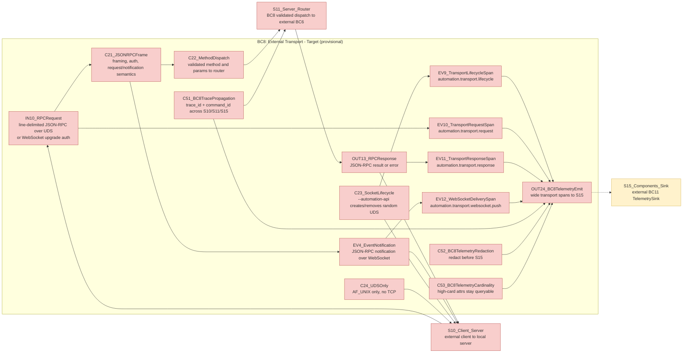
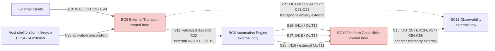

# Phase 2/3 Automation API External Transport and Platform Input TDD Plan

**Date:** 2026-07-09
**Scope:** Phase 2 (External API) and Phase 3 (Platform-Specific Input) only
**Coordination:** parallel sibling plan after Phase 1; deliberately excludes Phases 1, 4, and 5
**Primary inputs:** `thoughts/searchable/shared/prd/2026-07-09-browser-automation-api.md` and `thoughts/searchable/shared/prd/2026-07-09-browser-automation-api-context-map.html`

## Overview

This plan turns the PRD's Phase 2 and Phase 3 requirements into the smallest testable behaviors needed to expose the Phase 1 automation engine over a local JSON-RPC API and to add platform-specific input/network capabilities behind explicit adapters.

Phase 1 is treated as a completed dependency. The plan consumes these Phase 1 interfaces as given: `AutomationRouter`, `AutomationError` with the 12 PRD variants, `PageCommandQueue`, `AutomationPagePort`, `TelemetrySink`, in-memory telemetry test sink, root `automation.command` spans, injected script command handling, command verbs, and the result ownership fix. If Phase 1 lands with different filenames, use its exported interfaces without changing the behavior contracts below.

## Current State Analysis

The repo currently has a cross-platform WebView shell with a page-JS-to-Zig IPC path, but no external automation transport and no native input/network capability adapters.

Key discoveries:
- `src/cli.zig:3` defines `Command.open` with `url`, `print_title`, and `e2e_protocol`; `src/cli.zig:54` parses open flags. There is no `--automation-api` or automation token flag.
- `src/main.zig:37` executes `.open` by validating the URL and calling `webkit.c.zb_app_run(valid_uri.ptr, print_title, e2e_protocol)`.
- `src/webkit_shim.h:30` exposes the current C ABI with `zb_app_run(const char*, int, int)`, `zb_reload`, `zb_window_new`, `zb_policy_decide`, and `zb_ipc_dispatch`; no automation launch config or platform capability ABI exists.
- `src/ipc.zig:42` exposes `zb_ipc_dispatch`; Phase 1 must replace its 4096-byte result ceiling before Phase 2/3 run against real command output.
- `src/webkit_shim.c:530` installs the GTK `zbHost` page-to-native handler; `src/webkit_shim.c:1103` owns the GTK app lifecycle; `src/webkit_shim.c:1262` is the only native-to-JS evaluation call, limited to screenshot title retrieval.
- `src/webview2_shim.cpp:555` injects only a `window.__zigBrowserBackend` marker via `AddScriptToExecuteOnDocumentCreated`; `src/webview2_shim.cpp:646` wires page messages; there are no `ExecuteScript`, `CallDevToolsProtocolMethodAsync`, `AddWebResourceRequestedFilter`, or cookie/input/network capability calls.
- `src/wkwebview_shim.m:368` registers `zbHost` in `WKContentWorld.pageWorld`; `src/wkwebview_shim.m:388` injects only a marker script; `src/wkwebview_shim.m:582` handles page IPC. There is no automation content world eval/input adapter.
- `build.zig:105` selects backend by target OS; `build.zig:223` wires the current `test` step. New backend-free unit tests should follow the existing `ipc` and `nav_policy` test module pattern.
- `tests/e2e/PROTOCOL.md:1` is normative for existing stdout E2E events, but Phase 2 must add a real UDS client harness rather than extending stdout as the production API.
- Local Zig is `0.16.0`; installed stdlib exposes `std.Io.net.has_unix_sockets` and `std.Io.net.UnixAddress` with `listen`/`connect`. The stdlib gates Windows Unix sockets on Windows 10 RS4 or later.

Context-map contracts consumed by this plan:
- BC8: `IN10_RPCRequest`, `OUT13_RPCResponse`, `EV4_EventNotification`
- BC8: `C21_JSONRPCFrame`, `C22_MethodDispatch`, `C23_SocketLifecycle`, `C24_UDSOnly`
- BC8 seams: `S10_Client_Server`, `S11_Server_Router`
- BC12: `IN15_NetworkControl`, `IN16_InputCommand`, `OUT18_NetworkEvent`
- BC12: `C37_NetworkCapability`, `C38_InputDispatchMode`, `C39_ResultOwnership`
- BC12 seams: `S17_Engine_Network`, `S18_Engine_Input`
- BC11 consumed only for export/correlation: `S15_Components_Sink`, `C33_RedactionPolicy`, `C34_TraceCorrelation`, `C35_ExportIsolation`

## Desired End State

After Phase 2:
- `zigBrowser <URL> --automation-api` creates exactly one local AF_UNIX listener, no TCP listener, with a randomized socket path and an authenticated local token.
- The server accepts line-delimited JSON-RPC 2.0 command frames over the UDS command path and HTTP WebSocket upgrades for event push on the same UDS listener.
- JSON-RPC framing, auth, method dispatch, error mapping, event notifications, socket cleanup, trace correlation, and optional OTLP export are covered by unit and integration tests.
- Automation errors returned by Phase 1 include `trace_id` and `command_id` in JSON-RPC `error.data`.
- BC8 emits transport-layer wide spans for lifecycle, request, response, and WebSocket push delivery through external S15 `TelemetrySink`, preserving `trace_id` and `command_id` without recording raw tokens, raw params, or raw payloads.

After Phase 3:
- `AutomationPagePort` exposes explicit optional `InputDispatcher` and `NetworkInterceptor` capabilities.
- WebView2 dispatches native-ish input through in-process CDP `Input.dispatchMouseEvent` and `Input.dispatchKeyEvent`, without `Runtime.enable` or a remote debugging port.
- WebView2 implements `NetworkInterceptor` with `AddWebResourceRequestedFilter` and emits request/response/rate-limit network events.
- WebKitGTK and WKWebView expose JS synthetic event input dispatch through their Phase 1 eval/script path and return typed unsupported capability errors for network interception.
- Platform adapters emit `automation.cookie.command`, `automation.platform.eval`, `automation.input.dispatch`, `automation.network.capability`, and `automation.network.event` wide spans/events through the Phase 1 `TelemetrySink`.

## What We Are Not Doing

- No Phase 1 work: command verbs, selector/actionability implementation, error taxonomy, queueing, result ownership, root telemetry sink, and injected script engine are assumed present.
- No Phase 4 work: behavioral simulation, Gaussian typing jitter, Bezier mouse movement, pacing, daily caps, DOM challenge detection, stealth assessment, and anti-detection scoring are out of scope.
- No Phase 5 work: Python SDK, Node SDK, user-facing automation CLI, LinkedIn/Instagram/social commands, and `--trace` helpers are out of scope.
- No TCP fallback. ADR-1 says UDS-only unless the Windows AF_UNIX spike fails; if the spike fails, stop and write an ADR update rather than quietly adding TCP.
- No `WebKitAutomationSession`, no WebDriver mode, no `navigator.webdriver`.
- No WebView2 `Runtime.enable`, no `--remote-debugging-port`, and no page-world telemetry export.
- No full network interception on GTK/macOS; unsupported stubs are the intended Phase 3 result and must be visible as tracked security debt.

## Testing Strategy

Frameworks and gates:
- Zig unit tests via `zig build test --summary all`; add backend-free tests for JSON-RPC framing, socket path planning, telemetry export config, capability adapters, and span fields.
- Linux integration tests with temporary AF_UNIX sockets and a fake Phase 1 router; these should not require a real WebView.
- Linux real-binary E2E with `tests/e2e/slice2_common.py` patterns for `--automation-api` startup, socket discovery, command roundtrip, WebSocket event push, and clean shutdown.
- Windows spike/gates through `bash tests/guest/build-in-guest.sh <step>` and in-guest execution with `ZB_ENABLE_M8_E2E=1`.
- macOS gates through `bash tests/mac/build-on-mac.sh <step>` and `tests/mac/gate.sh` patterns where a real WKWebView is required.
- Telemetry assertions use Phase 1's in-memory sink and fixture scanner; OTLP export tests use a fake local collector and must prove export failure does not fail commands.

Transport framing decision for Phase 2 tests:
- Command path: one UTF-8 JSON-RPC object per line on the AF_UNIX stream. Writers must emit canonical one-line JSON and `\n`; readers reject oversized or malformed lines before queueing.
- Event path: clients connect to the same AF_UNIX listener and send an HTTP `GET /events` WebSocket upgrade request. The listener routes upgrade requests to the WebSocket event channel and all other connections to the line-delimited JSON-RPC reader.
- Authentication: every connection must prove possession of the per-session token before command dispatch or event subscription. Tests should cover token-in-first-frame for JSON-RPC and `Authorization: Bearer <token>` for WebSocket upgrade.

## Observable Behaviors

1. AF_UNIX Windows spike: Given Zig 0.16 on Windows 10 RS4+ or the provisioned Win11 guest, when the spike creates a Unix socket under `%LOCALAPPDATA%\zigbrowser`, then a client connects and exchanges bytes without TCP.
2. CLI activation and lifecycle: Given `--automation-api`, when the browser starts and shuts down, then one randomized local socket exists during runtime, is removed on clean shutdown, and no socket is created without the flag.
3. JSON-RPC framing and auth: Given a local client, when it sends valid, invalid, unauthenticated, and notification frames, then the server returns exactly the JSON-RPC response semantics in `C21`.
4. Router dispatch and error mapping: Given Phase 1 router outcomes, when the external server maps them, then unknown methods, invalid params, standard errors, and `AutomationError` variants map to the correct JSON-RPC codes with `trace_id` and `command_id`.
5. WebSocket event push: Given an authenticated event subscriber, when Phase 1/3 emits navigation, session, rate-limit, console, or network events, then subscribers receive JSON-RPC notifications on the WebSocket channel without blocking command completion.
6. Optional OTLP export: Given no export config, telemetry remains local; given an OTLP endpoint, spans are exported with redaction and failures are isolated from command responses.
7. Platform capability interfaces: Given adapters for each backend, when the engine queries input/network capabilities, then support is explicit and unsupported operations return typed capability errors, not silent success.
8. WebView2 input dispatch: Given a `dom.click` or `dom.type` action result from Phase 1, when WebView2 input mode is selected, then CDP `Input.dispatchMouseEvent`/`Input.dispatchKeyEvent` is called in-process and the action result grammar stays identical to JS synthetic mode.
9. WebView2 network interception: Given WebView2 network capability is enabled, when requests/responses occur, then `NetworkInterceptor` emits sanitized network events and rate-limit candidates.
10. GTK/WKWebView synthetic input: Given Linux/macOS adapters, when input dispatch is requested, then JS synthetic event commands are evaluated through the Phase 1 script path and emit adapter spans.
11. Platform adapter spans: Given any cookie, eval, input, or network adapter call, when it completes, fails, or reports unsupported capability, then required child spans/events share the command trace.

## Observability Design for BC8 and BC12

This phase consumes Phase 1's `TelemetrySink` as external seam S15. BC8 and BC12 emit wide, flat span events into that sink; they do not own the sink implementation, export batching, storage, or BC11 policy internals. The instrumentation shape follows the observability-fundamentals rule: one wide event per unit of work, with enough high-cardinality and high-dimensional context to debug novel failures later. Do not add metrics-style counters where a query over spans can compute the same count or ratio.

### Units of Work and Wide Events

| Context | Unit of work | Span/event schema | Parentage |
|---|---|---|---|
| BC8 | Automation API server start/stop | `EV9_TransportLifecycleSpan` / `automation.transport.lifecycle` with `trace_id`, `span_id`, `session_id_hash`, `lifecycle.phase`, `transport.protocol`, `socket_path_hash`, `platform.name`, `os.name`, `result.status`, `error.class`, `duration_ms` | Standalone startup/shutdown span; no command parent. |
| BC8 | Accepted JSON-RPC line or rejected parse/auth frame | `EV10_TransportRequestSpan` / `automation.transport.request` with `trace_id`, `span_id`, `command_id`, `connection_id_hash`, `session_id_hash`, `rpc.method`, `rpc.id_hash`, `request.kind`, `auth.status`, `parse.status`, `frame.bytes`, `retry.count`, `result.status`, `error.class`, `duration_ms` | Root transport span for the accepted frame; creates `trace_id` and `command_id` before S11 dispatch. |
| BC8 | JSON-RPC response or error write | `EV11_TransportResponseSpan` / `automation.transport.response` with `trace_id`, `span_id`, `parent_span_id`, `command_id`, `rpc.method`, `rpc.id_hash`, `jsonrpc.error_code`, `automation.error`, `response.bytes`, `result.status`, `write.status`, `duration_ms` | Child of `EV10`; JSON-RPC `error.data.trace_id` and `error.data.command_id` match this trace. |
| BC8 | WebSocket notification delivery attempt | `EV12_WebSocketDeliverySpan` / `automation.transport.websocket.push` with `trace_id`, `span_id`, `event_id`, `origin_command_id`, `ws.connection_id_hash`, `ws.subscriber_id_hash`, `event.method`, `event.kind`, `page_id`, `queue.depth`, `delivery.status`, `drop.reason`, `frame.bytes`, `duration_ms` | Child of the originating event trace when present; otherwise standalone event-delivery trace with `origin_command_id=null`. |
| BC12 | Native or script eval through a platform adapter | `EV13_PlatformEvalSpan` / `automation.platform.eval` with `trace_id`, `span_id`, `parent_span_id`, `command_id`, `page_id`, `backend.name`, `platform.name`, `content_world`, `eval.kind`, `payload.bytes`, `result.bytes`, `result.status`, `platform.error_class`, `duration_ms` | Child of Phase 1 `automation.command`. |
| BC12 | Input dispatch | `EV14_InputDispatchSpan` / `automation.input.dispatch` with `trace_id`, `span_id`, `parent_span_id`, `command_id`, `page_id`, `backend.name`, `input.mode`, `input.kind`, `input.action`, `input.trial`, `cdp.method`, `coordinate.x`, `coordinate.y`, `payload.bytes`, `result.status`, `platform.error_class`, `duration_ms` | Child of Phase 1 `automation.command`; may also have an `EV13` child for JS synthetic eval. |
| BC12 | Network capability query/start/stop | `EV15_NetworkCapabilitySpan` / `automation.network.capability` with `trace_id`, `span_id`, `parent_span_id`, `command_id`, `page_id`, `backend.name`, `network.operation`, `network.capability`, `unsupported.reason`, `debt.kind`, `result.status`, `duration_ms` | Child of Phase 1 `automation.command` when command-initiated; standalone when emitted during adapter startup diagnostics. |
| BC12 | Network event capture/reporting | `EV16_NetworkEventSpan` / `automation.network.event` with `trace_id`, `span_id`, `parent_span_id`, `command_id`, `page_id`, `backend.name`, `network.event.kind`, `network.request_id_hash`, `target.host`, `target.path_hash`, `http.method`, `http.status_code`, `http.status_class`, `resource.kind`, `rate_limit`, `queue.depth`, `drop.reason`, `result.status`, `duration_ms` | Child of the command that started interception when available; otherwise a page/session-scoped event trace. |
| BC12 | Cookie store command | `EV17_CookieCommandSpan` / `automation.cookie.command` with `trace_id`, `span_id`, `parent_span_id`, `command_id`, `page_id`, `backend.name`, `cookie.operation`, `cookie.domain_hash`, `cookie.name_hash`, `cookie.count`, `cookie.scope`, `result.status`, `platform.error_class`, `duration_ms` | Child of Phase 1 `automation.command`; values are never recorded. |

### Cardinality and Debuggability

High-cardinality dimensions to preserve as span attributes: `trace_id`, `span_id`, `parent_span_id`, `command_id`, `event_id`, `connection_id_hash`, `ws.subscriber_id_hash`, `rpc.id_hash`, `session_id_hash`, `page_id`, `socket_path_hash`, `network.request_id_hash`, `target.host`, `target.path_hash`, `cookie.domain_hash`, `cookie.name_hash`, and `selector.hash` when a selector crosses the adapter boundary.

Low-cardinality dimensions to keep enumerable in tests: `span.name`, `transport.protocol`, `lifecycle.phase`, `request.kind`, `auth.status`, `parse.status`, `rpc.method`, `jsonrpc.error_code`, `automation.error`, `result.status`, `write.status`, `event.method`, `event.kind`, `delivery.status`, `drop.reason`, `backend.name`, `platform.name`, `content_world`, `eval.kind`, `input.mode`, `input.kind`, `input.action`, `network.operation`, `network.capability`, `unsupported.reason`, `debt.kind`, `network.event.kind`, `http.method`, `http.status_class`, `resource.kind`, `rate_limit`, `cookie.operation`, and `cookie.scope`.

Cardinality tests should not cap the number of distinct `trace_id`, `command_id`, or hashed identifier values. They should instead assert that low-cardinality dimensions come from explicit enums and that high-cardinality dimensions are present as flat attributes, not embedded in log text.

### Trace Propagation

- BC8 generates `trace_id` and `command_id` at the accepted-frame boundary before S11 dispatch. Parse/auth failures also get generated correlation IDs even though no router command exists.
- `automation.transport.request` is the parent for `automation.transport.response` and for the Phase 1 `automation.command` root when a router dispatch happens. All child spans keep the same `trace_id` and `command_id`.
- JSON-RPC `error.data.trace_id` and `error.data.command_id` must match the emitted `EV11_TransportResponseSpan`.
- WebSocket pushed notifications carry `event_id` and the originating `trace_id`/`origin_command_id` when the source event has them. Delivery failures emit `EV12_WebSocketDeliverySpan` with `delivery.status=failed` or `delivery.status=dropped`.
- BC12 adapter spans are children of the Phase 1 `automation.command` span when command-initiated. Network events that occur after a start command retain the start command correlation when available and always include `page_id` plus `session_id_hash` through the sink context.

### Redaction and Privacy

Redaction runs before S15 receives the event. Denylisted fields must never reach the in-memory sink, OTLP side sink, fixture snapshots, or WebSocket diagnostics: raw automation tokens, authorization headers, raw socket paths, raw JSON-RPC params, raw selectors, typed text, cookie names paired with values, cookie values, request/response bodies, screenshots, DOM snapshots, raw JavaScript payloads, full URLs with path/query, and raw platform error payloads that may include user data.

Allowed transformations: `socket_path_hash`, `connection_id_hash`, `ws.subscriber_id_hash`, `rpc.id_hash`, `session_id_hash`, `profile.id_hash`, `selector.hash`, `network.request_id_hash`, `target.path_hash`, `cookie.domain_hash`, and `cookie.name_hash`. `target.host` may be retained as a high-cardinality diagnostic field; path and query must be hashed. Platform failures expose low-cardinality `platform.error_class` and may include hashed/native numeric code only if tests prove it cannot include sensitive text.

### Queryable SLIs

- Transport command completion SLI: count of `EV11_TransportResponseSpan` where `write.status=sent` and `result.status` is not `transport_error`, divided by count of authenticated `EV10_TransportRequestSpan` with `request.kind=request`. Candidate SLO: 99.9% of authenticated local requests produce exactly one correlated response span within the command timeout window.
- WebSocket event delivery SLI: count of `EV12_WebSocketDeliverySpan` where `delivery.status=sent`, divided by sent plus dropped delivery attempts for authenticated subscribers. Candidate SLO: 99.5% of event notifications are delivered or explicitly dropped with a queryable `drop.reason`; silent drops are never acceptable.
- Platform dispatch SLI: count of BC12 adapter spans where `result.status=success` or `result.status=unsupported`, divided by all adapter spans including cookie, input, network, and eval operations. Candidate SLO: 99.9% of adapter operations produce a terminal span with `trace_id`, `command_id` when command-initiated, and a low-cardinality `result.status`.

## File-Level Change Plan

Likely new Zig modules:
- `src/automation_rpc.zig`: JSON-RPC frame structs, parser/serializer, id handling, error object mapping, line framing.
- `src/automation_transport.zig`: AF_UNIX socket path generation, token loading/generation, permissions, listener lifecycle, connection routing.
- `src/automation_api_server.zig`: server accept loop, auth, router calls, command/event connection management.
- `src/automation_websocket.zig`: minimal WebSocket upgrade and text-frame notification writer for local event push.
- `src/automation_otlp.zig`: optional OTLP-compatible export adapter around the Phase 1 `TelemetrySink`.
- `src/automation_platform.zig`: `InputDispatcher`, `NetworkInterceptor`, `NetworkCapability`, and capability error contracts if Phase 1 did not already define them.

Likely source updates:
- `src/cli.zig`: add `automation_api: bool`, optional `automation_token_file`, and tests.
- `src/main.zig` and `src/app.zig`: start/stop `AutomationApiServer` around `.open` lifecycle when enabled; preserve existing `.version` and `.screenshot`.
- `src/webkit_shim.h`: add the minimal C ABI needed for Phase 3 capability calls and, if needed, a backward-compatible automation launch/config struct.
- `src/webkit_shim.c`: GTK adapter for JS synthetic input, network unsupported stub, platform span attributes, lifecycle cleanup.
- `src/webview2_shim.cpp`: WebView2 `Input.*` CDP dispatcher, `AddWebResourceRequestedFilter` interceptor, network event queue, and no-`Runtime.enable` assertions.
- `src/wkwebview_shim.m`: WKWebView content-world eval/synthetic input adapter, network unsupported stub, platform span attributes.
- `build.zig`: add unit/integration test modules and HW-gated steps without disturbing current `test` behavior.

Likely tests:
- `tests/automation_rpc_test.zig`
- `tests/automation_transport_test.zig`
- `tests/automation_api_server_test.zig`
- `tests/automation_platform_test.zig`
- `tests/automation_otlp_test.zig`
- `tests/e2e/automation_api_socket_test.py`
- `tests/e2e/automation_api_events_test.py`
- `tests/e2e/m8_automation_input_test.py`
- `tests/e2e/m8_network_interceptor_test.py`
- `tests/e2e/m9_automation_input_test.py`

## Behavior P2.0: ADR-1 AF_UNIX Windows Spike

### Test Specification

Given: Zig 0.16 on the provisioned Windows guest and `std.Io.net.has_unix_sockets == true`.
When: a tiny spike program creates `std.Io.net.UnixAddress` under `%LOCALAPPDATA%\zigbrowser`, listens, connects, exchanges `ping\n`/`pong\n`, and closes.
Then: the exchange succeeds, no TCP port is opened, the socket file/path is cleaned up, and failures are classified as `AddressFamilyUnsupported` vs ordinary IO errors.

Edge cases:
- `has_unix_sockets == false` produces a loud skip/fail artifact, not an implementation fallback.
- Path length stays below `std.Io.net.UnixAddress.max_len`.
- Stale socket path from a killed prior run is removed before bind and after close.

### TDD Cycle

Red:
- Add a spike test step such as `automation-afunix-spike-win` that currently fails because the spike source and build step do not exist.
- Add an in-guest invocation to `tests/guest/build-in-guest.sh automation-afunix-spike-win`.

Green:
- Add a small spike source under `tests/spikes/af_unix_roundtrip.zig` or a build-only test module.
- Use `std.Io.net.UnixAddress.init`, `listen`, `connect`, `accept`, and local byte exchange.
- Print a stable artifact line: `PASS\tafunix-windows\t<socket-path>`.

Refactor:
- Extract reusable socket-path and cleanup helpers into `automation_transport.zig` tests only after the spike passes on Windows.
- If the spike fails due to OS/runtime support, file an ADR-1 update before any TCP design work.

Success criteria:
- Automated: Linux compile gate for the spike; Windows in-guest run through `tests/guest/build-in-guest.sh automation-afunix-spike-win`.
- Manual: artifact shows AF_UNIX path under `%LOCALAPPDATA%\zigbrowser`, not `127.0.0.1`.

## Behavior P2.1: CLI Activation and Socket Lifecycle

### Test Specification

Given: `zigBrowser https://example.com --automation-api` with an optional `--automation-token-file <path>`.
When: CLI parsing and `.open` execution begin.
Then: the process starts exactly one automation API server, creates a randomized AF_UNIX socket with local-only permissions, writes/loads the per-session token, passes no TCP port, and removes the socket on clean shutdown.

Edge cases:
- `--automation-api` is valid before or after the URL, like `--e2e-protocol`.
- `--automation-api` is rejected for `--screenshot`.
- Duplicate automation flags remain idempotent.
- Token file path starting with `-` is usage.
- Startup failure returns a distinct startup error before entering the WebView event loop.

### TDD Cycle

Red:
- Add `cli.zig` tests beside `src/cli.zig:119` for accepted/rejected flag positions.
- Add `automation_transport_test.zig` tests for randomized socket path shape on Linux/macOS and Windows path planning.
- Add lifecycle integration test with a fake app runner that observes `server.started == true` during open and `server.stopped == true` after return.

Green:
- Extend `cli.Command.open` with `automation_api` and optional `automation_token_file`.
- Add `AutomationConfig` construction in `main.zig`/`app.zig`.
- Start the server before entering `zb_app_run` only when the flag is present; stop it in a `defer`/post-run cleanup path.
- Keep current `zb_app_run(uri, print_title, e2e_protocol)` behavior for non-automation runs, or add a backward-compatible config wrapper if Phase 1 requires platform registration.

Refactor:
- Move socket path, token, and cleanup policy into `automation_transport.zig`.
- Keep platform shims ignorant of token parsing; shims should only receive capability/page-port context needed by Phase 3.

Telemetry assertions:
- Assert `EV9_TransportLifecycleSpan` is emitted on server start and clean stop with `trace_id`, `span_id`, `session_id_hash`, `lifecycle.phase`, `transport.protocol=uds`, `socket_path_hash`, `platform.name`, `os.name`, `result.status`, and `duration_ms`.
- Assert raw socket paths and automation tokens are absent from the in-memory sink; only `socket_path_hash` is allowed.
- Assert `session_id_hash` and `socket_path_hash` are treated as high-cardinality attributes, while `transport.protocol`, `lifecycle.phase`, and `result.status` are checked against low-cardinality enums.

Success criteria:
- Automated: `zig build test --summary all`; new transport unit tests; Linux E2E verifies socket exists while the browser is alive and is gone after SIGTERM.
- Manual: no TCP listener appears in `ss -ltnp` during an automation-enabled run.

## Behavior P2.2: JSON-RPC 2.0 Frame Parser and Auth Gate

### Test Specification

Given: an AF_UNIX command connection.
When: the client sends line-delimited JSON-RPC requests, notifications, malformed JSON, invalid `jsonrpc`, missing method, wrong params shape, or bad token.
Then: the server enforces JSON-RPC 2.0 semantics, rejects unauthenticated clients before router dispatch, returns exactly one response for requests with `id`, and returns no response for notifications.

Edge cases:
- `id` may be string, integer, or null and is echoed unchanged.
- Batch JSON-RPC is rejected as invalid request for initial scope.
- Oversized lines are rejected before parse and before queueing.
- Auth failure closes or errors the connection without leaking socket path/token.

### TDD Cycle

Red:
- Add parser tests for `parse error -32700`, `invalid request -32600`, `method not found -32601`, and `invalid params -32602`.
- Add fake-router tests proving malformed/auth-failed frames never call `AutomationRouter.dispatch`.

Green:
- Implement `JsonRpcFrame`, `JsonRpcId`, `JsonRpcErrorObject`, and one-line parser/serializer in `automation_rpc.zig`.
- Implement token validation as the first accepted frame or explicit auth field, then require authenticated state for all later frames.
- Route only grammar-valid method/params frames to Phase 1.

Refactor:
- Separate byte framing from JSON shape validation so WebSocket notification serialization can reuse the JSON-RPC notification writer.

Telemetry assertions:
- Assert every valid, malformed, oversized, unauthenticated, and notification frame emits `EV10_TransportRequestSpan` with `trace_id`, `command_id`, `connection_id_hash`, `session_id_hash`, `request.kind`, `auth.status`, `parse.status`, `frame.bytes`, `result.status`, and `duration_ms`.
- Assert malformed/auth-failed frames have generated `trace_id` and `command_id` but no S11 router dispatch.
- Assert raw token, raw JSON line, raw params, raw selectors, and typed text are absent before S15; `rpc.id_hash` is present when an id exists.
- Assert low-cardinality fields `auth.status`, `parse.status`, `request.kind`, and `result.status` are enum-bounded, while `trace_id`, `command_id`, `connection_id_hash`, and `rpc.id_hash` remain high-cardinality dimensions.

Success criteria:
- Automated: `zig build test --summary all`; fuzz/property-style parser tests over malformed bytes where feasible.
- Manual: `socat - UNIX-CONNECT:<socket>` or a Python UDS client can show exact response objects.

## Behavior P2.3: Server Dispatch, Error Mapping, and Trace Correlation

### Test Specification

Given: a fake Phase 1 router that returns success, unknown method, invalid params, each `AutomationError`, cancellation, and internal failure.
When: the JSON-RPC server dispatches a valid request.
Then: success returns `{jsonrpc:"2.0", result, id}`; standard failures use standard JSON-RPC codes; automation failures use `-32001..-32012`; every error `data` includes `trace_id`, `command_id`, redacted diagnostic fields, and the Phase 1 automation error name.

Edge cases:
- Parse/auth errors get generated `trace_id` and `command_id` even when no router command exists.
- Caller-provided ids are not used as `command_id`.
- Raw selectors and typed values are hashed/redacted according to Phase 1/BC11 redaction policy.

### TDD Cycle

Red:
- Add table-driven tests mapping the 12 Phase 1 `AutomationError` variants to Appendix A JSON-RPC codes.
- Add assertions that error `data.trace_id` and `data.command_id` are non-empty and stable across root/child telemetry events.

Green:
- Implement `mapRouterResultToJsonRpc`.
- Generate `command_id` at accepted-frame boundary and `trace_id` through Phase 1 telemetry context.
- Include `rpc.method`, `jsonrpc.error_code`, `automation.error`, `trace_id`, and `command_id` in root span attrs.

Refactor:
- Centralize redacted diagnostic construction so later external clients can consume the same fields without changing Phase 2 behavior.

Telemetry assertions:
- Assert `EV11_TransportResponseSpan` is emitted for success and every error branch with `trace_id`, `parent_span_id`, `command_id`, `rpc.method`, `rpc.id_hash`, `jsonrpc.error_code`, `automation.error`, `response.bytes`, `result.status`, `write.status`, and `duration_ms`.
- Assert JSON-RPC `error.data.trace_id` and `error.data.command_id` exactly match the emitted response span and the Phase 1 command trace.
- Assert redacted diagnostics never contain raw selectors, raw typed values, raw params, tokens, screenshots, DOM snapshots, or full URLs; selector and path diagnostics use hashes.
- Assert `jsonrpc.error_code`, `automation.error`, `result.status`, and `write.status` are low-cardinality enum fields; `trace_id`, `command_id`, and `rpc.id_hash` are high-cardinality fields.

Success criteria:
- Automated: unit tests for every error code; telemetry fixture assertion for trace/command correlation.
- Manual: failing a fake `dom.click` shows trace fields in the JSON-RPC error and matching local telemetry.

## Behavior P2.4: WebSocket Event Push on the Same Socket

### Test Specification

Given: a client connects to the same AF_UNIX socket and sends an authenticated WebSocket upgrade request for `/events`.
When: Phase 1/3 emits navigation, rate-limit, session, console, or network events.
Then: the server sends JSON-RPC notification text frames such as `event.navigation` and `event.network`, ordered per page, best-effort across pages, and never blocks command completion.

Edge cases:
- Bad token in the upgrade request rejects the upgrade.
- Slow subscribers are disconnected or drop events with local diagnostics.
- Command connections and event connections can be open at the same time.
- Notifications never include `id`.

### TDD Cycle

Red:
- Add tests for WebSocket `Sec-WebSocket-Accept` handshake over a Unix socket.
- Add fake event source tests for ordered per-page notifications and no response to notifications.
- Add slow-client test with a bounded event queue.

Green:
- Implement minimal server-side WebSocket upgrade and text-frame writer in `automation_websocket.zig`.
- Route first bytes beginning with `GET ` to WebSocket upgrade; otherwise use JSON-RPC line reader.
- Subscribe event clients to Phase 1 event bus / telemetry-derived notifications without coupling to later client-library code.

Refactor:
- Keep event payload shaping separate from WebSocket framing so later external clients can reuse event structs unchanged.

Telemetry assertions:
- Assert each subscriber delivery attempt emits `EV12_WebSocketDeliverySpan` with `trace_id`, `span_id`, `event_id`, `origin_command_id` when available, `ws.connection_id_hash`, `ws.subscriber_id_hash`, `event.method`, `event.kind`, `page_id`, `queue.depth`, `delivery.status`, `drop.reason`, `frame.bytes`, and `duration_ms`.
- Assert slow-subscriber drops emit `delivery.status=dropped` with a bounded `drop.reason` instead of disappearing silently.
- Assert notification payloads and telemetry omit raw event payloads, raw URLs, raw console text, raw network paths, tokens, and cookies; network paths use `target.path_hash`.
- Assert `event.method`, `event.kind`, `delivery.status`, and `drop.reason` are low-cardinality fields; `event_id`, `ws.connection_id_hash`, and `ws.subscriber_id_hash` are high-cardinality fields.

Success criteria:
- Automated: Zig unit tests for handshake/frame writer; Python E2E using `socket.socket(AF_UNIX)` plus a small WebSocket client helper.
- Manual: event subscriber receives notifications while a command client still receives responses.

## Behavior P2.5: Optional OTLP Export with Local Default

### Test Specification

Given: no OTLP config.
When: automation commands execute through the JSON-RPC server.
Then: telemetry remains local/in-memory and no network export is attempted.

Given: `ZB_AUTOMATION_OTLP_ENDPOINT` or equivalent config is set.
When: spans end.
Then: root and child spans are exported after redaction, and exporter failures do not change JSON-RPC command outcomes.

Edge cases:
- Invalid endpoint disables export with a local diagnostic, not a command failure.
- Denied fields such as cookies, tokens, raw form values, raw selectors, screenshots, and DOM snapshots are stripped before local and OTLP sinks.
- Export batching must not block command response path.

### TDD Cycle

Red:
- Add default-config tests proving export is disabled unless explicitly configured.
- Add fake OTLP collector tests proving payloads include trace/span ids and exclude denylisted fields.
- Add exporter-failure test proving command result remains success/error from the router, not telemetry failure.

Green:
- Implement `AutomationTelemetryExportConfig` and an OTLP-compatible exporter behind Phase 1 `TelemetrySink`.
- Wire config from environment or an automation config object; avoid broad CLI expansion beyond `--automation-api` and token file in this phase.

Refactor:
- Keep local sink as the default and compose OTLP as a non-failing side sink.

Telemetry assertions:
- Assert fake collector payloads contain the BC8/BC12 wide event names and correlation fields, including `trace_id`, `span_id`, `command_id` when command-scoped, and `parent_span_id` for child spans.
- Assert exporter failure emits a local diagnostic span/event with low-cardinality `telemetry.export.status=failed` and does not alter JSON-RPC `result` or `error`.
- Assert denylisted fields are absent from both local and OTLP sinks: tokens, authorization headers, raw params, raw selectors, typed text, cookies, screenshots, DOM snapshots, raw JavaScript, raw request bodies, and full URLs.
- Assert high-cardinality fields remain attributes in exported events and are not collapsed into log text or removed by batching.

Success criteria:
- Automated: telemetry config/unit tests; redaction fixture scanner; fake collector assertions.
- Manual: with no config, packet capture or logs show no remote telemetry attempts.

## Behavior P3.1: Capability Interfaces and Unsupported Stubs

### Test Specification

Given: the Phase 1 engine asks a platform page port for input or network capability.
When: the adapter is WebView2, GTK, or WKWebView.
Then: input capability returns supported mode (`cdp_input` for WebView2, `js_synthetic` for GTK/WKWebView); network capability returns supported for WebView2 and unsupported for GTK/WKWebView with a typed capability error and telemetry.

Edge cases:
- Unsupported network start returns an error, not an empty event stream.
- Capability is queryable before use.
- Result ownership follows Phase 1 `C39` and never returns pointers bound to a static 4KB buffer.

### TDD Cycle

Red:
- Add backend-free tests against fake adapters for `InputDispatcher` and `NetworkInterceptor` vtables.
- Add table tests for platform capability names and typed unsupported errors.

Green:
- Define `InputDispatcher`, `NetworkInterceptor`, `NetworkCapability`, `InputMode`, and `CapabilityUnsupported` error if Phase 1 did not already define them.
- Add platform adapter constructors and stubs.

Refactor:
- Keep capability advertisement pure and fast; actual start/dispatch paths own async resources.

Telemetry assertions:
- Assert each cookie command emits `EV17_CookieCommandSpan` with `trace_id`, `span_id`, `parent_span_id`, `command_id`, `page_id`, `backend.name`, `cookie.operation`, `cookie.domain_hash`, `cookie.name_hash`, `cookie.count`, `cookie.scope`, `result.status`, `platform.error_class`, and `duration_ms`.
- Assert each capability query/start/stop emits `EV15_NetworkCapabilitySpan` with `trace_id`, `span_id`, `command_id` when command-scoped, `page_id`, `backend.name`, `network.operation`, `network.capability`, `unsupported.reason`, `debt.kind`, `result.status`, and `duration_ms`.
- Assert GTK/WKWebView unsupported network capability emits `result.status=unsupported` and a low-cardinality `unsupported.reason`, not an empty event stream or silent success.
- Assert no cookie values, cookie name/value pairs, raw profile paths, or raw platform diagnostics reach S15; cookie names/domains and profile/session identifiers are hashed.
- Assert `backend.name`, `cookie.operation`, `cookie.scope`, `network.operation`, `network.capability`, `unsupported.reason`, and `result.status` are enum-bounded; `page_id`, `cookie.domain_hash`, `cookie.name_hash`, and `session_id_hash` remain high-cardinality dimensions.

Success criteria:
- Automated: `zig build test --summary all`; backend-free compile tests for all adapters.
- Manual: capability dump in a debug test reports WebView2 network supported, GTK/macOS unsupported.

## Behavior P3.2: WebView2 CDP Input.dispatch* Adapter

### Test Specification

Given: WebView2 backend and a Phase 1 action requiring input dispatch.
When: `InputDispatcher.dispatchMouse` or `dispatchKey` is called.
Then: the shim calls `ICoreWebView2::CallDevToolsProtocolMethodAsync` with `Input.dispatchMouseEvent` or `Input.dispatchKeyEvent`, completes exactly once, returns the common action result grammar, emits `automation.input.dispatch`, and never calls `Runtime.enable` or opens a remote debugging port.

Edge cases:
- Failed HRESULT maps to the Phase 1 platform/action error without raw HRESULT leaking past the adapter boundary.
- Coordinates and key names are validated before CDP call.
- Multiple dispatches serialize on the WebView2 UI thread.
- `trial=true` from Phase 1 must not dispatch input.

### TDD Cycle

Red:
- Add C++ adapter unit/compile test with a fake `ICoreWebView2` recording CDP method names and JSON payloads.
- Add negative assertion that recorded method names never include `Runtime.enable`.
- Add Windows E2E fixture where `dom.click` changes a page-visible counter through WebView2 input mode.

Green:
- Implement WebView2 input adapter in `src/webview2_shim.cpp`.
- Build JSON payloads for mouse/key dispatch through structured helpers, not string concatenation where a JSON writer is available.
- Complete callbacks exactly once and bridge results back to Phase 1.

Refactor:
- Share validation and telemetry attribute shaping with synthetic adapters.

Telemetry assertions:
- Assert each dispatch emits `EV14_InputDispatchSpan` with `trace_id`, `parent_span_id`, `command_id`, `page_id`, `backend.name=webview2`, `input.mode=cdp_input`, `input.kind`, `input.action`, `input.trial`, `cdp.method`, `coordinate.x`, `coordinate.y`, `payload.bytes`, `result.status`, `platform.error_class`, and `duration_ms`.
- Assert `trial=true` emits a terminal span with `input.trial=true` and no recorded native dispatch call.
- Assert raw typed text and raw HRESULT/error strings are absent; native failures expose only low-cardinality `platform.error_class` and an allowed hashed/native numeric code if needed.
- Assert `backend.name`, `input.mode`, `input.kind`, `input.action`, `cdp.method`, `result.status`, and `platform.error_class` are low-cardinality fields; `trace_id`, `command_id`, and `page_id` remain high-cardinality dimensions.

Success criteria:
- Automated: Windows compile gate; `ZB_ENABLE_M8_E2E=1 python3 tests/e2e/m8_automation_input_test.py`.
- Manual: fixture visibly reacts to click/type in a real WebView2 window.

## Behavior P3.3: WebView2 NetworkInterceptor

### Test Specification

Given: WebView2 backend with network interception started for a page.
When: the page issues document, XHR/fetch, image, or other resource requests.
Then: `AddWebResourceRequestedFilter` captures sanitized request/response metadata, `pollEvent` returns `NetworkEvent` records, HTTP 429/403 candidates are marked as rate-limit signals, and `automation.network.event` is emitted.

Edge cases:
- `start` is idempotent per page; `stop` removes handlers.
- URLs are redacted into host plus hashed path/query according to BC11.
- Event queue has a bounded size and drops with diagnostics rather than blocking the UI thread.
- WebSocket soft-ban visibility remains a documented limitation unless WebView2 exposes a usable event in this phase.

### TDD Cycle

Red:
- Add fake WebView2 network adapter tests for `capability`, `start`, `stop`, event queue, and redaction.
- Add Windows E2E fixture with local HTTP endpoints returning 200, 403, and 429; assert network events and rate-limit classification.

Green:
- Implement `AddWebResourceRequestedFilter` registration and event handler in `src/webview2_shim.cpp`.
- Convert platform events into Phase 3 `NetworkEvent` objects with sanitized fields.
- Emit spans/events through Phase 1 `TelemetrySink`.

Refactor:
- Keep WebView2-specific event structs behind the adapter; the engine should consume only the vtable interface.

Telemetry assertions:
- Assert `start`/`stop` emit `EV15_NetworkCapabilitySpan` and each captured request/response/rate-limit record emits `EV16_NetworkEventSpan`.
- Assert `EV16_NetworkEventSpan` includes `trace_id`, `span_id`, `command_id` when available, `page_id`, `backend.name=webview2`, `network.event.kind`, `network.request_id_hash`, `target.host`, `target.path_hash`, `http.method`, `http.status_code`, `http.status_class`, `resource.kind`, `rate_limit`, `queue.depth`, `drop.reason`, `result.status`, and `duration_ms`.
- Assert raw URLs, path/query strings, request bodies, response bodies, cookies, authorization headers, and WebSocket payloads never reach S15.
- Assert `network.event.kind`, `http.method`, `http.status_class`, `resource.kind`, `rate_limit`, and `drop.reason` are low-cardinality fields; `network.request_id_hash`, `target.host`, and `target.path_hash` are high-cardinality dimensions.

Success criteria:
- Automated: adapter unit tests; Windows E2E `m8_network_interceptor_test.py`.
- Manual: local telemetry shows `network.capability=supported` and event counts for the fixture.

## Behavior P3.4: WebKitGTK JS Synthetic Input and Network Stub

### Test Specification

Given: GTK backend and Phase 1 injected script/eval path.
When: input dispatch is requested.
Then: the GTK adapter evaluates a Phase 1 script command that synthesizes pointer/keyboard events in the isolated world and returns the same action result grammar as WebView2.

Given: network interception is requested.
When: `NetworkInterceptor.start` is called.
Then: GTK returns typed unsupported capability and emits telemetry identifying the Web Extension requirement as tracked debt.

Edge cases:
- Eval failure maps to Phase 1 platform errors and emits `automation.platform.eval`.
- Synthetic input must not create page-world globals or persistent observers.
- Network unsupported is observable through capability query and error response.

### TDD Cycle

Red:
- Add GTK adapter unit/fake tests for JS command shape and unsupported network error.
- Add Linux E2E fixture where synthetic click/type updates the DOM through the real WebKitGTK window.

Green:
- Implement GTK input adapter using the Phase 1 `evalScript`/script handler path.
- Add `NetworkInterceptor` unsupported stub with explicit capability metadata.

Refactor:
- Share JS synthetic input command serialization with WKWebView adapter.

Telemetry assertions:
- Assert GTK synthetic input emits `EV14_InputDispatchSpan` and its eval call emits `EV13_PlatformEvalSpan`, both sharing the Phase 1 command `trace_id` and `command_id`.
- Assert GTK unsupported network start emits `EV15_NetworkCapabilitySpan` with `backend.name=webkitgtk`, `network.capability=unsupported`, `unsupported.reason=web_extension_required`, `debt.kind=network_interception`, and `result.status=unsupported`.
- Assert raw JS payloads, raw selectors, typed text, cookies, DOM snapshots, and full URLs are absent before S15; selectors and target paths are hashed.
- Assert `backend.name`, `input.mode=js_synthetic`, `content_world`, `eval.kind`, `unsupported.reason`, and `result.status` are low-cardinality fields; `page_id`, `trace_id`, and `command_id` are high-cardinality dimensions.

Success criteria:
- Automated: `zig build test --summary all`; Linux E2E under display/xvfb.
- Manual: telemetry includes `input.mode=js_synthetic`, `backend.name=webkitgtk`, and unsupported network capability.

## Behavior P3.5: WKWebView JS Synthetic Input and Network Stub

### Test Specification

Given: macOS WKWebView backend and Phase 1 automation content world.
When: input dispatch is requested.
Then: the adapter evaluates synthetic pointer/keyboard event commands in the automation content world, returns the common action result grammar, and emits platform/input spans.

Given: network interception is requested.
When: `NetworkInterceptor.start` is called.
Then: WKWebView returns typed unsupported capability and emits telemetry identifying the no-API limitation.

Edge cases:
- Evaluation must run in the Phase 1 automation `WKContentWorld`, not `WKContentWorld.pageWorld`.
- Completion handler fires exactly once.
- Shared `WKProcessPool`/`WKWebsiteDataStore` assumptions remain untouched except where Phase 1 already established them.

### TDD Cycle

Red:
- Add Objective-C adapter compile test or HW-gated E2E proving `evaluateJavaScript` is invoked in the intended content world.
- Add macOS E2E fixture where synthetic click/type updates the DOM.
- Add unsupported network test.

Green:
- Implement WKWebView input adapter in `src/wkwebview_shim.m`.
- Bridge completion into Phase 1 result/error mapping.
- Add network unsupported stub.

Refactor:
- Keep WK-specific content-world selection in one helper; do not duplicate page-world `zbHost` IPC code.

Telemetry assertions:
- Assert WKWebView synthetic input emits `EV14_InputDispatchSpan` and `EV13_PlatformEvalSpan`, both sharing the Phase 1 command `trace_id` and `command_id`.
- Assert `EV13_PlatformEvalSpan` includes `backend.name=wkwebview`, `content_world=automation`, `eval.kind=synthetic_input`, `payload.bytes`, `result.bytes`, `result.status`, `platform.error_class`, and `duration_ms`.
- Assert WKWebView unsupported network start emits `EV15_NetworkCapabilitySpan` with `unsupported.reason=no_platform_api` and `result.status=unsupported`.
- Assert raw JavaScript, page-world message text, typed text, raw selectors, cookies, DOM snapshots, and full URLs are absent; content-world and unsupported reasons are low-cardinality enum values.

Success criteria:
- Automated: `bash tests/mac/build-on-mac.sh test`; `ZB_ENABLE_M9_E2E=1 python3 tests/e2e/m9_automation_input_test.py` on the mac host.
- Manual: fixture visibly reacts in a real WKWebView; telemetry reports `backend.name=wkwebview`.

## Behavior P3.6: Platform Adapter Spans

### Test Specification

Given: any platform adapter operation.
When: cookie command, eval, input dispatch, network capability query, network event poll, success, failure, cancellation, or unsupported capability occurs.
Then: child spans/events share the root `trace_id` and include required attributes for backend, cookie operation, input mode, network capability, payload/result byte counts, duration, and platform error classification.

Edge cases:
- Unsupported capability still emits telemetry.
- Export failure does not fail adapter operation.
- Redaction applies before both local sink and OTLP sink.

### TDD Cycle

Red:
- Add in-memory telemetry assertions for `automation.cookie.command`, `automation.platform.eval`, `automation.input.dispatch`, `automation.network.capability`, and `automation.network.event`.
- Add missing-required-attribute tests that fail before adapter instrumentation exists.

Green:
- Wrap all adapter vtable operations with Phase 1 `TelemetrySink` child spans.
- Add common span attribute helper for backend/version/os/input/network.

Refactor:
- Keep adapter span emission in a thin decorator where possible so platform code remains focused on native API calls.

Telemetry assertions:
- Assert fixture scanning fails if any BC12 span lacks required correlation fields: `trace_id`, `span_id`, `parent_span_id` for command children, `command_id` for command-scoped operations, `page_id`, `backend.name`, `result.status`, and `duration_ms`.
- Assert the redaction deny-list is enforced before both local and OTLP sinks for all adapter spans.
- Assert cardinality metadata classifies hashed identifiers and hosts/paths as high-cardinality attributes and classifies backend, input, network, error, and status dimensions as low-cardinality enums.
- Assert export failure is represented as telemetry failure metadata only and never changes adapter return values.

Success criteria:
- Automated: telemetry fixture tests; redaction scanner; adapter failure tests.
- Manual: a failing platform dispatch can be correlated from JSON-RPC `trace_id` to local telemetry.

## Integration Sequence

1. Run P2.0 first. If Windows AF_UNIX fails, stop and update ADR-1; do not continue Phase 2 transport implementation.
2. Implement P2.1 through P2.3 with a fake Phase 1 router; do not depend on platform input.
3. Add P2.4 WebSocket event push using fake event source.
4. Add P2.5 OTLP export after local telemetry/error mapping is stable.
5. Implement P3.1 adapter interfaces/stubs.
6. Implement WebView2 input (P3.2) and network (P3.3) as the only full network-capable backend.
7. Implement GTK/WKWebView synthetic input and unsupported network stubs (P3.4/P3.5).
8. Finish with P3.6 telemetry coverage across all adapters.

## Verification Commands

Baseline:
```bash
zig build test --summary all
```

Linux Phase 2/3 gates to add:
```bash
zig build automation-api-test --summary all
python3 tests/e2e/automation_api_socket_test.py --prefer-xvfb
python3 tests/e2e/automation_api_events_test.py --prefer-xvfb
```

Windows Phase 2/3 gates to add:
```bash
bash tests/guest/build-in-guest.sh automation-afunix-spike-win
bash tests/guest/build-in-guest.sh automation-platform-win
```

macOS Phase 3 gates to add:
```bash
bash tests/mac/build-on-mac.sh automation-platform-mac
```

Release-gate assertions:
- No command path opens a TCP listener.
- No WebView2 adapter calls `Runtime.enable` or configures a remote debugging port.
- GTK/macOS network capability is unsupported with telemetry, not silent success.
- Every JSON-RPC error has `trace_id` and `command_id` in `error.data`.
- Every adapter operation emits the required cookie/platform/input/network telemetry dimensions.
- Every transport request/response and WebSocket delivery attempt emits a redacted wide span with trace correlation through S15.
- Redaction deny-list tests pass before local and OTLP sinks; raw tokens, params, selectors, typed text, cookies, full URLs, bodies, screenshots, DOM snapshots, and raw JS payloads never appear in telemetry.
- Cardinality fixture asserts high-cardinality fields remain queryable attributes and low-cardinality fields are enum-bounded.

## References

- PRD: `thoughts/searchable/shared/prd/2026-07-09-browser-automation-api.md`
- Context map: `thoughts/searchable/shared/prd/2026-07-09-browser-automation-api-context-map.html`
- Codebase seam research: `thoughts/searchable/shared/research/2026-07-09-14-40-codebase-automation-api-seams.md`
- Automation contracts research: `thoughts/searchable/shared/research/2026-07-09-browser-automation-api-contracts.md`
- Current CLI: `src/cli.zig`
- Current app entry: `src/main.zig`
- Current C ABI: `src/webkit_shim.h`
- Current GTK shim: `src/webkit_shim.c`
- Current WebView2 shim: `src/webview2_shim.cpp`
- Current WKWebView shim: `src/wkwebview_shim.m`
- Current test wiring: `build.zig`
- Existing E2E protocol: `tests/e2e/PROTOCOL.md`

## System Map

This section maps only the Phase 2/3 owned bounded contexts:

- BC8 External Transport: JSON-RPC, UDS, WebSocket event push, and automation activation.
- BC12 Platform Capabilities: cookie, network interception, and native/synthetic input adapters.

Other contexts are referenced only as external seams. BC6, BC7, BC9, BC10, BC11, and host shell/platform/build contexts are not mapped internally here.

Definitions used exactly:

- Seam (S#): a boundary where control or data crosses between contexts.
- Interface (IN#/OUT#): a port ON a boundary. IN# = inbound (calls received), OUT# = outbound (calls/messages this context makes).
- Event (EV#): a domain event emitted across a seam, with its schema.
- Contract (C#): an invariant + preconditions + postconditions governing a named target (an interface, event, or aggregate).
- Grammar: an EBNF block defining the SYNTAX of each interface/event/contract above.

### BC8 External Transport

#### AS-IS Boundary Evidence

BC8 is absent in current code. `src/cli.zig` accepts `--version`, `--screenshot`, `--print-title`, and `--e2e-protocol`, but no `--automation-api` or token-file flag. `src/main.zig` passes only `(uri, print_title, e2e_protocol)` to `zb_app_run`. `src/webkit_shim.h` has no automation launch config, server handle, socket path, or token interface. Source search found no `AutomationApiServer`, JSON-RPC implementation, AF_UNIX listener, or WebSocket event channel.

Boundary status: target/provisional. The boundary is PRD-defined rather than code-defined today, and remains provisional until the AF_UNIX Windows spike validates C24 and until the Phase 1 `AutomationRouter` shape lands.

#### Target Boundary Diagram



All BC8 target nodes are marked `gap` because the transport boundary and transport telemetry emission are missing as-is. S15 is shown as an external seam and is not owned by this phase.

#### EBNF Grammar

```ebnf
IN10_RPCRequest ::=
    "line" "("
      "jsonrpc" "=" "\"2.0\"" ","
      "method" "=" CommandMethod ","
      [ "params" "=" JSONObject "," ]
      [ "id" "=" (JSONString | JSONInteger | "null") "," ]
      "auth" "=" "per-session-token-proven-before-dispatch"
    ")" ;

OUT13_RPCResponse ::=
    "line" "("
      "jsonrpc" "=" "\"2.0\"" ","
      ( "result" "=" JSONValue | "error" "=" RpcErrorObject ) ","
      "id" "=" (JSONString | JSONInteger | "null")
    ")" ;

EV4_EventNotification ::=
    "websocket-text-frame" "("
      "jsonrpc" "=" "\"2.0\"" ","
      "method" "=" ( "\"event.navigation\"" | "\"event.rate_limit\"" |
                     "\"event.session\"" | "\"event.console\"" |
                     "\"event.network\"" ) ","
      [ "params" "=" JSONObject ]
    ")" ;

OUT24_BC8TelemetryEmit ::=
    "emit-to-s15" "("
      "sink=external-IN13_TelemetryInput;"
      "events=[EV9_TransportLifecycleSpan,EV10_TransportRequestSpan,"
      "EV11_TransportResponseSpan,EV12_WebSocketDeliverySpan]"
    ")" ;

EV9_TransportLifecycleSpan ::=
    "wide-span" "("
      "name=automation.transport.lifecycle;"
      "attrs=[trace_id,span_id,session_id_hash,lifecycle.phase,"
      "transport.protocol,socket_path_hash,platform.name,os.name,"
      "result.status,error.class,duration_ms]"
    ")" ;

EV10_TransportRequestSpan ::=
    "wide-span" "("
      "name=automation.transport.request;"
      "attrs=[trace_id,span_id,command_id,connection_id_hash,"
      "session_id_hash,rpc.method,rpc.id_hash,request.kind,"
      "auth.status,parse.status,frame.bytes,retry.count,"
      "result.status,error.class,duration_ms]"
    ")" ;

EV11_TransportResponseSpan ::=
    "wide-span" "("
      "name=automation.transport.response;"
      "attrs=[trace_id,span_id,parent_span_id,command_id,rpc.method,"
      "rpc.id_hash,jsonrpc.error_code,automation.error,response.bytes,"
      "result.status,write.status,duration_ms]"
    ")" ;

EV12_WebSocketDeliverySpan ::=
    "wide-span" "("
      "name=automation.transport.websocket.push;"
      "attrs=[trace_id,span_id,event_id,origin_command_id,"
      "ws.connection_id_hash,ws.subscriber_id_hash,event.method,"
      "event.kind,page_id,queue.depth,delivery.status,drop.reason,"
      "frame.bytes,duration_ms]"
    ")" ;

C21_JSONRPCFrame ::=
    "contract" "("
      "target=IN10_RPCRequest->OUT13_RPCResponse,EV4_EventNotification;"
      "invariant=jsonrpc-is-2.0-and-connection-authenticated;"
      "pre=utf8-json-object-or-websocket-upgrade;"
      "post=request-with-id-produces-exactly-one-OUT13;"
      "post=notification-without-id-produces-no-OUT13;"
      "post=parse-error=-32700,invalid-request=-32600"
    ")" ;

C22_MethodDispatch ::=
    "contract" "("
      "target=S11_Server_Router;"
      "invariant=method-matches-PRD-CommandMethod-grammar;"
      "pre=C21_JSONRPCFrame-accepted-and-authenticated;"
      "post=unknown-method=-32601;"
      "post=invalid-params=-32602;"
      "post=automation-failure-mapped-by-external-C16"
    ")" ;

C23_SocketLifecycle ::=
    "contract" "("
      "target=S10_Client_Server;"
      "invariant=socket-created-only-when-automation-api-enabled;"
      "pre=host-open-lifecycle-starts-with-automation-flag;"
      "post=randomized-local-socket-path-exists-during-runtime;"
      "post=socket-removed-on-clean-shutdown;"
      "post=token-loaded-or-generated-before-accepting-dispatch"
    ")" ;

C24_UDSOnly ::=
    "contract" "("
      "target=S10_Client_Server;"
      "invariant=AF_UNIX-only-no-TCP-listener;"
      "pre=platform-supports-local-unix-sockets;"
      "post=filesystem-permissions-plus-token-protect-connection;"
      "post=if-Windows-AF_UNIX-spike-fails-stop-for-ADR-update"
    ")" ;

C51_BC8TracePropagation ::=
    "contract" "("
      "target=OUT24_BC8TelemetryEmit,EV10_TransportRequestSpan,"
      "EV11_TransportResponseSpan,S11_Server_Router;"
      "invariant=trace_id-and-command_id-generated-at-accepted-frame-boundary;"
      "invariant=parse-and-auth-failures-still-get-trace_id-and-command_id;"
      "post=EV11-trace-fields-match-jsonrpc-error.data;"
      "post=S11-dispatch-receives-same-trace_id-and-command_id"
    ")" ;

C52_BC8TelemetryRedaction ::=
    "contract" "("
      "target=OUT24_BC8TelemetryEmit,EV9_TransportLifecycleSpan,"
      "EV10_TransportRequestSpan,EV11_TransportResponseSpan,"
      "EV12_WebSocketDeliverySpan;"
      "invariant=redaction-before-S15;"
      "deny=[raw-token,authorization-header,raw-socket-path,raw-jsonrpc-line,"
      "raw-params,raw-selector,typed-text,cookie-value,request-body,"
      "response-body,screenshot,dom-snapshot,full-url];"
      "hash=[socket_path_hash,connection_id_hash,ws.subscriber_id_hash,"
      "rpc.id_hash,session_id_hash,selector.hash,target.path_hash]"
    ")" ;

C53_BC8TelemetryCardinality ::=
    "contract" "("
      "target=EV9_TransportLifecycleSpan,EV10_TransportRequestSpan,"
      "EV11_TransportResponseSpan,EV12_WebSocketDeliverySpan;"
      "invariant=high-cardinality-fields-remain-flat-queryable-attrs;"
      "high=[trace_id,span_id,parent_span_id,command_id,event_id,"
      "connection_id_hash,ws.subscriber_id_hash,rpc.id_hash,"
      "session_id_hash,page_id,socket_path_hash,target.host,target.path_hash];"
      "low=[transport.protocol,lifecycle.phase,request.kind,auth.status,"
      "parse.status,rpc.method,jsonrpc.error_code,automation.error,"
      "result.status,write.status,event.method,event.kind,delivery.status,"
      "drop.reason,retry.count]"
    ")" ;

S10_Client_Server ::=
    "seam" "("
      "interfaces=[IN10_RPCRequest,OUT13_RPCResponse];"
      "events=[EV4_EventNotification];"
      "contracts=[C21_JSONRPCFrame,C23_SocketLifecycle,C24_UDSOnly]"
    ")" ;

S11_Server_Router ::=
    "seam" "("
      "interfaces=[external-IN8_AutomationCommand,external-OUT11_CommandResult];"
      "events=[];"
      "contracts=[C22_MethodDispatch,external-C16_ErrorTaxonomy]"
    ")" ;
```

#### Seam Table

| Seam | Interfaces | Events | Contracts | External owner notes |
|---|---|---|---|---|
| S10_Client_Server | IN10_RPCRequest, OUT13_RPCResponse | EV4_EventNotification | C21_JSONRPCFrame, C23_SocketLifecycle, C24_UDSOnly | External clients are outside the browser bounded contexts. |
| S11_Server_Router | external IN8_AutomationCommand, external OUT11_CommandResult | None | C22_MethodDispatch, external C16_ErrorTaxonomy | BC6 owns AutomationRouter internals, command queue, and AutomationError taxonomy. |
| S15_Components_Sink | OUT24_BC8TelemetryEmit -> external IN13_TelemetryInput | EV9_TransportLifecycleSpan, EV10_TransportRequestSpan, EV11_TransportResponseSpan, EV12_WebSocketDeliverySpan | C51_BC8TracePropagation, C52_BC8TelemetryRedaction, C53_BC8TelemetryCardinality, external C33_RedactionPolicy, external C34_TraceCorrelation, external C35_ExportIsolation | BC11 owns sink internals; BC8 owns only the emitted transport span schemas. |

### BC12 Platform Capabilities

#### AS-IS Boundary Evidence

BC12 is absent as a capability-port context. Current platform code has host/browser primitives, but no `CookieStorePort`, `NetworkInterceptor`, or `InputDispatcher` vtables. `src/webkit_shim.c` configures WebKitGTK cookie accept policy for the browser context, but exposes no cookie command API. `src/webview2_shim.cpp` handles page messages through `zb_ipc_dispatch`, but source search found no `CallDevToolsProtocolMethodAsync`, `Input.dispatch*`, `AddWebResourceRequestedFilter`, `CookieManager`, or `ExecuteScript` automation adapter. `src/wkwebview_shim.m` registers `zbHost` in `WKContentWorld.pageWorld` and injects only the backend marker script; there is no `WKHTTPCookieStore` port, automation content-world eval adapter, or network/input capability interface.

Boundary status: target/provisional. The boundary is PRD-defined and separated from BC4 because capability advertisement, unsupported behavior, and platform-specific result ownership differ from general rendering. It may fold back into BC4 if the vtable layer proves too thin during implementation.

#### Target Boundary Diagram



```mermaid
flowchart TB
    classDef iface   fill:#dae8fc,stroke:#6c8ebf;
    classDef event   fill:#e1d5e7,stroke:#9673a6;
    classDef contract fill:#d5e8d4,stroke:#82b366;
    classDef seam    fill:#fff2cc,stroke:#d6b656;
    classDef gap     fill:#f8cecc,stroke:#b85450;

    subgraph BC12["BC12: Platform Capabilities - Target (provisional)"]
        IN14["IN14_CookieCommand\ncookies.getAll, cookies.set, cookies.delete"]
        OUT17["OUT17_CookieData\ncookie records scoped to active profile"]
        IN15["IN15_NetworkControl\ncapability, start, stop, pollEvent"]
        OUT18["OUT18_NetworkEvent\nrequest, response, rate-limit signal"]
        IN16["IN16_InputCommand\nmouse and keyboard dispatch"]
        OUT25["OUT25_BC12TelemetryEmit\nwide adapter spans to S15"]
        EV13["EV13_PlatformEvalSpan\nautomation.platform.eval"]
        EV14["EV14_InputDispatchSpan\nautomation.input.dispatch"]
        EV15["EV15_NetworkCapabilitySpan\nautomation.network.capability"]
        EV16["EV16_NetworkEventSpan\nautomation.network.event"]
        EV17["EV17_CookieCommandSpan\nautomation.cookie.command"]
        C36["C36_CookieScope\nactive browser profile/data store"]
        C37["C37_NetworkCapability\nadvertise before use; unsupported typed error"]
        C38["C38_InputDispatchMode\nWebView2 CDP Input.*, GTK/WK JS synthetic"]
        C39["C39_ResultOwnership\ndynamic result lifetime, no 4KB ceiling"]
        C54["C54_BC12TracePropagation\nadapter children share command trace"]
        C55["C55_BC12TelemetryRedaction\nadapter privacy before S15"]
        C56["C56_BC12TelemetryCardinality\nadapter high-card attrs preserved"]
    end

    S16["S16_Engine_Cookie\nexternal BC6 to CookieStorePort"]
    S17["S17_Engine_Network\nexternal BC6 to NetworkInterceptor"]
    S18["S18_Engine_Input\nexternal BC6 to InputDispatcher"]
    S15["S15_Components_Sink\nexternal BC11 TelemetrySink"]

    S16 --> IN14
    IN14 --> C36
    IN14 --> EV17
    C36 --> OUT17
    OUT17 --> S16
    OUT17 --> EV17
    S17 --> IN15
    IN15 --> C37
    IN15 --> EV15
    C37 --> OUT18
    OUT18 --> S17
    OUT18 --> EV16
    S18 --> IN16
    IN16 --> C38
    IN16 --> EV14
    C38 --> S18
    C38 --> EV13
    C39 --> S16
    C39 --> S17
    C39 --> S18
    EV13 --> OUT25
    EV14 --> OUT25
    EV15 --> OUT25
    EV16 --> OUT25
    EV17 --> OUT25
    C54 --> OUT25
    C55 --> OUT25
    C56 --> OUT25
    OUT25 -.-> S15

    class IN14,IN15,IN16,OUT17,OUT18,OUT25 iface;
    class EV13,EV14,EV15,EV16,EV17 event;
    class C36,C37,C38,C39,C54,C55,C56 contract;
    class S16,S17,S18,S15 seam;
    class IN14,IN15,IN16,OUT17,OUT18,OUT25,EV13,EV14,EV15,EV16,EV17,C36,C37,C38,C39,C54,C55,C56,S16,S17,S18 gap;
```

All BC12 target nodes are marked `gap` because the capability-port boundary and adapter telemetry emission are missing as-is. C37/S17 also carry the PRD-tracked GTK/macOS network debt after implementation. S15 is shown as an external seam and is not owned by this phase.

#### EBNF Grammar

```ebnf
IN14_CookieCommand ::=
    "cookies.getAll" "(" [ "url" "=" JSONString ] ")"
  | "cookies.set" "("
      "name" "=" JSONString ","
      "value" "=" JSONString ","
      "domain" "=" JSONString
      [ "," "path" "=" JSONString ]
      [ "," "expires" "=" JSONNumber ]
      [ "," "httpOnly" "=" JSONBoolean ]
      [ "," "secure" "=" JSONBoolean ]
    ")"
  | "cookies.delete" "("
      "name" "=" JSONString ","
      "domain" "=" JSONString
    ")" ;

OUT17_CookieData ::=
    "cookies" "("
      "{name,value,domain,path,expires,httpOnly,secure}" "*"
    ")" ;

IN15_NetworkControl ::=
    "capability" "(" "page_id" "=" PageId ")"
  | "start" "(" "page_id" "=" PageId ")"
  | "stop" "(" "page_id" "=" PageId ")"
  | "pollEvent" "(" "page_id" "=" PageId ")" ;

OUT18_NetworkEvent ::=
    "network-event" "("
      "kind" "=" ( "request" | "response" | "rate_limit" ) ","
      "host" "=" JSONString ","
      "path_hash" "=" JSONString ","
      [ "method" "=" JSONString "," ]
      [ "status" "=" JSONInteger "," ]
      [ "resource_kind" "=" JSONString "," ]
      [ "rate_limit" "=" JSONBoolean ]
    ")" ;

IN16_InputCommand ::=
    "mouse" "("
      "action" "=" ( "move" | "down" | "up" | "click" ) ","
      "x" "=" JSONNumber ","
      "y" "=" JSONNumber
      [ "," "button" "=" JSONString ]
    ")"
  | "keyboard" "("
      "action" "=" ( "down" | "up" | "type" ) ","
      "key" "=" JSONString
      [ "," "text" "=" JSONString ]
    ")" ;

OUT25_BC12TelemetryEmit ::=
    "emit-to-s15" "("
      "sink=external-IN13_TelemetryInput;"
      "events=[EV13_PlatformEvalSpan,EV14_InputDispatchSpan,"
      "EV15_NetworkCapabilitySpan,EV16_NetworkEventSpan,"
      "EV17_CookieCommandSpan]"
    ")" ;

EV13_PlatformEvalSpan ::=
    "wide-span" "("
      "name=automation.platform.eval;"
      "attrs=[trace_id,span_id,parent_span_id,command_id,page_id,"
      "backend.name,platform.name,content_world,eval.kind,payload.bytes,"
      "result.bytes,result.status,platform.error_class,duration_ms]"
    ")" ;

EV14_InputDispatchSpan ::=
    "wide-span" "("
      "name=automation.input.dispatch;"
      "attrs=[trace_id,span_id,parent_span_id,command_id,page_id,"
      "backend.name,input.mode,input.kind,input.action,input.trial,"
      "cdp.method,coordinate.x,coordinate.y,payload.bytes,result.status,"
      "platform.error_class,duration_ms]"
    ")" ;

EV15_NetworkCapabilitySpan ::=
    "wide-span" "("
      "name=automation.network.capability;"
      "attrs=[trace_id,span_id,parent_span_id,command_id,page_id,"
      "backend.name,network.operation,network.capability,unsupported.reason,"
      "debt.kind,result.status,duration_ms]"
    ")" ;

EV16_NetworkEventSpan ::=
    "wide-span" "("
      "name=automation.network.event;"
      "attrs=[trace_id,span_id,parent_span_id,command_id,page_id,"
      "backend.name,network.event.kind,network.request_id_hash,"
      "target.host,target.path_hash,http.method,http.status_code,"
      "http.status_class,resource.kind,rate_limit,queue.depth,drop.reason,"
      "result.status,duration_ms]"
    ")" ;

EV17_CookieCommandSpan ::=
    "wide-span" "("
      "name=automation.cookie.command;"
      "attrs=[trace_id,span_id,parent_span_id,command_id,page_id,"
      "backend.name,cookie.operation,cookie.domain_hash,cookie.name_hash,"
      "cookie.count,cookie.scope,result.status,platform.error_class,"
      "duration_ms]"
    ")" ;

C36_CookieScope ::=
    "contract" "("
      "target=IN14_CookieCommand->OUT17_CookieData;"
      "invariant=operations-use-active-browser-profile-data-store;"
      "pre=browser-profile-initialized;"
      "post=GTK-uses-WebKitCookieManager;"
      "post=WebView2-uses-CoreWebView2-CookieManager;"
      "post=macOS-uses-WKHTTPCookieStore-not-NSHTTPCookieStorage;"
      "post=unsupported-or-invalid-cookie-shape-returns-typed-error"
    ")" ;

C37_NetworkCapability ::=
    "contract" "("
      "target=IN15_NetworkControl->OUT18_NetworkEvent;"
      "invariant=capability-advertised-before-start;"
      "pre=NetworkInterceptor-present-on-page-port;"
      "post=WebView2-supported-via-AddWebResourceRequestedFilter;"
      "post=GTK-unsupported-typed-error-with-WebExtension-debt;"
      "post=macOS-unsupported-typed-error-with-no-API-debt;"
      "post=unsupported-never-silent-success"
    ")" ;

C38_InputDispatchMode ::=
    "contract" "("
      "target=IN16_InputCommand;"
      "invariant=same-action-result-grammar-across-platforms;"
      "pre=InputDispatcher-capability-present-or-explicitly-unsupported;"
      "post=WebView2-uses-in-process-CDP-Input-dispatchMouseEvent-dispatchKeyEvent;"
      "post=WebView2-never-enables-Runtime-or-remote-debugging-port;"
      "post=GTK-and-macOS-use-JS-synthetic-events-through-Phase1-eval-path;"
      "post=trial-true-does-not-dispatch-input"
    ")" ;

C39_ResultOwnership ::=
    "contract" "("
      "target=S16_Engine_Cookie,S17_Engine_Network,S18_Engine_Input;"
      "invariant=results-survive-until-documented-release-point;"
      "invariant=results-may-exceed-4096-bytes;"
      "pre=caller-provides-allocator-or-release-callback;"
      "post=allocation-failure-maps-to-internal-error;"
      "post=static-buffer-overflow-not-observable"
    ")" ;

C54_BC12TracePropagation ::=
    "contract" "("
      "target=OUT25_BC12TelemetryEmit,EV13_PlatformEvalSpan,"
      "EV14_InputDispatchSpan,EV15_NetworkCapabilitySpan,"
      "EV16_NetworkEventSpan,EV17_CookieCommandSpan;"
      "invariant=command-initiated-adapter-spans-share-Phase1-trace_id;"
      "invariant=command-initiated-adapter-spans-carry-command_id;"
      "post=network-events-retain-start-command-correlation-when-available;"
      "post=standalone-capability-diagnostics-include-page_id-and-session_id_hash"
    ")" ;

C55_BC12TelemetryRedaction ::=
    "contract" "("
      "target=OUT25_BC12TelemetryEmit,EV13_PlatformEvalSpan,"
      "EV14_InputDispatchSpan,EV15_NetworkCapabilitySpan,"
      "EV16_NetworkEventSpan,EV17_CookieCommandSpan;"
      "invariant=redaction-before-S15;"
      "deny=[raw-js-payload,raw-selector,typed-text,cookie-name-value-pair,"
      "cookie-value,request-body,response-body,authorization-header,"
      "dom-snapshot,screenshot,full-url,raw-platform-error-text];"
      "hash=[selector.hash,network.request_id_hash,target.path_hash,"
      "session_id_hash,profile.id_hash,cookie.domain_hash,cookie.name_hash]"
    ")" ;

C56_BC12TelemetryCardinality ::=
    "contract" "("
      "target=EV13_PlatformEvalSpan,EV14_InputDispatchSpan,"
      "EV15_NetworkCapabilitySpan,EV16_NetworkEventSpan,"
      "EV17_CookieCommandSpan;"
      "invariant=high-cardinality-fields-remain-flat-queryable-attrs;"
      "high=[trace_id,span_id,parent_span_id,command_id,page_id,"
      "network.request_id_hash,target.host,target.path_hash,selector.hash,"
      "cookie.domain_hash,cookie.name_hash];"
      "low=[backend.name,platform.name,content_world,eval.kind,input.mode,"
      "input.kind,input.action,input.trial,cdp.method,network.operation,"
      "network.capability,unsupported.reason,debt.kind,network.event.kind,"
      "http.method,http.status_class,resource.kind,rate_limit,drop.reason,"
      "cookie.operation,cookie.scope,result.status,platform.error_class]"
    ")" ;

S16_Engine_Cookie ::=
    "seam" "("
      "interfaces=[IN14_CookieCommand,OUT17_CookieData];"
      "events=[];"
      "contracts=[C36_CookieScope,C39_ResultOwnership]"
    ")" ;

S17_Engine_Network ::=
    "seam" "("
      "interfaces=[IN15_NetworkControl,OUT18_NetworkEvent];"
      "events=[];"
      "contracts=[C37_NetworkCapability,C39_ResultOwnership]"
    ")" ;

S18_Engine_Input ::=
    "seam" "("
      "interfaces=[IN16_InputCommand,external-OUT11_CommandResult];"
      "events=[];"
      "contracts=[C38_InputDispatchMode,C39_ResultOwnership]"
    ")" ;
```

#### Seam Table

| Seam | Interfaces | Events | Contracts | External owner notes |
|---|---|---|---|---|
| S16_Engine_Cookie | IN14_CookieCommand, OUT17_CookieData | None | C36_CookieScope, C39_ResultOwnership | BC6 owns command routing and queueing into this port. |
| S17_Engine_Network | IN15_NetworkControl, OUT18_NetworkEvent | None | C37_NetworkCapability, C39_ResultOwnership | BC6 consumes network events; BC8 may later expose them as EV4 `event.network`. |
| S18_Engine_Input | IN16_InputCommand, external OUT11_CommandResult | None | C38_InputDispatchMode, C39_ResultOwnership | BC6 owns the common command result grammar; BC12 owns dispatch mechanics. |
| S15_Components_Sink | OUT25_BC12TelemetryEmit -> external IN13_TelemetryInput | EV13_PlatformEvalSpan, EV14_InputDispatchSpan, EV15_NetworkCapabilitySpan, EV16_NetworkEventSpan, EV17_CookieCommandSpan | C54_BC12TracePropagation, C55_BC12TelemetryRedaction, C56_BC12TelemetryCardinality, external C33_RedactionPolicy, external C34_TraceCorrelation, external C35_ExportIsolation | BC11 owns sink internals; BC12 owns only emitted platform adapter span schemas. |

### Index

#### Context Roster

| Context | Status | Owned here | Provisional reason |
|---|---|---|---|
| BC8 External Transport | Target, missing as-is | IN10, OUT13, OUT24, EV4, EV9-EV12, C21-C24, C51-C53, S10, S11 | No transport code exists; AF_UNIX Windows support, Phase 1 router shape, and transport telemetry propagation must be validated. |
| BC12 Platform Capabilities | Target, missing as-is | IN14-IN16, OUT17-OUT18, OUT25, EV13-EV17, C36-C39, C54-C56, S16-S18 | Capability ports and platform telemetry decorators do not exist; separation from BC4 may change if vtables prove too thin. |
| BC6 Automation Engine | External seam only | Referenced through S11 and S16-S18 | Owned by sibling phase/map; internals intentionally omitted. |
| BC11 Observability | External seam only | Referenced through S15 and external IN13/OUT16/C33-C35 | Owned by sibling phase/map; this phase only emits redacted wide spans through the sink seam. |
| Host contexts BC1/BC4/BC5 | External seam only | Activation/lifecycle evidence only | Existing shell/platform/build internals are outside this phase map. |

#### Context-Map Diagram



#### External-Only Seam References

| Seam | Interfaces | Events | Contracts | Owner notes |
|---|---|---|---|---|
| S15_Components_Sink | OUT24_BC8TelemetryEmit, OUT25_BC12TelemetryEmit, external IN13_TelemetryInput, external OUT16_TelemetryExport | EV9_TransportLifecycleSpan, EV10_TransportRequestSpan, EV11_TransportResponseSpan, EV12_WebSocketDeliverySpan, EV13_PlatformEvalSpan, EV14_InputDispatchSpan, EV15_NetworkCapabilitySpan, EV16_NetworkEventSpan, EV17_CookieCommandSpan | C51_BC8TracePropagation, C52_BC8TelemetryRedaction, C53_BC8TelemetryCardinality, C54_BC12TracePropagation, C55_BC12TelemetryRedaction, C56_BC12TelemetryCardinality, external C33_RedactionPolicy, external C34_TraceCorrelation, external C35_ExportIsolation | BC11 sibling map owns sink internals. BC8/BC12 own only emitted wide-event schemas and pre-sink redaction/propagation invariants. |

```ebnf
S15_Components_Sink ::=
    "external-seam" "("
      "interfaces=[OUT24_BC8TelemetryEmit,OUT25_BC12TelemetryEmit,"
      "external-IN13_TelemetryInput,external-OUT16_TelemetryExport];"
      "events=[EV9_TransportLifecycleSpan,EV10_TransportRequestSpan,"
      "EV11_TransportResponseSpan,EV12_WebSocketDeliverySpan,"
      "EV13_PlatformEvalSpan,EV14_InputDispatchSpan,"
      "EV15_NetworkCapabilitySpan,EV16_NetworkEventSpan,"
      "EV17_CookieCommandSpan];"
      "contracts=[C51_BC8TracePropagation,C52_BC8TelemetryRedaction,"
      "C53_BC8TelemetryCardinality,C54_BC12TracePropagation,"
      "C55_BC12TelemetryRedaction,C56_BC12TelemetryCardinality,"
      "external-C33_RedactionPolicy,external-C34_TraceCorrelation,"
      "external-C35_ExportIsolation]"
    ")" ;
```

#### Gap/Risk Register

| Gap/Risk | Context | Diagram visibility | Impact | Resolution in this plan |
|---|---|---|---|---|
| G7_NoTransport | BC8 | IN10, OUT13, EV4, C21-C24, S10, and S11 are `gap` | No external client can connect; JSON-RPC/WebSocket behavior does not exist. | P2.1-P2.4 add activation, socket lifecycle, JSON-RPC auth/framing, router dispatch, and WebSocket events. |
| G11_AFUNIXSpike | BC8 | C24 and S10 are `gap` | UDS-only security model depends on unvalidated Windows AF_UNIX behavior. | P2.0 spike must pass before implementing transport; otherwise stop for ADR-1 update. |
| G10_NetDebt | BC12 | C37, OUT18, and S17 are `gap` | GTK/macOS network stubs cannot see silent throttling, 429s, or WebSocket soft-bans. | P3.3 implements WebView2 network events; P3.4/P3.5 return typed unsupported errors with telemetry. |
| G13_CapabilityPortsAbsent | BC12 | IN14-IN16, OUT17-OUT18, C36-C39, and S16-S18 are `gap` | Cookie, network, and input capability contracts cannot be called from BC6 yet. | P3.1 defines ports/stubs; P3.2-P3.5 implement per-platform adapters. |
| TransportTelemetryMissing | BC8 | OUT24, EV9-EV12, and C51-C53 are `gap` | Request/response failures, WebSocket drops, and trace propagation defects would be hard to investigate from S15. | P2.1-P2.5 add transport wide spans, redaction tests, error.data correlation, and delivery-drop visibility. |
| PlatformTelemetryMissing | BC12 | OUT25, EV13-EV17, and C54-C56 are `gap` | Adapter failures, unsupported capability paths, cookie command failures, and silent network-event drops would lack debuggable dimensions. | P3.1-P3.6 add adapter span decorators, redaction tests, cardinality assertions, and terminal-span checks. |

#### Acceptance Self-Check

- [x] Diagram IDs and grammar entries are 1:1. BC8 diagram/grammar IDs: IN10, OUT13, OUT24, EV4, EV9, EV10, EV11, EV12, C21, C22, C23, C24, C51, C52, C53, S10, S11. BC12 diagram/grammar IDs: IN14, IN15, IN16, OUT17, OUT18, OUT25, EV13, EV14, EV15, EV16, EV17, C36, C37, C38, C39, C54, C55, C56, S16, S17, S18. External seam grammar ID: S15. Orphan IDs: none.
- [x] Every contract names the target it governs. C21-C24, C36-C39, and C51-C56 each include `target=...`.
- [x] Every seam enumerates crossing interfaces, events, and contracts. S10, S11, S15, and S16-S18 are listed in grammar entries and seam tables; S15 enumerates OUT24/OUT25, EV9-EV17, C51-C56, and external C33-C35.
- [x] Every context has all three parts. BC8 and BC12 each include a diagram, EBNF grammar block, and seam table.
- [x] Every violated/missing boundary is marked with the `gap` class. BC8 target nodes, BC12 target nodes, and the new observability emit/event/contract nodes are classed `gap`; G7/G10/G11/G13 plus the transport/platform telemetry gaps are listed in the register.
- [x] Provisional boundaries are labeled with a reason. BC8 and BC12 AS-IS sections and the roster state why each target boundary is provisional.
