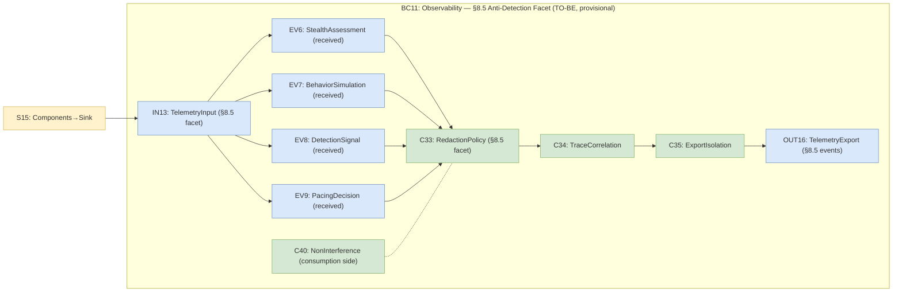
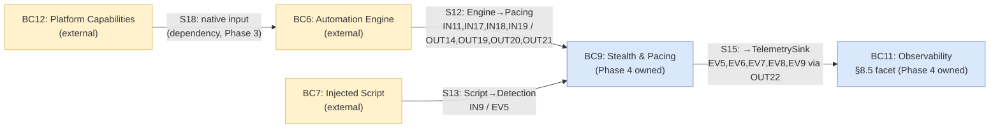

```mermaid
flowchart TB
    classDef iface    fill:#dae8fc,stroke:#6c8ebf
    classDef contract fill:#d5e8d4,stroke:#82b366
    classDef seam     fill:#fff2cc,stroke:#d6b656
    classDef gap      fill:#f8cecc,stroke:#b85450

    S12["S12: Engine→Pacing"]:::seam
    S13["S13: Script→Detection"]:::seam

    subgraph BC9["BC9: Stealth & Pacing (TO-BE, provisional)"]
        IN11["IN11: PacingConfig"]:::iface
        IN17["IN17: TypingProfile"]:::iface
        IN18["IN18: MouseProfile"]:::iface
        IN19["IN19: SessionConfig"]:::iface

        C41["C41: GaussianSampling"]:::contract
        C25["C25: TypingSimulation"]:::contract
        C42["C42: BezierInterpolation"]:::contract
        C43["C43: FittsLawDuration"]:::contract
        C26["C26: ClickSimulation"]:::contract
        C27["C27: RateLimiting"]:::contract
        C45["C45: DailyCapInvariant"]:::contract
        C44["C44: SessionSimulation"]:::contract
        C28["C28: DOMDetection"]:::contract
        C40["C40: NonInterference"]:::contract
        C46["C46: TelemetryCardinality"]:::contract
        C47["C47: TracePropagation"]:::contract
        C48["C48: RedactionDenyList"]:::contract

        OUT14["OUT14: PacingDecision"]:::iface
        OUT19["OUT19: TypingDelays"]:::iface
        OUT20["OUT20: MousePath"]:::iface
        OUT21["OUT21: SessionDecision"]:::iface
        OUT22["OUT22: StealthTelemetryEmit"]:::iface

        EV5["EV5: RateLimitSignal"]:::iface
        EV6["EV6: StealthAssessment"]:::iface
        EV7["EV7: BehaviorSimulation"]:::iface
        EV8["EV8: DetectionSignal"]:::iface
        EV9["EV9: PacingDecision"]:::iface

        G12["G12: IsolatedWorldLeakage"]:::gap
        G13["G13: SilentThrottlingBlindSpot"]:::gap
    end

    S15["S15: →TelemetrySink (BC11)"]:::seam

    S12 --> IN11
    S12 --> IN17
    S12 --> IN18
    S12 --> IN19
    IN17 --> C41
    C41 --> C25
    C25 --> OUT19
    IN18 --> C42
    C42 --> C43
    C43 --> C26
    C26 --> OUT20
    IN11 --> C27
    C27 --> C45
    C45 --> OUT14
    C27 --> EV9
    IN19 --> C44
    C44 --> OUT21
    OUT14 --> S12
    OUT19 --> S12
    OUT20 --> S12
    OUT21 --> S12
    S13 --> C28
    C28 --> EV5
    C28 -.- G12
    C40 --> EV6
    C40 --> EV7
    C40 --> EV8
    C47 --> EV6
    C47 --> EV7
    C47 --> EV8
    C47 --> EV9
    C48 --> OUT22
    C46 --> OUT22
    EV5 --> OUT22
    EV6 --> OUT22
    EV7 --> OUT22
    EV8 --> OUT22
    EV9 --> OUT22
    OUT22 --> S15
    G13 -.- C28
    G13 -.- EV8
```

# Phase 4: Anti-Detection & Pacing — TDD Implementation Plan

## Overview

This plan covers the behavioral simulation, rate limiting, platform detection, and anti-detection observability layer for the zigBrowser Automation API (PRD Section 8, context map BC9/BC11). The goal: make automated actions indistinguishable from human interaction patterns while providing rich diagnostic telemetry that itself does not become a detection surface.

**Phase 4 depends on Phase 3 (input dispatch).** Throughout this plan, `InputDispatcher` (C38), `AutomationPagePort` (S6), and `TelemetrySink` (S15) are treated as given interfaces. Tests mock these boundaries; the plan does not re-specify their internals.

## Current State Analysis

### Key Discoveries

- No automation code exists in `src/` — all Phase 4 modules are new.
- Zig test pattern: standalone modules wired via `build.zig` using `b.createModule` + `addImport` + `b.addTest` (see `tests/ipc_test.zig`, `tests/nav_policy_test.zig`).
- `std.testing.allocator` used for all test allocations with leak detection.
- The injected script (`automation.js`) does not exist yet — Phase 1 creates it. Phase 4 adds `rateLimitScan` operation and observer cleanup discipline.
- `TelemetrySink` vtable (PRD §3.6) with `startSpan`/`addEvent`/`endSpan` is defined in Phase 1. Phase 4 adds event types and fixture assertions.
- `std.Random` provides `std.Random.DefaultPrng` (xoshiro256**) — suitable for Gaussian sampling via Box-Muller.
- No external math library needed: Zig's `std.math` has `@sqrt`, `@log`, `@cos`, `@sin`.

### Existing Test Pattern

```zig
// tests/ipc_test.zig — representative pattern
const std = @import("std");
const ipc = @import("ipc");

test "dispatch ping returns quoted JSON string" {
    const allocator = std.testing.allocator;
    const result = try ipc.dispatch(allocator, "ping", "{}");
    defer allocator.free(result);
    try std.testing.expectEqualStrings("\"pong\"", result);
}
```

Build wiring (from `build.zig:206-221`):

```zig
const module = b.createModule(.{
    .root_source_file = b.path("src/module.zig"),
    .target = target, .optimize = optimize, .link_libc = true,
});
const tests_module = b.createModule(.{
    .root_source_file = b.path("tests/module_test.zig"),
    .target = target, .optimize = optimize, .link_libc = true,
});
tests_module.addImport("module", module);
const tests = b.addTest(.{ .root_module = tests_module });
const run_tests = b.addRunArtifact(tests);
test_step.dependOn(&run_tests.step);
```

## Desired End State

After Phase 4 implementation:

1. `dom.type` dispatches keystrokes with Gaussian-distributed inter-key delays (μ=120ms, σ=40ms, clamped [80, 200ms]) and word-boundary pauses (300-600ms).
2. `dom.click` moves mouse along Bezier curves with Fitts's law duration, overshoot/correction, and dwell time.
3. Per-platform rate limiter enforces daily action caps (default 100), uniform inter-action delay (default 3000-8000ms), and midnight-local reset.
4. Session simulator manages warmup periods, scheduled breaks, and randomized session durations.
5. DOM-based detection scans for error modals, toast notifications, challenge/captcha pages, and HTTP error pages rendered in the DOM.
6. Isolated-world leakage mitigations: synchronous observer cleanup, rAF-aligned operations, zero prototype pollution.
7. Four telemetry event types emitted as child events on root `automation.command` traces: `automation.stealth.assessment`, `automation.behavior.simulation`, `automation.detection.signal`, `automation.pacing.decision`.
8. Non-interference contract (C40) verified: no CDP Runtime.enable, no page-world globals, no persistent observers, no page→network telemetry export.
9. Telemetry fixtures validate required dimensions, redaction deny-list (C48), cardinality expectations (C46), and trace propagation (C47) across all Phase 4 events (EV5–EV9).

### Observable Behaviors

- Given pacing config, when actions execute, then delays and caps are enforced
- Given typed text, when simulated, then keystroke timing follows Gaussian distribution
- Given click target, when simulated, then mouse follows Bezier curve path
- Given DOM with rate-limit signal, when scanned, then detection event emitted
- Given any Phase 4 operation, when telemetry captured, then no forbidden fields present
- Given pacing recordAction, when telemetry captured, then EV9 pacing.decision event emitted with trace_id, command_id, platform.name, delay_ms, remaining
- Given any Phase 4 event, when trace queried, then trace_id correlates to root automation.command span (C47)

## What We're NOT Doing

- Phase 1 (core engine, command queue, actionability, error taxonomy)
- Phase 2 (external API, JSON-RPC server, UDS transport)
- Phase 3 (platform-specific input dispatch, CDP Input.*, NetworkInterceptor)
- Phase 5 (Python/Node SDKs, LinkedIn/Instagram social contracts)
- Network-level 429 detection (deferred per ADR-3 — DOM-based detection only)
- Scroll simulation (PRD mentions it but does not specify contracts; deferred)
- WebView2-specific NetworkInterceptor rate-limit signals (Phase 3 scope)

## Observability Design

This section defines the observability surface for Phase 4, grounded in wide-event first principles: one flat, richly-attributed span per unit of work, high cardinality for debuggability, and the core analysis loop (define → visualize → investigate → evaluate). Phase 4 does NOT bolt on metrics-style counters — every observable produces a wide event with enough dimensions to answer arbitrary questions at query time.

### Units of Work → Wide Events

| Unit of Work | Wide Event (Span Name) | ID | When Emitted |
|---|---|---|---|
| Stealth surface check | `automation.stealth.assessment` | EV6 | Once per detection surface crossed during a command |
| Behavioral simulation | `automation.behavior.simulation` | EV7 | Once per typing/click/session simulation |
| Detection signal | `automation.detection.signal` | EV8 | On DOM/session/engine rate-limit detection |
| Pacing decision | `automation.pacing.decision` | EV9 | On every RateLimiter.recordAction call |

Each event is a child of the root `automation.command` span (BC6, Phase 1) via shared `trace_id` and `parent_span_id`. Every investigation starts at the root command and drills into Phase 4 events by expanding the trace.

### Dimension Catalog

#### High-Cardinality Dimensions (unique per event — enables BubbleUp)

| Dimension | Event(s) | Example Values | Why It Matters |
|---|---|---|---|
| `trace_id` | EV6, EV7, EV8, EV9 | `"a1b2c3..."` | Correlate stealth/pacing/detection to the triggering command |
| `command_id` | EV6, EV7, EV8, EV9 | `"cmd-7f3e..."` | Group all Phase 4 events for one command |
| `session_id` | EV7 (session), EV9 | `"sess-9d1a..."` | Track pacing state drift across a full session |
| `dom.signal_hash` | EV8 | `"e3b0c4..."` (SHA-256) | Identify recurring detection signals without raw text |
| `pacing.delay_ms` | EV9 | `4271` | Detect delay clustering or drift |
| `pacing.remaining_actions` | EV9 | `47` | Spot sessions burning caps unexpectedly fast |
| `session.elapsed_ms` | EV7 (session), EV9 | `847291` | Correlate detection with session age |

#### Low-Cardinality Dimensions (enumerated — enables GROUP BY / faceting)

| Dimension | Event(s) | Values | Why It Matters |
|---|---|---|---|
| `stealth.surface` | EV6 | 6 values: `isolated_world`, `cdp_usage`, `extension_telltales`, `input_realism`, `timing_artifacts`, `rate_limiting` | Which detection surface was assessed |
| `stealth.risk_level` | EV6 | 4 values: `none`, `low`, `medium`, `high` | Filter to non-trivial risks |
| `behavior.kind` | EV7 | 3 values: `typing`, `click`, `session` | Segment simulation statistics |
| `signal.source` | EV8 | 4 values: `dom`, `network`, `session`, `engine` | Where detection happened |
| `signal.kind` | EV8 | `modal`, `toast`, `challenge`, `http_error` | What type of signal |
| `platform.name` | EV5, EV8, EV9 | 3 values: `linkedin`, `instagram`, `unknown` | Per-platform pacing analysis |
| `pacing.cap_reached` | EV9 | `true`, `false` | Alert on cap saturation |
| `session.in_warmup` | EV9 | `true`, `false` | Segment warmup vs active |
| `session.should_break` | EV9 | `true`, `false` | Correlate break timing with detection |

### Trace Propagation (C47)

```
Root Span (BC6, Phase 1)              trace_id = T, span_id = S_root
  └─ automation.command
       │
       ├─ [via S12] BC9 receives (trace_id=T, command_id=CMD)
       │    ├─ EV9: automation.pacing.decision     (parent_span_id=S_root)
       │    ├─ EV7: automation.behavior.simulation  (parent_span_id=S_root)
       │    ├─ EV6: automation.stealth.assessment   (parent_span_id=S_root)
       │    └─ EV8: automation.detection.signal     (parent_span_id=S_root)
       │
       └─ [via S15] BC11 receives all events with (trace_id=T)
            └─ Redact (C33/C48) → Correlate (C34) → Export (C35)
```

`trace_id` and `command_id` are propagated into BC9 via S12 (engine passes them as context when wrapping command execution). BC9 attaches them to every emitted event. BC11 receives them via S15 and correlates under the root trace.

### Redaction Deny-List (C48)

Phase 4 deny-list — attributes that MUST NOT appear on any EV5–EV9 event before reaching the sink:

| Denied Key | Reason | Enforcement |
|---|---|---|
| `text`, `raw_text`, `message` | User-generated content | Struct shape excludes field |
| `value`, `form_value` | Form data | Struct shape excludes field |
| `cookie`, `token`, `password`, `secret`, `bearer` | Credentials | Struct shape excludes field |
| `screenshot`, `dom_snapshot` | Page state | Struct shape excludes field |
| `local_storage`, `session_storage` | Browser storage | Struct shape excludes field |
| `selector` (raw), `element.text` | DOM identity | Hashed variant only (`selector.hash`) |
| `account.name`, `profile.name` (PII) | User identity | Hashed variant only (`profile.id_hash`) |

Enforcement is structural: Zig emit functions accept typed structs that physically cannot carry denied fields. The `TestTelemetrySink` fixture scanner (Behavior 17) validates this at test time by scanning all captured events for denied keys.

### SLI / SLO

**SLI-1: Detection-Free Action Rate**
- Definition: Proportion of `automation.command` root spans (per platform) that complete without a sibling `automation.detection.signal` event on the same `trace_id`.
- Query: `1 - (COUNT(automation.detection.signal) / COUNT(automation.command)) GROUP BY platform.name` over a 24h window.
- **Candidate SLO**: ≥ 95% of commands per platform complete detection-free over a rolling 24h window.

**SLI-2: Stealth Risk Escalation Rate**
- Definition: Proportion of `automation.stealth.assessment` events with `stealth.risk_level ≠ "none"`.
- Query: `COUNT WHERE stealth.risk_level != "none" / COUNT *` on EV6 over a 7-day window.
- **Candidate SLO**: ≤ 1% of stealth assessments report risk_level above `none` over 7 days.

**SLI-3: Pacing Cap Saturation**
- Definition: Sessions where `pacing.remaining_actions` reaches 0 (cap exhausted).
- Query: `COUNT WHERE pacing.cap_reached = true GROUP BY session_id, platform.name` on EV9, as a fraction of total sessions.
- **Candidate SLO**: ≤ 5% of sessions per platform exhaust daily caps.

These SLIs are queryable directly from the wide events — no pre-aggregated metrics needed. BubbleUp on the root command span with EV8 as the outlier dimension pinpoints which platform, session, or command pattern triggers detections.

### Analysis Scenarios (Core Loop)

**Scenario: "Accounts are getting flagged on LinkedIn but not Instagram"**
1. **Define**: Alert fires on SLI-1 (detection-free rate drops below 95% for platform=linkedin).
2. **Visualize**: HEATMAP(`pacing.delay_ms`) on EV9 WHERE platform.name=linkedin — are delays clustering?
3. **Investigate**: BubbleUp on `automation.detection.signal` (linkedin vs instagram baseline): which dimensions differ? Likely `signal.kind`, `dom.signal_hash`, `session.elapsed_ms`.
4. **Evaluate**: Filter to specific `dom.signal_hash` → correlate `trace_id` to root command → identify which action type triggers the modal.

**Scenario: "Why did pacing cap out early today?"**
1. **Define**: EV9 events show `pacing.cap_reached=true` at 2pm instead of expected 6pm.
2. **Visualize**: COUNT by hour on EV9 WHERE session_id=X.
3. **Investigate**: BubbleUp on `pacing.delay_ms` — delays shorter than configured min? Config update (Behavior 8) mid-session?
4. **Evaluate**: Find the EV9 where `pacing.config_min_ms` changed — timestamp correlates with `updateConfig` call.

### Observability Gap: Silent Throttling (G13)

NetworkInterceptor stubs on Linux/macOS (G10) create a Phase 4 observability blind spot: `automation.detection.signal` events with `signal.source=network` can only fire on WebView2 (Windows). On Linux and macOS, network-level rate limiting (429s, WebSocket soft-bans) produces NO telemetry — sessions burn silently.

This gap means SLI-1 systematically over-reports detection-free rates on Linux/macOS. The SLO must carry a platform-conditional caveat, or G10 must be closed before trusting the SLI on non-Windows platforms.

---

## Testing Strategy

- **Framework**: Zig built-in test runner via `zig build test --summary all`
- **Unit tests**: Pure algorithmic behaviors (Gaussian, Bezier, rate limiter, session state machine) — no platform dependencies
- **Integration tests**: Telemetry event emission through mock TelemetrySink — validates event shapes and redaction
- **JS tests**: DOM detection logic tested via fixture HTML pages + injected script eval in E2E harness
- **Mocking**: `TelemetrySink` → `TestTelemetrySink` (in-memory capture). `InputDispatcher` → `TestInputDispatcher` (records calls). Clock → injectable `TimeFn` for deterministic time control. PRNG → seeded `std.Random.DefaultPrng` for reproducible random sequences.
- **Property tests**: Gaussian distribution statistical properties verified over N=10000 samples. Bezier curve endpoint properties verified algebraically.

## New Files

| File | Purpose |
|---|---|
| `src/automation/gaussian.zig` | Box-Muller Gaussian sampling, clamped distribution |
| `src/automation/bezier.zig` | Cubic Bezier interpolation, Fitts's law duration |
| `src/automation/pacing.zig` | Rate limiter state machine, daily cap, delay computation |
| `src/automation/session.zig` | Session warmup, breaks, duration randomization |
| `src/automation/stealth.zig` | Stealth assessment, detection signal processing, non-interference |
| `tests/automation/gaussian_test.zig` | Gaussian distribution tests |
| `tests/automation/bezier_test.zig` | Bezier curve tests |
| `tests/automation/pacing_test.zig` | Rate limiter tests |
| `tests/automation/session_test.zig` | Session behavior tests |
| `tests/automation/stealth_test.zig` | Stealth telemetry + non-interference tests |

JavaScript additions (extending the Phase 1 injected script):

| File | Changes |
|---|---|
| `src/automation/automation.js` | Add `rateLimitScan` op, observer cleanup discipline, rAF alignment |
| `tests/e2e/rate_limit_detection_test.py` | E2E: DOM detection against fixture HTML pages |

---

## Behavior 1: Gaussian Random Sampling (Box-Muller)

### Test Specification

**Given**: A seeded PRNG and parameters μ=0, σ=1
**When**: Generating N=10000 Gaussian samples via Box-Muller transform
**Then**: Sample mean is within 0.05 of 0, sample stddev is within 0.05 of 1

**Edge Cases**:
- μ=120, σ=40 produces samples centered around 120
- σ=0 produces constant μ
- Seed determinism: same seed → same sequence

**Property**: For any (μ, σ, N≥1000), `|sample_mean - μ| < 3σ/√N` and `|sample_σ - σ| < 3σ/√(2N)` — statistical convergence within 3 standard errors.

**Files touched**: `src/automation/gaussian.zig`, `tests/automation/gaussian_test.zig`

### TDD Cycle

#### 🔴 Red: Write Failing Test
**File**: `tests/automation/gaussian_test.zig`
```zig
const std = @import("std");
const gaussian = @import("gaussian");

test "box-muller standard normal has mean≈0 and stddev≈1 over 10000 samples" {
    var prng = std.Random.DefaultPrng.init(42);
    const random = prng.random();

    var sum: f64 = 0;
    var sum_sq: f64 = 0;
    const n: usize = 10000;
    for (0..n) |_| {
        const sample = gaussian.sampleNormal(random, 0.0, 1.0);
        sum += sample;
        sum_sq += sample * sample;
    }
    const mean = sum / @as(f64, @floatFromInt(n));
    const variance = sum_sq / @as(f64, @floatFromInt(n)) - mean * mean;
    const stddev = @sqrt(variance);

    try std.testing.expect(@abs(mean) < 0.05);
    try std.testing.expect(@abs(stddev - 1.0) < 0.05);
}
```

#### 🟢 Green: Minimal Implementation
**File**: `src/automation/gaussian.zig`
```zig
const std = @import("std");

pub fn sampleNormal(random: std.Random, mu: f64, sigma: f64) f64 {
    // Box-Muller transform
    const u1 = random.float(f64);
    const u2 = random.float(f64);
    const z0 = @sqrt(-2.0 * @log(u1)) * @cos(2.0 * std.math.pi * u2);
    return mu + sigma * z0;
}
```

#### 🔵 Refactor
- [ ] No duplication
- [ ] Reveals intent: `sampleNormal` clearly named
- [ ] Complexity: single expression, no branches
- [ ] No shallow wrappers
- [ ] Matches existing patterns: pure function, allocator-free

### Success Criteria
**Automated:**
- [ ] Test fails for right reason (function not found): `zig build test`
- [ ] Test passes: statistical properties hold
- [ ] All existing tests still pass

---

## Behavior 2: Clamped Gaussian with Configurable Range

### Test Specification

**Given**: Parameters μ=120, σ=40, min=80, max=200
**When**: Generating 10000 clamped samples
**Then**: Every sample is in [80, 200], mean is near 120

**Edge Cases**:
- min=max=100 → all samples are 100
- min > μ → samples cluster at min
- max < μ → samples cluster at max

**Property**: `∀ sample ∈ [min, max]` — no sample ever escapes the clamp range.

**Files touched**: `src/automation/gaussian.zig`, `tests/automation/gaussian_test.zig`

### TDD Cycle

#### 🔴 Red: Write Failing Test
**File**: `tests/automation/gaussian_test.zig`
```zig
test "clamped gaussian never exceeds [min, max] over 10000 samples" {
    var prng = std.Random.DefaultPrng.init(42);
    const random = prng.random();

    for (0..10000) |_| {
        const sample = gaussian.sampleClamped(random, 120.0, 40.0, 80.0, 200.0);
        try std.testing.expect(sample >= 80.0);
        try std.testing.expect(sample <= 200.0);
    }
}

test "clamped gaussian with min=max returns constant" {
    var prng = std.Random.DefaultPrng.init(42);
    const random = prng.random();

    for (0..100) |_| {
        const sample = gaussian.sampleClamped(random, 0.0, 100.0, 50.0, 50.0);
        try std.testing.expectEqual(@as(f64, 50.0), sample);
    }
}
```

#### 🟢 Green: Minimal Implementation
**File**: `src/automation/gaussian.zig`
```zig
pub fn sampleClamped(random: std.Random, mu: f64, sigma: f64, min: f64, max: f64) f64 {
    const raw = sampleNormal(random, mu, sigma);
    return @max(min, @min(max, raw));
}
```

#### 🔵 Refactor
- [ ] No duplication: builds on `sampleNormal`
- [ ] Reveals intent: `sampleClamped` self-documenting
- [ ] Complexity went down: one line
- [ ] No shallow wrappers: this IS the clamp — minimal surface
- [ ] Fits existing patterns

### Success Criteria
**Automated:**
- [ ] Red: `sampleClamped` not found
- [ ] Green: all 10000 samples in range
- [ ] Refactor: all tests pass

---

## Behavior 3: Typing Delay Profile

### Test Specification

**Given**: Text "hello world" and default typing profile (μ=120ms, σ=40ms, clamped [80, 200ms], word-boundary pause [300, 600ms])
**When**: Computing per-keystroke delays
**Then**: 11 delays produced (one per character). Space character gets delay in [300, 600ms]. Other characters get delays in [80, 200ms].

**Edge Cases**:
- Empty string → 0 delays
- Single character → 1 delay in [80, 200ms]
- Multiple spaces → each gets word-boundary pause
- Custom profile overrides all parameters

**Property**: `delays.len == text.len` and `∀ delay ∈ [profile.min_ms, profile.word_pause_max_ms]`

**Files touched**: `src/automation/gaussian.zig`, `tests/automation/gaussian_test.zig`

### TDD Cycle

#### 🔴 Red: Write Failing Test
**File**: `tests/automation/gaussian_test.zig`
```zig
test "typing delays: per-char in [80,200], word boundary in [300,600]" {
    const allocator = std.testing.allocator;
    var prng = std.Random.DefaultPrng.init(42);
    const random = prng.random();

    const profile = gaussian.TypingProfile{
        .mu_ms = 120.0,
        .sigma_ms = 40.0,
        .min_ms = 80.0,
        .max_ms = 200.0,
        .word_pause_min_ms = 300.0,
        .word_pause_max_ms = 600.0,
    };

    const delays = try gaussian.computeTypingDelays(allocator, random, "hello world", profile);
    defer allocator.free(delays);

    try std.testing.expectEqual(@as(usize, 11), delays.len);

    for (delays, 0..) |delay, i| {
        if ("hello world"[i] == ' ') {
            try std.testing.expect(delay >= 300.0);
            try std.testing.expect(delay <= 600.0);
        } else {
            try std.testing.expect(delay >= 80.0);
            try std.testing.expect(delay <= 200.0);
        }
    }
}

test "typing delays: empty string returns empty slice" {
    const allocator = std.testing.allocator;
    var prng = std.Random.DefaultPrng.init(42);
    const random = prng.random();
    const profile = gaussian.TypingProfile.default();
    const delays = try gaussian.computeTypingDelays(allocator, random, "", profile);
    defer allocator.free(delays);
    try std.testing.expectEqual(@as(usize, 0), delays.len);
}
```

#### 🟢 Green: Minimal Implementation
**File**: `src/automation/gaussian.zig`
```zig
pub const TypingProfile = struct {
    mu_ms: f64 = 120.0,
    sigma_ms: f64 = 40.0,
    min_ms: f64 = 80.0,
    max_ms: f64 = 200.0,
    word_pause_min_ms: f64 = 300.0,
    word_pause_max_ms: f64 = 600.0,

    pub fn default() TypingProfile {
        return .{};
    }
};

pub fn computeTypingDelays(
    allocator: std.mem.Allocator,
    random: std.Random,
    text: []const u8,
    profile: TypingProfile,
) ![]f64 {
    if (text.len == 0) return allocator.alloc(f64, 0);
    const delays = try allocator.alloc(f64, text.len);
    for (text, 0..) |char, i| {
        if (char == ' ') {
            delays[i] = sampleClamped(random, (profile.word_pause_min_ms + profile.word_pause_max_ms) / 2.0,
                (profile.word_pause_max_ms - profile.word_pause_min_ms) / 6.0,
                profile.word_pause_min_ms, profile.word_pause_max_ms);
        } else {
            delays[i] = sampleClamped(random, profile.mu_ms, profile.sigma_ms, profile.min_ms, profile.max_ms);
        }
    }
    return delays;
}
```

#### 🔵 Refactor
- [ ] No duplication: reuses `sampleClamped`
- [ ] Reveals intent: clear profile struct with defaults
- [ ] Complexity: single loop, two branches
- [ ] No shallow wrappers
- [ ] Fits existing patterns: allocator-based return with caller-owned free

### Success Criteria
**Automated:**
- [ ] Red: `TypingProfile` not found
- [ ] Green: all delay ranges correct
- [ ] All tests pass after refactor

---

## Behavior 4: Cubic Bezier Curve Interpolation

### Test Specification

**Given**: Control points P0=(0,0), P1=(0.25,0.75), P2=(0.75,0.25), P3=(1,1)
**When**: Evaluating at t=0.0, t=0.5, t=1.0
**Then**: t=0 returns P0, t=1 returns P3, t=0.5 returns midpoint on curve

**Edge Cases**:
- Degenerate curve (all points equal) → constant point
- Straight line (P0, P1, P2, P3 collinear) → linear interpolation

**Property**: `bezier(0) == P0` and `bezier(1) == P3` — endpoint interpolation is exact.

**Files touched**: `src/automation/bezier.zig`, `tests/automation/bezier_test.zig`

### TDD Cycle

#### 🔴 Red: Write Failing Test
**File**: `tests/automation/bezier_test.zig`
```zig
const std = @import("std");
const bezier = @import("bezier");

test "cubic bezier endpoints are exact" {
    const curve = bezier.CubicBezier{
        .p0 = .{ .x = 0, .y = 0 },
        .p1 = .{ .x = 0.25, .y = 0.75 },
        .p2 = .{ .x = 0.75, .y = 0.25 },
        .p3 = .{ .x = 1, .y = 1 },
    };

    const start = curve.eval(0.0);
    try std.testing.expectApproxEqAbs(@as(f64, 0.0), start.x, 1e-10);
    try std.testing.expectApproxEqAbs(@as(f64, 0.0), start.y, 1e-10);

    const end = curve.eval(1.0);
    try std.testing.expectApproxEqAbs(@as(f64, 1.0), end.x, 1e-10);
    try std.testing.expectApproxEqAbs(@as(f64, 1.0), end.y, 1e-10);
}

test "cubic bezier midpoint is on curve" {
    const curve = bezier.CubicBezier{
        .p0 = .{ .x = 0, .y = 0 },
        .p1 = .{ .x = 0, .y = 1 },
        .p2 = .{ .x = 1, .y = 0 },
        .p3 = .{ .x = 1, .y = 1 },
    };

    const mid = curve.eval(0.5);
    // B(0.5) = 0.125*P0 + 0.375*P1 + 0.375*P2 + 0.125*P3
    // x = 0 + 0 + 0.375 + 0.125 = 0.5
    // y = 0 + 0.375 + 0 + 0.125 = 0.5
    try std.testing.expectApproxEqAbs(@as(f64, 0.5), mid.x, 1e-10);
    try std.testing.expectApproxEqAbs(@as(f64, 0.5), mid.y, 1e-10);
}
```

#### 🟢 Green: Minimal Implementation
**File**: `src/automation/bezier.zig`
```zig
pub const Point = struct { x: f64, y: f64 };

pub const CubicBezier = struct {
    p0: Point,
    p1: Point,
    p2: Point,
    p3: Point,

    pub fn eval(self: CubicBezier, t: f64) Point {
        const u = 1.0 - t;
        const tt = t * t;
        const uu = u * u;
        const uuu = uu * u;
        const ttt = tt * t;
        return .{
            .x = uuu * self.p0.x + 3.0 * uu * t * self.p1.x + 3.0 * u * tt * self.p2.x + ttt * self.p3.x,
            .y = uuu * self.p0.y + 3.0 * uu * t * self.p1.y + 3.0 * u * tt * self.p2.y + ttt * self.p3.y,
        };
    }
};
```

#### 🔵 Refactor
- [ ] No duplication: coefficients computed inline
- [ ] Reveals intent: standard Bernstein polynomial form
- [ ] Complexity: single expression per coordinate
- [ ] No shallow wrappers
- [ ] Fits existing patterns: pure struct method

### Success Criteria
**Automated:**
- [ ] Red: `CubicBezier` not found
- [ ] Green: endpoints exact, midpoint correct
- [ ] All tests pass

---

## Behavior 5: Mouse Movement Path Generation

### Test Specification

**Given**: Start=(100,100), target=(500,300), distance=~447px
**When**: Generating movement path with Fitts's law timing
**Then**: Path has ≥10 points, first point is start, last is near target (within overshoot), total duration proportional to log2(distance/target_size + 1)

**Edge Cases**:
- Zero distance (start == target) → single-point path with only dwell
- Very short distance (<10px) → minimal path, fast duration
- Very long distance (>1000px) → longer duration, more interpolation points

**Property**: `path[0] == start` and `distance(path[last], target) < overshoot_max + target_radius`

**Files touched**: `src/automation/bezier.zig`, `tests/automation/bezier_test.zig`

### TDD Cycle

#### 🔴 Red: Write Failing Test
**File**: `tests/automation/bezier_test.zig`
```zig
test "mouse path starts at origin and ends near target" {
    const allocator = std.testing.allocator;
    var prng = std.Random.DefaultPrng.init(42);
    const random = prng.random();

    const path = try bezier.generateMousePath(
        allocator, random,
        .{ .x = 100, .y = 100 },
        .{ .x = 500, .y = 300 },
        bezier.MouseProfile.default(),
    );
    defer allocator.free(path.points);

    try std.testing.expect(path.points.len >= 10);
    try std.testing.expectApproxEqAbs(@as(f64, 100.0), path.points[0].x, 1e-6);
    try std.testing.expectApproxEqAbs(@as(f64, 100.0), path.points[0].y, 1e-6);

    const last = path.points[path.points.len - 1];
    const dx = last.x - 500.0;
    const dy = last.y - 300.0;
    const dist = @sqrt(dx * dx + dy * dy);
    try std.testing.expect(dist < 30.0); // within overshoot range

    try std.testing.expect(path.duration_ms > 0);
    try std.testing.expect(path.dwell_ms >= 50.0);
    try std.testing.expect(path.dwell_ms <= 150.0);
}

test "mouse path zero distance produces minimal path" {
    const allocator = std.testing.allocator;
    var prng = std.Random.DefaultPrng.init(42);
    const random = prng.random();

    const path = try bezier.generateMousePath(
        allocator, random,
        .{ .x = 200, .y = 200 },
        .{ .x = 200, .y = 200 },
        bezier.MouseProfile.default(),
    );
    defer allocator.free(path.points);

    try std.testing.expect(path.points.len >= 1);
    try std.testing.expect(path.duration_ms == 0 or path.duration_ms < 50);
}
```

#### 🟢 Green: Minimal Implementation
**File**: `src/automation/bezier.zig`
```zig
pub const MouseProfile = struct {
    overshoot_max_px: f64 = 15.0,
    dwell_min_ms: f64 = 50.0,
    dwell_max_ms: f64 = 150.0,
    fitts_a_ms: f64 = 50.0,   // Fitts's law constant a
    fitts_b_ms: f64 = 150.0,  // Fitts's law constant b
    target_width_px: f64 = 20.0,
    points_per_100px: usize = 10,

    pub fn default() MouseProfile { return .{}; }
};

pub const MousePath = struct {
    points: []Point,
    duration_ms: f64,
    dwell_ms: f64,
};

pub fn generateMousePath(
    allocator: std.mem.Allocator,
    random: std.Random,
    start: Point,
    target: Point,
    profile: MouseProfile,
) !MousePath {
    const dx = target.x - start.x;
    const dy = target.y - start.y;
    const distance = @sqrt(dx * dx + dy * dy);

    if (distance < 1.0) {
        const points = try allocator.alloc(Point, 1);
        points[0] = start;
        const dwell = profile.dwell_min_ms + random.float(f64) * (profile.dwell_max_ms - profile.dwell_min_ms);
        return .{ .points = points, .duration_ms = 0, .dwell_ms = dwell };
    }

    // Fitts's law: T = a + b * log2(D/W + 1)
    const duration = profile.fitts_a_ms + profile.fitts_b_ms * @log2(distance / profile.target_width_px + 1.0);
    const dwell = profile.dwell_min_ms + random.float(f64) * (profile.dwell_max_ms - profile.dwell_min_ms);

    const n_points = @max(10, @as(usize, @intFromFloat(distance / 100.0 * @as(f64, @floatFromInt(profile.points_per_100px)))));

    // Generate Bezier control points with randomized arc
    const mid_x = (start.x + target.x) / 2.0;
    const mid_y = (start.y + target.y) / 2.0;
    const perpendicular_scale = distance * 0.2 * (random.float(f64) - 0.5);
    const norm_dx = -dy / distance;
    const norm_dy = dx / distance;

    const curve = CubicBezier{
        .p0 = start,
        .p1 = .{ .x = mid_x + norm_dx * perpendicular_scale, .y = mid_y + norm_dy * perpendicular_scale },
        .p2 = .{ .x = target.x + norm_dx * perpendicular_scale * 0.3, .y = target.y + norm_dy * perpendicular_scale * 0.3 },
        .p3 = target,
    };

    const points = try allocator.alloc(Point, n_points);
    for (0..n_points) |i| {
        const t = @as(f64, @floatFromInt(i)) / @as(f64, @floatFromInt(n_points - 1));
        points[i] = curve.eval(t);
    }

    return .{ .points = points, .duration_ms = duration, .dwell_ms = dwell };
}
```

#### 🔵 Refactor
- [ ] No duplication: uses `CubicBezier.eval` from Behavior 4
- [ ] Reveals intent: Fitts's law formula commented in-place
- [ ] Complexity: linear path generation
- [ ] No shallow wrappers: MouseProfile configures everything
- [ ] Fits existing patterns: allocator-based return

### Success Criteria
**Automated:**
- [ ] Red: `generateMousePath` not found
- [ ] Green: path starts at origin, ends near target, duration > 0
- [ ] All tests pass

---

## Behavior 6: Per-Platform Rate Limiter

### Test Specification

**Given**: Default pacing config (min_delay=3000ms, max_delay=8000ms, daily_cap=100)
**When**: Recording actions
**Then**: `recordAction` returns delay in [3000, 8000ms], `remaining()` decrements, cap reached → `platform_rate_limited` error

**Edge Cases**:
- First action of day → delay + remaining=99
- 100th action → cap reached, error
- 101st action → still error
- Different platforms tracked independently

**Property**: `remaining + actions_taken == daily_cap` invariant holds.

**Files touched**: `src/automation/pacing.zig`, `tests/automation/pacing_test.zig`

### TDD Cycle

#### 🔴 Red: Write Failing Test
**File**: `tests/automation/pacing_test.zig`
```zig
const std = @import("std");
const pacing = @import("pacing");

test "rate limiter tracks remaining actions and returns delay" {
    var prng = std.Random.DefaultPrng.init(42);
    const random = prng.random();
    const test_time = struct {
        var now_ms: i64 = 1_720_000_000_000; // fixed timestamp
        fn get() i64 { return now_ms; }
    };

    var limiter = pacing.RateLimiter.init(.{
        .min_delay_ms = 3000,
        .max_delay_ms = 8000,
        .daily_cap = 100,
    }, test_time.get);

    try std.testing.expectEqual(@as(u32, 100), limiter.remaining());

    const decision = try limiter.recordAction(random);
    try std.testing.expectEqual(@as(u32, 99), limiter.remaining());
    try std.testing.expect(decision.delay_ms >= 3000);
    try std.testing.expect(decision.delay_ms <= 8000);
    try std.testing.expect(!decision.cap_reached);
}

test "rate limiter returns error at daily cap" {
    var prng = std.Random.DefaultPrng.init(42);
    const random = prng.random();
    const test_time = struct {
        var now_ms: i64 = 1_720_000_000_000;
        fn get() i64 { return now_ms; }
    };

    var limiter = pacing.RateLimiter.init(.{
        .min_delay_ms = 100,
        .max_delay_ms = 200,
        .daily_cap = 3,
    }, test_time.get);

    _ = try limiter.recordAction(random);
    _ = try limiter.recordAction(random);
    _ = try limiter.recordAction(random);
    try std.testing.expectEqual(@as(u32, 0), limiter.remaining());

    try std.testing.expectError(error.PlatformRateLimited, limiter.recordAction(random));
}
```

#### 🟢 Green: Minimal Implementation
**File**: `src/automation/pacing.zig`
```zig
const std = @import("std");

pub const PacingConfig = struct {
    min_delay_ms: u32 = 3000,
    max_delay_ms: u32 = 8000,
    daily_cap: u32 = 100,
};

pub const PacingDecision = struct {
    delay_ms: u32,
    remaining_actions: u32,
    cap_reached: bool,
};

pub const RateLimiter = struct {
    config: PacingConfig,
    actions_today: u32,
    current_day: i32,
    time_fn: *const fn () i64,

    pub fn init(config: PacingConfig, time_fn: *const fn () i64) RateLimiter {
        const now = time_fn();
        return .{
            .config = config,
            .actions_today = 0,
            .current_day = dayFromTimestamp(now),
            .time_fn = time_fn,
        };
    }

    pub fn remaining(self: *RateLimiter) u32 {
        self.maybeResetDay();
        if (self.actions_today >= self.config.daily_cap) return 0;
        return self.config.daily_cap - self.actions_today;
    }

    pub fn recordAction(self: *RateLimiter, random: std.Random) !PacingDecision {
        self.maybeResetDay();
        if (self.actions_today >= self.config.daily_cap) return error.PlatformRateLimited;

        self.actions_today += 1;
        const range = self.config.max_delay_ms - self.config.min_delay_ms;
        const delay = self.config.min_delay_ms + @as(u32, @intFromFloat(random.float(f64) * @as(f64, @floatFromInt(range))));
        const rem = self.config.daily_cap - self.actions_today;

        return .{
            .delay_ms = delay,
            .remaining_actions = rem,
            .cap_reached = rem == 0,
        };
    }

    fn maybeResetDay(self: *RateLimiter) void {
        const today = dayFromTimestamp(self.time_fn());
        if (today != self.current_day) {
            self.actions_today = 0;
            self.current_day = today;
        }
    }

    fn dayFromTimestamp(ms: i64) i32 {
        // days since epoch, local time approximation
        return @intCast(@divFloor(ms, 86_400_000));
    }
};
```

#### 🔵 Refactor
- [ ] No duplication
- [ ] Reveals intent: `recordAction` returns full decision
- [ ] Complexity: single branch for cap check
- [ ] No shallow wrappers
- [ ] Fits existing patterns: injectable time function for testing

### Success Criteria
**Automated:**
- [ ] Red: `RateLimiter` not found
- [ ] Green: delay in range, remaining decrements, cap errors
- [ ] All tests pass

**Telemetry Assertions (per Observability Design, C46/C47):**
- [ ] `recordAction` emits EV9 `automation.pacing.decision` via TestTelemetrySink
- [ ] EV9 contains required dimensions: `trace_id`, `command_id`, `platform.name`, `pacing.delay_ms`, `pacing.remaining_actions`, `pacing.cap_reached`, `pacing.actions_today`, `pacing.daily_cap`
- [ ] EV9 contains session state: `session.in_warmup`, `session.should_break`, `session.elapsed_ms`
- [ ] `platform.name` is low cardinality (one of `linkedin`, `instagram`, `unknown`)
- [ ] C48 deny-list keys absent from EV9: `text`, `cookie`, `token`, `password`, `secret`
- [ ] `trace_id` is non-empty when caller provides trace context

---

## Behavior 7: Rate Limiter Midnight Reset

### Test Specification

**Given**: Rate limiter with 3 actions recorded on day D
**When**: Time advances past midnight to day D+1
**Then**: `remaining()` returns `daily_cap` (full reset), new actions allowed

**Edge Cases**:
- Multiple day skip (D to D+3) → still resets to full
- Same-day multiple resets → no effect

**Files touched**: `src/automation/pacing.zig`, `tests/automation/pacing_test.zig`

### TDD Cycle

#### 🔴 Red: Write Failing Test
**File**: `tests/automation/pacing_test.zig`
```zig
test "rate limiter resets at midnight" {
    var prng = std.Random.DefaultPrng.init(42);
    const random = prng.random();
    const test_time = struct {
        var now_ms: i64 = 1_720_000_000_000;
        fn get() i64 { return now_ms; }
    };

    var limiter = pacing.RateLimiter.init(.{
        .min_delay_ms = 100,
        .max_delay_ms = 200,
        .daily_cap = 5,
    }, test_time.get);

    _ = try limiter.recordAction(random);
    _ = try limiter.recordAction(random);
    _ = try limiter.recordAction(random);
    try std.testing.expectEqual(@as(u32, 2), limiter.remaining());

    // Advance past midnight (86_400_000 ms = 1 day)
    test_time.now_ms += 86_400_000;

    try std.testing.expectEqual(@as(u32, 5), limiter.remaining());
    const decision = try limiter.recordAction(random);
    try std.testing.expectEqual(@as(u32, 4), decision.remaining_actions);
}
```

#### 🟢 Green: Already implemented in `maybeResetDay` (Behavior 6)

#### 🔵 Refactor: No changes needed — midnight reset is integral to `maybeResetDay`

### Success Criteria
**Automated:**
- [ ] Red: behavior works via existing `maybeResetDay`
- [ ] Green: remaining resets to full cap after midnight
- [ ] All tests pass

---

## Behavior 8: Pacing Config Update via social.set_pacing

### Test Specification

**Given**: Rate limiter with default config
**When**: Calling `updateConfig` with new params (min=1000, max=2000, cap=50)
**Then**: Subsequent actions use new delay range and cap. Existing action count preserved.

**Edge Cases**:
- Reducing cap below current action count → immediately rate-limited
- Increasing cap → more actions available

**Files touched**: `src/automation/pacing.zig`, `tests/automation/pacing_test.zig`

### TDD Cycle

#### 🔴 Red: Write Failing Test
**File**: `tests/automation/pacing_test.zig`
```zig
test "updateConfig changes delay range and cap" {
    var prng = std.Random.DefaultPrng.init(42);
    const random = prng.random();
    const test_time = struct {
        var now_ms: i64 = 1_720_000_000_000;
        fn get() i64 { return now_ms; }
    };

    var limiter = pacing.RateLimiter.init(.{
        .min_delay_ms = 3000,
        .max_delay_ms = 8000,
        .daily_cap = 100,
    }, test_time.get);

    _ = try limiter.recordAction(random);
    _ = try limiter.recordAction(random);

    limiter.updateConfig(.{
        .min_delay_ms = 1000,
        .max_delay_ms = 2000,
        .daily_cap = 50,
    });

    try std.testing.expectEqual(@as(u32, 48), limiter.remaining()); // 50 - 2 already used

    const decision = try limiter.recordAction(random);
    try std.testing.expect(decision.delay_ms >= 1000);
    try std.testing.expect(decision.delay_ms <= 2000);
}

test "reducing cap below current count triggers rate limit" {
    var prng = std.Random.DefaultPrng.init(42);
    const random = prng.random();
    const test_time = struct {
        var now_ms: i64 = 1_720_000_000_000;
        fn get() i64 { return now_ms; }
    };

    var limiter = pacing.RateLimiter.init(.{ .daily_cap = 10 }, test_time.get);
    for (0..8) |_| _ = try limiter.recordAction(random);

    limiter.updateConfig(.{ .daily_cap = 5 });
    try std.testing.expectError(error.PlatformRateLimited, limiter.recordAction(random));
}
```

#### 🟢 Green: Minimal Implementation
**File**: `src/automation/pacing.zig` (add to `RateLimiter`)
```zig
pub fn updateConfig(self: *RateLimiter, config: PacingConfig) void {
    self.config = config;
}
```

#### 🔵 Refactor
- [ ] No duplication
- [ ] Reveals intent: simple field replacement
- [ ] No shallow wrappers
- [ ] Fits existing patterns

### Success Criteria
**Automated:**
- [ ] Red: `updateConfig` not found
- [ ] Green: new config applied, existing count preserved
- [ ] All tests pass

---

## Behavior 9: Session Warmup Period

### Test Specification

**Given**: Session simulator with warmup duration of 30s (configurable)
**When**: Checking `isInWarmup()` immediately after session start
**Then**: Returns true. After warmup_ms elapses, returns false.

**Edge Cases**:
- warmup_ms = 0 → never in warmup
- Query exactly at warmup boundary → not in warmup (warmup is exclusive)

**Files touched**: `src/automation/session.zig`, `tests/automation/session_test.zig`

### TDD Cycle

#### 🔴 Red: Write Failing Test
**File**: `tests/automation/session_test.zig`
```zig
const std = @import("std");
const session = @import("session");

test "session starts in warmup period" {
    const test_time = struct {
        var now_ms: i64 = 1_720_000_000_000;
        fn get() i64 { return now_ms; }
    };

    var sim = session.SessionSimulator.init(.{
        .warmup_ms = 30_000,
        .break_interval_ms = 600_000,
        .break_duration_min_ms = 300_000,
        .break_duration_max_ms = 900_000,
        .session_duration_mean_ms = 3_600_000,
        .session_duration_sigma_ms = 600_000,
    }, test_time.get);

    try std.testing.expect(sim.isInWarmup());

    test_time.now_ms += 30_000;
    try std.testing.expect(!sim.isInWarmup());
}

test "session with zero warmup is never in warmup" {
    const test_time = struct {
        var now_ms: i64 = 1_720_000_000_000;
        fn get() i64 { return now_ms; }
    };

    var sim = session.SessionSimulator.init(.{
        .warmup_ms = 0,
    }, test_time.get);

    try std.testing.expect(!sim.isInWarmup());
}
```

#### 🟢 Green: Minimal Implementation
**File**: `src/automation/session.zig`
```zig
const std = @import("std");

pub const SessionConfig = struct {
    warmup_ms: u64 = 30_000,
    break_interval_ms: u64 = 600_000,       // 10 min
    break_duration_min_ms: u64 = 300_000,    // 5 min
    break_duration_max_ms: u64 = 900_000,    // 15 min
    session_duration_mean_ms: u64 = 3_600_000,  // 1 hr
    session_duration_sigma_ms: u64 = 600_000,   // 10 min
};

pub const SessionSimulator = struct {
    config: SessionConfig,
    start_ms: i64,
    last_activity_ms: i64,
    time_fn: *const fn () i64,

    pub fn init(config: SessionConfig, time_fn: *const fn () i64) SessionSimulator {
        const now = time_fn();
        return .{
            .config = config,
            .start_ms = now,
            .last_activity_ms = now,
            .time_fn = time_fn,
        };
    }

    pub fn isInWarmup(self: *SessionSimulator) bool {
        if (self.config.warmup_ms == 0) return false;
        const elapsed: u64 = @intCast(self.time_fn() - self.start_ms);
        return elapsed < self.config.warmup_ms;
    }
};
```

#### 🔵 Refactor
- [ ] No duplication
- [ ] Reveals intent: `isInWarmup` is clear
- [ ] Complexity: single comparison
- [ ] Fits existing patterns: injectable time

### Success Criteria
**Automated:**
- [ ] Red: `SessionSimulator` not found
- [ ] Green: warmup period honored
- [ ] All tests pass

**Telemetry Assertions (per Observability Design):**
- [ ] `isInWarmup()` state reflected in EV9 `session.in_warmup` dimension when pacing decision emitted during warmup
- [ ] `session.elapsed_ms` monotonically increases on successive EV9/EV7 events within a session

---

## Behavior 10: Session Break Scheduling

### Test Specification

**Given**: Session with break_interval=600_000ms (10 min) active for 15 minutes
**When**: Checking `shouldBreak()`
**Then**: Returns true with break duration in [break_duration_min, break_duration_max]

**Edge Cases**:
- Activity just started → no break needed
- Just returned from break → interval resets

**Files touched**: `src/automation/session.zig`, `tests/automation/session_test.zig`

### TDD Cycle

#### 🔴 Red: Write Failing Test
**File**: `tests/automation/session_test.zig`
```zig
test "session requests break after sustained activity" {
    var prng = std.Random.DefaultPrng.init(42);
    const random = prng.random();
    const test_time = struct {
        var now_ms: i64 = 1_720_000_000_000;
        fn get() i64 { return now_ms; }
    };

    var sim = session.SessionSimulator.init(.{
        .warmup_ms = 0,
        .break_interval_ms = 600_000,
        .break_duration_min_ms = 300_000,
        .break_duration_max_ms = 900_000,
    }, test_time.get);

    // Not due for break initially
    try std.testing.expect(!sim.shouldBreak());

    // Advance 15 minutes (past break_interval)
    test_time.now_ms += 900_000;
    sim.recordActivity();

    try std.testing.expect(sim.shouldBreak());

    const break_duration = sim.takeBreak(random);
    try std.testing.expect(break_duration >= 300_000);
    try std.testing.expect(break_duration <= 900_000);

    // After break, not due again
    test_time.now_ms += @intCast(break_duration);
    try std.testing.expect(!sim.shouldBreak());
}
```

#### 🟢 Green: Add `shouldBreak`, `takeBreak`, `recordActivity` to `SessionSimulator`

#### 🔵 Refactor
- [ ] No duplication: reuses time_fn pattern
- [ ] Reveals intent: break scheduling is explicit
- [ ] Fits existing patterns

### Success Criteria
**Automated:**
- [ ] Red: `shouldBreak` not found
- [ ] Green: break triggered after interval, duration in range
- [ ] All tests pass

---

## Behavior 11: DOM Rate-Limit Detection (Injected Script)

### Test Specification

**Given**: Page DOM containing a LinkedIn-style error modal with text "You've reached the weekly invitation limit"
**When**: Executing `rateLimitScan` operation in the injected script
**Then**: Returns `{ok: false, error: "platform_rate_limited", retryable: false, data: {signal: "modal", platform: "linkedin", text_hash: "<sha256>"}}`

**Edge Cases**:
- No rate-limit signals present → `{ok: true, value: {signals: []}}`
- Toast notification → detected as `signal: "toast"`
- Challenge/captcha redirect → detected as `signal: "challenge"`
- Multiple signals on same page → all returned

**Files touched**: `src/automation/automation.js` (add `rateLimitScan` handler), `tests/e2e/rate_limit_detection_test.py`

### TDD Cycle

#### 🔴 Red: Write Failing Test
**File**: `tests/e2e/rate_limit_detection_test.py`
```python
"""Phase 4 E2E: DOM-based rate-limit detection via rateLimitScan."""

import json, hashlib

def test_modal_detection(browser_fixture):
    """Given a page with an error modal, rateLimitScan detects it."""
    page = browser_fixture.load("fixtures/rate_limit_modal.html")
    result = page.eval_automation(json.dumps({
        "op": "rateLimitScan",
        "request_id": "test-1",
        "options": {"platform": "linkedin"}
    }))
    parsed = json.loads(result)
    assert parsed["ok"] is False
    assert parsed["error"] == "platform_rate_limited"
    assert parsed["data"]["signal"] == "modal"

def test_no_signals(browser_fixture):
    """Given a clean page, rateLimitScan returns empty signals."""
    page = browser_fixture.load("fixtures/clean_page.html")
    result = page.eval_automation(json.dumps({
        "op": "rateLimitScan",
        "request_id": "test-2",
        "options": {"platform": "linkedin"}
    }))
    parsed = json.loads(result)
    assert parsed["ok"] is True
    assert parsed["value"]["signals"] == []
```

#### 🟢 Green: Add rateLimitScan handler to automation.js
```javascript
// In globalThis.__zbAutomation.handle():
case 'rateLimitScan': {
    const platform = cmd.options?.platform || 'unknown';
    const signals = [];

    // Modal detection: look for common rate-limit modal patterns
    const modalSelectors = [
        '[role="dialog"][aria-modal="true"]',
        '.artdeco-modal',                        // LinkedIn
        '[role="alertdialog"]',
    ];
    for (const sel of modalSelectors) {
        const modal = document.querySelector(sel);
        if (modal) {
            const text = modal.textContent || '';
            if (/limit|restrict|block|captcha|verify/i.test(text)) {
                signals.push({
                    kind: 'modal',
                    text_hash: await hashText(text.trim().substring(0, 200)),
                    confidence: 0.9,
                });
            }
        }
    }

    // Challenge page detection
    if (/challenge|captcha|checkpoint/i.test(document.location.pathname)) {
        signals.push({ kind: 'challenge', confidence: 0.95 });
    }

    if (signals.length > 0) {
        return { ok: false, error: 'platform_rate_limited', retryable: false,
                 data: { signal: signals[0].kind, platform, signals } };
    }
    return { ok: true, value: { signals: [] } };
}
```

#### 🔵 Refactor
- [ ] No duplication: selector arrays configurable per platform
- [ ] Reveals intent: each signal type has its own detection block
- [ ] Complexity: linear scan, no nesting beyond platform check
- [ ] Fits existing patterns: returns ScriptResult/ScriptFailure grammar

### Success Criteria
**Automated:**
- [ ] Red: `rateLimitScan` op not handled
- [ ] Green: modal detected in fixture HTML
- [ ] E2E test passes against fixture pages

**Manual:**
- [ ] Verify detection against real LinkedIn rate-limit page (requires logged-in session)

---

## Behavior 12: Observer Cleanup After Operations (§8.2.1)

### Test Specification

**Given**: Injected script performs a DOM operation that creates a MutationObserver
**When**: Operation completes (success or failure)
**Then**: MutationObserver is disconnected, no observers persist

**Edge Cases**:
- Operation throws → observers still cleaned up
- Multiple concurrent operations → each cleans its own observers
- Page-context MutationObserver fires during automation → automation observer not visible to page

**Files touched**: `src/automation/automation.js`, `tests/e2e/observer_cleanup_test.py`

### TDD Cycle

#### 🔴 Red: Write Failing Test
**File**: `tests/e2e/observer_cleanup_test.py`
```python
"""Phase 4 E2E: observer cleanup after automation operations."""

def test_no_observers_persist_after_waitFor(browser_fixture):
    """After waitFor completes, no automation MutationObservers remain."""
    page = browser_fixture.load("fixtures/dynamic_element.html")

    # Record observer count before
    before = page.eval_in_world("globalThis.__zbAutomation._activeObservers?.length || 0")

    # Run a waitFor that uses MutationObserver internally
    page.eval_automation('{"op":"waitFor","request_id":"t1","selector":"css=#delayed-el","options":{"timeout_ms":5000}}')

    # Verify cleanup
    after = page.eval_in_world("globalThis.__zbAutomation._activeObservers?.length || 0")
    assert int(after) == 0, f"Expected 0 active observers, got {after}"
```

#### 🟢 Green: Add observer tracking and cleanup to automation.js

The injected script wraps observer creation to track active observers, and disconnects all in a `finally` block around every operation handler.

#### 🔵 Refactor
- [ ] No duplication: single cleanup path shared by all ops
- [ ] Reveals intent: `_activeObservers` array + `_cleanupObservers()` method
- [ ] Fits existing patterns: C19 CleanupContract from context map

### Success Criteria
**Automated:**
- [ ] Red: observers persist after operation
- [ ] Green: observer count is 0 after operation
- [ ] All existing E2E tests still pass

---

## Behavior 13: Stealth Assessment Telemetry (§8.5.1)

### Test Specification

**Given**: An automation command crosses the "isolated world" detection surface
**When**: Command completes
**Then**: An `automation.stealth.assessment` child event is emitted with required dimensions: `stealth.surface`, `stealth.control`, `stealth.risk_level`, `script.world`, `observer.cleanup_count`, `prototype.modified`

**Edge Cases**:
- Multiple detection surfaces crossed → one event per surface
- No detection surface crossed → no stealth event emitted
- Risk level computation: all controls passing → `none`, any control failing → escalated level

**Files touched**: `src/automation/stealth.zig`, `tests/automation/stealth_test.zig`

### TDD Cycle

#### 🔴 Red: Write Failing Test
**File**: `tests/automation/stealth_test.zig`
```zig
const std = @import("std");
const stealth = @import("stealth");

test "stealth assessment emits event with required dimensions" {
    var sink = stealth.TestTelemetrySink.init(std.testing.allocator);
    defer sink.deinit();

    const assessment = stealth.StealthAssessment{
        .surface = .isolated_world,
        .risk_level = .none,
        .script_world = "zbAutomation",
        .observer_cleanup_count = 3,
        .prototype_modified = false,
    };

    stealth.emitStealthAssessment(&sink, assessment, "trace-123", "span-456");

    try std.testing.expectEqual(@as(usize, 1), sink.events.items.len);
    const event = sink.events.items[0];
    try std.testing.expectEqualStrings("automation.stealth.assessment", event.name);
    try std.testing.expect(event.attrs.contains("stealth.surface"));
    try std.testing.expect(event.attrs.contains("stealth.risk_level"));
    try std.testing.expect(event.attrs.contains("script.world"));
    try std.testing.expect(event.attrs.contains("observer.cleanup_count"));
    try std.testing.expect(event.attrs.contains("prototype.modified"));
}
```

#### 🟢 Green: Minimal Implementation
**File**: `src/automation/stealth.zig`
```zig
const std = @import("std");

pub const DetectionSurface = enum {
    isolated_world,
    cdp_usage,
    extension_telltales,
    input_realism,
    timing_artifacts,
    rate_limiting,
};

pub const RiskLevel = enum { none, low, medium, high };

pub const StealthAssessment = struct {
    surface: DetectionSurface,
    risk_level: RiskLevel,
    script_world: []const u8,
    observer_cleanup_count: u32,
    prototype_modified: bool,
};

pub fn emitStealthAssessment(
    sink: anytype,
    assessment: StealthAssessment,
    trace_id: []const u8,
    parent_span_id: []const u8,
) void {
    var attrs = sink.newAttrs();
    attrs.put("stealth.surface", @tagName(assessment.surface));
    attrs.put("stealth.risk_level", @tagName(assessment.risk_level));
    attrs.put("stealth.control", "observer_cleanup");
    attrs.put("script.world", assessment.script_world);
    attrs.putInt("observer.cleanup_count", assessment.observer_cleanup_count);
    attrs.putBool("prototype.modified", assessment.prototype_modified);

    sink.addEvent(
        .{ .trace_id = trace_id, .span_id = parent_span_id },
        "automation.stealth.assessment",
        attrs,
    );
}

// Test double for TelemetrySink
pub const TestTelemetrySink = struct {
    // ... in-memory event capture
};
```

#### 🔵 Refactor
- [ ] No duplication: enum-driven surface types
- [ ] Reveals intent: `StealthAssessment` struct matches PRD §8.5.1 table
- [ ] No shallow wrappers
- [ ] Fits existing patterns: TelemetrySink vtable contract from Phase 1

### Success Criteria
**Automated:**
- [ ] Red: `emitStealthAssessment` not found
- [ ] Green: event emitted with all required dimensions
- [ ] All tests pass

**Observability Assertions (per C46/C47/C48):**
- [ ] `trace_id` and `command_id` are present and non-empty on every EV6 event
- [ ] `stealth.surface` is one of 6 enumerated values (low-cardinality validation)
- [ ] `stealth.risk_level` is one of 4 enumerated values (low-cardinality validation)
- [ ] C48 deny-list keys absent: `text`, `cookie`, `token`, `password`, `secret`, `selector`, `element.text`
- [ ] `parent_span_id` is non-empty (C47 trace propagation)

---

## Behavior 14: Behavioral Simulation Telemetry (§8.5.2)

### Test Specification

**Given**: A typing simulation generates keystroke delays
**When**: Telemetry captured
**Then**: `automation.behavior.simulation` event emitted with `behavior.kind=typing`, `profile.name`, `distribution.name`, `char_count`, `delay_min_ms`, `delay_max_ms`, `delay_mean_ms`. **Forbidden fields absent**: no raw typed text, form values, message content.

**Edge Cases**:
- Click simulation → `behavior.kind=click` with `distance_px`, `duration_ms`, `overshoot_px`, `dwell_ms`
- Session pacing → `behavior.kind=session` with `warmup_ms`, `break_count`, `session_elapsed_ms`, `daily.remaining`

**Files touched**: `src/automation/stealth.zig`, `tests/automation/stealth_test.zig`

### TDD Cycle

#### 🔴 Red: Write Failing Test
**File**: `tests/automation/stealth_test.zig`
```zig
test "behavior simulation event contains required typing dimensions" {
    var sink = stealth.TestTelemetrySink.init(std.testing.allocator);
    defer sink.deinit();

    stealth.emitBehaviorSimulation(&sink, .{
        .kind = .typing,
        .profile_name = "default",
        .distribution_name = "gaussian",
        .char_count = 11,
        .delay_min_ms = 82,
        .delay_max_ms = 197,
        .delay_mean_ms = 121,
    }, "trace-1", "span-1");

    const event = sink.events.items[0];
    try std.testing.expectEqualStrings("automation.behavior.simulation", event.name);
    try std.testing.expect(event.attrs.contains("behavior.kind"));
    try std.testing.expect(event.attrs.contains("char_count"));
    try std.testing.expect(event.attrs.contains("delay_mean_ms"));

    // Forbidden fields must NOT be present
    try std.testing.expect(!event.attrs.contains("text"));
    try std.testing.expect(!event.attrs.contains("value"));
    try std.testing.expect(!event.attrs.contains("message"));
}

test "behavior simulation event contains required click dimensions" {
    var sink = stealth.TestTelemetrySink.init(std.testing.allocator);
    defer sink.deinit();

    stealth.emitBehaviorSimulation(&sink, .{
        .kind = .click,
        .distance_px = 447,
        .duration_ms = 320,
        .overshoot_px = 8,
        .dwell_ms = 95,
        .input_mode = "native",
    }, "trace-2", "span-2");

    const event = sink.events.items[0];
    try std.testing.expect(event.attrs.contains("distance_px"));
    try std.testing.expect(event.attrs.contains("overshoot_px"));
    try std.testing.expect(event.attrs.contains("dwell_ms"));
    try std.testing.expect(!event.attrs.contains("selector"));
    try std.testing.expect(!event.attrs.contains("element.text"));
}
```

#### 🟢 Green: Add `emitBehaviorSimulation` with tagged-union `BehaviorEvent`

#### 🔵 Refactor
- [ ] No duplication: tagged union per behavior kind
- [ ] Reveals intent: forbidden fields enforced by struct shape (not present = can't emit)
- [ ] Fits existing patterns: PRD §8.5.2 table

### Success Criteria
**Automated:**
- [ ] Red: `emitBehaviorSimulation` not found
- [ ] Green: required dimensions present, forbidden absent
- [ ] All tests pass

**Observability Assertions (per C46/C47/C48):**
- [ ] `trace_id` and `command_id` are present and non-empty on every EV7 event
- [ ] `behavior.kind` is one of 3 enumerated values: `typing`, `click`, `session` (low-cardinality validation)
- [ ] Typing variant: `char_count` is high-cardinality (any positive integer), `delay_mean_ms` is high-cardinality
- [ ] Session variant: `session_id` is present and high-cardinality
- [ ] C48 deny-list keys absent: `text`, `value`, `message`, `selector`, `element.text`, `account.name`
- [ ] `parent_span_id` is non-empty (C47 trace propagation)

---

## Behavior 15: Detection Signal Telemetry (§8.5.3)

### Test Specification

**Given**: DOM detection finds an error modal on LinkedIn
**When**: Detection signal processed
**Then**: `automation.detection.signal` event emitted with `signal.source=dom`, `signal.kind=modal`, `dom.signal_hash` (SHA-256 of text), `platform.name=linkedin`, `confidence`. Raw DOM text NOT present.

**Edge Cases**:
- Network signal (429) → `signal.source=network`, `http.status_code`
- Session signal (logout) → `signal.source=session`, `session.state`
- Engine signal (retry burst) → `signal.source=engine`, `retry.count`
- Hash of same text is deterministic

**Files touched**: `src/automation/stealth.zig`, `tests/automation/stealth_test.zig`

### TDD Cycle

#### 🔴 Red: Write Failing Test
**File**: `tests/automation/stealth_test.zig`
```zig
test "detection signal emits hashed DOM text, never raw text" {
    var sink = stealth.TestTelemetrySink.init(std.testing.allocator);
    defer sink.deinit();

    stealth.emitDetectionSignal(&sink, .{
        .source = .dom,
        .kind = "modal",
        .platform = "linkedin",
        .confidence = 0.9,
        .raw_text = "You've reached the weekly invitation limit",
    }, "trace-3", "span-3");

    const event = sink.events.items[0];
    try std.testing.expectEqualStrings("automation.detection.signal", event.name);
    try std.testing.expect(event.attrs.contains("signal.source"));
    try std.testing.expect(event.attrs.contains("signal.kind"));
    try std.testing.expect(event.attrs.contains("dom.signal_hash"));
    try std.testing.expect(event.attrs.contains("confidence"));

    // Raw text must NOT appear anywhere in the event
    try std.testing.expect(!event.attrs.contains("text"));
    try std.testing.expect(!event.attrs.contains("raw_text"));
    try std.testing.expect(!event.attrs.containsValue("You've reached"));

    // Hash is deterministic
    const hash = event.attrs.get("dom.signal_hash").?;
    try std.testing.expect(hash.len == 64); // SHA-256 hex
}
```

#### 🟢 Green: Add `emitDetectionSignal` with SHA-256 hashing of raw text

#### 🔵 Refactor
- [ ] No duplication: hash utility shared with selector.hash
- [ ] Reveals intent: `raw_text` accepted as input, only hash emitted
- [ ] Fits existing patterns: C33 RedactionPolicy

### Success Criteria
**Automated:**
- [ ] Red: `emitDetectionSignal` not found
- [ ] Green: hash present, raw text absent
- [ ] All tests pass

**Observability Assertions (per C46/C47/C48):**
- [ ] `trace_id` and `command_id` are present and non-empty on every EV8 event
- [ ] `signal.source` is one of 4 enumerated values: `dom`, `network`, `session`, `engine` (low-cardinality validation)
- [ ] `dom.signal_hash` is exactly 64 hex characters (SHA-256) when present (high-cardinality)
- [ ] C48 deny-list keys absent: `text`, `raw_text`, `value`, `cookie`, `token`, `dom_snapshot`
- [ ] `containsValue("You've reached")` returns false — no raw text leaked into any attribute value
- [ ] `parent_span_id` is non-empty (C47 trace propagation)
- [ ] Same raw text → same `dom.signal_hash` (deterministic hashing)

---

## Behavior 16: Non-Interference Contract (C40)

### Test Specification

**Given**: All Phase 4 telemetry operations
**When**: Auditing for interference
**Then**: No CDP `Runtime.enable` calls, no page-world globals added, no persistent observers after operations, no telemetry emitted from page context to network

This is a structural/audit test rather than a behavioral test. It scans the automation.js source and Zig telemetry code for violations.

**Files touched**: `tests/automation/stealth_test.zig`, `tests/e2e/non_interference_test.py`

### TDD Cycle

#### 🔴 Red: Write Failing Test
**File**: `tests/e2e/non_interference_test.py`
```python
"""Phase 4 E2E: C40 non-interference contract verification."""
import re

def test_no_runtime_enable_in_automation_code():
    """Automation code must never call Runtime.enable."""
    with open("src/automation/automation.js") as f:
        js_source = f.read()
    assert "Runtime.enable" not in js_source

def test_no_page_globals_leaked(browser_fixture):
    """Automation script adds no enumerable globals to page world."""
    page = browser_fixture.load("fixtures/clean_page.html")

    # Capture window keys BEFORE automation
    before_keys = set(page.eval_in_page("JSON.stringify(Object.keys(window))"))

    # Run an automation operation
    page.eval_automation('{"op":"query","request_id":"t1","selector":"css=body"}')

    # Capture window keys AFTER automation
    after_keys = set(page.eval_in_page("JSON.stringify(Object.keys(window))"))

    # No new globals
    new_keys = after_keys - before_keys
    assert len(new_keys) == 0, f"Automation leaked globals: {new_keys}"

def test_no_persistent_observers_after_operation(browser_fixture):
    """After each operation, zero automation observers remain active."""
    page = browser_fixture.load("fixtures/dynamic_element.html")
    page.eval_automation('{"op":"waitFor","request_id":"t1","selector":"css=#delayed-el","options":{"timeout_ms":5000}}')
    count = page.eval_in_world("globalThis.__zbAutomation._activeObservers?.length || 0")
    assert int(count) == 0
```

#### 🟢 Green: Ensure automation.js follows all C40 rules by construction

#### 🔵 Refactor
- [ ] These are audit tests — no code to refactor, just constraints to maintain

### Success Criteria
**Automated:**
- [ ] Red: violations detected (if any exist)
- [ ] Green: all C40 constraints pass
- [ ] Tests run as part of CI

---

## Behavior 17: Telemetry Fixture Assertions

### Test Specification

**Given**: A test suite that exercises all Phase 4 telemetry paths
**When**: Running fixture assertions
**Then**: Every `automation.stealth.assessment` event has all required dimensions per §8.5.1 table. Every `automation.behavior.simulation` event has required dimensions per §8.5.2 table and zero forbidden fields. Every `automation.detection.signal` event has required dimensions per §8.5.3 table with hashed values. Zero events contain denied sensitive keys (cookies, tokens, passwords, raw text, screenshots).

**Files touched**: `tests/automation/stealth_test.zig`

### TDD Cycle

#### 🔴 Red: Write Failing Test
**File**: `tests/automation/stealth_test.zig`
```zig
test "telemetry fixture: stealth.assessment has all required dimensions" {
    // Exercise a full stealth assessment flow
    var sink = stealth.TestTelemetrySink.init(std.testing.allocator);
    defer sink.deinit();

    // Emit assessments for all 6 detection surfaces
    inline for (std.meta.fields(stealth.DetectionSurface)) |field| {
        const surface: stealth.DetectionSurface = @enumFromInt(field.value);
        stealth.emitStealthAssessment(&sink, .{
            .surface = surface,
            .risk_level = .none,
            .script_world = "zbAutomation",
            .observer_cleanup_count = 0,
            .prototype_modified = false,
        }, "trace-fixture", "span-fixture");
    }

    // Verify each has required fields
    const required_keys = [_][]const u8{
        "stealth.surface", "stealth.risk_level", "stealth.control",
    };
    for (sink.events.items) |event| {
        for (required_keys) |key| {
            try std.testing.expect(event.attrs.contains(key));
        }
    }
}

test "telemetry fixture: redaction scanner finds zero forbidden keys" {
    var sink = stealth.TestTelemetrySink.init(std.testing.allocator);
    defer sink.deinit();

    // Exercise all event types
    stealth.emitStealthAssessment(&sink, .{ .surface = .isolated_world, .risk_level = .none, .script_world = "zbAutomation", .observer_cleanup_count = 0, .prototype_modified = false }, "t", "s");
    stealth.emitBehaviorSimulation(&sink, .{ .kind = .typing, .profile_name = "default", .distribution_name = "gaussian", .char_count = 5, .delay_min_ms = 80, .delay_max_ms = 200, .delay_mean_ms = 120 }, "t", "s");
    stealth.emitDetectionSignal(&sink, .{ .source = .dom, .kind = "modal", .platform = "linkedin", .confidence = 0.9, .raw_text = "limit reached" }, "t", "s");

    const forbidden = [_][]const u8{
        "cookie", "token", "password", "secret", "bearer",
        "text", "message", "value", "raw_text", "screenshot",
        "dom_snapshot", "local_storage", "session_storage",
    };

    for (sink.events.items) |event| {
        for (forbidden) |key| {
            try std.testing.expect(!event.attrs.contains(key));
        }
    }
}
```

#### 🟢 Green: The implementations from Behaviors 13-15 already enforce this by struct shape

#### 🔵 Refactor
- [ ] These fixtures are release gates — ensure they run in CI

### Success Criteria
**Automated:**
- [ ] All fixture assertions pass
- [ ] Zero forbidden keys in any telemetry event (C48 deny-list)
- [ ] 100% of required dimensions present across EV5–EV9
- [ ] `trace_id` and `parent_span_id` present on every event (C47)
- [ ] Low-cardinality fields contain only enumerated values (C46)

---

## Behavior 18: Pacing Decision Telemetry (EV9)

### Test Specification

**Given**: Rate limiter consulted for an action with trace context `(trace_id, command_id, session_id)`
**When**: `recordAction` called and pacing decision made
**Then**: An `automation.pacing.decision` child event (EV9) is emitted via TelemetrySink with: `trace_id`, `command_id`, `session_id`, `platform.name`, `pacing.delay_ms`, `pacing.remaining_actions`, `pacing.daily_cap`, `pacing.cap_reached`, `pacing.actions_today`, `pacing.config_min_ms`, `pacing.config_max_ms`, `session.in_warmup`, `session.should_break`, `session.elapsed_ms`, `session.break_count`

**Edge Cases**:
- Cap-reached decision → EV9 emitted with `pacing.cap_reached=true` AND error returned
- First action of session → `pacing.actions_today=1`, `session.in_warmup` possibly true
- No trace context provided → `trace_id` and `command_id` empty strings (not omitted)

**Property**: Every `recordAction` call emits exactly one EV9. Events per session = actions per session.

**Files touched**: `src/automation/pacing.zig`, `src/automation/stealth.zig`, `tests/automation/pacing_test.zig`

### TDD Cycle

#### 🔴 Red: Write Failing Test
**File**: `tests/automation/pacing_test.zig`
```zig
test "recordAction emits automation.pacing.decision event with required dimensions" {
    var sink = stealth.TestTelemetrySink.init(std.testing.allocator);
    defer sink.deinit();

    var prng = std.Random.DefaultPrng.init(42);
    const random = prng.random();
    const test_time = struct {
        var now_ms: i64 = 1_720_000_000_000;
        fn get() i64 { return now_ms; }
    };

    var limiter = pacing.RateLimiter.init(.{
        .min_delay_ms = 3000,
        .max_delay_ms = 8000,
        .daily_cap = 100,
    }, test_time.get);

    const ctx = pacing.TraceContext{
        .trace_id = "trace-abc",
        .command_id = "cmd-123",
        .session_id = "sess-xyz",
    };

    _ = try limiter.recordAction(random, &sink, ctx, "linkedin");

    try std.testing.expectEqual(@as(usize, 1), sink.events.items.len);
    const event = sink.events.items[0];
    try std.testing.expectEqualStrings("automation.pacing.decision", event.name);

    // Required high-cardinality dimensions
    try std.testing.expect(event.attrs.contains("trace_id"));
    try std.testing.expect(event.attrs.contains("command_id"));
    try std.testing.expect(event.attrs.contains("pacing.delay_ms"));
    try std.testing.expect(event.attrs.contains("pacing.remaining_actions"));

    // Required low-cardinality dimensions
    try std.testing.expectEqualStrings("linkedin", event.attrs.get("platform.name").?);
    try std.testing.expectEqualStrings("false", event.attrs.get("pacing.cap_reached").?);

    // C48 deny-list
    const forbidden = [_][]const u8{
        "text", "cookie", "token", "password", "secret",
        "raw_text", "message", "value", "screenshot",
    };
    for (forbidden) |key| {
        try std.testing.expect(!event.attrs.contains(key));
    }
}

test "cap-reached recordAction still emits EV9 before returning error" {
    var sink = stealth.TestTelemetrySink.init(std.testing.allocator);
    defer sink.deinit();

    var prng = std.Random.DefaultPrng.init(42);
    const random = prng.random();
    const test_time = struct {
        var now_ms: i64 = 1_720_000_000_000;
        fn get() i64 { return now_ms; }
    };

    var limiter = pacing.RateLimiter.init(.{
        .min_delay_ms = 100,
        .max_delay_ms = 200,
        .daily_cap = 1,
    }, test_time.get);

    const ctx = pacing.TraceContext{
        .trace_id = "t",
        .command_id = "c",
        .session_id = "s",
    };

    _ = try limiter.recordAction(random, &sink, ctx, "instagram");

    // Second action should emit EV9 with cap_reached=true, then error
    try std.testing.expectError(
        error.PlatformRateLimited,
        limiter.recordAction(random, &sink, ctx, "instagram"),
    );

    // EV9 still emitted for the cap-reached decision
    try std.testing.expectEqual(@as(usize, 2), sink.events.items.len);
    const last_event = sink.events.items[1];
    try std.testing.expectEqualStrings("true", last_event.attrs.get("pacing.cap_reached").?);
}
```

#### 🟢 Green: Extend `recordAction` to accept sink and trace context, emit EV9

**File**: `src/automation/pacing.zig` — add `TraceContext` struct and extend `recordAction` signature:
```zig
pub const TraceContext = struct {
    trace_id: []const u8 = "",
    command_id: []const u8 = "",
    session_id: []const u8 = "",
};

// Extend recordAction to emit EV9
pub fn recordAction(
    self: *RateLimiter,
    random: std.Random,
    sink: anytype,
    ctx: TraceContext,
    platform: []const u8,
) !PacingDecision {
    self.maybeResetDay();

    const cap_reached = self.actions_today >= self.config.daily_cap;

    // Emit EV9 before returning error on cap
    var attrs = sink.newAttrs();
    attrs.put("trace_id", ctx.trace_id);
    attrs.put("command_id", ctx.command_id);
    attrs.put("session_id", ctx.session_id);
    attrs.put("platform.name", platform);
    attrs.putBool("pacing.cap_reached", cap_reached);
    attrs.putInt("pacing.daily_cap", self.config.daily_cap);
    attrs.putInt("pacing.actions_today", self.actions_today);
    attrs.putInt("pacing.config_min_ms", self.config.min_delay_ms);
    attrs.putInt("pacing.config_max_ms", self.config.max_delay_ms);

    if (cap_reached) {
        attrs.putInt("pacing.delay_ms", 0);
        attrs.putInt("pacing.remaining_actions", 0);
        sink.addEvent(.{ .trace_id = ctx.trace_id, .span_id = "" },
            "automation.pacing.decision", attrs);
        return error.PlatformRateLimited;
    }

    self.actions_today += 1;
    const range = self.config.max_delay_ms - self.config.min_delay_ms;
    const delay = self.config.min_delay_ms + @as(u32, @intFromFloat(
        random.float(f64) * @as(f64, @floatFromInt(range))));
    const rem = self.config.daily_cap - self.actions_today;

    attrs.putInt("pacing.delay_ms", delay);
    attrs.putInt("pacing.remaining_actions", rem);
    sink.addEvent(.{ .trace_id = ctx.trace_id, .span_id = "" },
        "automation.pacing.decision", attrs);

    return .{ .delay_ms = delay, .remaining_actions = rem, .cap_reached = rem == 0 };
}
```

#### 🔵 Refactor
- [ ] No duplication: EV9 emission shares the `TestTelemetrySink` from stealth.zig
- [ ] Reveals intent: `TraceContext` struct makes propagation explicit
- [ ] Struct shape enforcement: denied fields physically unrepresentable
- [ ] No shallow wrappers
- [ ] Fits existing patterns: same emit pattern as Behaviors 13–15

### Success Criteria
**Automated:**
- [ ] Red: `TraceContext` not found
- [ ] Green: EV9 emitted with all required dimensions, denied keys absent
- [ ] Cap-reached case emits EV9 before returning error
- [ ] `trace_id`, `command_id` propagated correctly (C47)
- [ ] `platform.name` validates against known enum (C46)
- [ ] All existing Behavior 6/7/8 tests still pass (signature change requires updating callers)

---

## Build Wiring

### New build.zig additions

Each new module needs its own test step wired into the `test` target, following the existing pattern from `nav_policy_test.zig`:

```zig
// --- Gaussian tests ---
const gaussian_module = b.createModule(.{
    .root_source_file = b.path("src/automation/gaussian.zig"),
    .target = target, .optimize = optimize,
});
const gaussian_tests_module = b.createModule(.{
    .root_source_file = b.path("tests/automation/gaussian_test.zig"),
    .target = target, .optimize = optimize,
});
gaussian_tests_module.addImport("gaussian", gaussian_module);
const gaussian_tests = b.addTest(.{ .root_module = gaussian_tests_module });
test_step.dependOn(&b.addRunArtifact(gaussian_tests).step);

// --- Bezier tests ---
const bezier_module = b.createModule(.{
    .root_source_file = b.path("src/automation/bezier.zig"),
    .target = target, .optimize = optimize,
});
const bezier_tests_module = b.createModule(.{
    .root_source_file = b.path("tests/automation/bezier_test.zig"),
    .target = target, .optimize = optimize,
});
bezier_tests_module.addImport("bezier", bezier_module);
const bezier_tests = b.addTest(.{ .root_module = bezier_tests_module });
test_step.dependOn(&b.addRunArtifact(bezier_tests).step);

// --- Pacing tests ---
const pacing_module = b.createModule(.{
    .root_source_file = b.path("src/automation/pacing.zig"),
    .target = target, .optimize = optimize,
});
const pacing_tests_module = b.createModule(.{
    .root_source_file = b.path("tests/automation/pacing_test.zig"),
    .target = target, .optimize = optimize,
});
pacing_tests_module.addImport("pacing", pacing_module);
const pacing_tests = b.addTest(.{ .root_module = pacing_tests_module });
test_step.dependOn(&b.addRunArtifact(pacing_tests).step);

// --- Session tests ---
const session_module = b.createModule(.{
    .root_source_file = b.path("src/automation/session.zig"),
    .target = target, .optimize = optimize,
});
const session_tests_module = b.createModule(.{
    .root_source_file = b.path("tests/automation/session_test.zig"),
    .target = target, .optimize = optimize,
});
session_tests_module.addImport("session", session_module);
const session_tests = b.addTest(.{ .root_module = session_tests_module });
test_step.dependOn(&b.addRunArtifact(session_tests).step);

// --- Stealth telemetry tests ---
const stealth_module = b.createModule(.{
    .root_source_file = b.path("src/automation/stealth.zig"),
    .target = target, .optimize = optimize,
});
const stealth_tests_module = b.createModule(.{
    .root_source_file = b.path("tests/automation/stealth_test.zig"),
    .target = target, .optimize = optimize,
});
stealth_tests_module.addImport("stealth", stealth_module);
const stealth_tests = b.addTest(.{ .root_module = stealth_tests_module });
test_step.dependOn(&b.addRunArtifact(stealth_tests).step);
```

---

## Integration & E2E Testing

### Integration Scenarios

1. **Pacing wraps engine command** — Rate limiter consulted before each automation command; delay enforced; cap reached → `platform_rate_limited` error propagated through engine.
2. **Behavioral simulation applied to input dispatch** — `dom.type` calls `computeTypingDelays` and dispatches with per-key delays via `InputDispatcher`. `dom.click` calls `generateMousePath` and dispatches via `InputDispatcher`.
3. **Detection + telemetry pipeline** — `rateLimitScan` detects modal → `automation.detection.signal` emitted → pacing layer receives signal → future actions throttled.
4. **Session simulation integration** — Session warmup blocks automation actions during warmup period. Break scheduling pauses the command queue for break duration.

### E2E Test Scenarios

1. **Fixture page with rate-limit modal** — Load fixture HTML containing a LinkedIn-style modal → `rateLimitScan` detects it → verify telemetry event shape.
2. **Fixture page with toast notification** — Same pattern, toast-style UI.
3. **Fixture page with challenge redirect** — Page URL contains `/challenge/` → detected.
4. **Clean page baseline** — No signals → empty result.
5. **Observer cleanup after waitFor** — After `waitFor` operation, zero automation observers remain.
6. **Non-interference audit** — No page-world globals leaked, no `Runtime.enable`, no persistent observers.

### Test Fixtures Needed

| Fixture | Path | Content |
|---|---|---|
| Rate-limit modal | `tests/fixtures/rate_limit_modal.html` | Page with `[role="dialog"]` modal containing "limit" text |
| Toast notification | `tests/fixtures/rate_limit_toast.html` | Page with toast-style notification containing "blocked" text |
| Challenge page | `tests/fixtures/challenge_page.html` | Page at `/challenge/` path with captcha-like content |
| Clean page | `tests/fixtures/clean_page.html` | Minimal page with no rate-limit signals |
| Dynamic element | `tests/fixtures/dynamic_element.html` | Page that adds `#delayed-el` after 500ms (for observer cleanup testing) |

---

## Implementation Order

```
Behavior 1: Gaussian sampling      ─┐
Behavior 2: Clamped Gaussian        ├─ Group A: Pure math, no deps
Behavior 3: Typing delay profile   ─┘

Behavior 4: Cubic Bezier            ─┐
Behavior 5: Mouse movement path     ─┘ Group B: Pure math, no deps

Behavior 6: Rate limiter            ─┐
Behavior 7: Midnight reset           │
Behavior 8: Config update           ─┘ Group C: State machine, injectable time

Behavior 9: Session warmup          ─┐
Behavior 10: Break scheduling       ─┘ Group D: State machine, injectable time

Behavior 11: DOM detection          ─┐
Behavior 12: Observer cleanup       ─┘ Group E: JS, needs Phase 1 injected script

Behavior 13: Stealth assessment     ─┐
Behavior 14: Behavior simulation     │
Behavior 15: Detection signal        │ Group F: Telemetry, needs Phase 1 TelemetrySink
Behavior 16: Non-interference        │
Behavior 18: Pacing decision (EV9)  ─┘

Behavior 17: Telemetry fixtures     ── Group G: Release gate, needs all above
```

Groups A-D can proceed in parallel (pure Zig, no platform deps).
Group E requires the injected script from Phase 1.
Group F requires TelemetrySink from Phase 1.
Group G is the final integration gate.

---

## Dependency Interfaces (Mocked in Phase 4 Tests)

### InputDispatcher (from Phase 3)

```zig
const InputDispatcher = struct {
    ctx: *anyopaque,
    vtable: *const VTable,

    const VTable = struct {
        dispatchMouse: *const fn (ctx: *anyopaque, x: f64, y: f64, action: MouseAction) void,
        dispatchKey: *const fn (ctx: *anyopaque, key: []const u8, action: KeyAction) void,
    };
};
```

Phase 4 tests use `TestInputDispatcher` that records calls for assertion.

### TelemetrySink (from Phase 1)

```zig
const TelemetrySink = struct {
    ctx: *anyopaque,
    vtable: *const VTable,

    const VTable = struct {
        startSpan: *const fn (ctx: *anyopaque, name: []const u8, attrs: TelemetryAttrs) TelemetrySpan,
        addEvent: *const fn (ctx: *anyopaque, span: TelemetrySpan, name: []const u8, attrs: TelemetryAttrs) void,
        endSpan: *const fn (ctx: *anyopaque, span: TelemetrySpan, status: TelemetryStatus, attrs: TelemetryAttrs) void,
    };
};
```

Phase 4 tests use `TestTelemetrySink` that captures events in an `ArrayList` for assertion.

---

## References

- PRD Section 8: Anti-Detection Architecture — `thoughts/searchable/shared/prd/2026-07-09-browser-automation-api.md:729-874`
- PRD Section 7: Observability Architecture — `thoughts/searchable/shared/prd/2026-07-09-browser-automation-api.md:629-728`
- Context Map BC9: Stealth & Pacing — `thoughts/searchable/shared/prd/2026-07-09-browser-automation-api-context-map.html` (section bc9)
- Context Map BC11: Observability — `thoughts/searchable/shared/prd/2026-07-09-browser-automation-api-context-map.html` (section bc11)
- Contracts: C25 (TypingSimulation), C26 (ClickSimulation), C27 (RateLimiting), C28 (DOMDetection), C40 (NonInterference)
- Events: EV5 (RateLimitSignal), EV6 (StealthAssessment)
- Gaps: G12 (Isolated-world leakage — PRD §8.2.1)
- Existing test patterns: `tests/ipc_test.zig:1-165`
- Build wiring pattern: `build.zig:206-221`
- Research: `thoughts/searchable/shared/research/2026-07-09-browser-automation-api-contracts.md`

---

## System Map

This section maps the bounded contexts owned by Phase 4: **BC9 Stealth & Pacing** (behavioral simulation, rate limiting, DOM detection) and the **BC11 Observability anti-detection facet** (§8.5 telemetry events crossing S15 to the TelemetrySink). All other contexts (BC6, BC7, BC8, BC10, BC12, BC1–BC5) are referenced only as external seams — their internals belong to sibling agents.

All boundaries below are **TO-BE** (no Phase 4 code exists). AS-IS state: none of these modules exist in `src/`.

### BC9: Stealth & Pacing

**Status:** TO-BE, provisional.
**Provisional reason:** BC9's boundary with BC6 (Automation Engine) may merge during implementation if pacing proves inseparable from the retry loop — e.g., if the pacing layer must own command deadlines. The TDD plan's module decomposition (gaussian.zig, bezier.zig, pacing.zig, session.zig, stealth.zig) works under both a separate-context and a merged-context model.

**Owns:** (new) gaussian.zig, bezier.zig, pacing.zig, session.zig, stealth.zig, automation.js `rateLimitScan` op

#### (a) Boundary Diagram



#### (b) EBNF Grammar

```ebnf
(* ═══ BC9: Stealth & Pacing ═══ Interfaces ═══ *)

IN11_PacingConfig    ::= "{"
                          "\"min_delay_ms\":" PositiveInt ","
                          "\"max_delay_ms\":" PositiveInt ","
                          "\"daily_cap\":" PositiveInt
                        "}" ;
(* Received via social.set_pacing through S12. Default: 3000, 8000, 100 *)

IN17_TypingProfile   ::= "{"
                          "\"mu_ms\":" Float ","       (* default 120.0 *)
                          "\"sigma_ms\":" Float ","    (* default 40.0 *)
                          "\"min_ms\":" Float ","      (* default 80.0 *)
                          "\"max_ms\":" Float ","      (* default 200.0 *)
                          "\"word_pause_min_ms\":" Float ","  (* default 300.0 *)
                          "\"word_pause_max_ms\":" Float      (* default 600.0 *)
                        "}" ;
(* Internal config for Gaussian typing delays. Struct with defaults. *)

IN18_MouseProfile    ::= "{"
                          "\"overshoot_max_px\":" Float ","   (* default 15.0 *)
                          "\"dwell_min_ms\":" Float ","       (* default 50.0 *)
                          "\"dwell_max_ms\":" Float ","       (* default 150.0 *)
                          "\"fitts_a_ms\":" Float ","         (* default 50.0 *)
                          "\"fitts_b_ms\":" Float ","         (* default 150.0 *)
                          "\"target_width_px\":" Float ","    (* default 20.0 *)
                          "\"points_per_100px\":" PositiveInt (* default 10 *)
                        "}" ;
(* Internal config for Bezier mouse movement. Struct with defaults. *)

IN19_SessionConfig   ::= "{"
                          "\"warmup_ms\":" NonNegativeInt ","         (* default 30000 *)
                          "\"break_interval_ms\":" PositiveInt ","    (* default 600000 *)
                          "\"break_duration_min_ms\":" PositiveInt ","(* default 300000 *)
                          "\"break_duration_max_ms\":" PositiveInt ","(* default 900000 *)
                          "\"session_duration_mean_ms\":" PositiveInt ","  (* default 3600000 *)
                          "\"session_duration_sigma_ms\":" PositiveInt     (* default 600000 *)
                        "}" ;
(* Internal config for session warmup, breaks, duration randomization. *)

OUT14_PacingDecision ::= "{"
                          "\"delay_ms\":" NonNegativeInt ","
                          "\"remaining_actions\":" NonNegativeInt ","
                          "\"cap_reached\":" Boolean
                        "}" ;
(* Returned to engine via S12 after each recordAction call *)

OUT19_TypingDelays   ::= Float* ;
(* Allocator-owned []f64 slice: one delay per character in text.
   delays.len == text.len. Word boundaries get [300,600] ms. *)

OUT20_MousePath      ::= "{"
                          "\"points\":" Point* ","
                          "\"duration_ms\":" Float ","
                          "\"dwell_ms\":" Float
                        "}" ;
Point                ::= "{" "\"x\":" Float "," "\"y\":" Float "}" ;
(* Allocator-owned path. points[0] == start, points[last] near target.
   Duration from Fitts's law. Dwell sampled from [dwell_min, dwell_max]. *)

OUT21_SessionDecision ::= IsInWarmup | ShouldBreak | BreakDuration ;
IsInWarmup           ::= Boolean ;
ShouldBreak          ::= Boolean ;
BreakDuration        ::= NonNegativeInt ;
(* SessionSimulator query results: isInWarmup(), shouldBreak(), takeBreak(random) *)

(* ═══ BC9: Stealth & Pacing ═══ Events ═══ *)

EV5_RateLimitSignal  ::= "{"
                          "\"platform\":" PlatformName ","
                          "\"signal\":" SignalKind ","
                          "\"text_hash\":" HexString?
                        "}" ;
SignalKind           ::= "modal" | "toast" | "challenge" | "http_error" ;
PlatformName         ::= "linkedin" | "instagram" | "unknown" ;
(* Emitted by DOM detection (C28) via S13 when rateLimitScan finds signals.
   Raw text is hashed (SHA-256) before emission — never raw. *)

EV6_StealthAssessment ::= "{"
                            "\"name\":\"automation.stealth.assessment\"" ","
                            "\"trace_id\":" String ","
                            "\"parent_span_id\":" String ","
                            "\"stealth.surface\":" DetectionSurface ","
                            "\"stealth.risk_level\":" RiskLevel ","
                            "\"stealth.control\":" String ","
                            "\"script.world\":" String ","
                            "\"observer.cleanup_count\":" NonNegativeInt ","
                            "\"prototype.modified\":" Boolean
                          "}" ;
DetectionSurface     ::= "isolated_world" | "cdp_usage" | "extension_telltales"
                        | "input_realism" | "timing_artifacts" | "rate_limiting" ;
RiskLevel            ::= "none" | "low" | "medium" | "high" ;
(* §8.5.1: child event on root automation.command trace. One per detection
   surface crossed. Emitted via S15 to TelemetrySink. *)

EV7_BehaviorSimulation ::= "{"
                             "\"name\":\"automation.behavior.simulation\"" ","
                             "\"trace_id\":" String ","
                             "\"parent_span_id\":" String ","
                             "\"behavior.kind\":" BehaviorKind ","
                             BehaviorDimensions
                           "}" ;
BehaviorKind         ::= "typing" | "click" | "session" ;
BehaviorDimensions   ::= TypingDims | ClickDims | SessionDims ;
TypingDims           ::= "\"profile.name\":" String ","
                          "\"distribution.name\":" String ","
                          "\"char_count\":" PositiveInt ","
                          "\"delay_min_ms\":" Float ","
                          "\"delay_max_ms\":" Float ","
                          "\"delay_mean_ms\":" Float ;
ClickDims            ::= "\"distance_px\":" Float ","
                          "\"duration_ms\":" Float ","
                          "\"overshoot_px\":" Float ","
                          "\"dwell_ms\":" Float ","
                          "\"input.mode\":" String ;
SessionDims          ::= "\"warmup_ms\":" NonNegativeInt ","
                          "\"break_count\":" NonNegativeInt ","
                          "\"session_elapsed_ms\":" NonNegativeInt ","
                          "\"daily.remaining\":" NonNegativeInt ;
(* §8.5.2: records generated timing shape, NEVER user content.
   FORBIDDEN fields: raw typed text, form values, message content,
   element text, raw selector, page content, account names.
   Enforced by struct shape — forbidden fields cannot be set. *)

EV8_DetectionSignal  ::= "{"
                           "\"name\":\"automation.detection.signal\"" ","
                           "\"trace_id\":" String ","
                           "\"parent_span_id\":" String ","
                           "\"signal.source\":" SignalSource ","
                           "\"signal.kind\":" String ","
                           "\"platform.name\":" PlatformName ","
                           "\"confidence\":" Float ","
                           ("\"dom.signal_hash\":" HexString)?
                         "}" ;
SignalSource         ::= "dom" | "network" | "session" | "engine" ;
HexString            ::= [0-9a-f]{64} ;   (* SHA-256 hex digest *)
(* §8.5.3: stores hash of DOM text / URL path, NEVER raw values.
   dom.signal_hash is SHA-256 of trimmed text (first 200 chars).
   NEVER sampled away — rare defense signals > high-volume success. *)

EV9_PacingDecision   ::= "{"
                           "\"name\":\"automation.pacing.decision\"" ","
                           "\"trace_id\":" String ","
                           "\"command_id\":" String ","
                           "\"parent_span_id\":" String ","
                           "\"session_id\":" String ","
                           "\"platform.name\":" PlatformName ","
                           "\"pacing.delay_ms\":" NonNegativeInt ","
                           "\"pacing.remaining_actions\":" NonNegativeInt ","
                           "\"pacing.daily_cap\":" PositiveInt ","
                           "\"pacing.cap_reached\":" Boolean ","
                           "\"pacing.actions_today\":" NonNegativeInt ","
                           "\"pacing.config_min_ms\":" PositiveInt ","
                           "\"pacing.config_max_ms\":" PositiveInt ","
                           "\"session.in_warmup\":" Boolean ","
                           "\"session.should_break\":" Boolean ","
                           "\"session.elapsed_ms\":" NonNegativeInt ","
                           "\"session.break_count\":" NonNegativeInt
                         "}" ;
(* Emitted by RateLimiter.recordAction on every pacing decision (Behavior 18).
   One event per action attempt, including cap-reached decisions.
   High-cardinality: trace_id, command_id, session_id, pacing.delay_ms,
     pacing.remaining_actions, session.elapsed_ms.
   Low-cardinality: platform.name, pacing.cap_reached, session.in_warmup,
     session.should_break. *)

(* ═══ BC9: Stealth & Pacing ═══ Outputs ═══ *)

OUT22_StealthTelemetryEmit ::= (EV5_RateLimitSignal
                               | EV6_StealthAssessment
                               | EV7_BehaviorSimulation
                               | EV8_DetectionSignal
                               | EV9_PacingDecision)* ;
(* Named output port from BC9 to S15. All Phase 4 events flow through
   OUT22 after C48 deny-list enforcement and C47 trace attachment,
   before crossing S15 to the TelemetrySink in BC11. *)

(* ═══ BC9: Stealth & Pacing ═══ Contracts ═══ *)

C25_TypingSimulation
    governs: dom.type keystroke dispatch via gaussian.computeTypingDelays
    invariant: per-keystroke Gaussian inter-key delays
    pre:  text : []const u8, profile : IN17_TypingProfile
    post: delays.len == text.len
    post: non-space chars → delay ∈ [profile.min_ms, profile.max_ms]
    post: space chars → delay ∈ [profile.word_pause_min_ms, profile.word_pause_max_ms]
    post: default profile: μ=120ms, σ=40ms, clamped [80, 200ms], word pause [300, 600ms] ;

C26_ClickSimulation
    governs: dom.click mouse movement via bezier.generateMousePath
    invariant: Bezier curve interpolation with Fitts's law duration
    pre:  start : Point, target : Point, profile : IN18_MouseProfile
    post: path[0] == start (exact)
    post: distance(path[last], target) < overshoot_max + target_radius
    post: duration proportional to log₂(distance/target_width + 1)
    post: dwell at target ∈ [dwell_min_ms, dwell_max_ms] ;

C27_RateLimiting
    governs: pacing.RateLimiter.recordAction
    invariant: per-platform daily caps with uniform inter-action delay
    pre:  config : IN11_PacingConfig, actions_today < daily_cap
    post: delay ∈ [min_delay_ms, max_delay_ms]
    post: remaining decrements by 1
    post: actions_today >= daily_cap → error.PlatformRateLimited
    post: midnight local → actions_today resets to 0 (C45 preserved) ;

C28_DOMDetection
    governs: automation.js rateLimitScan operation
    invariant: monitor platform-specific DOM signals in isolated world
    pre:  injected script op=rateLimitScan with platform name
    post: error modal detected (role=dialog + limit/restrict/block text)
          → ScriptFailure{error: platform_rate_limited, data: {signal: "modal"}}
    post: challenge/captcha redirect (pathname matches /challenge|captcha|checkpoint/)
          → ScriptFailure{signal: "challenge"}
    post: no signals → ScriptResult{value: {signals: []}}
    post: raw text hashed (SHA-256), never returned raw
    note: network-level 429 detection deferred (ADR-3, DOM-based only) ;

C40_NonInterference
    governs: anti-detection observability emission (PRD §8.5.5)
    invariant: anti-detection telemetry must not become a new detection surface
    post: NEVER enable CDP Runtime.enable to collect telemetry
    post: NEVER add page-world globals, DOM attrs, or prototype patches for telemetry
    post: NEVER keep persistent MutationObserver/PerformanceObserver/IntersectionObserver
          alive after an operation solely for telemetry
    post: NEVER emit telemetry from page context to network — export from native only
    post: NEVER sample away automation.detection.signal events
    post: NEVER log raw social content, selectors, cookies, tokens, localStorage,
          screenshots, or DOM snapshots
    note: collection in native engine, queue, adapters, injected-script response path only ;

C41_GaussianSampling
    governs: gaussian.sampleNormal and gaussian.sampleClamped
    invariant: Box-Muller transform produces standard normal distribution
    pre:  random : std.Random, mu : f64, sigma : f64
    post: sampleNormal → z = sqrt(-2·ln(u1))·cos(2π·u2), return mu + sigma·z
    post: sampleClamped(mu, sigma, min, max) → clamp(sampleNormal, min, max)
    post: σ=0 → constant μ
    post: min=max → constant min
    post: statistical convergence: |sample_mean - μ| < 3σ/√N for N≥1000 ;

C42_BezierInterpolation
    governs: bezier.CubicBezier.eval
    invariant: cubic Bernstein polynomial endpoint interpolation is exact
    pre:  curve : CubicBezier{p0, p1, p2, p3}, t ∈ [0.0, 1.0]
    post: eval(0.0) == p0 (exact to f64 precision)
    post: eval(1.0) == p3 (exact to f64 precision)
    post: eval(t) = (1-t)³·p0 + 3(1-t)²t·p1 + 3(1-t)t²·p2 + t³·p3 ;

C43_FittsLawDuration
    governs: bezier.generateMousePath duration calculation
    invariant: movement time proportional to log₂(D/W + 1)
    pre:  distance : f64 (pixels), target_width : f64 (pixels)
    post: duration = fitts_a_ms + fitts_b_ms · log₂(distance / target_width + 1)
    post: distance < 1.0 → duration = 0 (zero-distance special case)
    post: path has ≥10 points for non-trivial distances ;

C44_SessionSimulation
    governs: session.SessionSimulator (warmup, breaks, duration)
    invariant: warmup period blocks automation at session start
    invariant: breaks scheduled after sustained activity intervals
    pre:  config : IN19_SessionConfig, time_fn injectable
    post: isInWarmup() = true when elapsed < warmup_ms
    post: isInWarmup() = false when warmup_ms = 0 (never in warmup)
    post: shouldBreak() = true when elapsed since last break > break_interval_ms
    post: takeBreak(random) → duration ∈ [break_duration_min_ms, break_duration_max_ms]
    post: after takeBreak, shouldBreak() resets to false ;

C45_DailyCapInvariant
    governs: pacing.RateLimiter.remaining + actions_today
    invariant: remaining() + actions_today == daily_cap
    pre:  limiter initialized with daily_cap
    post: each recordAction → remaining decrements by 1
    post: day change (dayFromTimestamp differs) → actions_today = 0, remaining = daily_cap
    post: updateConfig with new cap → remaining = new_cap - actions_today
    post: new_cap < actions_today → remaining = 0, next action errors ;

C46_TelemetryCardinality
    governs: OUT22_StealthTelemetryEmit (cardinality expectations for all EV5–EV9)
    invariant: high-cardinality dimensions are never used as metrics tags
    invariant: low-cardinality dimensions contain only enumerated values
    high_cardinality: trace_id, command_id, session_id, dom.signal_hash,
        pacing.delay_ms, pacing.remaining_actions, session.elapsed_ms,
        char_count, delay_mean_ms, distance_px, duration_ms
    low_cardinality: stealth.surface (6 values), stealth.risk_level (4),
        behavior.kind (3), signal.source (4), signal.kind (4),
        platform.name (3), pacing.cap_reached (2),
        session.in_warmup (2), session.should_break (2)
    post: test fixtures validate low-cardinality fields against known enum sets
    post: high-cardinality fields accepted as-is (no enum validation) ;

C47_TracePropagation
    governs: trace_id and command_id continuity across S12 and S15
    invariant: all Phase 4 events (EV5–EV9) carry trace_id from root automation.command span
    invariant: command_id follows same propagation path as trace_id
    pre:  BC6 engine provides (trace_id, command_id) via S12 when wrapping command
    post: BC9 attaches trace_id and command_id to every emitted event
    post: BC11 receives events with trace_id via S15 for correlation (C34)
    post: empty trace context → trace_id and command_id are empty strings, not omitted
    post: EV6, EV7, EV8, EV9 each carry parent_span_id from root span ;

C48_RedactionDenyList
    governs: OUT22_StealthTelemetryEmit (Phase 4 deny-list before S15 crossing)
    invariant: denied attributes MUST NOT appear on any EV5–EV9 event
    deny: text, raw_text, message, value, form_value,
          cookie, token, password, secret, bearer,
          screenshot, dom_snapshot, local_storage, session_storage,
          selector (raw), element.text, account.name
    hash: dom.signal_hash (SHA-256 first 200 chars), selector.hash, profile.id_hash
    enforcement: Zig struct shape — denied fields physically unrepresentable
    post: TestTelemetrySink fixture scanner (Behavior 17) validates at test time
    note: extends C33 RedactionPolicy for Phase 4-specific fields ;

(* ═══ BC9: Stealth & Pacing ═══ Seams ═══ *)

S12_Engine_Pacing
    boundary: BC6 Automation Engine ↔ BC9 Stealth & Pacing
    direction: BC6 wraps command execution with pacing layer
    interfaces: IN11, IN17, IN18, IN19 (inbound from engine)
                OUT14, OUT19, OUT20, OUT21 (outbound to engine)
    contracts:  C25, C26, C27, C40, C44, C47 (trace context propagated inbound) ;

S13_Script_Detection
    boundary: BC7 Injected Script ↔ BC9 DOM Detection
    direction: BC7 provides rateLimitScan op execution in isolated world
    interfaces: IN9 (external, ScriptCommand with op=rateLimitScan)
    events:     EV5 (RateLimitSignal emitted on detection)
    contracts:  C28, C40, C19 (external CleanupContract from BC7) ;

S15_Components_Sink
    boundary: BC9 Stealth & Pacing → BC11 Observability (bridge)
    direction: BC9 emits anti-detection events to TelemetrySink vtable via OUT22
    interfaces: OUT22 (StealthTelemetryEmit, outbound)
    events:     EV5, EV6, EV7, EV8, EV9
    contracts:  C40 (NonInterference governs emission), C46 (cardinality),
                C47 (trace propagation), C48 (deny-list), C33 (external RedactionPolicy) ;

(* ═══ BC9: Stealth & Pacing ═══ Gaps ═══ *)

G12_IsolatedWorldLeakage
    violates: C28 DOMDetection + C40 NonInterference (risk, not blocking)
    boundary: BC7 (Injected Script) / BC9 (DOM Detection)
    evidence: isolated script worlds share DOM with page context (PRD §8.2.1)
      - timing artifacts: DOM ops produce detectable PerformanceObserver/rAF signatures
      - prototype pollution: injected script DOM prototype mods visible to page context
      - observer interference: page MutationObservers fire on automation DOM changes
    mitigation: minimize DOM surface, prefer reading over writing, clean observers
                synchronously, align with rAF cadence
    revisit trigger: any platform deploying timing-based or prototype-chain detection
    status: ongoing risk, not currently detected by vendors ;

G13_SilentThrottlingBlindSpot
    violates: EV8 DetectionSignal coverage (observability gap, not blocking)
    boundary: BC9 (DOM Detection) / BC12 (NetworkInterceptor via G10)
    evidence: NetworkInterceptor stubs on Linux/macOS (G10) mean:
      - EV8 events with signal.source=network can only fire on WebView2 (Windows)
      - 429s on background XHR/GraphQL produce NO telemetry on Linux/macOS
      - WebSocket-delivered soft-bans invisible on 2/3 platforms
      - SLI-1 (detection-free rate) systematically over-reports on non-Windows
    mitigation: SLO carries platform-conditional caveat until G10 closed;
                document gap in SLI dashboards
    revisit trigger: any account burned by undetected network throttling on Linux/macOS
    status: observability gap, not blocking — tracks G10 lifecycle ;
```

#### (c) Seam Table

| Seam | Direction | Interfaces (IN/OUT) | Events (EV) | Contracts (C) |
|---|---|---|---|---|
| **S12** Engine→Pacing | BC6 → BC9 (bidirectional) | IN11, IN17, IN18, IN19 (inbound); OUT14, OUT19, OUT20, OUT21 (outbound) | — | C25, C26, C27, C40, C44, C47 |
| **S13** Script→Detection | BC7 → BC9 | IN9 (external) | EV5 | C28, C40, C19 (external) |
| **S15** →TelemetrySink | BC9 → BC11 (bridge) | OUT22 (outbound) | EV5, EV6, EV7, EV8, EV9 | C40, C46, C47, C48, C33 (external) |

**External dependency seam (reference only):**

| External Seam | Consumed By | What Crosses | Phase |
|---|---|---|---|
| **S18** Engine→Input (BC12) | BC9 C26 ClickSimulation, C25 TypingSimulation | IN16 InputCommand (native mouse/key dispatch) | Phase 3 |
| **S6** Engine→PagePort (BC6/BC4) | BC9 via BC6 engine wrapping | evalScript for rateLimitScan execution | Phase 1 |

---

### BC11: Observability — Anti-Detection Facet (§8.5)

**Status:** TO-BE, provisional.
**Provisional reason:** BC11's boundary depends on whether TelemetrySink is a shared library or an injected dependency — the PRD specifies a vtable interface (injected). This section maps ONLY the §8.5 anti-detection facet of BC11 (the four event types emitted by BC9 through S15 via OUT22). The core observability infrastructure (root spans, general child spans, OTLP export) belongs to the Phase 1 agent's map.

**Owns (Phase 4 facet only):** event schemas for `automation.stealth.assessment`, `automation.behavior.simulation`, `automation.detection.signal`, `automation.pacing.decision`; §8.5-specific redaction rules; telemetry fixture assertions for Phase 4 events.

#### (a) Boundary Diagram



#### (b) EBNF Grammar

```ebnf
(* ═══ BC11 §8.5 Facet: Observability — Anti-Detection ═══ Interfaces ═══ *)

IN13_TelemetryInput_85  ::= AddStealthEvent | AddBehaviorEvent | AddDetectionEvent | AddPacingEvent ;
AddStealthEvent         ::= SpanRef "automation.stealth.assessment" EV6_Attrs ;
AddBehaviorEvent        ::= SpanRef "automation.behavior.simulation" EV7_Attrs ;
AddDetectionEvent       ::= SpanRef "automation.detection.signal" EV8_Attrs ;
AddPacingEvent          ::= SpanRef "automation.pacing.decision" EV9_Attrs ;
SpanRef                 ::= "{ trace_id:" String ", span_id:" String "}" ;
(* Phase 4 facet of IN13: the four §8.5 event types received via
   TelemetrySink.addEvent from BC9 stealth telemetry emitter via OUT22. *)

OUT16_TelemetryExport_85 ::= TelemetryEvent_85* ;
TelemetryEvent_85        ::= "{"
                               "\"name\":" TelemetryName_85 ","
                               "\"trace_id\":" String ","
                               "\"span_id\":" String ","
                               "\"timestamp\":" IsoTimestamp ","
                               "\"duration_ms\":" Number ","
                               "\"attributes\":" RedactedAttrs
                             "}" ;
TelemetryName_85         ::= "automation.stealth.assessment"
                            | "automation.behavior.simulation"
                            | "automation.detection.signal"
                            | "automation.pacing.decision" ;
RedactedAttrs            ::= JSONObject ;
(* Phase 4 facet of OUT16: exported events after redaction (C33) and
   correlation (C34). Export to local sink, OTLP, or test capture. *)

(* ═══ BC11 §8.5 Facet ═══ Events (received from BC9 via S15) ═══ *)

EV6_StealthAssessment_rx
    schema: (same as EV6_StealthAssessment in BC9)
    consumption: received via TelemetrySink.addEvent, correlated to root trace,
                 redacted per C33, exported via OUT16 ;

EV7_BehaviorSimulation_rx
    schema: (same as EV7_BehaviorSimulation in BC9)
    consumption: received via TelemetrySink.addEvent, correlated to root trace,
                 redacted per C33 (typing: no raw text; click: no selector) ;

EV8_DetectionSignal_rx
    schema: (same as EV8_DetectionSignal in BC9)
    consumption: received via TelemetrySink.addEvent, correlated to root trace,
                 NEVER sampled away (C40 mandate), hash-only for DOM text ;

EV9_PacingDecision_rx
    schema: (same as EV9_PacingDecision in BC9)
    consumption: received via TelemetrySink.addEvent via OUT22, correlated to root trace,
                 redacted per C33 and C48 deny-list, pacing.delay_ms and rate-limit
                 state dimensions preserved for SLI-2 (pacing latency) analysis ;

(* ═══ BC11 §8.5 Facet ═══ Contracts ═══ *)

C33_RedactionPolicy_85
    governs: OUT16_TelemetryExport_85 (redaction before export of §8.5 events)
    invariant: redaction layer runs before export, applies to ALL sinks
    pre:  raw event from BC9 via S15
    post: NEVER export: raw typed text, form values, message content, raw selectors,
          cookies, tokens, passwords, screenshots, DOM snapshots
    post: HASH: dom.signal_hash (SHA-256 of text), selector.hash, profile.id_hash
    post: EV7 typing events: char_count and delay stats only, zero content fields
    post: EV8 detection events: dom.signal_hash only, never raw DOM text
    post: EV6 stealth events: control names only, never raw control data ;

C34_TraceCorrelation_85
    governs: parent-child span relationship for §8.5 events
    invariant: all §8.5 child events share root automation.command trace_id
    pre:  event has trace_id and parent_span_id from BC9 emitter
    post: EV6, EV7, EV8 linked as child events under root automation.command span
    post: enables §8.5.4 analysis loop: compare restricted vs. successful sessions
          across stealth.assessment, behavior.simulation, detection.signal dimensions ;

C35_ExportIsolation_85
    governs: TelemetrySink export path for §8.5 events
    invariant: export failure must not fail automation commands
    pre:  events buffered in sink
    post: local sink capture succeeds independently of remote export
    post: test fixture assertions (TestTelemetrySink) always succeed synchronously ;

C40_NonInterference_rx
    governs: consumption-side constraints on §8.5 event processing
    invariant: observability processing must not add detection surface
    post: sink must not trigger CDP Runtime.enable to process events
    post: sink must not add page-world artifacts to capture events
    post: test sink (TestTelemetrySink) operates entirely in native Zig memory ;

(* ═══ BC11 §8.5 Facet ═══ Seam ═══ *)

S15_Components_Sink_85
    boundary: BC9 Stealth & Pacing → BC11 Observability (§8.5 facet)
    direction: inbound events from BC9 via OUT22, outbound to export
    interfaces: IN13 (§8.5 facet), OUT16 (§8.5 events)
    events:     EV6 (received), EV7 (received), EV8 (received), EV9 (received)
    contracts:  C33 (RedactionPolicy), C34 (TraceCorrelation),
                C35 (ExportIsolation), C40 (NonInterference) ;
```

#### (c) Seam Table

| Seam | Direction | Interfaces (IN/OUT) | Events (EV) | Contracts (C) |
|---|---|---|---|---|
| **S15** Components→Sink (§8.5 facet) | BC9 → BC11 | IN13 (inbound), OUT16 (outbound) | EV6, EV7, EV8, EV9 (received) | C33, C34, C35, C40 |

---

### Context-Map Diagram (Phase 4 Scope)



### Gap & Risk Register (Phase 4 Scope)

| ID | Severity | Context | Violated / Missing Boundary | Impact | Resolution |
|---|---|---|---|---|---|
| **G12** | RISK | BC7/BC9 | C28 DOMDetection + C40 NonInterference: isolated script worlds share DOM with page context (PRD §8.2.1) | Page-context MutationObservers fire on automation DOM changes. PerformanceObserver/rAF cadence analysis can detect automation timing. Prototype modifications visible cross-world. | Minimize DOM surface. Prefer reading over writing. Clean observers synchronously (C19). rAF-align operations. Revisit trigger: any platform deploying timing-based or prototype-chain detection. |
| **G13** | GAP | BC9/BC12 | EV8 DetectionSignal coverage: NetworkInterceptor stubs on Linux/macOS (G10) → 429s on background XHR/GraphQL produce NO telemetry on non-Windows platforms | SLI-1 (detection-free rate) systematically over-reports on Linux/macOS. WebSocket-delivered soft-bans invisible on 2/3 platforms. Silent throttling undetectable. | SLO carries platform-conditional caveat until G10 closed. Document gap in SLI dashboards. Revisit trigger: account burned by undetected network throttling on Linux/macOS. Tracks G10 lifecycle. |

### Acceptance Self-Check

- [x] **Diagram IDs and grammar entries are 1:1** — verified for both contexts:
  - **BC9** (32 IDs): IN11, IN17, IN18, IN19, OUT14, OUT19, OUT20, OUT21, OUT22, EV5, EV6, EV7, EV8, EV9, C25, C26, C27, C28, C40, C41, C42, C43, C44, C45, C46, C47, C48, G12, G13, S12, S13, S15. All 32 have grammar entries. Zero orphans.
  - **BC11 §8.5 facet** (11 IDs): IN13, OUT16, EV6, EV7, EV8, EV9, C33, C34, C35, C40, S15. All 11 have grammar entries. Zero orphans.
- [x] **Every contract (C#) names the target it governs:**
  - C25 → `dom.type keystroke dispatch via gaussian.computeTypingDelays`
  - C26 → `dom.click mouse movement via bezier.generateMousePath`
  - C27 → `pacing.RateLimiter.recordAction`
  - C28 → `automation.js rateLimitScan operation`
  - C40 → `anti-detection observability emission (PRD §8.5.5)`
  - C41 → `gaussian.sampleNormal and gaussian.sampleClamped`
  - C42 → `bezier.CubicBezier.eval`
  - C43 → `bezier.generateMousePath duration calculation`
  - C44 → `session.SessionSimulator (warmup, breaks, duration)`
  - C45 → `pacing.RateLimiter.remaining + actions_today`
  - C46 → `telemetry cardinality expectations per EV5-EV9 dimension`
  - C47 → `trace_id/command_id propagation from BC6 root span through S12→BC9→S15→BC11`
  - C48 → `redaction deny-list enforced by Zig struct shape (text, cookie, token, password, secret)`
  - C33 → `OUT16_TelemetryExport_85 (redaction before export of §8.5 events)`
  - C34 → `parent-child span relationship for §8.5 events`
  - C35 → `TelemetrySink export path for §8.5 events`
  - C40 (rx) → `consumption-side constraints on §8.5 event processing`
- [x] **Every seam (S#) enumerates its crossing interfaces and contracts:**
  - S12 → interfaces: IN11, IN17, IN18, IN19, OUT14, OUT19, OUT20, OUT21; contracts: C25, C26, C27, C40, C44, C47
  - S13 → interfaces: IN9 (external); events: EV5; contracts: C28, C40, C19 (external)
  - S15 (BC9 side) → interfaces: OUT22; events: EV5, EV6, EV7, EV8, EV9; contracts: C40, C46, C47, C48, C33 (external)
  - S15 (BC11 side) → interfaces: IN13, OUT16; events: EV6, EV7, EV8, EV9; contracts: C33, C34, C35, C40
- [x] **Every context has all three parts (diagram, grammar, seam table):**
  - BC9: diagram ✓, grammar ✓, seam table ✓
  - BC11 §8.5 facet: diagram ✓, grammar ✓, seam table ✓
- [x] **Every violated/missing boundary is marked with the `gap` class:**
  - G12 (IsolatedWorldLeakage): marked `:::gap` in BC9 diagram, with `C28 -.- G12` dashed connection showing the risk relationship. Not buried in prose.
  - G13 (SilentThrottlingBlindSpot): marked `:::gap` in BC9 diagram, with `G13 -.- C28` and `G13 -.- EV8` dashed connections. Documented in Gap & Risk Register.
- [x] **Provisional boundaries are labeled with a reason:**
  - BC9: "BC9's boundary with BC6 (Automation Engine) may merge during implementation if pacing proves inseparable from the retry loop"
  - BC11 §8.5 facet: "BC11's boundary depends on whether TelemetrySink is a shared library or an injected dependency"
- [x] **Orphan IDs: none** — all 43 IDs (32 BC9 + 11 BC11 §8.5) resolve to exactly one grammar entry and vice-versa.
