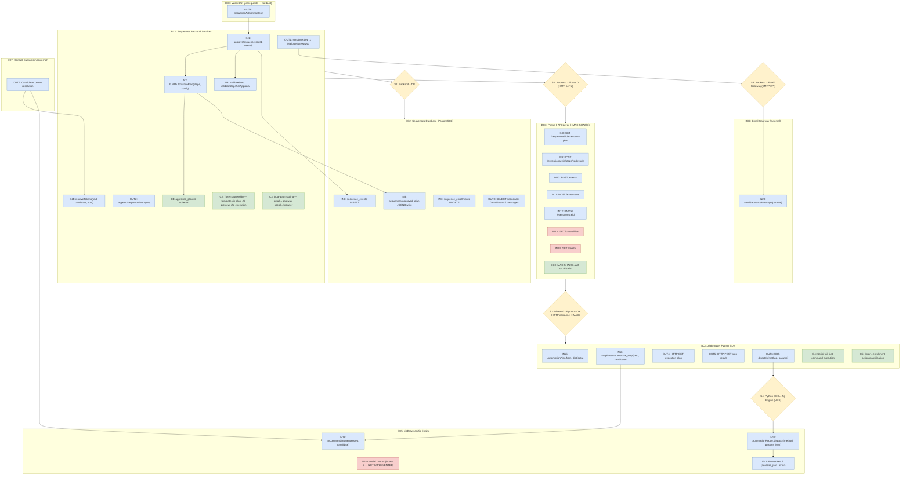
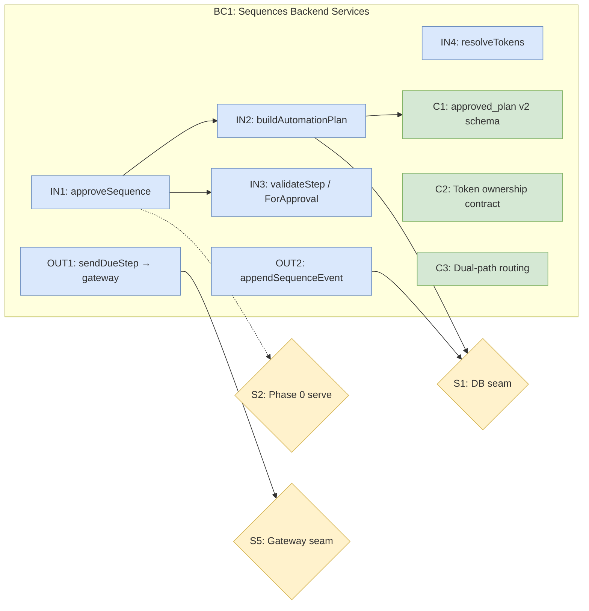
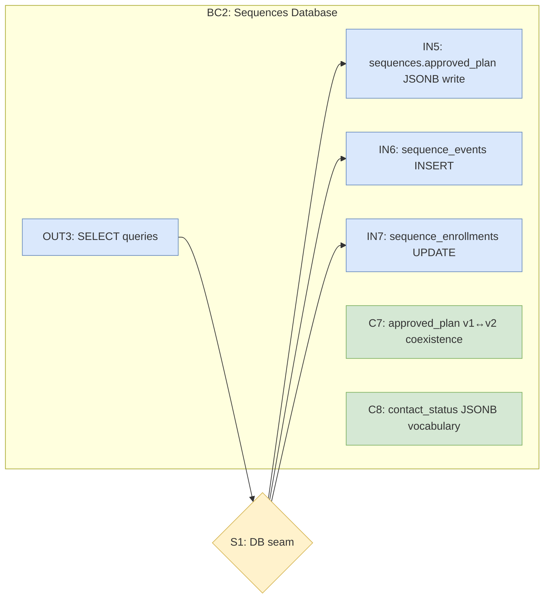
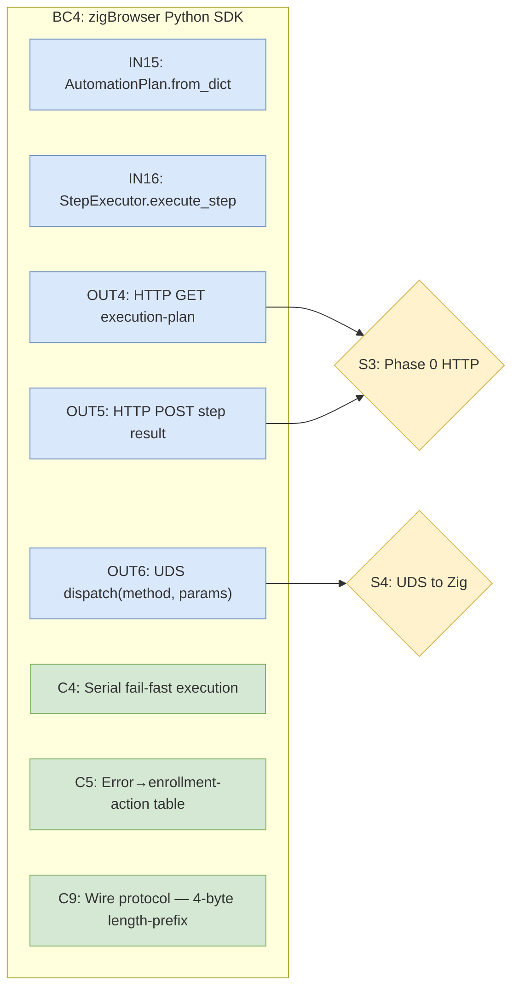
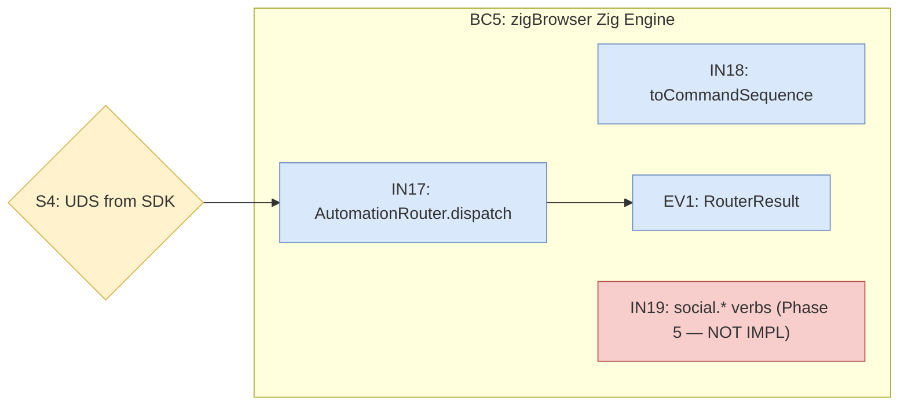

```mermaid
graph LR
    classDef iface    fill:#dae8fc,stroke:#6c8ebf
    classDef contract fill:#d5e8d4,stroke:#82b366
    classDef seam     fill:#fff2cc,stroke:#d6b656
    classDef gap      fill:#f8cecc,stroke:#b85450

    subgraph BC3["BC3: Phase 0 API Layer"]
        IN8["IN8: GET /execution-plan"]:::iface
        IN9["IN9: POST /steps/:sid/result"]:::iface
        IN10["IN10: POST /events"]:::iface
        IN11["IN11: POST /executions"]:::iface
        IN12["IN12: PATCH /executions/:eid"]:::iface
        IN13_GAP["IN13: GET /capabilities (NOT IN PHASE 0)"]:::gap
        IN14_GAP["IN14: GET /health (NOT IN PHASE 0)"]:::gap
        C6["C6: HMAC-SHA256 auth"]:::contract
    end

    S2{"S2: Backend serve"}:::seam
    S3{"S3: SDK consume"}:::seam

    S2 --> BC3
    BC3 --> S3
```

# Sequences Automation Execution Bridge — Step→Command Mapping and Plan Construction

**(Covers automation-layer tie-ins for PRD 9.3 + 9.4; does NOT implement wizard/authoring UI)**

**Date:** 2026-07-09
**Scope:** zigBrowser ↔ sequences app tie-in for sequence creation and step authoring — specifically the automation execution bridge that converts authored steps into executable plans
**Coordination:** Agent pane 1 of 4; Phase 0 (API-DB layer) plan is the shared seam
**Primary inputs:**
- `sequences/thoughts/searchable/shared/prds/sequences/9.3-new-sequence-creation.md`
- `sequences/thoughts/searchable/shared/prds/sequences/9.4-sequence-step-authoring.md`
- zigBrowser automation engine: `src/automation/router.zig`, `src/automation_rpc.zig`, `sdk/python/`
- sequences DB: migrations `090`, `100`, `110`

### Prerequisites (Not Built By This Plan)

This plan assumes the following are implemented separately:

1. **PRD 9.3 wizard/authoring UI** — dashboard entry (S1), wizard shell (S2-S3), mailbox settings pane, template chooser, AI-config pane, generation orchestration (S4-S6)
2. **PRD 9.4 step authoring UI** — step list/editor, generate-step-with-AI modal, preview/personalization panel
3. **Phase 0 API-DB layer** — the HTTP seam between zigBrowser and the sequences backend (`2026-07-09-sequences-integration-api-db-layer-plan.md`)

This plan builds the **downstream automation execution bridge**: step→action mapping, automation plan construction, token resolution, execution plan reading, and result reporting. It produces executable plans from steps that the wizard and authoring UIs have already created.

## Section 0: Execution Model Decision

**Decision: Dual-path execution — gateway for email, browser automation for social/LinkedIn only.**

The existing send pipeline (`sequenceExecutionService.sendDueStep()` at `/home/maceo/ntm_Dev/sequences/backend/services/sequences/sequenceExecutionService.js:175`) sends emails via `MailboxGatewayV1.sendSequenceMessage()` — a direct API/SMTP gateway call. This path uses `claimForSend()` (row-level `FOR UPDATE` locking), `evaluateSendability()` (preflight checks), `buildSentMessage()` (canonical sent-row builder), and `persistSentMessage()` (DB write + enrollment advancement). **This path is NOT modified by this plan and continues to handle all email sends.**

Browser automation via zigBrowser is used **exclusively** for social/LinkedIn actions that require actual browser interaction:
- `linkedin.view_profile` — viewing a candidate's profile
- `linkedin.connect` — sending a connection request
- `linkedin.message` — sending an InMail/message

**Routing rule:** Step `type: 'email'` → gateway pipeline (existing `sendDueStep`). Step actions requiring browser interaction (LinkedIn, social) → zigBrowser automation engine via Phase 0 execution plan.

**Implications for this plan:**
- The `approved_plan` uses Phase 0's **high-level action model** (`action: "send_email"`, `action: "linkedin_connect"`), NOT low-level browser command sequences
- Email steps in the approved plan carry `renderedMessage: { subject, body }` for the gateway — no DOM commands
- Social/LinkedIn steps in the approved plan carry action descriptors that zigBrowser maps to browser command sequences at execution time
- Token resolution for email happens in the JS backend at approval/send time; Zig-side token resolution applies only to social step execution

## Overview

This plan defines how sequences created and authored in the sequences app become executable automation targets for zigBrowser, and how zigBrowser's automation commands map to sequence step authoring. It covers:

1. **Sequence-to-automation data model** — the schema that bridges a sequences-app "draft sequence with steps" to an execution plan consumable by both the gateway (email) and zigBrowser (social/LinkedIn)
2. **Step-to-action mapping** — how each `SequenceAuthoringStep` type maps to high-level actions (`send_email`, `linkedin_connect`, etc.) in the approved plan, and how social actions further map to zigBrowser `dom.*`, `page.*`, and `social.*` command verbs at execution time
3. **Creation flow integration** — how `POST /api/v1/automation/sequences` and AI generation connect to the execution plan
4. **Step validation against automation capabilities** — ensuring authored steps are executable before approval

## Current State Analysis

### zigBrowser Automation API (BUILT)

The automation engine exposes a JSON-RPC 2.0 API over AF_UNIX sockets with these command verbs:

| Verb | Params | Purpose |
|---|---|---|
| `dom.query` | `{selector, strict?, timeout_ms?}` | Find element |
| `dom.click` | `{selector, options?{force, trial, strict, timeout_ms}}` | Click element |
| `dom.fill` | `{selector, value, options?}` | Clear + fill input |
| `dom.type` | `{selector, text, delay_ms?, options?}` | Type character-by-character |
| `dom.getText` | `{selector, strict?}` | Extract text content |
| `dom.getAttribute` | `{selector, name, strict?}` | Read attribute |
| `dom.waitFor` | `{selector, state?, strict?, timeout_ms?}` | Wait for element state |
| `page.navigate` | `{url, timeout_ms?, waitUntil?}` | Navigate to URL |
| `page.reload` | `{timeout_ms?, waitUntil?}` | Reload page |
| `page.url` | `{}` | Get current URL |
| `page.title` | `{}` | Get page title |
| `page.evaluate` | `{expression}` | Run JS expression |
| `page.screenshot` | `{fullPage?}` | Capture screenshot |

**Source:** `src/automation/router.zig:5-19` (Verb enum — dom.* and page.* ONLY)

Phase 5 (NOT YET IMPLEMENTED) will add social compound commands:
| Verb | Purpose | Status |
|---|---|---|
| `social.login_check` | Verify platform login state | **Not in router.zig** |
| `social.rate_status` | Check daily action limits | **Not in router.zig** |
| `linkedin.connect` | Send connection request | **Not in router.zig** |
| `linkedin.message` | Send InMail/message | **Not in router.zig** |
| `linkedin.view_profile` | View a profile | **Not in router.zig** |
| `instagram.follow` | Follow account | **Not in router.zig** |

**Source:** `thoughts/searchable/shared/plans/2026-07-09-phase5-sdks-social-contracts-tdd-plan.md:27-31`
**⚠️ Blocking dependency:** LinkedIn step execution (Behavior 1, Behavior 6) requires Phase 5 social verbs to be implemented in `router.zig`. Tests for LinkedIn commands must be marked pending until then.

Python SDK public API: `ZigBrowser.dom.click()`, `.dom.fill()`, `.dom.type()`, `.page.navigate()`, etc.
**Source:** `sdk/python/src/zigbrowser/client.py:13-75`
**Wire protocol:** 4-byte big-endian length-prefixed framing over UDS (`client.py:305`), NOT line-based JSON-RPC. The Zig side (`automation_rpc.zig:5`) uses line-based framing. The existing Python client handles this difference correctly.

### Sequences App DB (EXISTING)

**`sequences` table** (mig 090, extended by mig 100):
- `id`, `org_id`, `owner_user_id`, `name`, `status` (`draft|pending_approval|active|archived`)
- `job_id`, `workspace_search_id`
- `approved_at`, `approved_by`, `approved_plan` JSONB (mig 100)

**`sequence_enrollments`** (mig 090, extended by mig 100):
- `id`, `org_id`, `owner_user_id`, `sequence_id`
- `candidate_source`, `candidate_id`, `workspace_candidate_id`
- `status` (`draft|active|sent|paused|suppressed|bounced|stopped`), `current_step_index`, `next_send_at`, `stop_reason`

**`sequence_messages`** (mig 090, extended by mig 110):
- `id`, `org_id`, `owner_user_id`, `sequence_id`, `enrollment_id`
- `direction` (`outbound|inbound`), `subject`, `body`, `strategy`
- `grounding_status` (`grounded|partial|review`), `evidence_map` JSONB, `review_queue` JSONB
- `render_status` (`draft|failed`), `is_current`, `supersedes_id`
- Send columns: `sender_mailbox_connection_id`, `rendered_subject/body`, `sent_at`, `provider_message_id/thread_id`

**`sequence_events`** (mig 110):
- Canonical event types: `SequenceCreated`, `AudienceSelected`, `DraftGenerated`, `SequenceApproved`, `MessageSent`, etc.

**`approved_plan`** JSONB structure (from `sequenceExecutionService.js:82`):
```json
{ "steps": [{ "index": 0 }], "approved_at": "...", "version": 1 }
```

**Key gap:** There is NO `sequence_steps` table. Steps exist only as:
1. The `approved_plan` JSONB blob on the `sequences` table (frozen at approval)
2. Individual `sequence_messages` rows per enrollment (one message per enrollment per step)

The PRD 9.4 step model (`SequenceAuthoringStep`) is a UX-only contract today. Backend storage maps it to `approved_plan` + `sequence_messages`.

### What's Missing (This Plan's Scope)

1. No high-level action-based step schema that bridges the wizard's step model to the execution engine (gateway for email, browser automation for social)
2. No mapping from `SequenceAuthoringStep.type` to execution actions and (for social steps) to zigBrowser command verbs
3. No integration with Phase 0 API for zigBrowser to read execution plans (`GET /api/v1/automation/sequences/:sequenceId/execution-plan`)
4. No integration with Phase 0 API for zigBrowser to report step results (`POST /api/v1/automation/executions/:executionId/steps/:stepExecutionId/result`)
5. No validation that authored steps are executable by the automation engine
6. No v2 `approved_plan` schema that extends the existing v1 placeholder with action-based automation steps

## Desired End State

After this plan is implemented:

1. A sequence created in the wizard (9.3) carries enough data for dual-path execution: email steps route to the existing gateway pipeline (`MailboxGatewayV1`); social/LinkedIn steps route to zigBrowser browser automation.
2. Each authored step (9.4) maps deterministically to a high-level action (`send_email`, `linkedin_connect`, etc.) in the approved plan. Social actions further map to zigBrowser command verb sequences at execution time. Mappings are validated before approval.
3. The `approved_plan` JSONB is extended to v2, adding `automation_steps` with action-based step definitions alongside the existing v1 `steps` array. v1 plans remain backward-compatible.
4. zigBrowser can read execution plans through the Phase 0 API contract (`GET /api/v1/automation/sequences/:sequenceId/execution-plan`) and report results back (`POST /api/v1/automation/executions/:executionId/steps/:stepExecutionId/result`).

## What We're NOT Doing

- Phase 0 API layer internals (endpoints, auth, middleware) — we reference the seam
- PRD 9.1 (Sequence Tracking) or 9.2 (Analytics)
- The sequences dashboard UI or wizard shell implementation (prerequisite — see Prerequisites above)
- The UI components (React) for step authoring (prerequisite — see Prerequisites above)
- Modifying the existing email send-pipeline execution (`sendStore.js`, `sequenceExecutionService.sendDueStep`) — email continues through `MailboxGatewayV1` (see Section 0)
- Adding new DB tables — we extend existing schemas

## Phase 0 API Contract Dependencies

The Phase 0 API-DB layer plan (`2026-07-09-sequences-integration-api-db-layer-plan.md`) is being designed by a sibling agent. This plan consumes Phase 0's **actual** endpoint contract and specifies what 9.3/9.4 require from it.

**Authentication:** All service-authenticated requests use **HMAC-SHA256 request signing** (NOT simple API keys). Required headers per Phase 0 contract:
- `Authorization: Bearer <user-session-token-when-available>`
- `X-ZB-Client-Id: <registered-zigbrowser-client-id>`
- `X-ZB-Timestamp: <unix-ms>`
- `X-ZB-Nonce: <random-128-bit-base64url>`
- `X-ZB-Signature: v1=<base64url-hmac-sha256>`

Write requests additionally require `Idempotency-Key`, `X-ZB-Trace-Id`, and `X-ZB-Command-Id` headers.

### Required Reads (zigBrowser → sequences DB via Phase 0)

| Phase 0 Endpoint | Purpose | 9.3/9.4 Consumer |
|---|---|---|
| `GET /api/v1/automation/sequences/:sequenceId/execution-plan` | Fetch the high-level execution plan for a sequence (action-based, NOT command-level) | zigBrowser execution engine, after approval |
| `GET /api/v1/automation/sequences/:sequenceId/steps` | Fetch ordered steps with metadata | Step authoring preview, automation dry-run |

### Required Writes (zigBrowser → sequences DB via Phase 0)

| Phase 0 Endpoint | Purpose | 9.3/9.4 Producer |
|---|---|---|
| `POST /api/v1/automation/executions/:executionId/steps/:stepExecutionId/result` | Report step execution outcome (keyed by execution+stepExecution IDs, NOT sequence+stepIndex) | zigBrowser after executing a step |
| `POST /api/v1/automation/events` | Emit automation execution events (NOT scoped under sequence) | zigBrowser telemetry bridge |
| `POST /api/v1/automation/executions` | Create a new execution run | zigBrowser when starting a sequence run |
| `PATCH /api/v1/automation/executions/:executionId` | Update execution state (pause, complete, fail) | zigBrowser post-step execution |

### Required but NOT Yet in Phase 0 (Scope Additions Needed)

These endpoints are needed by this plan but are NOT defined in Phase 0's current contract. They must be filed as Phase 0 scope additions:

| Proposed Endpoint | Purpose | Blocker? |
|---|---|---|
| `GET /api/v1/automation/capabilities` | Query available command verbs and platform support for step validation | Non-blocking — can hardcode capability list initially |
| `GET /api/v1/automation/health` | Check zigBrowser connectivity for wizard shell status | Non-blocking — can use execution-plan 404 as proxy |

**Note:** Candidate context for token resolution is embedded in Phase 0's execution-plan response (`candidate` field per step), NOT served via a separate `/enrollments/:id/context` endpoint. Enrollment state advancement is handled by step result reporting and execution updates, NOT a separate `PATCH /enrollments` endpoint.

## Testing Strategy

- **Unit tests (Zig):** Social step-to-command mapping logic, automation plan validation, verb parameter construction — in zigBrowser repo
- **Unit tests (JS/Node):** Step schema validation, automation plan serialization, wizard-to-plan conversion — in **sequences repo** (`/home/maceo/ntm_Dev/sequences`)
- **Integration tests (JS):** End-to-end lifecycle from draft creation through approval to plan construction — in sequences repo, using existing Vitest + PostgreSQL test infra
- **Integration tests (Python):** Execution plan reading and command dispatch — in zigBrowser repo
- **Framework:** Zig `zig build test`, JS **Vitest** (NOT Jest — sequences repo uses Vitest, configured at `sequences/vitest.config.js`), Python pytest per SDK patterns
- **Test DB:** Sequences repo has existing test infra at `tests/integration/global-setup.js` — provisions test DB, runs migrations, seeds org, creates RLS-honest app role
- **Fail-closed rule:** Closure tests (BLOCKING behaviors) MUST NOT use `describe.skipIf(!databaseUrl)` — they must fail-closed when the DB is absent, per closure-test-framework §4 rule 6. Use plain `describe()` and let the test error when infrastructure is missing.

### Repository File Path Convention

Files in this plan span two repos. All paths use explicit prefixes:
- **zigBrowser repo:** `/home/maceo/ntm_Dev/zigBrowser/` — Zig automation code, Python SDK
- **sequences repo:** `/home/maceo/ntm_Dev/sequences/` — JS backend services, DB migrations, Vitest tests

---

## Behavior 1: Social/LinkedIn Step-to-Command Mapping (LEAF)

**Classification: LEAF** — pure function within zigBrowser, no async edge, no DB boundary. Unit tests suffice.

> **Scope note:** Email steps are NOT mapped to browser commands — they execute through the existing gateway pipeline (`MailboxGatewayV1.sendSequenceMessage`). This behavior covers **only** social/LinkedIn steps that require browser automation.

### Token Resolution Ownership Contract

- **approved_plan contains TEMPLATE parameters** with `{{Token Name}}` placeholders — it is per-sequence, not per-enrollment, so it CANNOT contain resolved values
- **JS `resolveTokens`** (Behavior 5) is for **authoring preview only** — showing the recruiter what a step looks like with sample candidate data
- **Zig `toCommandSequence`** does **execution-time resolution per enrollment** — it receives candidate context from the Phase 0 execution plan's per-step `candidate` field and resolves templates into final values

### Phase 5 Social Verb Dependency

The Zig router (`src/automation/router.zig:5-19`) currently defines ONLY `dom.*` and `page.*` verbs — **NO social verbs exist yet**. Social verbs (`linkedin.connect`, `linkedin.view_profile`, `linkedin.message`, `social.login_check`, `social.rate_status`) are planned for Phase 5. LinkedIn step mapping tests in this behavior MUST be marked `test.skip` / pending until Phase 5 social verbs land in `router.zig`.

### Test Specification

**Given:** A social step of type `linkedin_action` with `action: 'view_profile'` and candidate context `{ profileUrl: "https://linkedin.com/in/alice" }`
**When:** The step is converted to a browser command sequence at execution time
**Then:** It produces an ordered array of command verb calls:
1. `page.navigate` to the candidate's LinkedIn profile URL
2. `dom.waitFor` the profile content container
3. (For `connect` action): `dom.click` the Connect button; `dom.waitFor` confirmation dialog; `dom.click` Send

**Given:** A step of type `wait` with `{ amount: 2, unit: 'business_days' }`
**When:** Converted to automation commands
**Then:** No automation commands are produced; the wait is a scheduling directive consumed by the execution scheduler, not the automation engine

**Given:** A step with `groundingStatus: 'review'` and non-empty `reviewQueue`
**When:** Converted to automation commands
**Then:** The step is flagged as NOT executable — automation plan marks it `blocked: 'grounding_review_required'` and no command sequence is generated until grounding is resolved

**Edge Cases:**
- Steps with unresolved `{{Token Name}}` tokens at execution time produce error `UnresolvedTokens`, not a command sequence
- LinkedIn steps without a valid `profileUrl` in candidate context produce error `MissingCandidateField`
- Email-type steps passed to `toCommandSequence` return empty — they are handled by the gateway, not browser automation

### Files touched
- `/home/maceo/ntm_Dev/zigBrowser/src/automation/step_mapping.zig` (new: social step-to-verb conversion logic)
- `/home/maceo/ntm_Dev/zigBrowser/sdk/python/src/zigbrowser/sequences.py` (new: Python-side step model + mapping)

### Build System Changes
Register the new module in `src/automation.zig` (the automation module root):
```zig
pub const step_mapping = @import("automation/step_mapping.zig");
```
Register the test in `build.zig` following the existing pattern (see `build.zig:241-270`):
```zig
const step_mapping_tests_module = b.createModule(.{
    .root_source_file = b.path("tests/automation_step_mapping_test.zig"),
    ...
});
step_mapping_tests_module.addImport("automation", automation_module);
// ... register and add to test_step
```

### TDD Cycle

#### 🔴 Red: Write Failing Test
**File:** `/home/maceo/ntm_Dev/zigBrowser/tests/automation_step_mapping_test.zig`
```zig
const std = @import("std");
const testing = std.testing;
const step_mapping = @import("automation").step_mapping;

test "linkedin view_profile step produces navigate-waitFor command sequence" {
    const step = step_mapping.SequenceStep{
        .id = "step-1",
        .index = 0,
        .step_type = .linkedin_action,
        .linkedin_action = .view_profile,
        .grounding_status = .grounded,
    };
    const candidate = step_mapping.CandidateContext{
        .linkedin_profile_url = "https://linkedin.com/in/alice",
    };

    const commands = try step_mapping.toCommandSequence(testing.allocator, step, candidate);
    defer testing.allocator.free(commands);

    try testing.expectEqual(@as(usize, 2), commands.len);
    try testing.expectEqualStrings("page.navigate", commands[0].method);
    try testing.expectEqualStrings("dom.waitFor", commands[1].method);
}

test "email step produces zero automation commands (handled by gateway)" {
    const step = step_mapping.SequenceStep{
        .id = "step-2",
        .index = 0,
        .step_type = .email,
        .reply_mode = .new_thread,
        .subject = "Hello {{First Name}}",
        .body = "Your work at {{Current Company}} caught our eye",
    };

    const commands = try step_mapping.toCommandSequence(testing.allocator, step, .{});
    try testing.expectEqual(@as(usize, 0), commands.len);
}

test "wait step produces zero automation commands" {
    const step = step_mapping.SequenceStep{
        .id = "step-3",
        .index = 1,
        .step_type = .wait,
        .wait_amount = 2,
        .wait_unit = .business_days,
    };

    const commands = try step_mapping.toCommandSequence(testing.allocator, step, .{});
    try testing.expectEqual(@as(usize, 0), commands.len);
}

test "linkedin step with missing profile URL produces error" {
    const step = step_mapping.SequenceStep{
        .id = "step-4",
        .index = 0,
        .step_type = .linkedin_action,
        .linkedin_action = .connect,
    };
    const candidate = step_mapping.CandidateContext{}; // no linkedin_profile_url

    const result = step_mapping.toCommandSequence(testing.allocator, step, candidate);
    try testing.expectError(error.MissingCandidateField, result);
}

test "review grounding status blocks command generation" {
    const step = step_mapping.SequenceStep{
        .id = "step-5",
        .index = 0,
        .step_type = .linkedin_action,
        .linkedin_action = .connect,
        .grounding_status = .review,
        .review_queue = &.{.{ .reason = "ungrounded_claim" }},
    };

    const result = step_mapping.toCommandSequence(testing.allocator, step, .{});
    try testing.expectError(error.GroundingReviewRequired, result);
}
```

#### 🟢 Green: Minimal Implementation
**File:** `/home/maceo/ntm_Dev/zigBrowser/src/automation/step_mapping.zig`
```zig
pub const StepType = enum { email, wait, linkedin_action };
pub const ReplyMode = enum { new_thread, reply_in_same_thread };
pub const LinkedInAction = enum { view_profile, connect, message };
pub const WaitUnit = enum { minutes, hours, business_days, days };
pub const GroundingStatus = enum { grounded, partial, review };

pub const SequenceStep = struct {
    id: []const u8,
    index: u32,
    step_type: StepType,
    // Email fields (used only when step_type == .email — but email returns empty commands)
    reply_mode: ReplyMode = .new_thread,
    subject: []const u8 = "",
    body: []const u8 = "",
    tokens: []const []const u8 = &.{},
    include_unsubscribe: bool = false,
    // LinkedIn fields
    linkedin_action: LinkedInAction = .view_profile,
    // Shared fields
    grounding_status: GroundingStatus = .grounded,
    review_queue: []const ReviewItem = &.{},
    wait_amount: u32 = 0,
    wait_unit: WaitUnit = .days,
    // PRD fields intentionally omitted: senderMailboxId (email-only, handled by gateway),
    // signatureId (email-only), status (UI-only state not relevant to execution)
};

pub const CandidateContext = struct {
    // Required for LinkedIn steps
    linkedin_profile_url: ?[]const u8 = null,
    // Optional context for message personalization
    first_name: ?[]const u8 = null,
    current_company: ?[]const u8 = null,
    job_title: ?[]const u8 = null,
};

pub const AutomationCommand = struct {
    method: []const u8,
    params_json: []const u8,
};

pub fn toCommandSequence(
    allocator: std.mem.Allocator,
    step: SequenceStep,
    candidate: CandidateContext,
) ![]AutomationCommand {
    // Email and wait steps produce NO browser commands — email goes through gateway
    if (step.step_type == .email or step.step_type == .wait) return &.{};
    if (step.grounding_status == .review) return error.GroundingReviewRequired;

    if (step.step_type == .linkedin_action) {
        if (candidate.linkedin_profile_url == null) return error.MissingCandidateField;
        // Build LinkedIn command sequence based on action type
        // view_profile: navigate + waitFor
        // connect: navigate + waitFor + click Connect + waitFor dialog + click Send
        // message: navigate + waitFor + click Message + waitFor compose + fill + click Send
        // ...
    }
}
```

#### 🔵 Refactor: Improve Code
- [ ] No duplication: token resolution logic extracted into shared resolver
- [ ] Reveals intent: `toCommandSequence` reads as "convert step to commands"
- [ ] Complexity went down: flat switch on step_type
- [ ] No shallow wrappers: step_mapping does real work
- [ ] Fits existing patterns: follows `router.zig` Verb enum pattern

### Success Criteria
**Automated:**
- [ ] `zig build test --summary all` — step mapping tests pass
- [ ] Email steps return empty commands (gateway handles email)
- [ ] Wait steps return empty commands (scheduling directive)
- [ ] LinkedIn view_profile produces navigate+waitFor sequence
- [ ] LinkedIn connect produces navigate+waitFor+click+waitFor+click sequence (pending Phase 5 social verbs)
- [ ] Missing candidate fields produce `MissingCandidateField` error
- [ ] Grounding review blocks command generation

**Manual:**
- [ ] LinkedIn step produces correct command sequence for a sample candidate profile URL

---

## Behavior 2: Automation Plan Construction — Sequence to Executable Plan (BLOCKING)

**Classification: BLOCKING** — crosses DB boundary (writes `approved_plan` JSONB).

### `approved_plan` v2 Schema

The current `approved_plan` (from `sequenceExecutionService.js:81`) is a **hardcoded single-step placeholder**:
```json
{ "steps": [{ "index": 0 }], "approved_at": "...", "version": 1 }
```

This plan extends it to v2 with an **additive** change. v1 plans remain valid — no existing behavior breaks. v2 adds the `automation_steps` array alongside `steps`:

```json
{
  "version": 2,
  "steps": [{ "index": 0 }, { "index": 1 }, ...],
  "automation_steps": [
    {
      "step_id": "step-1",
      "step_index": 0,
      "action": "send_email",
      "template_subject": "Hello {{First Name}}",
      "template_body": "Your work at {{Current Company}}...",
      "token_bindings": [{ "token": "First Name", "source": "candidate", "field": "first_name" }],
      "grounding_metadata": { "status": "grounded", "evidence_map": [], "review_queue": [] },
      "scheduling": { "wait_before": null }
    },
    {
      "step_id": "step-3",
      "step_index": 2,
      "action": "linkedin_connect",
      "scheduling": { "wait_before": { "amount": 2, "unit": "business_days" } }
    }
  ],
  "approved_at": "..."
}
```

**Key design decisions:**
- `action` field uses **high-level intents** aligned with Phase 0's execution-plan model: `"send_email"`, `"linkedin_view_profile"`, `"linkedin_connect"`, `"linkedin_message"`
- Email steps carry `template_subject`/`template_body` with **unresolved `{{Token}}` placeholders** — resolution happens per-enrollment at send time via the gateway
- LinkedIn steps carry only the action type — candidate context (profile URL) comes from Phase 0's execution plan at runtime
- `version: 2` discriminator lets readers handle both shapes; code reading `approved_plan` MUST check version
- Plan construction runs AFTER all editing/reordering is complete (at approval time), so wait-step folding is always correct

### Test Specification

**Given:** A draft sequence with 5 email steps and 4 wait steps (interleaved), mailbox settings, and AI-generated content
**When:** The sequence is approved via `sequenceExecutionService.approveSequence()`
**Then:** The `approved_plan` JSONB v2 includes an `automation_steps` array where each step has:
- `action`: high-level intent (`"send_email"`, `"linkedin_connect"`, etc.)
- `template_subject`/`template_body`: unresolved token templates (for email steps)
- `token_bindings`: which candidate fields feed which tokens
- `grounding_metadata`: evidence_map and review status
- `scheduling`: wait-before timing derived from preceding wait steps

**Given:** The approved plan is read by zigBrowser through the Phase 0 API (`GET /api/v1/automation/sequences/:sequenceId/execution-plan`)
**When:** zigBrowser parses the execution plan
**Then:** Each step has an `action` field that determines the execution path: `send_email` → gateway pipeline; `linkedin_*` → browser automation via `toCommandSequence`

**Edge Cases:**
- LinkedIn steps (`includeLinkedInStep: true` from PRD 9.3 S5 checkbox) are appended as `action: "linkedin_view_profile"` + `action: "linkedin_connect"` entries. Position is after the last email step (matching PRD 9.3's "a single step will be added" UX).
- Plan construction validates all steps are executable before writing `approved_plan`
- Steps with `render_status: 'failed'` block plan construction
- v1 approved plans (existing sequences) continue to work — they have no `automation_steps` array and execute entirely through the existing gateway path

### Files touched
- `/home/maceo/ntm_Dev/sequences/backend/services/sequences/automationPlanBuilder.js` (new — in **sequences repo**)
- `/home/maceo/ntm_Dev/sequences/backend/services/sequences/sequenceExecutionService.js` (extend `approveSequence`)

### TDD Cycle

#### 🔴 Red: Write Failing Test
**File:** `/home/maceo/ntm_Dev/sequences/backend/services/sequences/__tests__/automationPlanBuilder.test.js`
```javascript
import { describe, it, expect } from 'vitest';
import { buildAutomationPlan } from '../automationPlanBuilder.js';

describe('Automation Plan Builder', () => {
  it('converts authored steps to high-level action plan with template params', () => {
    const steps = [
      { id: 'step-1', index: 0, type: 'email', replyMode: 'new_thread',
        subject: 'Hello {{First Name}}', body: 'Your work at {{Current Company}}...',
        tokens: ['First Name', 'Current Company'], includeUnsubscribe: true,
        groundingStatus: 'grounded', evidenceMap: [] },
      { id: 'step-2', index: 1, type: 'wait', wait: { amount: 2, unit: 'business_days' } },
      { id: 'step-3', index: 2, type: 'email', replyMode: 'reply_in_same_thread',
        subject: 'Re: Hello {{First Name}}', body: 'Just following up...',
        tokens: ['First Name'], includeUnsubscribe: true,
        groundingStatus: 'grounded', evidenceMap: [] },
    ];

    const plan = buildAutomationPlan(steps, {
      senderMailboxId: 'mbx-1',
      language: 'en',
      includeLinkedInStep: false,
    });

    expect(plan.version).toBe(2);
    expect(plan.automation_steps).toHaveLength(2); // only email steps (wait is scheduling)
    expect(plan.automation_steps[0].action).toBe('send_email');
    expect(plan.automation_steps[0].template_subject).toBe('Hello {{First Name}}');
    expect(plan.automation_steps[0].template_body).toContain('{{Current Company}}');
    expect(plan.automation_steps[0].scheduling.wait_before).toBeNull();
    expect(plan.automation_steps[1].action).toBe('send_email');
    expect(plan.automation_steps[1].scheduling.wait_before).toEqual({
      amount: 2, unit: 'business_days',
    });
  });

  it('includes linkedin steps when configured', () => {
    const steps = [
      { id: 'step-1', index: 0, type: 'email', replyMode: 'new_thread',
        subject: 'Hello', body: 'Message', tokens: [],
        includeUnsubscribe: true, groundingStatus: 'grounded' },
    ];

    const plan = buildAutomationPlan(steps, {
      senderMailboxId: 'mbx-1',
      language: 'en',
      includeLinkedInStep: true,
    });

    const linkedInSteps = plan.automation_steps.filter(
      s => s.action.startsWith('linkedin_')
    );
    expect(linkedInSteps).toHaveLength(2); // view_profile + connect
    expect(linkedInSteps[0].action).toBe('linkedin_view_profile');
    expect(linkedInSteps[1].action).toBe('linkedin_connect');
  });

  it('rejects plan with review-blocked steps', () => {
    const steps = [
      { id: 'step-1', index: 0, type: 'email', replyMode: 'new_thread',
        subject: 'Hello', body: 'Body', tokens: [],
        groundingStatus: 'review', reviewQueue: [{ reason: 'ungrounded_claim' }] },
    ];

    expect(() => buildAutomationPlan(steps, { senderMailboxId: 'mbx-1' }))
      .toThrow('grounding_review_required');
  });

  it('rejects plan with empty subject or body', () => {
    const steps = [
      { id: 'step-1', index: 0, type: 'email', replyMode: 'new_thread',
        subject: '', body: '', tokens: [], groundingStatus: 'grounded' },
    ];

    expect(() => buildAutomationPlan(steps, { senderMailboxId: 'mbx-1' }))
      .toThrow('invalid_step');
  });

  it('plan params contain template placeholders, not resolved values', () => {
    const steps = [
      { id: 'step-1', index: 0, type: 'email', replyMode: 'new_thread',
        subject: 'Hello {{First Name}}', body: 'At {{Current Company}}',
        tokens: ['First Name', 'Current Company'],
        includeUnsubscribe: true, groundingStatus: 'grounded' },
    ];

    const plan = buildAutomationPlan(steps, { senderMailboxId: 'mbx-1' });

    // Templates must contain unresolved {{}} placeholders
    expect(plan.automation_steps[0].template_subject).toContain('{{First Name}}');
    expect(plan.automation_steps[0].template_body).toContain('{{Current Company}}');
  });
});
```

#### 🟢 Green: Minimal Implementation
**File:** `/home/maceo/ntm_Dev/sequences/backend/services/sequences/automationPlanBuilder.js`
```javascript
export function buildAutomationPlan(steps, config) {
  const automationSteps = [];
  let pendingWait = null;

  for (const step of steps) {
    if (step.type === 'wait') {
      pendingWait = step.wait;
      continue;
    }
    if (step.type === 'email') {
      validateEmailStep(step);
      automationSteps.push({
        step_id: step.id,
        step_index: step.index,
        action: 'send_email',
        template_subject: step.subject,
        template_body: step.includeUnsubscribe
          ? step.body + '\n{{unsubscribe_footer}}'
          : step.body,
        token_bindings: step.tokens.map(t => ({
          token: t, source: 'candidate', field: tokenToField(t),
        })),
        grounding_metadata: {
          status: step.groundingStatus,
          evidence_map: step.evidenceMap || [],
          review_queue: step.reviewQueue || [],
        },
        scheduling: { wait_before: pendingWait },
      });
      pendingWait = null;
    }
  }

  if (config.includeLinkedInStep) {
    automationSteps.push({
      step_id: `linkedin-view-${Date.now()}`,
      step_index: automationSteps.length,
      action: 'linkedin_view_profile',
      scheduling: { wait_before: pendingWait },
    });
    automationSteps.push({
      step_id: `linkedin-connect-${Date.now()}`,
      step_index: automationSteps.length,
      action: 'linkedin_connect',
      scheduling: { wait_before: null },
    });
    pendingWait = null;
  }

  return {
    version: 2,
    steps: automationSteps.map((s, i) => ({ index: i })),
    automation_steps: automationSteps,
    approved_at: new Date().toISOString(),
  };
}
```

#### 🔵 Refactor: Improve Code
- [ ] No duplication: `tokenToField` centralized for token→candidate-field mapping
- [ ] Reveals intent: function name is the contract; `action` field is self-documenting
- [ ] Complexity went down: single pass through steps, accumulating wait directives
- [ ] No shallow wrappers: real construction logic
- [ ] Fits existing patterns: extends `sequenceExecutionService.js:81` approved_plan shape with v2 discriminator
- [ ] Backward compatible: v1 plans (no `automation_steps`) continue to work through gateway

### Success Criteria
**Automated:**
- [ ] `npx vitest run automationPlanBuilder.test.js` — all cases pass (Vitest, NOT Jest)
- [ ] Email steps produce `action: 'send_email'` with template params (NOT command sequences)
- [ ] Wait steps produce scheduling directives, not action steps
- [ ] LinkedIn steps included when configured, with correct actions
- [ ] Validation rejects review-blocked and empty steps
- [ ] Plan params contain template placeholders, NOT resolved values

**Manual:**
- [ ] Generated plan JSON is parseable by zigBrowser Python SDK
- [ ] v1 approved plans continue to work (no regression in existing sequences)

---

## Behavior 3: Step Schema Validation Against Automation Capabilities (LEAF)

**Classification: LEAF** — pure function, no async edge, no DB boundary. Unit tests suffice.

### Test Specification

**Given:** An authored step referencing `dom.click` with selector `#compose-send`
**When:** Step validation runs against the automation capability manifest
**Then:** The step is marked valid because `dom.click` is a known verb

**Given:** An authored step referencing a social command `linkedin.connect`
**When:** Step validation runs against the capability manifest
**Then:** The step is valid only if Phase 5 social commands are available (capability advertised)

**Given:** An authored step with `groundingStatus: 'partial'` and non-empty `reviewQueue`
**When:** Validation runs
**Then:** The step gets a warning (not a blocking error) — the recruiter can review but the step cannot be auto-executed

**Edge Cases:**
- Unknown command verbs fail validation
- Steps with tokens that reference non-existent candidate fields produce warnings at authoring time, errors at approval time
- `page.evaluate` with arbitrary JS is blocked at validation (security constraint)

### Files touched
- `/home/maceo/ntm_Dev/sequences/backend/services/sequences/stepValidator.js` (new — in **sequences repo**)

### TDD Cycle

#### 🔴 Red: Write Failing Test
**File:** `/home/maceo/ntm_Dev/sequences/backend/services/sequences/__tests__/stepValidator.test.js`
```javascript
import { describe, it, expect } from 'vitest';
import { validateStep, validateStepsForApproval } from '../stepValidator.js';

describe('Step Validator', () => {
  const capabilities = {
    verbs: ['dom.query', 'dom.click', 'dom.fill', 'dom.type', 'dom.getText',
            'dom.getAttribute', 'dom.waitFor', 'page.navigate', 'page.reload',
            'page.url', 'page.title', 'page.screenshot'],
    social: ['linkedin.connect', 'linkedin.view_profile', 'linkedin.message'],
  };

  it('validates email step with known verbs', () => {
    const step = {
      id: 'step-1', index: 0, type: 'email', replyMode: 'new_thread',
      subject: 'Hello', body: 'Body', tokens: [],
      groundingStatus: 'grounded',
    };
    const result = validateStep(step, capabilities);
    expect(result.valid).toBe(true);
    expect(result.errors).toHaveLength(0);
  });

  it('warns on partial grounding', () => {
    const step = {
      id: 'step-2', index: 0, type: 'email', replyMode: 'new_thread',
      subject: 'Hello', body: 'Body', tokens: [],
      groundingStatus: 'partial',
      reviewQueue: [{ reason: 'claim_check' }],
    };
    const result = validateStep(step, capabilities);
    expect(result.valid).toBe(true); // not blocking
    expect(result.warnings).toContainEqual(
      expect.objectContaining({ code: 'partial_grounding' })
    );
  });

  it('blocks approval with empty subject', () => {
    const steps = [{
      id: 'step-3', index: 0, type: 'email', replyMode: 'new_thread',
      subject: '', body: 'Body', tokens: [], groundingStatus: 'grounded',
    }];
    const result = validateStepsForApproval(steps, capabilities);
    expect(result.valid).toBe(false);
    expect(result.errors[0].step_id).toBe('step-3');
    expect(result.errors[0].code).toBe('empty_subject');
  });

  it('blocks page.evaluate in automation plan', () => {
    const step = {
      id: 'step-4', index: 0, type: 'email', replyMode: 'new_thread',
      subject: 'Hello', body: 'Body with <script>eval</script>', tokens: [],
      groundingStatus: 'grounded',
    };
    // The plan builder should never produce page.evaluate from email steps
    const commands = [{ method: 'page.evaluate', params: { expression: 'alert(1)' } }];
    const result = validateStep(step, capabilities, { commands });
    expect(result.errors).toContainEqual(
      expect.objectContaining({ code: 'forbidden_verb' })
    );
  });
});
```

#### 🟢 Green: Minimal Implementation
**File:** `/home/maceo/ntm_Dev/sequences/backend/services/sequences/stepValidator.js`
```javascript
const FORBIDDEN_VERBS = ['page.evaluate'];

export function validateStep(step, capabilities, { commands } = {}) {
  const errors = [];
  const warnings = [];

  if (step.type === 'email') {
    if (!step.subject?.trim()) errors.push({ step_id: step.id, code: 'empty_subject' });
    if (!step.body?.trim()) errors.push({ step_id: step.id, code: 'empty_body' });
    if (step.groundingStatus === 'review')
      errors.push({ step_id: step.id, code: 'grounding_review_required' });
    if (step.groundingStatus === 'partial')
      warnings.push({ step_id: step.id, code: 'partial_grounding' });
  }

  if (commands) {
    for (const cmd of commands) {
      if (FORBIDDEN_VERBS.includes(cmd.method))
        errors.push({ step_id: step.id, code: 'forbidden_verb', verb: cmd.method });
    }
  }

  return { valid: errors.length === 0, errors, warnings };
}

export function validateStepsForApproval(steps, capabilities) {
  const allErrors = [];
  for (const step of steps) {
    const { errors } = validateStep(step, capabilities);
    allErrors.push(...errors);
  }
  return { valid: allErrors.length === 0, errors: allErrors };
}
```

#### 🔵 Refactor: Improve Code
- [ ] No duplication: validation rules centralized
- [ ] Reveals intent: `validateStepsForApproval` is the approval gate
- [ ] Complexity went down: linear scan, no nested conditionals
- [ ] No shallow wrappers: real validation logic
- [ ] Fits existing patterns: mirrors grounding validation in `outreach_service.ground_draft`

### Success Criteria
**Automated:**
- [ ] `npx vitest run stepValidator.test.js` — all cases pass (Vitest, NOT Jest)
- [ ] Valid steps pass, invalid steps fail with specific codes
- [ ] Partial grounding warns, review grounding blocks
- [ ] Forbidden verbs detected

**Manual:**
- [ ] Validation errors surface in the wizard UI (cross-verify with Track 2)

---

## Behavior 4: Sequence Creation → Automation Plan Lifecycle (BLOCKING)

**Classification: BLOCKING** — crosses DB boundary (reads/writes sequences table, sequence_messages, sequence_events).

### Test Specification

**Given:** A recruiter creates a new sequence via the wizard (9.3 S4 "Start from scratch")
**When:** `POST /api/v1/sequences` creates a draft
**Then:** The draft sequence has `status: 'draft'`, no `approved_plan`, and a `SequenceCreated` event is written to `sequence_events`

**Given:** A recruiter generates a sequence with AI (9.3 S5→S6)
**When:** Generation completes with 5 email steps
**Then:** Each generated step is stored as a `sequence_message` row with `render_status: 'draft'`, `grounding_status` set by the LLM grounding service, and `evidence_map` populated. The sequence remains `status: 'draft'` — no auto-send.

**Given:** A sequence with fully-authored valid steps
**When:** The recruiter approves via the editor (Track 2 → shell Save)
**Then:** `approved_plan` is written with the automation plan (Behavior 2), `status` transitions to `active`, enrollments advance to `status: 'active'`, and a `SequenceApproved` event is written

**Given:** zigBrowser reads the approved plan for execution
**When:** It connects to the Phase 0 API (`GET /api/v1/automation/sequences/:sequenceId/execution-plan`) and fetches the plan
**Then:** Each step has an `action` field routing execution: `send_email` → existing gateway pipeline (`sendDueStep`); `linkedin_*` → browser automation via `toCommandSequence`. No step contains raw browser command sequences — zigBrowser builds those at execution time for social steps only.

**Edge Cases:**
- Cloned sequences carry step content but NOT automation plans — a new plan must be built at approval
- Template-based sequences populate `sequence_messages` from template but require re-validation
- AI generation failure leaves partial steps; the sequence stays draft and the wizard shows error (9.3 S6 ERROR)
- Cancel during generation deletes the partial draft (or keeps it per OQ-4)

### Files touched
- `/home/maceo/ntm_Dev/sequences/backend/services/sequences/sequenceExecutionService.js` (extend `approveSequence` — in **sequences repo**)
- `/home/maceo/ntm_Dev/sequences/backend/services/sequences/automationPlanBuilder.js` (from Behavior 2)

### Test Helpers Required
The following test fixtures must be written for this behavior's tests (they do not exist yet):
- `createDraftSequence({ name, orgId, userId })` — inserts a draft sequence row, returns the row
- `createDraftWithSteps(steps[])` — inserts a draft sequence + `sequence_messages` rows per step, returns the sequence with steps

### TDD Cycle

#### 🔴 Red: Write Failing Test
**File:** `/home/maceo/ntm_Dev/sequences/backend/services/sequences/__tests__/sequenceCreationLifecycle.test.js`

**IMPORTANT:** This is a BLOCKING closure test. It MUST use plain `describe()`, NOT `describe.skipIf(!databaseUrl)`. If the test DB is absent, the test must FAIL (fail-closed per closure-test-framework §4 rule 6).

```javascript
import { describe, it, expect } from 'vitest';
import { approveSequence } from '../sequenceExecutionService.js';
import { buildAutomationPlan } from '../automationPlanBuilder.js';

describe('Sequence Creation → Automation Plan Lifecycle', () => {
  it('draft sequence has no approved_plan', async () => {
    const sequence = await createDraftSequence({
      name: 'Test Sequence', orgId: 'org-1', userId: 'user-1',
    });
    expect(sequence.status).toBe('draft');
    expect(sequence.approved_plan).toBeNull();
  });

  it('approval writes automation plan with command sequences', async () => {
    const sequence = await createDraftWithSteps([
      { type: 'email', subject: 'Hello', body: 'World', groundingStatus: 'grounded' },
      { type: 'wait', wait: { amount: 1, unit: 'days' } },
      { type: 'email', subject: 'Follow up', body: 'Checking in', groundingStatus: 'grounded' },
    ]);

    const result = await approveSequence(sequence.id, 'user-1');

    expect(result.status).toBe('active');
    expect(result.approved_plan).toBeDefined();
    expect(result.approved_plan.version).toBe(2);
    expect(result.approved_plan.automation_steps).toHaveLength(2);
    expect(result.approved_plan.automation_steps[0].action).toBe('send_email');
    expect(result.approved_plan.automation_steps[0].template_subject).toBe('Hello');
    expect(result.approved_plan.automation_steps[1].scheduling.wait_before)
      .toEqual({ amount: 1, unit: 'days' });
  });

  it('approval fails with invalid steps', async () => {
    const sequence = await createDraftWithSteps([
      { type: 'email', subject: '', body: '', groundingStatus: 'grounded' },
    ]);

    await expect(approveSequence(sequence.id, 'user-1'))
      .rejects.toThrow('invalid_step');
  });
});
```

#### 🟢 Green: Minimal Implementation
Extend `sequenceExecutionService.approveSequence()` to call `buildAutomationPlan()` and `validateStepsForApproval()` before writing `approved_plan`.

#### 🔵 Refactor: Improve Code
- [ ] No duplication: plan construction and validation in one approval path
- [ ] Reveals intent: approval gate is explicit
- [ ] Complexity went down: linear pipeline
- [ ] No shallow wrappers: integrates into existing approval flow
- [ ] Fits existing patterns: matches `sequenceExecutionService.js:82` approved_plan write

### Success Criteria
**Automated:**
- [ ] `npx vitest run sequenceCreationLifecycle.test.js` — lifecycle tests pass (Vitest, fail-closed)
- [ ] Draft has no plan, approval writes v2 plan with `action`-based steps
- [ ] Invalid steps block approval
- [ ] v2 plan contains template placeholders, not resolved values

**Manual:**
- [ ] Sequence created through wizard produces a valid v2 automation plan on approval

---

## Behavior 5: Token Resolution and Candidate Context Binding (LEAF)

**Classification: LEAF** — pure function, no async edge, no DB boundary. Unit tests suffice.

> **Scope:** This JS-side token resolver is for **authoring preview only** (showing the recruiter what a step looks like with sample candidate data). Execution-time token resolution for social steps happens in Zig (Behavior 1). Email token resolution at send time is handled by the existing gateway pipeline.

### Test Specification

**Given:** A step with subject `"Hello {{First Name}}, your work at {{Current Company}}"` and a candidate with `first_name: "Alice"`, `current_company: "Acme"`
**When:** Token resolution runs
**Then:** The resolved subject is `"Hello Alice, your work at Acme"`

**Given:** A step with `{{Education}}` token and a candidate missing education data
**When:** Token resolution runs in authoring preview mode
**Then:** The token is marked as unresolved: `"Hello {{Education:MISSING}}"` and a warning is surfaced

**Given:** A step with `{{Education}}` token at approval time
**When:** Token resolution runs in approval mode
**Then:** The step is blocked with error `'unresolved_token'` — cannot approve with missing mandatory personalization

**Edge Cases:**
- Nested tokens (`{{First Name}}{{Last Name}}`) resolve independently
- Empty string after resolution (candidate first_name is "") is treated as unresolved
- Token names are case-insensitive
- Unknown token names produce validation errors

**Property:** For all valid candidate contexts C and token strings T: `resolve(T, C)` produces a string with no `{{...}}` patterns remaining, OR produces exactly the set of `{{name:MISSING}}` markers for fields absent in C.

### CandidateContext Schema

Candidate data comes from the contact subsystem, NOT inline fields on `sequence_enrollments`. The enrollment row has `candidate_source`, `candidate_id`, `workspace_candidate_id` (references) and `contact_status` JSONB (status field with vocabulary: `bounced`, `suppressed`, `duplicate`, `ready`, `needs_enrichment`, `missing` — computed by `deriveContactStatus.js`).

Actual candidate details (name, company, etc.) are resolved through the contact subsystem (`contact/contactReadinessResolver.js`, `contact/persistContactPointsFromEnrichment.js`). For token resolution preview, the candidate context is:

```javascript
// CandidateContext — fields available for token resolution
{
  // Required fields (always present after enrichment)
  first_name: string,        // from contact enrichment
  last_name: string,         // from contact enrichment
  email: string,             // primary email from contact

  // Optional fields (may be absent — resolver marks as {{MISSING}})
  current_company: string?,  // from enrichment
  job_title: string?,        // from enrichment
  education: string?,        // from enrichment
  linkedin_profile_url: string?, // from candidate source or enrichment

  // Sender context (from mailbox config, not candidate)
  sender_first_name: string?, // from sender mailbox
}
```

Phase 0's execution plan embeds candidate context per-step in the `candidate` field (see Phase 0 plan lines 498-543), so no separate `/enrollments/:id/context` endpoint is needed.

### Files touched
- `/home/maceo/ntm_Dev/sequences/backend/services/sequences/tokenResolver.js` (new — in **sequences repo**)

### TDD Cycle

#### 🔴 Red: Write Failing Test
**File:** `/home/maceo/ntm_Dev/sequences/backend/services/sequences/__tests__/tokenResolver.test.js`
```javascript
import { describe, it, expect } from 'vitest';
import { resolveTokens, validateTokens } from '../tokenResolver.js';

describe('Token Resolution', () => {
  const candidate = {
    first_name: 'Alice',
    current_company: 'Acme',
    job_title: 'Engineer',
  };

  it('resolves all known tokens', () => {
    const result = resolveTokens('Hello {{First Name}} at {{Current Company}}', candidate);
    expect(result.text).toBe('Hello Alice at Acme');
    expect(result.unresolved).toHaveLength(0);
  });

  it('marks missing tokens in preview mode', () => {
    const result = resolveTokens('Hello {{Education}}', candidate, { mode: 'preview' });
    expect(result.text).toBe('Hello {{Education:MISSING}}');
    expect(result.unresolved).toEqual(['Education']);
  });

  it('blocks unresolved tokens in approval mode', () => {
    const result = validateTokens(['{{Education}}'], candidate);
    expect(result.valid).toBe(false);
    expect(result.errors[0].code).toBe('unresolved_token');
    expect(result.errors[0].token).toBe('Education');
  });

  it('is case-insensitive', () => {
    const result = resolveTokens('{{first name}}', candidate);
    expect(result.text).toBe('Alice');
  });

  it('treats empty resolved value as unresolved', () => {
    const result = resolveTokens('{{First Name}}', { first_name: '' }, { mode: 'preview' });
    expect(result.unresolved).toEqual(['First Name']);
  });
});
```

#### 🟢 Green: Minimal Implementation
**File:** `/home/maceo/ntm_Dev/sequences/backend/services/sequences/tokenResolver.js`
```javascript
const TOKEN_MAP = {
  'first name': 'first_name',
  'last name': 'last_name',
  'current company': 'current_company',
  'job title': 'job_title',
  'education': 'education',
  'sender first name': 'sender_first_name',
};

export function resolveTokens(text, candidate, { mode = 'resolve' } = {}) {
  const unresolved = [];
  const resolved = text.replace(/\{\{(.+?)\}\}/g, (match, tokenName) => {
    const key = TOKEN_MAP[tokenName.trim().toLowerCase()];
    const value = key ? candidate[key] : undefined;
    if (!value) {
      unresolved.push(tokenName.trim());
      return mode === 'preview' ? `{{${tokenName.trim()}:MISSING}}` : match;
    }
    return value;
  });
  return { text: resolved, unresolved };
}

export function validateTokens(tokens, candidate) {
  const errors = [];
  for (const token of tokens) {
    const match = token.match(/\{\{(.+?)\}\}/);
    if (!match) continue;
    const key = TOKEN_MAP[match[1].trim().toLowerCase()];
    if (!key || !candidate[key]) {
      errors.push({ code: 'unresolved_token', token: match[1].trim() });
    }
  }
  return { valid: errors.length === 0, errors };
}
```

#### 🔵 Refactor: Improve Code
- [ ] No duplication: `TOKEN_MAP` is the single source of token→field mapping
- [ ] Reveals intent: `resolveTokens` and `validateTokens` are the two modes
- [ ] Complexity went down: regex replace with lookup
- [ ] No shallow wrappers: real resolution logic
- [ ] Fits existing patterns: candidate context shape matches existing enrollment/candidate models

### Success Criteria
**Automated:**
- [ ] `npx vitest run tokenResolver.test.js` — all cases pass (Vitest, NOT Jest)
- [ ] Known tokens resolve, missing tokens surface
- [ ] Case insensitive, empty values detected

**Manual:**
- [ ] Preview in the wizard shows resolved/missing tokens correctly

---

## Behavior 6: zigBrowser Execution Plan Reader (Python SDK Extension) (BLOCKING)

**Classification: BLOCKING** — crosses system boundary (HTTP API to sequences backend, UDS to zigBrowser engine).

### Wire Protocol Note

The Python SDK (`client.py:305,371`) uses **4-byte big-endian length-prefixed framing** over UDS (`struct.pack(">I", len(encoded)) + encoded`). The Zig RPC layer (`automation_rpc.zig:5`) uses **line-based framing** (`default_max_line_bytes = 64 * 1024`). These are different wire protocols. The `StepExecutor` dispatches commands through the existing `ZigBrowser` client class, which already handles the length-prefixed framing correctly — it does NOT need to implement its own framing.

### Error Classification Table (C-7)

zigBrowser automation errors (from `sdk/python/src/zigbrowser/errors.py`) map to enrollment state transitions:

| zigBrowser Error Code | Error Name | Enrollment Action | Retry? |
|---|---|---|---|
| `-32001` | `element_not_found` | Pause enrollment, record error event | Yes (manual review) |
| `-32002` | `element_not_visible` | Pause enrollment, record error event | Yes (manual review) |
| `-32003` | `element_not_stable` | Retry step (up to 3 attempts) | Yes (auto) |
| `-32004` | `element_obscured` | Retry step (up to 3 attempts) | Yes (auto) |
| `-32005` | `element_disabled` | Pause enrollment, record error event | Yes (manual review) |
| `-32006` | `element_not_editable` | Pause enrollment, record error event | Yes (manual review) |
| `-32007` | `navigation_timeout` | Retry step (up to 3 attempts) | Yes (auto) |
| `-32008` | `navigation_failed` | Pause enrollment, record error event | No |
| `-32009` | `action_timeout` | Retry step (up to 3 attempts) | Yes (auto) |
| `-32010` | `platform_rate_limited` | Pause enrollment, record rate-limit event | Yes (after backoff) |
| `-32011` | `session_invalid` | Pause ALL enrollments for this session | No (re-auth required) |
| `-32012` | `cancelled` | No state change, record cancellation | N/A |

Error types live in `sdk/python/src/zigbrowser/errors.py` (NOT `types.py`, which is empty/0 bytes). The existing `AutomationError` dataclass with `from_rpc_error` classmethod handles deserialization.

### Execution Ordering Guarantee (P-1)

Commands within a step execute **serially** with **fail-fast** behavior:
- Commands dispatch in `command_sequence` array order
- If any command fails, execution stops immediately — remaining commands are NOT attempted
- The `failed_at_command` index records which command failed
- No parallel or speculative execution within a step

### Enrollment Scheduling Scope (P-2)

Enrollment scheduling is **out of scope** for this plan. The existing scheduler (`sequenceScheduler.js` exports `runSequenceTick`/`startSequenceScheduler`/`stopSequenceScheduler`) and `sendStore.listDueEnrollments()` handle multi-enrollment scheduling for the gateway path. Social/LinkedIn execution scheduling will be defined in a follow-up plan after Phase 5 social verbs land.

### Test Specification

**Given:** zigBrowser's Python SDK connects to the Phase 0 API using HMAC-SHA256 signing
**When:** It fetches an approved sequence's execution plan via `GET /api/v1/automation/sequences/:sequenceId/execution-plan`
**Then:** The plan is deserialized into `AutomationPlan` objects with typed `AutomationStep` entries containing `action` fields that determine execution path

**Given:** An execution plan with a LinkedIn step (`action: "linkedin_connect"`)
**When:** zigBrowser processes the step
**Then:** The step's `action` is mapped to browser commands via Zig `toCommandSequence`, and commands are dispatched through the existing `ZigBrowser.dom.*` and `ZigBrowser.page.*` methods (social namespace pending Phase 5)

**Given:** A step execution fails with `element_not_found` (`AutomationError` from `errors.py`)
**When:** zigBrowser reports the result via `POST /api/v1/automation/executions/:executionId/steps/:stepExecutionId/result`
**Then:** The result payload includes the error code, `failed_at_command` index, and the backend pauses the enrollment per the error classification table. A `sequence_event` with the error is recorded.

**Edge Cases:**
- Network disconnection during execution: step result is NOT reported, enrollment stays at current index, next execution attempt retries
- Rate-limited by pacing layer: `platform_rate_limited` error reported, enrollment paused per classification table
- Candidate context unavailable: skip enrollment, record skip reason

### Files touched
- `/home/maceo/ntm_Dev/zigBrowser/sdk/python/src/zigbrowser/sequences.py` (new: plan reader + executor — in **zigBrowser repo**)
- `/home/maceo/ntm_Dev/zigBrowser/sdk/python/tests/test_sequences.py` (new)
- `/home/maceo/ntm_Dev/zigBrowser/sdk/python/src/zigbrowser/errors.py` (existing — `AutomationError` already defined here, NOT in `types.py` which is empty)

### TDD Cycle

#### 🔴 Red: Write Failing Test
**File:** `/home/maceo/ntm_Dev/zigBrowser/sdk/python/tests/test_sequences.py`
```python
import pytest
from zigbrowser.sequences import AutomationPlan, StepExecutor, StepExecutionResult
from zigbrowser.errors import AutomationError

def test_plan_deserialization_v2():
    plan_json = {
        "version": 2,
        "automation_steps": [
            {
                "step_id": "step-1",
                "step_index": 0,
                "action": "send_email",
                "template_subject": "Hello {{First Name}}",
                "template_body": "Your work at {{Current Company}}...",
                "token_bindings": [{"token": "First Name", "source": "candidate", "field": "first_name"}],
                "scheduling": {"wait_before": None},
            },
            {
                "step_id": "step-2",
                "step_index": 1,
                "action": "linkedin_connect",
                "scheduling": {"wait_before": {"amount": 2, "unit": "business_days"}},
            },
        ],
    }

    plan = AutomationPlan.from_dict(plan_json)
    assert plan.version == 2
    assert len(plan.steps) == 2
    assert plan.steps[0].action == "send_email"
    assert plan.steps[0].template_subject == "Hello {{First Name}}"
    assert plan.steps[1].action == "linkedin_connect"
    assert plan.steps[1].scheduling.wait_before == {"amount": 2, "unit": "business_days"}

def test_step_executor_dispatches_linkedin_commands(mock_zigbrowser):
    executor = StepExecutor(mock_zigbrowser)
    step = AutomationPlan.from_dict(LINKEDIN_PLAN).steps[0]
    candidate = {"linkedin_profile_url": "https://linkedin.com/in/alice"}

    result = executor.execute_step(step, candidate)

    assert result.success is True
    assert isinstance(result, StepExecutionResult)
    assert mock_zigbrowser.call_count >= 2  # navigate, waitFor (+ click for connect)

def test_step_executor_skips_email_steps(mock_zigbrowser):
    executor = StepExecutor(mock_zigbrowser)
    step = AutomationPlan.from_dict(EMAIL_PLAN).steps[0]

    result = executor.execute_step(step, {})

    assert result.success is True
    assert result.skipped_reason == "gateway_handled"
    assert mock_zigbrowser.call_count == 0  # no browser commands for email

def test_step_executor_reports_failure(mock_zigbrowser):
    mock_zigbrowser.dom.click.side_effect = AutomationError(
        code=-32001, error_name="element_not_found",
        trace_id="trace-1", command_id="cmd-1",
    )
    executor = StepExecutor(mock_zigbrowser)
    step = AutomationPlan.from_dict(LINKEDIN_PLAN).steps[0]
    candidate = {"linkedin_profile_url": "https://linkedin.com/in/alice"}

    result = executor.execute_step(step, candidate)

    assert result.success is False
    assert isinstance(result, StepExecutionResult)
    assert result.error.error_name == "element_not_found"
    assert result.failed_at_command >= 0
```

#### 🟢 Green: Minimal Implementation
**File:** `/home/maceo/ntm_Dev/zigBrowser/sdk/python/src/zigbrowser/sequences.py`
```python
from dataclasses import dataclass, field
from typing import Optional
from zigbrowser.errors import AutomationError

@dataclass
class SchedulingDirective:
    wait_before: Optional[dict] = None

@dataclass
class TokenBinding:
    token: str
    source: str
    field: str

@dataclass
class AutomationStep:
    step_id: str
    step_index: int
    action: str  # "send_email", "linkedin_view_profile", "linkedin_connect", "linkedin_message"
    scheduling: SchedulingDirective
    template_subject: Optional[str] = None
    template_body: Optional[str] = None
    token_bindings: list[TokenBinding] = field(default_factory=list)

@dataclass
class AutomationPlan:
    version: int
    steps: list[AutomationStep]

    @classmethod
    def from_dict(cls, data: dict) -> 'AutomationPlan':
        steps = [
            AutomationStep(
                step_id=s['step_id'],
                step_index=s['step_index'],
                action=s['action'],
                scheduling=SchedulingDirective(**s.get('scheduling', {})),
                template_subject=s.get('template_subject'),
                template_body=s.get('template_body'),
                token_bindings=[TokenBinding(**tb) for tb in s.get('token_bindings', [])],
            )
            for s in data['automation_steps']
        ]
        return cls(version=data['version'], steps=steps)

@dataclass
class StepExecutionResult:
    success: bool
    error: Optional[AutomationError] = None
    failed_at_command: Optional[int] = None
    skipped_reason: Optional[str] = None

class StepExecutor:
    def __init__(self, zigbrowser):
        self._zb = zigbrowser

    def execute_step(self, step: AutomationStep, candidate: dict = None) -> StepExecutionResult:
        # Email steps are handled by the gateway, not browser automation
        if step.action == 'send_email':
            return StepExecutionResult(success=True, skipped_reason='gateway_handled')

        # Social/LinkedIn steps require browser automation
        commands = self._build_commands(step, candidate or {})
        for i, cmd in enumerate(commands):
            try:
                self._zb.dispatch(cmd.method, cmd.params)
            except AutomationError as e:
                return StepExecutionResult(success=False, error=e, failed_at_command=i)
        return StepExecutionResult(success=True)
```

#### 🔵 Refactor: Improve Code
- [ ] No duplication: dataclass models shared with SDK types
- [ ] Reveals intent: `AutomationPlan.from_dict()` is the entry point; `StepExecutionResult` is the output contract
- [ ] Complexity went down: flat mapping, action-based routing
- [ ] No shallow wrappers: real deserialization and execution logic
- [ ] Fits existing patterns: error types in `errors.py` (NOT `types.py` which is empty); uses existing `AutomationError` with `from_rpc_error`
- [ ] Auth: Phase 0 API calls use HMAC-SHA256 signing (`X-ZB-Client-Id`, `X-ZB-Timestamp`, `X-ZB-Nonce`, `X-ZB-Signature`)

### Success Criteria
**Automated:**
- [ ] `pytest tests/test_sequences.py` — plan deserialization and execution tests pass
- [ ] v2 plans deserialize correctly with `action` field routing
- [ ] Email steps are skipped (gateway-handled), not dispatched through browser
- [ ] LinkedIn steps dispatch commands serially with fail-fast
- [ ] Failures are captured with `failed_at_command` index and `AutomationError`
- [ ] `StepExecutionResult` carries success, error, failed_at_command, skipped_reason

**Manual:**
- [ ] Real zigBrowser instance can read an execution plan and dispatch LinkedIn commands against a test page (pending Phase 5)

---

## Workflow Closure

### Production Operation Chain

```
[wizard create] -> [POST /sequences] -> [sequence_messages rows] -> [approval]
    -> [buildAutomationPlan] -> [approved_plan JSONB] -> [zigBrowser reads plan]
    -> [command dispatch per step] -> [POST result] -> [enrollment advance]
    -> [sequence_events ledger]
```

### Closure Test 1: Sequence approval writes v2 automation plan [BLOCKING — Behavior 4]

- **SOURCE (seed only):** `sequences` table (draft row), `sequence_messages` table (step rows) — seeded in **sequences repo** test DB (`/home/maceo/ntm_Dev/sequences/tests/integration/global-setup.js`)
- **TRIGGER (start):** `approveSequence()` : `/home/maceo/ntm_Dev/sequences/backend/services/sequences/sequenceExecutionService.js:48`
- **DRIVERS (async edges):** None — approval is synchronous DB write
- **OBSERVE (assert via):** `SELECT approved_plan FROM sequences WHERE id = $1` : production read path. Assert `approved_plan.version === 2` and `approved_plan.automation_steps` array present with `action` fields.
- **FORBIDDEN SPAN:** `buildAutomationPlan` internals, `validateStepsForApproval` internals — test seeds a draft and calls `approveSequence`, observing only the written plan
- **RED-AT-SEAM proof:** Remove `buildAutomationPlan` call → `approved_plan.automation_steps` is absent → red
- **DRIVABILITY:** Store seam present (test DB via Vitest + PostgreSQL); no async edge → no clock needed
- **EXECUTION:** Requires PostgreSQL test instance (existing sequences repo test infra at `tests/integration/global-setup.js`); if absent, test **FAILS-CLOSED** (NOT `describe.skipIf` — plain `describe` per closure-test-framework §4 rule 6)

### Closure Test 2: zigBrowser reads execution plan and dispatches social commands in order [BLOCKING — Behavior 6]

- **SOURCE (seed only):** Phase 0 execution-plan response (mock HTTP), mock zigBrowser UDS
- **TRIGGER (start):** `StepExecutor.execute_step()` : `/home/maceo/ntm_Dev/zigBrowser/sdk/python/src/zigbrowser/sequences.py`
- **DRIVERS (async edges):** UDS length-prefixed framing round-trip → mock server in test (NOT line-based — Python SDK uses 4-byte big-endian length prefix per `client.py:305`)
- **OBSERVE (assert via):** Mock server received commands list : `conftest.py` mock assertion. Assert commands dispatched **serially** in array order with **fail-fast** on error.
- **FORBIDDEN SPAN:** JSON-RPC framing, router dispatch — test uses mock server
- **RED-AT-SEAM proof:** Corrupt plan step `action` → dispatch routing fails → red
- **DRIVABILITY:** Mock UDS server present (existing `conftest.py` pattern); no real browser needed
- **EXECUTION:** Requires Python + pytest (existing SDK test infra); if absent, test FAILS-CLOSED

### Closure Test 3: Full execution chain — scheduler → API → dispatch → result → event [BLOCKING — cross-system]

This closure test covers the **end-to-end execution chain** that Closure Tests 1 and 2 individually cannot prove:

- **SOURCE (seed only):** `sequences` table (approved, with v2 plan), `sequence_enrollments` (active, with candidate context via contact subsystem)
- **TRIGGER (start):** Execution plan fetch via Phase 0 API (`GET /api/v1/automation/sequences/:sequenceId/execution-plan`) — the production entrypoint, NOT `StepExecutor` directly
- **DRIVERS (async edges):** HTTP round-trip to Phase 0 API (mock); UDS round-trip to zigBrowser (mock); HTTP POST step result back to Phase 0 (mock)
- **OBSERVE (assert via):** 
  1. Mock Phase 0 API received `POST /api/v1/automation/executions/:executionId/steps/:stepExecutionId/result` with success payload
  2. Mock Phase 0 API received `POST /api/v1/automation/events` with `StepCompleted` event
- **FORBIDDEN SPAN:** Phase 0 API internals, zigBrowser engine internals — test uses mock HTTP + mock UDS
- **RED-AT-SEAM proof:** Remove step result POST → no `StepCompleted` event observed → red
- **DRIVABILITY:** Mock HTTP server + mock UDS server; requires Python + pytest + httpx/responses mock
- **EXECUTION:** Requires Python + pytest; if mock server fails to start, test FAILS-CLOSED
- **DEPENDENCY:** Requires Phase 0 API endpoint reconciliation (A-1) to be complete — mock must match actual Phase 0 contract
- **NOTE:** This test validates the production caller for Zig `toCommandSequence` — the `StepExecutor._build_commands()` method calls through to Zig-side command mapping for social steps, providing the production caller that W-3 flagged as missing

---

## Integration & E2E Testing

### Integration scenarios:
1. **Full wizard → plan:** Create sequence via API, add steps, approve, verify `approved_plan` v2 has valid action-based steps with template params
2. **Plan → execution:** Read execution plan via Phase 0 API (`GET /api/v1/automation/sequences/:sequenceId/execution-plan`), route email steps to gateway (skip) and LinkedIn steps to browser automation, verify commands dispatched serially
3. **Failure recovery:** Simulate step failure mid-execution, verify result reported via `POST /api/v1/automation/executions/:executionId/steps/:stepExecutionId/result` with error classification, verify enrollment paused per error table

### E2E test (requires both repos running):
1. Start sequences app backend + PostgreSQL (sequences repo)
2. Start zigBrowser with `--automation-api` (zigBrowser repo)
3. Create sequence via Phase 0 API with HMAC-SHA256 auth
4. Add email steps with tokens + LinkedIn step via `includeLinkedInStep: true`
5. Approve sequence — verify v2 `approved_plan` written
6. Read execution plan via Phase 0 API
7. Verify email steps route to gateway (no browser commands)
8. Execute LinkedIn step commands via Python SDK against a test LinkedIn page
9. Report step result via Phase 0 API, verify event recorded

## References

### zigBrowser repo (`/home/maceo/ntm_Dev/zigBrowser`)
- zigBrowser command verbs: `src/automation/router.zig:5-19` (dom.* and page.* ONLY — no social verbs yet)
- zigBrowser automation module root: `src/automation.zig:1-28`
- zigBrowser JSON-RPC + error codes: `src/automation_rpc.zig:1-27` (line-based framing, `AutomationError` enum)
- zigBrowser Python SDK: `sdk/python/src/zigbrowser/client.py:305,371` (4-byte big-endian length-prefixed framing)
- zigBrowser Python SDK errors: `sdk/python/src/zigbrowser/errors.py` (AutomationError, ProtocolError, ZigBrowserError)
- zigBrowser Python SDK types: `sdk/python/src/zigbrowser/types.py` (EMPTY — 0 bytes; do NOT add types here)
- Phase 5 social commands: `thoughts/searchable/shared/plans/2026-07-09-phase5-sdks-social-contracts-tdd-plan.md`
- Phase 0 API contract: `thoughts/searchable/shared/plans/2026-07-09-sequences-integration-api-db-layer-plan.md`

### sequences repo (`/home/maceo/ntm_Dev/sequences`)
- PRD 9.3: `thoughts/searchable/shared/prds/sequences/9.3-new-sequence-creation.md`
- PRD 9.4: `thoughts/searchable/shared/prds/sequences/9.4-sequence-step-authoring.md` (SequenceAuthoringStep type at line 143)
- Sequences foundation: `database/migrations/090_sequences_foundation.sql` (contact_status JSONB at line 53)
- Send pipeline state: `database/migrations/100_send_pipeline_state.sql`
- Sequences engine: `database/migrations/110_sequences_engine.sql`
- Approved plan usage: `backend/services/sequences/sequenceExecutionService.js:48` (approveSequence) and `:81` (approved_plan shape)
- Send pipeline: `backend/services/sequences/sequenceExecutionService.js:175` (sendDueStep → MailboxGatewayV1)
- Send store step tracking: `backend/services/sequences/sendStore.js:17-93`
- Test infrastructure: `tests/integration/global-setup.js` (Vitest + PostgreSQL provisioning)
- Contact status: `backend/services/contact/deriveContactStatus.js:10-17` (status vocabulary)

---

## System Map

### Context Roster

| # | Context | Repo | Status | Owner |
|---|---------|------|--------|-------|
| BC1 | Sequences Backend Services | `/home/maceo/ntm_Dev/sequences` | AS-IS + extensions | This plan (Behaviors 2-5) |
| BC2 | Sequences Database | `/home/maceo/ntm_Dev/sequences` | AS-IS (extended schema) | Shared |
| BC3 | Phase 0 API Layer | Both repos (seam) | AS-IS (sibling plan) | Sibling agent |
| BC4 | zigBrowser Python SDK | `/home/maceo/ntm_Dev/zigBrowser/sdk/python` | AS-IS + extensions | This plan (Behavior 6) |
| BC5 | zigBrowser Zig Engine | `/home/maceo/ntm_Dev/zigBrowser/src/automation` | AS-IS + extensions | This plan (Behavior 1) |
| BC6 | Email Gateway | External | AS-IS (not modified) | Existing |
| BC7 | Contact Subsystem | `/home/maceo/ntm_Dev/sequences/backend/services/contact` | AS-IS (not modified) | Existing |
| BC8 | Wizard UI | `/home/maceo/ntm_Dev/sequences` (prerequisite) | Not built by this plan | Prerequisite |

---

### (a) Context-Level Boundary Diagram



---

### BC1: Sequences Backend Services

#### (a) Diagram



#### (b) Grammar

```ebnf
(* === BC1: Sequences Backend Services === *)

(* IN1 — approveSequence: production entrypoint for plan construction *)
IN1 ::= "approveSequence" "(" sequenceId "," userId ")" ;
  sequenceId ::= uuid ;
  userId     ::= uuid ;
  (* pre:  sequence.status IN {'draft','pending_approval'} *)
  (* pre:  all steps pass validateStepsForApproval *)
  (* post: sequence.status = 'active' *)
  (* post: approved_plan written with version=2, automation_steps[] present *)
  (* post: SequenceApproved event appended to sequence_events *)

(* IN2 — buildAutomationPlan: constructs v2 approved_plan from authored steps *)
IN2 ::= "buildAutomationPlan" "(" steps "," config ")" ;
  steps  ::= "[" { SequenceAuthoringStep "," } "]" ;
  config ::= "{" "senderMailboxId" ":" string ","
                  "language" ":" string ","
                  "includeLinkedInStep" ":" boolean "}" ;
  (* pre:  steps[] are well-formed SequenceAuthoringStep per PRD 9.4 line 143 *)
  (* pre:  email steps have non-empty subject and body *)
  (* pre:  no step has groundingStatus='review' *)
  (* post: returns { version:2, steps:[], automation_steps:[], approved_at:iso8601 } *)
  (* post: automation_steps[].action IN {"send_email","linkedin_view_profile","linkedin_connect","linkedin_message"} *)
  (* post: email step params contain TEMPLATE placeholders {{...}}, never resolved values *)

(* IN3 — validateStep / validateStepsForApproval *)
IN3 ::= "validateStep" "(" step "," capabilities ["," "{" "commands" ":" commandList "}"] ")"
       | "validateStepsForApproval" "(" steps "," capabilities ")" ;
  (* pre:  capabilities.verbs lists known automation verbs *)
  (* post: returns { valid:boolean, errors:ValidationError[], warnings:ValidationWarning[] } *)
  (* post: forbidden verbs (page.evaluate) produce errors *)
  (* post: partial grounding produces warnings, review grounding produces errors *)

(* IN4 — resolveTokens: authoring preview ONLY *)
IN4 ::= "resolveTokens" "(" text "," candidate ["," "{" "mode" ":" ("'preview'" | "'resolve'") "}"] ")" ;
  (* pre:  text contains zero or more {{Token Name}} placeholders *)
  (* post: returns { text:string, unresolved:string[] } *)
  (* post: mode='preview' → unresolved tokens become {{Name:MISSING}} *)
  (* post: mode='resolve' → unresolved tokens remain as {{Name}} *)
  (* invariant: token names are case-insensitive via TOKEN_MAP *)

(* OUT1 — sendDueStep: existing email gateway call, NOT modified *)
OUT1 ::= "sendDueStep" "(" enrollmentId "," deps ")" ;
  (* pre:  enrollment.status = 'active', next_send_at <= NOW() *)
  (* post: email sent via MailboxGatewayV1.sendSequenceMessage *)
  (* post: enrollment.current_step_index advanced *)
  (* post: MessageSent event appended *)

(* OUT2 — appendSequenceEvent *)
OUT2 ::= "appendSequenceEvent" "(" event ")" ;
  event ::= "{" "org_id" ":" uuid ","
                "sequence_id" ":" uuid ","
                "event_type" ":" EventType ","
                "payload" ":" json ","
                "dedup_key" ":" ( string | null ) "}" ;
  EventType ::= "SequenceCreated" | "SequenceApproved" | "StepCompleted"
              | "StepFailed" | "MessageSent" | "AudienceSelected"
              | "DraftGenerated" ;

(* C1 — approved_plan v2 schema *)
C1 ::= "approved_plan_v2" ;
  (* target: IN2 return value, written to sequences.approved_plan JSONB *)
  (* invariant: version field discriminates v1 from v2 *)
  (* invariant: v1 = { steps:[{index:0}], approved_at, version:1 } — hardcoded placeholder *)
  (* invariant: v2 = { version:2, steps:[], automation_steps:AutomationStepV2[], approved_at } *)
  (* invariant: automation_steps[].action IN {"send_email","linkedin_view_profile","linkedin_connect","linkedin_message"} *)
  (* invariant: email steps carry template_subject, template_body with unresolved {{}} *)
  (* invariant: v1 plans remain valid — additive extension only *)
  (* pre:  all steps pass IN3 validation *)
  (* post: written atomically inside approveSequence transaction *)

(* C2 — Token Resolution Ownership *)
C2 ::= "token_ownership" ;
  (* target: IN4 (JS preview), IN18 (Zig execution) *)
  (* invariant: approved_plan NEVER contains resolved token values *)
  (* invariant: JS resolveTokens is authoring-preview ONLY *)
  (* invariant: Zig toCommandSequence resolves per-enrollment at execution time *)
  (* invariant: email token resolution at send time is gateway pipeline's responsibility *)

(* C3 — Dual-path Execution Routing *)
C3 ::= "dual_path_routing" ;
  (* target: IN1 approval flow, IN16 execution flow *)
  (* invariant: step.action = 'send_email' → email gateway pipeline (OUT1) *)
  (* invariant: step.action starts with 'linkedin_' → zigBrowser browser automation *)
  (* invariant: no step type uses BOTH paths *)
  (* pre:  approved_plan has version=2 with action fields *)
  (* post: email steps never produce browser commands *)
  (* post: social steps never use MailboxGatewayV1 *)
```

#### (c) Seam Table

| Seam | Direction | Interfaces | Events | Contracts |
|------|-----------|------------|--------|-----------|
| S1 (Backend↔DB) | OUT | IN5 (write approved_plan), IN6 (INSERT event), IN7 (UPDATE enrollment) | EV1 (SequenceApproved via IN6) | C1 (v2 schema written to JSONB) |
| S1 (Backend↔DB) | IN | OUT3 (SELECT sequences/enrollments/messages) | — | — |
| S2 (Backend↔Phase 0) | OUT | Serves IN8-IN12 as HTTP endpoints | EV2,EV3 (via IN10 POST events) | C6 (HMAC-SHA256 auth) |
| S5 (Backend↔Gateway) | OUT | OUT1 → IN20 (sendSequenceMessage) | — | C3 (email-only path) |

---

### BC2: Sequences Database

#### (a) Diagram



#### (b) Grammar

```ebnf
(* === BC2: Sequences Database === *)

(* IN5 — approved_plan JSONB write *)
IN5 ::= "UPDATE sequences SET approved_plan = $plan WHERE id = $id" ;
  (* pre:  $plan matches C1 schema (v1 or v2) *)
  (* pre:  called within FOR UPDATE lock *)
  (* post: approved_plan column contains valid JSONB *)

(* IN6 — sequence_events INSERT *)
IN6 ::= "INSERT INTO sequence_events" "(" columns ")" "VALUES" "(" values ")" ;
  (* pre:  event_type IN EventType enum *)
  (* post: dedup_key enforced by UNIQUE(org_id, dedup_key) WHERE dedup_key IS NOT NULL *)

(* IN7 — sequence_enrollments UPDATE *)
IN7 ::= "UPDATE sequence_enrollments SET status=$s, current_step_index=$i WHERE id=$id" ;
  (* pre:  status transition is valid per enrollment FSM *)
  (* post: next_send_at updated when advancing *)

(* OUT3 — SELECT queries *)
OUT3 ::= "SELECT" columns "FROM" table "WHERE" predicate ;
  (* post: approved_plan may be v1 or v2 — callers MUST check version field *)

(* C7 — approved_plan v1↔v2 coexistence *)
C7 ::= "approved_plan_coexistence" ;
  (* target: IN5, OUT3 *)
  (* invariant: existing rows have version:1 shape *)
  (* invariant: new approvals write version:2 shape *)
  (* invariant: all readers MUST check version before accessing automation_steps *)

(* C8 — contact_status JSONB vocabulary *)
C8 ::= "contact_status_vocab" ;
  (* target: sequence_enrollments.contact_status JSONB *)
  (* invariant: status IN {'bounced','suppressed','duplicate','ready','needs_enrichment','missing'} *)
  (* invariant: computed by deriveContactStatus.js, persisted on enrollment row *)
```

#### (c) Seam Table

| Seam | Direction | Interfaces | Events | Contracts |
|------|-----------|------------|--------|-----------|
| S1 (Backend↔DB) | IN | IN5, IN6, IN7 | EV1 (via IN6) | C1, C7 |
| S1 (Backend↔DB) | OUT | OUT3 | — | C7 (version check on read) |

---

### BC3: Phase 0 API Layer

#### (a) Diagram



#### (b) Grammar

```ebnf
(* === BC3: Phase 0 API Layer === *)

(* IN8 — GET execution-plan: high-level action model *)
IN8 ::= "GET /api/v1/automation/sequences/" sequenceId "/execution-plan" ;
  (* pre:  valid HMAC-SHA256 signature (C6) *)
  (* post: returns { steps: ExecutionPlanStep[] } *)
  (* post: each step has action field: "send_email" | "linkedin_*" *)
  (* post: each step embeds candidate context (no separate /enrollments/:id/context) *)
  (* post: step results keyed by executionId + stepExecutionId, NOT sequenceId + stepIndex *)

(* IN9 — POST step result *)
IN9 ::= "POST /api/v1/automation/executions/" executionId "/steps/" stepExecutionId "/result" ;
  (* pre:  valid HMAC-SHA256 + Idempotency-Key + X-ZB-Trace-Id + X-ZB-Command-Id *)
  (* pre:  executionId and stepExecutionId are backend-generated IDs from IN8 *)
  (* post: step result recorded; enrollment state updated per error classification (C5) *)

(* IN10 — POST events *)
IN10 ::= "POST /api/v1/automation/events" ;
  (* pre:  valid HMAC-SHA256 + Idempotency-Key *)
  (* post: event recorded in sequence_events (NOT scoped under /sequences/:id) *)

(* IN11 — POST create execution *)
IN11 ::= "POST /api/v1/automation/executions" ;
  (* pre:  valid HMAC-SHA256 + Idempotency-Key *)
  (* post: new execution run created, returns executionId *)

(* IN12 — PATCH update execution *)
IN12 ::= "PATCH /api/v1/automation/executions/" executionId ;
  (* pre:  valid HMAC-SHA256 *)
  (* post: execution state updated (pause, complete, fail) *)

(* IN13 — GET /capabilities: NOT IN PHASE 0 *)
IN13 ::= "GET /api/v1/automation/capabilities" ;
  (* GAP: endpoint not defined in Phase 0 contract *)
  (* workaround: hardcode capability list initially *)

(* IN14 — GET /health: NOT IN PHASE 0 *)
IN14 ::= "GET /api/v1/automation/health" ;
  (* GAP: endpoint not defined in Phase 0 contract *)
  (* workaround: use execution-plan 404 as connectivity proxy *)

(* C6 — HMAC-SHA256 auth model *)
C6 ::= "hmac_sha256_auth" ;
  (* target: all IN8-IN14 endpoints *)
  (* invariant: every request carries X-ZB-Client-Id, X-ZB-Timestamp, X-ZB-Nonce, X-ZB-Signature *)
  (* invariant: signature base = version + method + path+query + timestamp + nonce + SHA256(body) *)
  (* invariant: write requests additionally require Idempotency-Key, X-ZB-Trace-Id, X-ZB-Command-Id *)
  (* invariant: backend rejects stale timestamps, replayed nonces, unknown client IDs *)
```

#### (c) Seam Table

| Seam | Direction | Interfaces | Events | Contracts |
|------|-----------|------------|--------|-----------|
| S2 (Backend→Phase 0) | IN | BC1 serves IN8-IN12 | EV2,EV3 (via IN10) | C6 |
| S3 (Phase 0→SDK) | OUT | IN8,IN9,IN10,IN11,IN12 consumed by BC4 | — | C6 (SDK must sign) |

---

### BC4: zigBrowser Python SDK

#### (a) Diagram



#### (b) Grammar

```ebnf
(* === BC4: zigBrowser Python SDK === *)

(* IN15 — AutomationPlan.from_dict *)
IN15 ::= "AutomationPlan.from_dict" "(" plan_json ")" ;
  plan_json ::= "{" "version" ":" integer ","
                    "automation_steps" ":" "[" { AutomationStepJSON "," } "]" "}" ;
  AutomationStepJSON ::= "{" "step_id" ":" string ","
                             "step_index" ":" integer ","
                             "action" ":" ActionType ","
                             "scheduling" ":" SchedulingJSON ","
                             [ "template_subject" ":" string "," ]
                             [ "template_body" ":" string "," ]
                             [ "token_bindings" ":" "[" { TokenBindingJSON } "]" ] "}" ;
  ActionType ::= "send_email" | "linkedin_view_profile" | "linkedin_connect" | "linkedin_message" ;
  SchedulingJSON ::= "{" "wait_before" ":" ( WaitJSON | null ) "}" ;
  WaitJSON ::= "{" "amount" ":" integer "," "unit" ":" WaitUnit "}" ;
  WaitUnit ::= "minutes" | "hours" | "business_days" | "days" ;
  (* pre:  plan_json is valid JSON matching v2 schema *)
  (* post: returns AutomationPlan with typed AutomationStep list *)

(* IN16 — StepExecutor.execute_step *)
IN16 ::= "StepExecutor.execute_step" "(" step "," candidate ")" ;
  step      ::= AutomationStep ;
  candidate ::= "{" { field_name ":" string "," } "}" ;
  (* pre:  step is a deserialized AutomationStep *)
  (* post: returns StepExecutionResult *)
  (* post: if action='send_email' → skipped_reason='gateway_handled', no browser calls *)
  (* post: if action='linkedin_*' → commands built and dispatched serially via OUT6 *)
  (* post: on error → fail-fast, returns failed_at_command index (C4) *)

(* OUT4 — HTTP GET execution-plan *)
OUT4 ::= "GET" "/api/v1/automation/sequences/" sequenceId "/execution-plan" ;
  (* pre:  HMAC-SHA256 signed (C6) *)
  (* post: response deserialized via IN15 *)

(* OUT5 — HTTP POST step result *)
OUT5 ::= "POST" "/api/v1/automation/executions/" executionId "/steps/" stepExecutionId "/result" ;
  (* pre:  HMAC-SHA256 signed + Idempotency-Key (C6) *)
  (* post: result payload includes success/error, failed_at_command *)

(* OUT6 — UDS dispatch to Zig engine *)
OUT6 ::= "dispatch" "(" method "," params ")" ;
  method ::= dom_verb | page_verb | social_verb ;
  dom_verb    ::= "dom.query" | "dom.click" | "dom.fill" | "dom.type"
                | "dom.getText" | "dom.getAttribute" | "dom.waitFor" ;
  page_verb   ::= "page.navigate" | "page.reload" | "page.url"
                | "page.title" | "page.evaluate" | "page.screenshot" ;
  social_verb ::= "linkedin.connect" | "linkedin.view_profile"
                | "linkedin.message" | "social.login_check" | "social.rate_status" ;
  params ::= json_object ;
  (* pre:  UDS connection open, 4-byte big-endian length-prefix framing (C9) *)
  (* post: response via same framing, parsed as RouterResult *)

(* C4 — Serial fail-fast command execution *)
C4 ::= "serial_failfast" ;
  (* target: IN16 command dispatch loop *)
  (* invariant: commands dispatch in array order *)
  (* invariant: first failure stops execution — no remaining commands attempted *)
  (* invariant: failed_at_command records index of failing command *)
  (* invariant: no parallel or speculative execution within a step *)

(* C5 — Error→enrollment-action classification *)
C5 ::= "error_classification" ;
  (* target: IN16 error handling, OUT5 result reporting *)
  (* invariant: -32001 element_not_found → pause enrollment *)
  (* invariant: -32003 element_not_stable → retry (up to 3) *)
  (* invariant: -32007 navigation_timeout → retry (up to 3) *)
  (* invariant: -32010 platform_rate_limited → pause + backoff *)
  (* invariant: -32011 session_invalid → pause ALL enrollments *)
  (* invariant: error types in errors.py, NOT types.py (empty) *)

(* C9 — Wire protocol: 4-byte big-endian length prefix *)
C9 ::= "wire_protocol_length_prefix" ;
  (* target: OUT6 *)
  (* invariant: Python SDK uses struct.pack(">I", len) + payload *)
  (* invariant: Zig side uses line-based framing (different protocol) *)
  (* invariant: existing ZigBrowser client handles framing — StepExecutor delegates *)
```

#### (c) Seam Table

| Seam | Direction | Interfaces | Events | Contracts |
|------|-----------|------------|--------|-----------|
| S3 (Phase 0→SDK) | OUT | OUT4 (GET plan), OUT5 (POST result) | — | C6 (must sign) |
| S4 (SDK→Zig) | OUT | OUT6 dispatch | — | C4 (serial), C9 (framing) |

---

### BC5: zigBrowser Zig Engine

#### (a) Diagram



#### (b) Grammar

```ebnf
(* === BC5: zigBrowser Zig Engine === *)

(* IN17 — AutomationRouter.dispatch *)
IN17 ::= "dispatch" "(" method "," params_json ")" ;
  method     ::= "[]const u8" ;
  params_json ::= "?[]const u8" ;
  (* pre:  method is a known Verb enum value *)
  (* post: returns RouterResult = success_json | method_not_found | invalid_params | automation_error *)
  (* post: automation_error carries AutomationError enum value *)

(* IN18 — toCommandSequence: social step → browser commands *)
IN18 ::= "toCommandSequence" "(" allocator "," step "," candidate ")" ;
  step      ::= SequenceStep ;
  candidate ::= CandidateContext ;
  (* pre:  step.step_type IN {email, wait, linkedin_action} *)
  (* post: email/wait → empty slice (gateway handles email) *)
  (* post: linkedin_action → ordered []AutomationCommand *)
  (* post: grounding_status=review → error.GroundingReviewRequired *)
  (* post: missing candidate field → error.MissingCandidateField *)
  (* invariant: production caller is StepExecutor._build_commands (BC4) *)

(* EV1 — RouterResult *)
EV1 ::= "RouterResult" ;
  RouterResult ::= "success_json" "(" json ")"
                 | "method_not_found"
                 | "invalid_params"
                 | "automation_error" "(" AutomationError ")" ;
  AutomationError ::= "element_not_found" | "element_not_visible" | "element_not_stable"
                     | "element_obscured" | "element_disabled" | "element_not_editable"
                     | "navigation_timeout" | "navigation_failed" | "action_timeout"
                     | "platform_rate_limited" | "session_invalid" | "cancelled" ;
  (* error codes: -32001 - @intFromEnum(err) *)

(* IN19 — social verbs: Phase 5 dependency — GAP *)
IN19 ::= social_verb ;
  (* GAP: router.zig:5-19 has ONLY dom.* and page.* verbs *)
  (* GAP: social.*, linkedin.*, instagram.* verbs NOT IMPLEMENTED *)
  (* blocking: LinkedIn step execution (Behavior 1, 6) cannot work until Phase 5 *)
```

#### (c) Seam Table

| Seam | Direction | Interfaces | Events | Contracts |
|------|-----------|------------|--------|-----------|
| S4 (SDK→Zig) | IN | IN17 (dispatch) | EV1 (RouterResult) | C9 (wire framing handled by SDK) |

---

### Gap / Risk Register

| ID | Type | Context | Description | Impact | Mitigation |
|----|------|---------|-------------|--------|------------|
| IN13 | Missing endpoint | BC3 | `GET /capabilities` not in Phase 0 contract | Step validation can't query live capability set | Hardcode capability list initially; file as Phase 0 scope addition |
| IN14 | Missing endpoint | BC3 | `GET /health` not in Phase 0 contract | Wizard can't show zigBrowser connectivity status | Use execution-plan 404 as proxy; file as Phase 0 scope addition |
| IN19 | Missing verbs | BC5 | `social.*`, `linkedin.*` verbs not in `router.zig` | LinkedIn step execution fails at runtime | Phase 5 blocking dependency; mark tests pending |
| C9/S4 | Protocol mismatch | BC4↔BC5 | Python SDK uses 4-byte length-prefix; Zig uses line-based | Could cause framing errors if not handled | Existing `ZigBrowser` client handles correctly; `StepExecutor` delegates |
| C7 | Schema migration | BC2 | `approved_plan` v1→v2 coexistence | Readers that don't check `version` field will break on v2 | Version discriminator; all readers MUST check version |

---

### Acceptance Self-Check

- [x] Diagram IDs and grammar entries are 1:1 — all IDs (IN1-IN20, OUT1-OUT7, EV1, C1-C9, S1-S5) have grammar entries; no orphans
- [x] Every contract (C1-C9) names the target it governs
- [x] Every seam (S1-S5) enumerates its crossing interfaces and contracts
- [x] Every context (BC1-BC5) has all three parts (diagram, grammar, seam table)
- [x] Every violated/missing boundary is marked with `gap` class (IN13, IN14, IN19)
- [x] No provisional boundaries — all contexts are clearly defined from the plan
