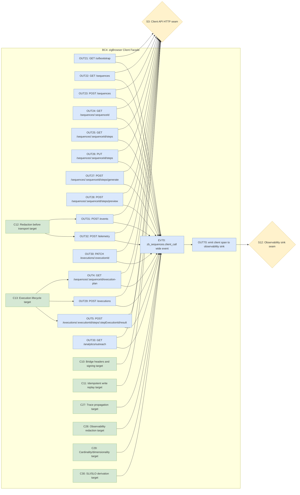
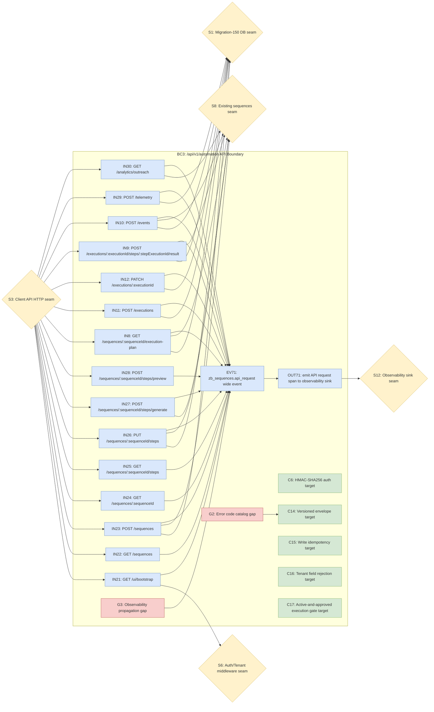
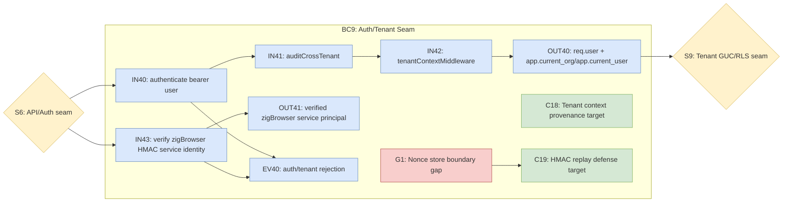
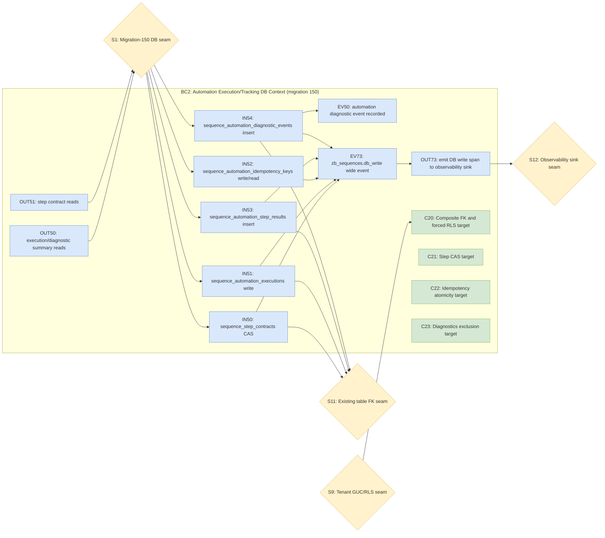
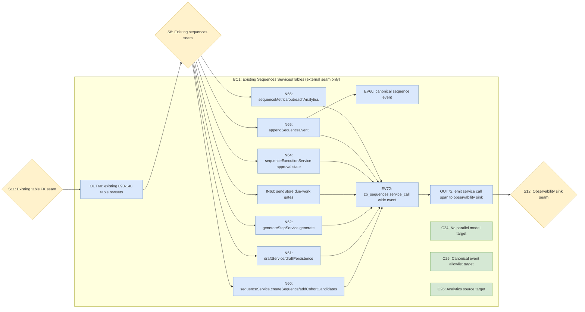
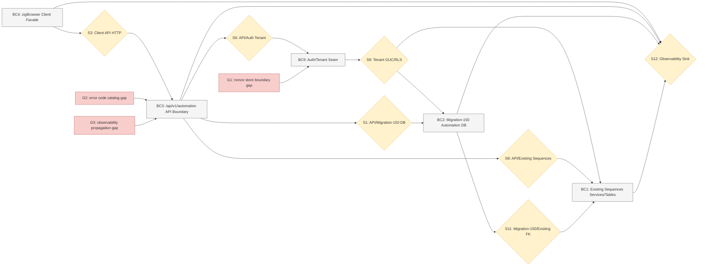

# zb-sequences-v1 Bridge Spec

**Date:** 2026-07-10
**Contract:** `zb-sequences-v1`
**Backend base path:** `/api/v1/automation`
**Purpose:** single handoff contract between zigBrowser automation/dashboard code and the sequences backend. The sequences session implements these endpoints; the zigBrowser session consumes them.

This spec supersedes the reviewed 2026-07-09 API-layer plan by grounding the contract in the live sequences backend at commit `bf640403` and baking in the review hardening: tenant-safe composite FKs, active-and-approved execution planning, durable step versioning with compare-and-swap, and explicit idempotent replay/conflict behavior for every write.

The user-facing shorthand says "14 endpoints." This document preserves that as 14 endpoint groups; the sequence collection group contains both `GET` and `POST` on `/sequences`, so the expanded HTTP operation count is 15.

## Source Grounding

All implementation must wrap the existing sequences model and services. Do not create parallel sequence, enrollment, message, event, mailbox, or analytics tables.

Primary live sources:

- Auth mount order: `/home/maceo/ntm_Dev/sequences/backend/server.js:426-432`.
- Existing sequence routes: `/home/maceo/ntm_Dev/sequences/backend/routes/sequences.js:71-188`.
- Metrics routes: `/home/maceo/ntm_Dev/sequences/backend/routes/sequenceMetrics.js:87-95`.
- Continuity routes: `/home/maceo/ntm_Dev/sequences/backend/routes/sequenceContinuity.js:29-42`.
- Webhook idempotency/envelope precedent: `/home/maceo/ntm_Dev/sequences/backend/routes/sequencesWebhook.js:48-120`.
- ATS error/idempotency precedent: `/home/maceo/ntm_Dev/sequences/backend/routes/sequencesAts.js:28-44`.
- Sequence creation/cohort service: `/home/maceo/ntm_Dev/sequences/backend/services/sequences/sequenceService.js:29-72`, `/home/maceo/ntm_Dev/sequences/backend/services/sequences/sequenceService.js:81-113`, `/home/maceo/ntm_Dev/sequences/backend/services/sequences/sequenceService.js:286-301`.
- Draft persistence and `DraftGenerated`: `/home/maceo/ntm_Dev/sequences/backend/services/sequences/draftService.js:92-146`, `/home/maceo/ntm_Dev/sequences/backend/services/sequences/draftPersistence.js:51-84`.
- Side-effect-free authoring generation: `/home/maceo/ntm_Dev/sequences/backend/services/sequences/generateStepService.js:329-463`.
- Send approval gate and provider-backed `MessageSent`: `/home/maceo/ntm_Dev/sequences/backend/services/sequences/sequenceExecutionService.js:49-123`, `/home/maceo/ntm_Dev/sequences/backend/services/sequences/sequenceExecutionService.js:175-286`.
- Due-work gate: `/home/maceo/ntm_Dev/sequences/backend/services/sequences/sendStore.js:14-28`, `/home/maceo/ntm_Dev/sequences/backend/services/sequences/sendStore.js:30-39`.
- Send payload and canonical required fields: `/home/maceo/ntm_Dev/sequences/backend/services/sequences/sendPayload.js:1-12`, `/home/maceo/ntm_Dev/sequences/backend/services/sequences/sendPayload.js:56-101`.
- Event allowlist and required payloads: `/home/maceo/ntm_Dev/sequences/backend/services/sequenceEvents/eventTypes.js:1-65`.
- Canonical event append and dedupe: `/home/maceo/ntm_Dev/sequences/backend/services/sequenceEvents/eventService.js:25-31`, `/home/maceo/ntm_Dev/sequences/backend/sequences_db.js:4-49`.
- Metrics over `sequence_events`: `/home/maceo/ntm_Dev/sequences/backend/services/sequenceMetrics/metricsService.js:189-320`, `/home/maceo/ntm_Dev/sequences/backend/services/sequenceMetrics/metricsService.js:322-400`.
- Outreach analytics service: `/home/maceo/ntm_Dev/sequences/backend/services/sequenceMetrics/outreachAnalyticsService.js:602-740`.
- Schema/RLS patterns: `/home/maceo/ntm_Dev/sequences/database/migrations/090_sequences_foundation.sql:17-165`, `/home/maceo/ntm_Dev/sequences/database/migrations/110_sequences_engine.sql:149-187`, `/home/maceo/ntm_Dev/sequences/database/migrations/110_sequences_engine.sql:391-445`, `/home/maceo/ntm_Dev/sequences/database/migrations/120_sequences_ats_crm.sql:3-131`, `/home/maceo/ntm_Dev/sequences/database/migrations/130_sequence_tracking.sql:18-126`, `/home/maceo/ntm_Dev/sequences/database/migrations/140_outreach_analytics_scope.sql:12-49`.

## Cross-Cutting Contract

### Version Header

Every request must include:

```http
X-ZB-Sequences-Version: zb-sequences-v1
```

Every response, including errors, must echo:

```http
X-ZB-Sequences-Version: zb-sequences-v1
```

Missing or mismatched version returns:

```json
{ "error": { "code": "AUTOMATION_VERSION_UNSUPPORTED", "message": "X-ZB-Sequences-Version must be zb-sequences-v1." } }
```

Use HTTP `400` for a missing or unsupported version. Do not silently fall forward to a later contract.

### Auth And Tenant Context

`/api/v1/automation` must mount below the existing `/api/v1/` chain:

```text
authenticate -> auditCrossTenant -> tenantContextMiddleware -> automation routes
```

This is the same chain currently applied at `/home/maceo/ntm_Dev/sequences/backend/server.js:426-432`. The route-level automation middleware validates zigBrowser service identity, but it must not derive tenant scope. Tenant scope remains `req.user.orgId` plus the `app.current_org`/`app.current_user` GUCs installed by `tenantContextMiddleware`.

Required user/session header:

```http
Authorization: Bearer <delegated-user-session-token>
```

Required HMAC service headers when the auth matrix below says "HMAC required":

```http
X-ZB-Client-Id: <registered zigBrowser client id>
X-ZB-Timestamp: <unix milliseconds>
X-ZB-Nonce: <base64url 128-bit nonce>
X-ZB-Signature: v1=<base64url hmac-sha256>
```

Signature base string:

```text
v1
<UPPERCASE_METHOD>
<path-and-query-exactly-as-sent>
<x-zb-timestamp>
<x-zb-nonce>
<sha256-hex-of-raw-request-body-or-empty-string>
```

The backend must reject stale timestamps, reused nonces, unknown client ids, invalid signatures, a missing delegated user for user-owned operations, and any request body/query/path field attempting to supply `orgId`, `org_id`, `tenantId`, or `tenant_id`.

Auth matrix:

| Endpoint group | User session | HMAC service auth |
|---|---:|---:|
| `GET /ui/bootstrap` | Required | Optional; validate if present |
| `GET /sequences` | Required | Optional; validate if present |
| `POST /sequences` | Required | Required |
| `GET /sequences/:sequenceId` | Required | Optional; validate if present |
| `GET /sequences/:sequenceId/steps` | Required | Optional; validate if present |
| `PUT /sequences/:sequenceId/steps` | Required | Required |
| `POST /sequences/:sequenceId/steps/generate` | Required | Required |
| `POST /sequences/:sequenceId/steps/preview` | Required | Optional; validate if present |
| `GET /sequences/:sequenceId/execution-plan` | Required | Required |
| `POST /executions` | Required | Required |
| `PATCH /executions/:executionId` | Required | Required |
| `POST /executions/:executionId/steps/:stepExecutionId/result` | Required | Required |
| `POST /events` | Required | Required |
| `POST /telemetry` | Required | Required |
| `GET /analytics/outreach` | Required | Optional; validate if present |

### Live-Run Backend Configuration

The HMAC contract above is verifiable only when the backend `/api/v1/automation` mount is wired with two stores and captures raw request bytes. These are the operational requirements for a real signed round-trip (proven against a live smoke test).

- **Client registry + nonce store.** The HMAC middleware needs a client registry (id -> secret) and a nonce store wired into the `/api/v1/automation` mount. For dev/smoke, client secrets are configured via env `ZB_AUTOMATION_CLIENTS="clientId:secret,clientId2:secret2"` — the first `:` splits id from secret, and secrets must not contain `,`. Production must resolve secrets from a secret store, not this env var.
- **Unknown client id.** A request whose `X-ZB-Client-Id` is not in the registry must yield a clean `401 ZIGBROWSER_SIGNATURE_INVALID`, never a crash.
- **Raw-body capture (critical gotcha).** The `bodyHash` in the signature base string is computed over the **raw request bytes** (see Canonical Hashing & Signing). The server must capture those bytes before JSON parsing — e.g. `express.json({ verify: (req, _res, buf) => { req.rawBody = buf } })` — and hash `req.rawBody`. If the raw bytes are not captured, the server hashes empty bytes and every signed write with a body fails signature verification. This was a real bug found and fixed during the live smoke.
- **Attribution rows must exist.** A signed `POST /events` MessageSent round-trip requires the referenced `sequence`, `enrollment`, and `message` rows to already exist under the caller's org; otherwise the write returns `422 EVENT_ATTRIBUTION_INVALID`.

### Error Envelope

Errors must use the sequences convention:

```json
{
  "error": {
    "code": "AUTOMATION_CONTRACT_INVALID",
    "message": "Request body does not match zb-sequences-v1.",
    "retryable": false,
    "requestId": "req_123",
    "traceId": "zb_trace_123",
    "commandId": "zb_cmd_123",
    "details": {}
  }
}
```

Only `code` and `message` are required. `retryable`, `requestId`, `traceId`, `commandId`, and `details` are optional but must be present when known.

Common codes:

| HTTP | Code | Retryable | Meaning |
|---:|---|---:|---|
| 400 | `AUTOMATION_CONTRACT_INVALID` | false | Schema, enum, or cross-field validation failed. |
| 400 | `AUTOMATION_VERSION_UNSUPPORTED` | false | Missing or wrong `X-ZB-Sequences-Version`. |
| 401 | `AUTH_REQUIRED` | false | User/session auth missing or invalid. |
| 401 | `ZIGBROWSER_SIGNATURE_INVALID` | false | HMAC headers missing, stale, replayed, or invalid. |
| 403 | `FORBIDDEN` | false | Authenticated principal cannot access the tenant object. |
| 404 | `SEQUENCE_NOT_FOUND` | false | Sequence absent or hidden by tenant scope. |
| 404 | `ENROLLMENT_NOT_FOUND` | false | Enrollment absent or hidden by tenant scope. |
| 404 | `MESSAGE_NOT_FOUND` | false | Message absent or hidden by tenant scope. |
| 404 | `EXECUTION_NOT_FOUND` | false | Automation execution absent or hidden by tenant scope. |
| 409 | `IDEMPOTENCY_CONFLICT` | false | Same idempotency key reused for a different canonical request hash. |
| 409 | `STEP_VERSION_CONFLICT` | false | `expectedVersion` does not match `sequence_step_contracts.version`. |
| 409 | `SEQUENCE_NOT_EXECUTABLE` | false | Sequence is not `active`, lacks `approved_at`, is archived/paused/suppressed, or has no eligible due work. |
| 422 | `EVENT_TYPE_UNSUPPORTED` | false | Event type is not accepted by `eventTypes.js` and the DB CHECK. |
| 422 | `EVENT_ATTRIBUTION_INVALID` | false | Canonical event lacks required sequence/enrollment/message attribution. |
| 422 | `TELEMETRY_REDACTION_FAILED` | false | Telemetry contains raw selectors, raw body, tokens, cookies, candidate PII, or raw URLs. |
| 429 | `RATE_LIMITED` | true | Backend rate limit or tenant send cap blocked the operation. |
| 500 | `DB_WRITE_FAILED` | true | Backend write failed after validation. |
| 503 | `SEQUENCES_BACKEND_UNAVAILABLE` | true | Dependency outage or maintenance. |

### Idempotency-Key Semantics

All state-changing writes require:

```http
Idempotency-Key: <stable client-generated key>
```

The backend stores write idempotency in `sequence_automation_idempotency_keys` from migration 150 unless a resource table also has a stronger uniqueness constraint. The canonical request hash must include:

- normalized request body,
- effective actor user id,
- effective org id,
- HTTP method,
- endpoint template, not raw URL,
- path parameters,
- query parameters that affect behavior,
- `X-ZB-Sequences-Version`.

Replay rules:

- Same org, actor, method, endpoint template, idempotency key, and request hash returns the original success response with `duplicate: true`.
- Same org, actor, method, endpoint template, and idempotency key with a different request hash returns `409 IDEMPOTENCY_CONFLICT`.
- Validation/auth failures must not create durable idempotency rows.
- Once a write transaction starts, the resource mutation and idempotency row commit together or roll back together.
- Stored idempotency responses must not include raw selectors, raw typed text, cookies, auth tokens, raw screenshots, or candidate PII.

Write-path replay matrix:

| Write | Replay behavior | Conflict behavior |
|---|---|---|
| `POST /sequences` | Returns same `sequenceId`, `status`, and `duplicate: true`. | Blocks a second draft create with the same key and different hash. |
| `PUT /sequences/:sequenceId/steps` | Returns the original post-save `version` and serialized response even if current version advanced later. | Same key different body returns `IDEMPOTENCY_CONFLICT`; new key with stale `expectedVersion` returns `STEP_VERSION_CONFLICT`. |
| `POST /sequences/:sequenceId/steps/generate` | Returns same generated step response; no sequence state mutation is replayed. | Same key different generation inputs returns `IDEMPOTENCY_CONFLICT`. |
| `POST /executions` | Returns same `executionId`; `sequence_automation_executions` also enforces `(org_id, external_run_id)`. | Same key or same external run id with different hash returns `IDEMPOTENCY_CONFLICT`. |
| `PATCH /executions/:executionId` | No-op replay returning the original transition response. | Same key different transition body returns `IDEMPOTENCY_CONFLICT`. |
| `POST /executions/:executionId/steps/:stepExecutionId/result` | Returns same step result and canonical/diagnostic event outcome. | Same key different body or same `(execution_id, step_execution_id)` with incompatible body returns `IDEMPOTENCY_CONFLICT`. |
| `POST /events` | Returns same batch result. Canonical items also dedupe through `sequence_events(org_id, dedup_key)`. Diagnostic items dedupe through `sequence_automation_diagnostic_events(org_id, dedup_key)`. | Same request key with different batch hash returns `IDEMPOTENCY_CONFLICT`; same item `dedupKey` with different canonical payload returns item `conflict`. |
| `POST /telemetry` | Returns same accepted/rejected counts and per-item diagnostics. | Same key different telemetry body returns `IDEMPOTENCY_CONFLICT`. |

`POST /steps/preview` is specified as read-only and must not persist rendered body text, so it does not require `Idempotency-Key`. If implementation later persists preview audits, that endpoint becomes a write and must adopt the idempotency contract.

### Canonical Hashing & Signing (NORMATIVE)

Every hash and signature in `zb-sequences-v1` uses these exact primitives so the zigBrowser client and the sequences backend produce **byte-identical** results. Where any earlier prose says "normalized request body" or `sha256:...`, this section is the authoritative definition.

**Primitives**

- `SHA256(b)` = SHA-256 over bytes `b`. `hex(d)` = lowercase hex of digest `d` (no `0x`, no uppercase).
- `H(s)` = `"sha256:" + hex(SHA256(utf8(s)))` for a string `s`. UTF-8, no BOM. Every spec field shaped `sha256:<hex>` is produced by `H(...)`.
- `Hbytes(b)` = `hex(SHA256(b))` for raw bytes `b` — bare lowercase hex, **no** `sha256:` prefix. Used only inside the signature base string.
- `JCS(obj)` = RFC 8785 JSON Canonicalization Scheme (sorted keys, minimal whitespace, ECMAScript number formatting, UTF-8).
- Multi-line base strings join with a single `LF` (U+000A), **no trailing newline**.
- **Empty request body** hashes to the SHA-256 of zero bytes: `e3b0c44298fc1c149afbf4c8996fb92427ae41e4649b934ca495991b7852b855`.
- `base64url` = RFC 4648 §5, **no padding**.

**1. `bodyHash`** (shared by signing and idempotency): `bodyHash = Hbytes(raw_request_body_bytes)`, or the empty-body constant above when there is no body. The client hashes the exact bytes it transmits; the server hashes the exact bytes it received **before any parsing or normalization**. Never re-serialize JSON before hashing the body.

**2. HMAC signature** (`X-ZB-Signature: v1=<sig>`) — client computes, server verifies, so it MUST match:

```text
base = join(LF):
  "v1"
  <UPPERCASE HTTP method>
  <request-target exactly as sent: path, plus "?"+query when present, no fragment>
  <X-ZB-Timestamp value>
  <X-ZB-Nonce value>
  <bodyHash>
X-ZB-Signature = "v1=" + base64url( HMAC_SHA256(client_shared_secret, utf8(base)) )
```

**3. `canonicalRequestHash`** (idempotency conflict detection; server-computed and deterministic — the client never computes it, it only retries byte-identically with the same `Idempotency-Key`): `canonicalRequestHash = H( JCS(R) )`, stored in `sequence_automation_idempotency_keys.request_hash`, where `R` is:

```json
{
  "actor": "<effective actor user id>",
  "body": "<bodyHash>",
  "endpoint": "<UPPERCASE method> <mounted template path, e.g. /api/v1/automation/sequences/:sequenceId/steps>",
  "method": "<UPPERCASE HTTP method>",
  "org": "<effective org id>",
  "path": { "<param>": "<string value>" },
  "query": { "<behavior-affecting param>": "<string value>" },
  "v": "<X-ZB-Sequences-Version, e.g. zb-sequences-v1>"
}
```

`body` carries `bodyHash` (raw-byte hash) so JSON re-serialization can never diverge. `path`/`query` are string→string maps (`{}` when none); JCS sorts their keys. Include only behavior-affecting query params; pagination cursors are excluded from writes (writes carry none).

**4. Observability key hashes** (emitted by BOTH the client EV70 and the server EV71/EV73 — MUST match so spans correlate): `idempotency_key_hash = H(raw Idempotency-Key header value)`; `dedup_key_hash = H(raw item dedupKey)`. Raw keys are never emitted — only these hashes.

**5. `renderedHash`** (step-content identity for preview/CAS): `renderedHash = H(rendered_body_string)`, where `rendered_body_string` is the final rendered step body after variable substitution, exactly as the server persists and returns it. The server is the sole producer; the client treats it as opaque and compares by string equality.

### Pagination

List endpoints use cursor pagination:

```text
limit=50
cursor=<opaque>
```

Rules:

- `limit` default is `50`; max is `100`; min is `1`.
- `cursor` is opaque to clients. It must encode the stable sort tuple and filters needed for the next page.
- Cursor-bearing responses use `{ "items": [...], "nextCursor": "..." }`.
- A cursor created under one org/user/filter/version cannot be reused under another; return `400 AUTOMATION_CONTRACT_INVALID`.
- Stable sort for sequence lists is `updated_at DESC, id DESC` unless endpoint-specific semantics override it.

### Step Versioning And CAS

The durable API version for steps is `sequence_step_contracts.version` from migration 150. It is not derived from `sequence_messages.updated_at`, message count, or a client counter.

Rules:

- `GET /steps` bootstraps one `sequence_step_contracts` row under tenant context if none exists.
- Bootstrap reads current `sequence_messages` (`is_current = true`) and serializes them into the step contract. If no current messages exist, `version = 0` and `steps = []`.
- `PUT /steps` runs in one transaction: lock the `sequence_step_contracts` row with `FOR UPDATE`, compare `expectedVersion`, validate all referenced mailboxes/messages/enrollments under `org_id`, update/supersede `sequence_messages` as needed, replace `steps`, increment `version` by exactly one, store the idempotency response, and commit.
- Stale `expectedVersion` returns `409 STEP_VERSION_CONFLICT` with `currentVersion`; no partial message writes are allowed.
- Approved/active and archived sequences are immutable for authoring. Save is allowed only while sequence status is `draft` or `pending_approval`.

### Canonical Events Versus Diagnostics

Canonical product outcomes must land in `sequence_events` through `appendSequenceEvent`, which validates event types and required payloads in `/home/maceo/ntm_Dev/sequences/backend/services/sequenceEvents/eventTypes.js:43-65` and dedupes via `/home/maceo/ntm_Dev/sequences/backend/sequences_db.js:11-49`.

Automation diagnostics must land in `sequence_automation_diagnostic_events` from migration 150 and must never feed `sequence_metrics_rollup`.

Accepted canonical event types for this bridge:

```text
MessageSent
MessageDelivered
MessageOpened
LinkClicked
ReplySynced
BounceSynced
SuppressionApplied
EnrollmentStopped
AtsWritebackSucceeded
AtsWritebackFailed
CandidateConverted
```

`MessageOpened`, `LinkClicked`, and `MessageDelivered` are already present in migration 130 and `eventTypes.js` at `/home/maceo/ntm_Dev/sequences/database/migrations/130_sequence_tracking.sql:18-42` and `/home/maceo/ntm_Dev/sequences/backend/services/sequenceEvents/eventTypes.js:15-20`. Migration 150 must not fork that allowlist.

### Bridge Observability Contract

The bridge treats OpenTelemetry spans as wide events, not as pre-aggregated metrics counters. Every critical unit of work emits one flat, high-dimensional span with enough context to support the core analysis loop: define the failing population, visualize latency/error shape, investigate by grouping and diffing dimensions, then evaluate the suspected cause.

Required span units:

| Tier | Wide event | Unit of work | Required correlation |
|---|---|---|---|
| zigBrowser client | `EV70 zb_sequences.client_call` | One client facade call to `/api/v1/automation` | `trace_id`, `command_id` when known, `execution_id` once known, idempotency key hash for writes |
| API boundary | `EV71 zb_sequences.api_request` | One `/api/v1/automation` request/response | Same `trace_id`; `request_id`; `command_id`/`execution_id` copied from body, path resource, or existing execution row |
| Wrapped service | `EV72 zb_sequences.service_call` | One wrapped existing sequences service operation | Same `trace_id`; service operation; sequence/enrollment/message ids when touched |
| DB write | `EV73 zb_sequences.db_write` | One bridge-owned transaction or durable write to migration-150 tables | Same `trace_id`; `execution_id`; table/operation; idempotency and request hashes |

Metrics and logs are derivative views of these spans. Metrics may be computed from the wide events for alerting and SLO burn, but instrumentation must preserve the raw span attributes rather than emitting only counters. Logs may include `trace_id`, `span_id`, `request_id`, and error code for audit/debugging, but logs are not the primary correlation contract.

Trace propagation rules:

- zigBrowser starts or joins the trace before the client facade call. It forwards W3C `traceparent`/`tracestate` when available and includes the existing automation `trace.traceId` in execution/event/telemetry bodies.
- The API extracts the inbound trace context, records it on `EV71`, and passes it to wrapped service calls and DB writes. If both W3C trace context and a legacy automation trace id are present, spans record `trace_id` for the propagated trace and `automation_trace_id` for the existing automation telemetry id.
- `command_id` is nullable until a browser command exists, but once a request body or telemetry item supplies it, downstream `EV71`, `EV72`, and `EV73` spans must preserve it exactly.
- `execution_id` is nullable before `POST /executions` commits. After an execution exists, every update, step result, event ingest, telemetry ingest, service call, and DB write span for that execution must include the same `execution_id`.
- Error envelopes continue to expose `traceId` and `commandId` when known, allowing users to jump from API failures to the automation telemetry stream.

Cardinality contract:

| Attribute | Cardinality | Handling |
|---|---|---|
| `trace_id`, `span_id`, `parent_span_id`, `automation_trace_id`, `command_id`, `execution_id`, `sequence_id`, `step_execution_id`, `external_run_id`, `org_id`, `tenant`, `actor_user_id`, `idempotency_key_hash`, `dedup_key_hash`, `request_id` | High | Preserve as queryable span attributes. Hash raw idempotency/dedup keys before emission. |
| `endpoint` when it is an endpoint template, `http.method`, `http.status_code`, `error.class`, `error.code`, `retryable`, `duplicate`, `event_type`, `service.name`, `service.operation`, `db.table`, `db.operation`, `status` | Low or bounded | Preserve directly; use templates/enums rather than raw URLs or free-form strings. |
| Raw URL, raw query string, raw selector, message subject/body, candidate name/email/phone, tenant display name/domain, auth token, cookie, signature | Unbounded or sensitive | Denied before any trace, log, diagnostic, idempotency, or analytics sink. Emit only approved hashes, enums, or counts. |

Privacy and redaction deny-list before any sink:

- Authorization headers, cookies, session tokens, provider tokens, HMAC signatures, API keys, and refresh tokens.
- Raw selectors, raw typed text, unbounded DOM text, screenshots, raw URLs with paths or query strings, and browser storage dumps.
- Raw message bodies, rendered body snapshots, rendered subjects, generation prompts that contain candidate or tenant PII, and preview output.
- Candidate PII including names, email addresses, phone numbers, profile URLs, resumes, and free-form notes.
- Tenant PII including tenant display names, domains, billing data, and customer-specific free-form labels. `tenant` in spans must be an opaque tenant key or hash.

If an inbound `/telemetry` item contains deny-listed data, reject it with `TELEMETRY_REDACTION_FAILED`. If internally generated instrumentation detects a deny-listed value, suppress the value before emission, set `redaction.suppressed=true`, and emit only the safe hash/classification needed for debugging.

Critical-path SLIs and candidate SLOs:

| Critical path | SLI from wide events | Candidate SLO |
|---|---|---|
| Execution create (`POST /executions`) | Valid non-conflicting `EV71` requests with `endpoint=POST /executions` and `http.status_code < 500` divided by valid non-conflicting attempts; latency from paired `EV71.duration_ms` | 99.5% success over 30 days and p95 API latency under 750 ms |
| Event ingest (`POST /events`) | Accepted item count from `EV71`/`EV73` divided by valid submitted items; ingest age from `EV73.event.ingest_age_ms` or `EV73.event.created_at - EV73.event.occurred_at` for canonical and diagnostic items | 99.0% of valid items durable within 60 seconds and p95 API latency under 500 ms |
| Analytics read (`GET /analytics/outreach`) | Successful `EV71` reads with `endpoint=GET /analytics/outreach`, `http.status_code=200`, and `EV72.service.operation=outreachAnalytics` divided by valid reads; latency from `EV71.duration_ms` and `EV72.duration_ms` | 99.5% success over 30 days, p95 API latency under 2 seconds, and p95 service latency under 1.5 seconds |

## Endpoint Groups

### 1. UI Bootstrap

**Method/path:** `GET /api/v1/automation/ui/bootstrap`
**Auth:** user session required; HMAC optional but validated if present.
**Wraps:** existing auth/tenant chain (`server.js:426-432`), `mailbox_connections` (`110_sequences_engine.sql:26-45`), outreach analytics defaults (`outreachAnalyticsService.js:602-641`).

Request:

```text
include=mailboxes,featureFlags,analyticsDefaults
```

Response:

```json
{
  "apiVersion": "zb-sequences-v1",
  "actor": {
    "userId": "usr_123",
    "orgId": "org_123",
    "roles": ["sequence_admin"]
  },
  "featureFlags": {
    "sequenceCreation": true,
    "stepAuthoring": true,
    "automationExecution": true,
    "analytics": true
  },
  "mailboxes": [
    {
      "mailboxConnectionId": "mbx_123",
      "provider": "gmail",
      "status": "connected",
      "dailyCapRemaining": 120
    }
  ],
  "analyticsDefaults": {
    "dateRangeDays": 30,
    "groupBy": "week"
  }
}
```

Errors: `AUTH_REQUIRED`, `FORBIDDEN`, `AUTOMATION_VERSION_UNSUPPORTED`, `SEQUENCES_BACKEND_UNAVAILABLE`.

Idempotency: read-only; no `Idempotency-Key`.

### 2. Sequence Collection: List And Create Draft

#### 2A. List Sequences

**Method/path:** `GET /api/v1/automation/sequences`
**Auth:** user session required; HMAC optional but validated if present.
**Wraps:** `sequences` (`090_sequences_foundation.sql:17-29`), `sequence_enrollments` (`090_sequences_foundation.sql:35-71`), continuity dashboard query (`dashboardService.js:41-85`), metrics from `sequence_events` (`metricsService.js:368-400`), optional execution summaries from migration-150 automation tables.

Request query:

```text
status=draft,pending_approval,active,archived
ownerUserId=usr_123
jobId=job_123
workspaceSearchId=ws_123
include=metrics,executionSummary
limit=50
cursor=<opaque>
```

Response:

```json
{
  "items": [
    {
      "sequenceId": "seq_123",
      "name": "Senior Backend Search",
      "status": "draft",
      "ownerUserId": "usr_123",
      "jobId": "job_123",
      "workspaceSearchId": "ws_123",
      "createdAt": "2026-07-09T16:00:00.000Z",
      "updatedAt": "2026-07-09T16:05:00.000Z",
      "metrics": {
        "profilesContacted": 0,
        "openRate": null,
        "clickRate": null,
        "replyRate": null,
        "bounceRate": null
      },
      "executionSummary": {
        "dueSteps": 0,
        "runningExecutions": 0,
        "lastExecutionStatus": null
      }
    }
  ],
  "nextCursor": null
}
```

Errors: `AUTH_REQUIRED`, `FORBIDDEN`, `AUTOMATION_CONTRACT_INVALID`, `AUTOMATION_VERSION_UNSUPPORTED`.

Idempotency: read-only; no `Idempotency-Key`.

#### 2B. Create Draft Sequence

**Method/path:** `POST /api/v1/automation/sequences`
**Auth:** user session and HMAC required.
**Wraps:** `createSequence` (`sequenceService.js:29-72`), optional `addCohortCandidates` (`sequenceService.js:81-92`, `sequenceService.js:286-301`), `sequences` (`090_sequences_foundation.sql:17-29`), `sequence_enrollments` (`090_sequences_foundation.sql:35-71`), canonical `SequenceCreated` event (`sequenceService.js:52-59`).

Headers: `Idempotency-Key` required.

Request body:

```json
{
  "name": "Senior Backend Search",
  "jobId": "job_123",
  "workspaceSearchId": "ws_123",
  "source": {
    "kind": "workspace_search",
    "ref": "ws_123"
  },
  "initialAudience": {
    "candidateRefs": [
      { "source": "workspace", "refId": "wc_123" }
    ],
    "overrideDuplicatesFor": []
  }
}
```

Rules:

- `name` is required and trimmed by the existing service.
- Client must not send `orgId`, `ownerUserId`, or tenant fields. Owner is the delegated user from tenant context.
- If `initialAudience` is present, bridge maps it to `addCohortCandidates`.

Response:

```json
{
  "sequenceId": "seq_123",
  "status": "draft",
  "createdAt": "2026-07-09T16:00:00.000Z",
  "cohortSummary": {
    "selected": 1,
    "contactable": 1,
    "missingContact": 0,
    "suppressedOrDuplicate": 0,
    "skipped": []
  },
  "duplicate": false
}
```

Errors: `AUTH_REQUIRED`, `ZIGBROWSER_SIGNATURE_INVALID`, `FORBIDDEN`, `AUTOMATION_CONTRACT_INVALID`, `IDEMPOTENCY_CONFLICT`, `DB_WRITE_FAILED`.

Idempotency: replay returns same `sequenceId` and `duplicate: true`; conflict blocks a second create.

### 3. Sequence Detail

**Method/path:** `GET /api/v1/automation/sequences/:sequenceId`
**Auth:** user session required; HMAC optional but validated if present.
**Wraps:** `sequences`, `sequence_enrollments`, `sequence_messages`, `sequence_events`, `mailbox_connections`, `getCohortSummary` (`sequenceService.js:99-113`), continuity metrics (`sequenceContinuity/metricsService.js:67-97`), optional automation execution tables from migration 150.

Request query:

```text
include=cohort,steps,metrics,executionSummary,mailboxes
```

Response:

```json
{
  "sequence": {
    "sequenceId": "seq_123",
    "name": "Senior Backend Search",
    "status": "draft",
    "ownerUserId": "usr_123",
    "jobId": "job_123",
    "workspaceSearchId": "ws_123",
    "approvedAt": null
  },
  "cohort": {
    "included": 25,
    "skipped": 3,
    "preview": [
      {
        "enrollmentId": "enr_123",
        "candidateSource": "workspace",
        "workspaceCandidateId": "wc_123",
        "contactStatus": "ready"
      }
    ]
  },
  "steps": [],
  "metrics": null,
  "executionSummary": null
}
```

Errors: `AUTH_REQUIRED`, `FORBIDDEN`, `SEQUENCE_NOT_FOUND`, `AUTOMATION_CONTRACT_INVALID`.

Idempotency: read-only.

### 4. Get Steps

**Method/path:** `GET /api/v1/automation/sequences/:sequenceId/steps`
**Auth:** user session required; HMAC optional but validated if present.
**Wraps:** `sequence_step_contracts` from migration 150, current `sequence_messages` (`090_sequences_foundation.sql:97-134`, `110_sequences_engine.sql:74-145`), side-effect-free bootstrap serialization under tenant context.

Response:

```json
{
  "sequenceId": "seq_123",
  "version": 3,
  "steps": [
    {
      "stepId": "step_1",
      "kind": "email",
      "index": 0,
      "replyMode": "stop_on_reply",
      "waitBefore": null,
      "senderMailboxId": "mbx_123",
      "subject": "Quick question",
      "body": "Hi {{first_name}}, ...",
      "tokens": ["first_name"],
      "signatureId": null,
      "includeUnsubscribe": true,
      "groundingStatus": "grounded",
      "evidenceMap": [],
      "reviewQueue": [],
      "status": "draft",
      "messageId": "msg_123"
    },
    {
      "stepId": "step_2",
      "kind": "wait",
      "index": 1,
      "duration": 3,
      "unit": "days"
    }
  ]
}
```

Errors: `AUTH_REQUIRED`, `FORBIDDEN`, `SEQUENCE_NOT_FOUND`, `DB_WRITE_FAILED` if bootstrap row creation fails.

Idempotency: read-only. Bootstrap row creation is internal and must be idempotent on `(org_id, sequence_id)`.

### 5. Save Steps

**Method/path:** `PUT /api/v1/automation/sequences/:sequenceId/steps`
**Auth:** user session and HMAC required.
**Wraps:** `sequence_step_contracts` from migration 150, `sequence_messages` current/supersede storage (`draftPersistence.js:61-84` pattern; table at `090_sequences_foundation.sql:97-134`), mailbox ownership via `mailbox_connections` (`110_sequences_engine.sql:26-45`).

Headers: `Idempotency-Key` required.

Request body:

```json
{
  "expectedVersion": 3,
  "steps": [
    {
      "stepId": "step_1",
      "kind": "email",
      "index": 0,
      "replyMode": "stop_on_reply",
      "waitBefore": null,
      "senderMailboxId": "mbx_123",
      "subject": "Quick question",
      "body": "Hi {{first_name}}, ...",
      "tokens": ["first_name"],
      "signatureId": null,
      "includeUnsubscribe": true
    }
  ]
}
```

Validation:

- `expectedVersion` required integer, `>= 0`.
- `steps` indexes must be contiguous from zero.
- `kind` is `email` or `wait`.
- Email steps require `subject`, `body`, `senderMailboxId`, `includeUnsubscribe: true`, and tokens resolvable by backend token rules.
- Wait steps require positive duration and unit `minutes`, `hours`, or `days`.
- Sequence status must be `draft` or `pending_approval`.
- All ids are checked by composite `(org_id, id)` lookup, never bare UUID lookup.

Response:

```json
{
  "sequenceId": "seq_123",
  "version": 4,
  "validation": {
    "status": "valid",
    "warnings": []
  },
  "steps": [],
  "duplicate": false
}
```

Errors: `AUTH_REQUIRED`, `ZIGBROWSER_SIGNATURE_INVALID`, `FORBIDDEN`, `SEQUENCE_NOT_FOUND`, `AUTOMATION_CONTRACT_INVALID`, `STEP_VERSION_CONFLICT`, `IDEMPOTENCY_CONFLICT`, `DB_WRITE_FAILED`.

Idempotency: same key/hash returns original response and `duplicate: true`; different hash returns `IDEMPOTENCY_CONFLICT`; a new key with stale `expectedVersion` returns `STEP_VERSION_CONFLICT` and must leave `sequence_messages` unchanged.

### 6. Generate Step Draft

**Method/path:** `POST /api/v1/automation/sequences/:sequenceId/steps/generate`
**Auth:** user session and HMAC required.
**Wraps:** live side-effect-free authoring generation route/service: `sequences.js:111-127`, `generateStepService.js:87-167`, `generateStepService.js:176-213`, `generateStepService.js:329-463`, `groundedOutreachGeneration.js:22-49`, `draftPersistence.callDraft` (`draftPersistence.js:129-147`).

Headers: `Idempotency-Key` required because this consumes LLM capacity and stores idempotency metadata, even though it must not mutate sequence state.

Request body:

```json
{
  "requestId": "zb_gen_123",
  "target": {
    "enrollmentId": "enr_123",
    "senderMailboxConnectionId": "mbx_123"
  },
  "instruction": "Add a concise intro email referencing the candidate's backend work.",
  "currentSteps": [
    {
      "id": "step_1",
      "type": "email",
      "index": 0,
      "subject": "Quick question",
      "body": "Hi {{first_name}}, ...",
      "replyMode": "stop_on_reply"
    }
  ],
  "selectedStepId": "step_1",
  "insertionIndex": 1
}
```

Response:

```json
{
  "requestId": "zb_gen_123",
  "sequenceId": "seq_123",
  "enrollmentId": "enr_123",
  "generatedStep": {
    "stepId": "step_generated_123",
    "kind": "email",
    "index": 1,
    "status": "draft",
    "subject": "Quick question",
    "body": "Hi Ada, ...",
    "replyMode": "stop_on_reply",
    "includeUnsubscribe": true,
    "tokens": [],
    "groundingStatus": "grounded",
    "evidenceMap": [],
    "reviewQueue": [],
    "generatedBy": "ai"
  },
  "insertedAfterStepId": "step_1",
  "generation": {
    "groundingStatus": "grounded",
    "reviewQueue": [],
    "evidenceMap": []
  },
  "duplicate": false
}
```

Rules:

- This endpoint must not write `sequence_messages` or `sequence_events`; live service records `side_effects_skipped` at `/home/maceo/ntm_Dev/sequences/backend/services/sequences/generateStepService.js:442-445`.
- Durable authoring state changes occur only through `PUT /steps`.
- Backend rejects body fields that directly supply candidate identity outside `target.enrollmentId`, matching `/home/maceo/ntm_Dev/sequences/backend/services/sequences/generateStepService.js:92-95`.

Errors: `AUTH_REQUIRED`, `ZIGBROWSER_SIGNATURE_INVALID`, `SEQUENCE_NOT_FOUND`, `ENROLLMENT_NOT_FOUND`, `AUTOMATION_CONTRACT_INVALID`, `DRAFT_GROUNDING_VIOLATION`, `IDEMPOTENCY_CONFLICT`, `RATE_LIMITED`, `SEQUENCES_BACKEND_UNAVAILABLE`.

Idempotency: same key/hash returns the same generated step; different hash returns `IDEMPOTENCY_CONFLICT`.

### 7. Preview Step

**Method/path:** `POST /api/v1/automation/sequences/:sequenceId/steps/preview`
**Auth:** user session required; HMAC optional but validated if present.
**Wraps:** `sequence_step_contracts`, `sequence_messages`, enrollment/contact data in `sequence_enrollments`, but must not persist preview output. Rendering/validation must use the same token and mailbox checks as save.

Request body:

```json
{
  "enrollmentId": "enr_123",
  "stepId": "step_1",
  "overrides": {
    "subject": "Quick question",
    "body": "Hi {{first_name}}, ..."
  }
}
```

Response:

```json
{
  "rendered": {
    "subject": "Quick question",
    "bodyPreview": "Hi Ada, ...",
    "renderedHash": "sha256:..."
  },
  "validation": {
    "status": "valid",
    "warnings": []
  }
}
```

Rules:

- Logs, telemetry, and idempotency storage must not contain raw rendered body text.
- `bodyPreview` is returned only to the authenticated caller and should be truncated to the UI-safe preview limit. The full raw body must not be stored by this endpoint.

Errors: `AUTH_REQUIRED`, `FORBIDDEN`, `SEQUENCE_NOT_FOUND`, `ENROLLMENT_NOT_FOUND`, `MESSAGE_NOT_FOUND`, `AUTOMATION_CONTRACT_INVALID`.

Idempotency: read-only preview; no idempotency row.

### 8. Execution Plan

**Method/path:** `GET /api/v1/automation/sequences/:sequenceId/execution-plan`
**Auth:** user session and HMAC required.
**Wraps:** approval and due-work gates in `sendStore.listDueEnrollments` (`sendStore.js:14-28`), `sendStore.isApproved` (`sendStore.js:30-39`), approval state from `sequenceExecutionService.approveSequence` (`sequenceExecutionService.js:82-120`), current messages in `sequence_messages`, mailbox rows in `mailbox_connections`.

Request query:

```text
limit=25
mailboxConnectionId=mbx_123
dueBefore=2026-07-09T17:00:00.000Z
include=renderedMessage,pacingPolicy,candidateRefs
```

Response:

```json
{
  "sequence": {
    "sequenceId": "seq_123",
    "status": "active",
    "name": "Senior Backend Search",
    "approvedAt": "2026-07-09T15:55:00.000Z"
  },
  "executionPlanId": "plan_20260709_001",
  "generatedAt": "2026-07-09T16:00:00.000Z",
  "pacingPolicy": {
    "tenantDailyCapRemaining": 120,
    "mailboxDailyCapRemaining": 50,
    "minDelayMs": 1500,
    "maxDelayMs": 9000
  },
  "steps": [
    {
      "stepExecutionId": "sexec_123",
      "sequenceId": "seq_123",
      "enrollmentId": "enr_123",
      "messageId": "msg_123",
      "stepId": "step_1",
      "stepIndex": 0,
      "kind": "email",
      "action": "send_email",
      "candidate": {
        "candidateSource": "workspace",
        "candidateId": null,
        "workspaceCandidateId": "wc_123"
      },
      "mailbox": {
        "mailboxConnectionId": "mbx_123",
        "provider": "gmail",
        "status": "connected"
      },
      "renderedMessage": {
        "subject": "Quick question",
        "body": "Hi Ada, ...",
        "renderedHash": "sha256:..."
      },
      "idempotencySeed": "seq_123:enr_123:msg_123:step_1:attempt_1",
      "requiredCanonicalEvent": "MessageSent"
    }
  ]
}
```

Hard gate:

- Return executable work only when `sequences.status = 'active'` and `sequences.approved_at IS NOT NULL`.
- Enrollment must be `active`, `stop_reason IS NULL`, and `next_send_at <= dueBefore` or null, matching `/home/maceo/ntm_Dev/sequences/backend/services/sequences/sendStore.js:20-24`.
- Draft and `pending_approval` sequences return `409 SEQUENCE_NOT_EXECUTABLE`, not an empty executable plan.
- Suppressed, paused, stopped, bounced, over-cap, or not-due work is excluded.

Errors: `AUTH_REQUIRED`, `ZIGBROWSER_SIGNATURE_INVALID`, `FORBIDDEN`, `SEQUENCE_NOT_FOUND`, `SEQUENCE_NOT_EXECUTABLE`, `RATE_LIMITED`.

Idempotency: read-only. `executionPlanId` can be deterministic from sequence id, due window, filters, and generated timestamp bucket; creating an execution is the durable write.

### 9. Create Execution

**Method/path:** `POST /api/v1/automation/executions`
**Auth:** user session and HMAC required.
**Wraps:** new `sequence_automation_executions` and `sequence_automation_idempotency_keys` from migration 150; validates `sequence_id` via existing `sequences(org_id, id)` unique key (`110_sequences_engine.sql:52-62`).

Headers: `Idempotency-Key` required.

Request body:

```json
{
  "externalRunId": "zb_run_123",
  "sequenceId": "seq_123",
  "executionPlanId": "plan_20260709_001",
  "stepExecutionIds": ["sexec_123"],
  "zigBrowser": {
    "sessionIdHash": "sha256:...",
    "version": "0.1.0",
    "platform": "linux",
    "automationApi": "jsonrpc-uds"
  },
  "trace": {
    "traceId": "zb_trace_123",
    "commandId": null
  }
}
```

Response:

```json
{
  "executionId": "aexec_123",
  "status": "running",
  "duplicate": false,
  "createdAt": "2026-07-09T16:00:00.000Z"
}
```

Errors: `AUTH_REQUIRED`, `ZIGBROWSER_SIGNATURE_INVALID`, `FORBIDDEN`, `SEQUENCE_NOT_FOUND`, `SEQUENCE_NOT_EXECUTABLE`, `AUTOMATION_CONTRACT_INVALID`, `IDEMPOTENCY_CONFLICT`, `DB_WRITE_FAILED`.

Idempotency: same key/hash returns same execution. Same `(org_id, external_run_id)` with incompatible request hash returns `IDEMPOTENCY_CONFLICT`.

### 10. Update Execution

**Method/path:** `PATCH /api/v1/automation/executions/:executionId`
**Auth:** user session and HMAC required.
**Wraps:** `sequence_automation_executions` and `sequence_automation_idempotency_keys` from migration 150.

Headers: `Idempotency-Key` required.

Request body:

```json
{
  "status": "rate_limited",
  "lastStepExecutionId": "sexec_123",
  "lastErrorCode": "platform_rate_limited",
  "trace": {
    "traceId": "zb_trace_123",
    "commandId": "zb_cmd_456"
  },
  "occurredAt": "2026-07-09T16:01:00.000Z"
}
```

Allowed statuses: `queued`, `running`, `succeeded`, `failed`, `cancelled`, `rate_limited`, `paused`.

Response:

```json
{
  "executionId": "aexec_123",
  "status": "rate_limited",
  "updatedAt": "2026-07-09T16:01:00.000Z",
  "duplicate": false
}
```

Rules:

- This endpoint never appends canonical analytics events.
- Terminal statuses are `succeeded`, `failed`, and `cancelled`. Transitioning from a terminal status with a new key must return `409 EXECUTION_STATE_CONFLICT` unless the new status is identical and the body is semantically equivalent.

Errors: `AUTH_REQUIRED`, `ZIGBROWSER_SIGNATURE_INVALID`, `EXECUTION_NOT_FOUND`, `AUTOMATION_CONTRACT_INVALID`, `IDEMPOTENCY_CONFLICT`, `EXECUTION_STATE_CONFLICT`, `DB_WRITE_FAILED`.

Idempotency: replay returns original transition response; same key different body returns `IDEMPOTENCY_CONFLICT`.

### 11. Record Step Result

**Method/path:** `POST /api/v1/automation/executions/:executionId/steps/:stepExecutionId/result`
**Auth:** user session and HMAC required.
**Wraps:** new `sequence_automation_step_results`, canonical `appendSequenceEvent` (`eventService.js:25-31`), existing `sequence_events` (`110_sequences_engine.sql:149-187`), `eventTypes.js` required `MessageSent` payload fields (`eventTypes.js:24-41`), and sent-message field semantics from `sendPayload.js:56-101`.

Headers: `Idempotency-Key` required.

Request body:

```json
{
  "status": "succeeded",
  "sequenceId": "seq_123",
  "enrollmentId": "enr_123",
  "messageId": "msg_123",
  "stepId": "step_1",
  "eventCandidate": {
    "eventType": "MessageSent",
    "occurredAt": "2026-07-09T16:01:00.000Z",
    "dedupKey": "zigbrowser:MessageSent:seq_123:enr_123:msg_123:step_1",
    "payload": {
      "message_id": "msg_123",
      "sent_at": "2026-07-09T16:01:00.000Z",
      "sender_mailbox_connection_id": "mbx_123",
      "sender_user_id": "usr_123",
      "rendered_subject": "Quick question",
      "rendered_body_hash": "sha256:...",
      "rendered_body_snapshot": "Hi Ada, ...",
      "provider_message_id": "provider_msg_123",
      "provider_thread_id": "provider_thread_123",
      "automation": {
        "executionId": "aexec_123",
        "externalRunId": "zb_run_123",
        "traceId": "zb_trace_123",
        "commandId": "zb_cmd_456"
      }
    }
  },
  "diagnostics": {
    "automationErrorCode": null,
    "retryable": false,
    "redacted": true
  }
}
```

Response:

```json
{
  "stepExecutionId": "sexec_123",
  "status": "succeeded",
  "canonicalEvent": {
    "eventId": "evt_123",
    "eventType": "MessageSent",
    "dedupKey": "zigbrowser:MessageSent:seq_123:enr_123:msg_123:step_1",
    "duplicate": false
  },
  "duplicate": false
}
```

Rules:

- A successful browser command is not enough for `MessageSent`. The canonical event requires provider message evidence and the required payload fields listed in `eventTypes.js`.
- If step status is not `succeeded`, persist a diagnostic result and do not append a canonical event.
- If `status = succeeded` but `eventCandidate` is missing or invalid, persist diagnostic result and return `canonicalEvent: null` with validation warnings; do not synthesize product outcomes.

Errors: `AUTH_REQUIRED`, `ZIGBROWSER_SIGNATURE_INVALID`, `EXECUTION_NOT_FOUND`, `SEQUENCE_NOT_FOUND`, `ENROLLMENT_NOT_FOUND`, `MESSAGE_NOT_FOUND`, `AUTOMATION_CONTRACT_INVALID`, `EVENT_TYPE_UNSUPPORTED`, `EVENT_ATTRIBUTION_INVALID`, `IDEMPOTENCY_CONFLICT`, `DB_WRITE_FAILED`.

Idempotency: replay returns same diagnostic/canonical outcome. Same `executionId` plus `stepExecutionId` with incompatible body returns `IDEMPOTENCY_CONFLICT`.

### 12. Ingest Events

**Method/path:** `POST /api/v1/automation/events`
**Auth:** user session and HMAC required.
**Wraps:** `appendSequenceEvent` (`eventService.js:25-31`), `sequence_events` dedupe (`sequences_db.js:11-49`), `CANONICAL_SEQUENCE_EVENT_TYPES` (`eventTypes.js:1-22`), diagnostic table from migration 150.

Headers: `Idempotency-Key` required.

Request body:

```json
{
  "events": [
    {
      "clientEventId": "zb_evt_123",
      "kind": "canonical_sequence_event",
      "eventType": "MessageDelivered",
      "sequenceId": "seq_123",
      "enrollmentId": "enr_123",
      "messageId": "msg_123",
      "occurredAt": "2026-07-09T16:05:00.000Z",
      "dedupKey": "zigbrowser:MessageDelivered:seq_123:enr_123:msg_123:provider_msg_123",
      "payload": {
        "provider": "gmail",
        "provider_message_id": "provider_msg_123",
        "automation": {
          "executionId": "aexec_123",
          "traceId": "zb_trace_123",
          "commandId": "zb_cmd_456"
        }
      }
    },
    {
      "clientEventId": "zb_evt_124",
      "kind": "automation_diagnostic",
      "eventType": "AutomationCommandFailed",
      "sequenceId": "seq_123",
      "enrollmentId": "enr_123",
      "messageId": "msg_123",
      "occurredAt": "2026-07-09T16:06:00.000Z",
      "dedupKey": "zigbrowser:AutomationCommandFailed:aexec_123:zb_cmd_789",
      "payload": {
        "rpcMethod": "dom.click",
        "automationErrorCode": "platform_rate_limited",
        "retryable": true,
        "traceId": "zb_trace_123",
        "commandId": "zb_cmd_789"
      }
    }
  ]
}
```

Response:

```json
{
  "results": [
    {
      "clientEventId": "zb_evt_123",
      "status": "inserted",
      "eventId": "evt_123",
      "dedupKey": "zigbrowser:MessageDelivered:seq_123:enr_123:msg_123:provider_msg_123"
    },
    {
      "clientEventId": "zb_evt_124",
      "status": "inserted",
      "diagnosticEventId": "diag_123",
      "dedupKey": "zigbrowser:AutomationCommandFailed:aexec_123:zb_cmd_789"
    }
  ],
  "duplicate": false
}
```

Item statuses: `inserted`, `duplicate`, `conflict`, `rejected`.

Rules:

- Canonical events require `sequenceId`; tracking/funnel events require `enrollmentId`; message-level events require `messageId`.
- `source_system` for zigBrowser canonical events is `zigbrowser`.
- If `sequence_events` already has the same `(org_id, dedup_key)` with the same canonical payload hash, return item `duplicate`.
- If the same dedup key exists with different event type, attribution, or payload hash, return item `conflict`; do not insert.
- Diagnostic events are stored in `sequence_automation_diagnostic_events`; they do not feed analytics.

Errors: request-level `AUTH_REQUIRED`, `ZIGBROWSER_SIGNATURE_INVALID`, `AUTOMATION_CONTRACT_INVALID`, `IDEMPOTENCY_CONFLICT`, `DB_WRITE_FAILED`. Per-item errors use `status: "rejected"` with an item `error`.

Idempotency: request-level replay returns the same batch result. Item-level dedupe still applies if a new request key resubmits known dedup keys.

### 13. Ingest Telemetry

**Method/path:** `POST /api/v1/automation/telemetry`
**Auth:** user session and HMAC required.
**Wraps:** `sequence_automation_diagnostic_events` and idempotency table from migration 150; zigBrowser telemetry redaction contract from the automation plans; must not write `sequence_events` or `sequence_metrics_rollup`.

Headers: `Idempotency-Key` required.

Request body:

```json
{
  "executionId": "aexec_123",
  "items": [
    {
      "name": "automation.command",
      "traceId": "zb_trace_123",
      "spanId": "span_123",
      "commandId": "zb_cmd_456",
      "occurredAt": "2026-07-09T16:01:00.000Z",
      "attributes": {
        "rpc.method": "dom.click",
        "result.status": "failed",
        "automation.error": "platform_rate_limited",
        "selector.kind": "css",
        "selector.hash": "sha256:..."
      }
    }
  ]
}
```

Response:

```json
{
  "accepted": 1,
  "rejected": 0,
  "items": [
    {
      "index": 0,
      "status": "accepted",
      "diagnosticEventId": "diag_123"
    }
  ],
  "duplicate": false
}
```

Redaction rejection list:

- raw selectors,
- raw typed text,
- raw message bodies,
- raw cookies,
- auth tokens,
- raw URLs with paths/query strings,
- screenshots,
- candidate PII,
- unbounded DOM text.

Errors: `AUTH_REQUIRED`, `ZIGBROWSER_SIGNATURE_INVALID`, `EXECUTION_NOT_FOUND`, `AUTOMATION_CONTRACT_INVALID`, `TELEMETRY_REDACTION_FAILED`, `IDEMPOTENCY_CONFLICT`, `DB_WRITE_FAILED`.

Idempotency: replay returns same accepted/rejected response. If client omits item dedup keys, backend derives one from `executionId`, `traceId`, `spanId`, `commandId`, `name`, and `occurredAt`.

### 14. Outreach Analytics

**Method/path:** `GET /api/v1/automation/analytics/outreach`
**Auth:** user session required; HMAC optional but validated if present.
**Wraps:** existing route `sequenceMetrics.js:87-95`, filter authorization in `sequenceMetrics.js:47-58`, `getOutreachAnalytics` (`outreachAnalyticsService.js:644-740`), `listOutreachAnalyticsEvents` over `sequence_events` (`sequences_db.js:113-185`), analytics RLS scope (`140_outreach_analytics_scope.sql:12-49`).

Request query:

```text
sequenceId=seq_123
jobId=job_123
ownerUserId=usr_123
mailboxConnectionId=mbx_123
startedBy=usr_123
dateFrom=2026-06-01
dateTo=2026-07-09
groupBy=week
```

Response:

```json
{
  "groupBy": "week",
  "series": [
    {
      "bucketStart": "2026-07-06T00:00:00.000Z",
      "profilesContacted": 42,
      "openRate": 0.62,
      "clickRate": 0.11,
      "replyRate": 0.19,
      "interestRate": 0.07,
      "bounceRate": 0.02
    }
  ],
  "totals": {
    "profilesContacted": 42,
    "opens": 26,
    "clicks": 5,
    "replies": 8,
    "interestedReplies": 3,
    "bounces": 1
  },
  "diagnostics": {
    "source": "sequence_events",
    "telemetryIncluded": false
  }
}
```

Metric definitions:

| Metric | Source |
|---|---|
| `profilesContacted` | Distinct enrollments with canonical `MessageSent`. |
| `openRate` | Distinct non-bot `MessageOpened` enrollments divided by contacted enrollments. |
| `clickRate` | Distinct non-bot `LinkClicked` enrollments divided by contacted enrollments. |
| `replyRate` | Distinct `ReplySynced` enrollments divided by contacted enrollments. |
| `interestRate` | Distinct positive `ReplySynced` enrollments divided by contacted enrollments. |
| `bounceRate` | Distinct hard `BounceSynced` enrollments divided by contacted enrollments. |

Implementation note: live `metricsService.computeSequenceFunnel` currently computes delivered as sent minus hard bounces at `/home/maceo/ntm_Dev/sequences/backend/services/sequenceMetrics/metricsService.js:270-294`; if the bridge exposes delivered-specific fields, it must use canonical `MessageDelivered` events rather than silently aliasing delivered to `MessageSent`.

Errors: `AUTH_REQUIRED`, `FORBIDDEN`, `AUTOMATION_CONTRACT_INVALID`, `SEQUENCES_BACKEND_UNAVAILABLE`.

Idempotency: read-only.

## Migration 150 Spec

**File to implement in sequences repo:** `database/migrations/150_sequence_automation_integration.sql`

Do not edit existing migrations. Migration 150 creates only bridge-owned automation and step-contract tables. It must reuse existing sequence/enrollment/message/event tables through composite `(org_id, id)` FKs.

Required DDL:

```sql
CREATE EXTENSION IF NOT EXISTS pgcrypto;

DO $$
BEGIN
  -- Guardrail only: migration 130 already owns the additive tracking allowlist.
  IF NOT EXISTS (
    SELECT 1
    FROM pg_constraint c
    JOIN pg_class t ON t.oid = c.conrelid
    WHERE t.relname = 'sequence_events'
      AND c.conname = 'sequence_events_event_type_chk'
      AND pg_get_constraintdef(c.oid) LIKE '%MessageOpened%'
      AND pg_get_constraintdef(c.oid) LIKE '%LinkClicked%'
      AND pg_get_constraintdef(c.oid) LIKE '%MessageDelivered%'
  ) THEN
    RAISE EXCEPTION 'sequence_events additive tracking event types from migration 130 are required before migration 150';
  END IF;
END $$;

CREATE TABLE sequence_step_contracts (
  id UUID PRIMARY KEY DEFAULT gen_random_uuid(),
  org_id UUID NOT NULL REFERENCES organizations(id) ON DELETE CASCADE,
  sequence_id UUID NOT NULL,
  version INTEGER NOT NULL DEFAULT 0 CHECK (version >= 0),
  steps JSONB NOT NULL DEFAULT '[]'::jsonb,
  steps_hash TEXT NOT NULL,
  updated_by_user_id UUID REFERENCES users(id) ON DELETE SET NULL,
  created_at TIMESTAMPTZ NOT NULL DEFAULT NOW(),
  updated_at TIMESTAMPTZ NOT NULL DEFAULT NOW(),
  UNIQUE (org_id, id),
  UNIQUE (org_id, sequence_id),
  FOREIGN KEY (org_id, sequence_id)
    REFERENCES sequences(org_id, id)
    ON DELETE CASCADE
);

CREATE TABLE sequence_automation_executions (
  id UUID PRIMARY KEY DEFAULT gen_random_uuid(),
  org_id UUID NOT NULL REFERENCES organizations(id) ON DELETE CASCADE,
  actor_user_id UUID NOT NULL REFERENCES users(id) ON DELETE RESTRICT,
  sequence_id UUID NOT NULL,
  external_run_id TEXT NOT NULL,
  execution_plan_id TEXT,
  status TEXT NOT NULL CHECK (
    status IN ('queued','running','succeeded','failed','cancelled','rate_limited','paused')
  ),
  idempotency_key TEXT NOT NULL,
  request_hash TEXT NOT NULL,
  zigbrowser_session_id_hash TEXT,
  zigbrowser_version TEXT,
  platform TEXT,
  automation_api TEXT,
  trace_id TEXT,
  command_id TEXT,
  last_step_execution_id TEXT,
  last_error_code TEXT,
  started_at TIMESTAMPTZ NOT NULL DEFAULT NOW(),
  finished_at TIMESTAMPTZ,
  created_at TIMESTAMPTZ NOT NULL DEFAULT NOW(),
  updated_at TIMESTAMPTZ NOT NULL DEFAULT NOW(),
  UNIQUE (org_id, id),
  UNIQUE (org_id, external_run_id),
  UNIQUE (org_id, idempotency_key),
  FOREIGN KEY (org_id, sequence_id)
    REFERENCES sequences(org_id, id)
    ON DELETE CASCADE
);

CREATE TABLE sequence_automation_idempotency_keys (
  id UUID PRIMARY KEY DEFAULT gen_random_uuid(),
  org_id UUID NOT NULL REFERENCES organizations(id) ON DELETE CASCADE,
  actor_user_id UUID NOT NULL REFERENCES users(id) ON DELETE RESTRICT,
  method TEXT NOT NULL,
  endpoint_template TEXT NOT NULL,
  idempotency_key TEXT NOT NULL,
  request_hash TEXT NOT NULL,
  status TEXT NOT NULL CHECK (status IN ('in_progress','succeeded','failed')),
  response_status INTEGER,
  response_body JSONB,
  resource_type TEXT,
  resource_id UUID,
  sequence_id UUID,
  execution_id UUID,
  created_at TIMESTAMPTZ NOT NULL DEFAULT NOW(),
  updated_at TIMESTAMPTZ NOT NULL DEFAULT NOW(),
  UNIQUE (org_id, id),
  UNIQUE (org_id, actor_user_id, method, endpoint_template, idempotency_key),
  FOREIGN KEY (org_id, sequence_id)
    REFERENCES sequences(org_id, id)
    ON DELETE CASCADE,
  FOREIGN KEY (org_id, execution_id)
    REFERENCES sequence_automation_executions(org_id, id)
    ON DELETE CASCADE
);

CREATE TABLE sequence_automation_step_results (
  id UUID PRIMARY KEY DEFAULT gen_random_uuid(),
  org_id UUID NOT NULL REFERENCES organizations(id) ON DELETE CASCADE,
  execution_id UUID NOT NULL,
  sequence_id UUID NOT NULL,
  enrollment_id UUID NOT NULL,
  message_id UUID,
  step_execution_id TEXT NOT NULL,
  step_id TEXT,
  status TEXT NOT NULL CHECK (
    status IN ('queued','running','succeeded','failed','skipped','rate_limited','cancelled')
  ),
  idempotency_key TEXT NOT NULL,
  request_hash TEXT NOT NULL,
  automation_error_code TEXT,
  retryable BOOLEAN NOT NULL DEFAULT false,
  trace_id TEXT,
  command_id TEXT,
  canonical_sequence_event_id UUID,
  diagnostic_payload JSONB NOT NULL DEFAULT '{}'::jsonb,
  occurred_at TIMESTAMPTZ NOT NULL DEFAULT NOW(),
  created_at TIMESTAMPTZ NOT NULL DEFAULT NOW(),
  UNIQUE (org_id, id),
  UNIQUE (org_id, idempotency_key),
  UNIQUE (org_id, execution_id, step_execution_id),
  FOREIGN KEY (org_id, execution_id)
    REFERENCES sequence_automation_executions(org_id, id)
    ON DELETE CASCADE,
  FOREIGN KEY (org_id, sequence_id)
    REFERENCES sequences(org_id, id)
    ON DELETE CASCADE,
  FOREIGN KEY (org_id, enrollment_id)
    REFERENCES sequence_enrollments(org_id, id)
    ON DELETE CASCADE,
  FOREIGN KEY (org_id, message_id)
    REFERENCES sequence_messages(org_id, id)
    ON DELETE CASCADE,
  FOREIGN KEY (org_id, canonical_sequence_event_id)
    REFERENCES sequence_events(org_id, id)
);

CREATE TABLE sequence_automation_diagnostic_events (
  id UUID PRIMARY KEY DEFAULT gen_random_uuid(),
  org_id UUID NOT NULL REFERENCES organizations(id) ON DELETE CASCADE,
  execution_id UUID,
  sequence_id UUID,
  enrollment_id UUID,
  message_id UUID,
  event_type TEXT NOT NULL,
  dedup_key TEXT,
  request_hash TEXT,
  trace_id TEXT,
  command_id TEXT,
  span_id TEXT,
  payload JSONB NOT NULL DEFAULT '{}'::jsonb,
  occurred_at TIMESTAMPTZ NOT NULL,
  created_at TIMESTAMPTZ NOT NULL DEFAULT NOW(),
  UNIQUE (org_id, id),
  FOREIGN KEY (org_id, execution_id)
    REFERENCES sequence_automation_executions(org_id, id)
    ON DELETE CASCADE,
  FOREIGN KEY (org_id, sequence_id)
    REFERENCES sequences(org_id, id)
    ON DELETE CASCADE,
  FOREIGN KEY (org_id, enrollment_id)
    REFERENCES sequence_enrollments(org_id, id)
    ON DELETE CASCADE,
  FOREIGN KEY (org_id, message_id)
    REFERENCES sequence_messages(org_id, id)
    ON DELETE CASCADE
);

CREATE UNIQUE INDEX sequence_automation_diagnostic_events_org_dedup_uniq
  ON sequence_automation_diagnostic_events (org_id, dedup_key)
  WHERE dedup_key IS NOT NULL;

CREATE INDEX sequence_step_contracts_sequence_idx
  ON sequence_step_contracts (org_id, sequence_id);

CREATE INDEX sequence_automation_executions_sequence_status_idx
  ON sequence_automation_executions (org_id, sequence_id, status, updated_at DESC);

CREATE INDEX sequence_automation_step_results_execution_idx
  ON sequence_automation_step_results (org_id, execution_id, created_at DESC);

CREATE INDEX sequence_automation_diagnostic_events_execution_idx
  ON sequence_automation_diagnostic_events (org_id, execution_id, occurred_at DESC);

DO $$
DECLARE
  t text;
  automation_tables text[] := ARRAY[
    'sequence_step_contracts',
    'sequence_automation_executions',
    'sequence_automation_idempotency_keys',
    'sequence_automation_step_results',
    'sequence_automation_diagnostic_events'
  ];
BEGIN
  FOREACH t IN ARRAY automation_tables LOOP
    EXECUTE format('ALTER TABLE %I ENABLE ROW LEVEL SECURITY', t);
    EXECUTE format('ALTER TABLE %I FORCE ROW LEVEL SECURITY', t);
    EXECUTE format('DROP POLICY IF EXISTS %I ON %I', t || '_tenant_isolation', t);
    EXECUTE format(
      'CREATE POLICY %I ON %I FOR ALL ' ||
      'USING (org_id = NULLIF(current_setting(''app.current_org'', true), '''')::uuid) ' ||
      'WITH CHECK (org_id = NULLIF(current_setting(''app.current_org'', true), '''')::uuid)',
      t || '_tenant_isolation',
      t
    );
  END LOOP;
END $$;
```

Migration 150 acceptance:

- Every new tenant-owned table has `UNIQUE (org_id, id)`.
- Every sequence, enrollment, message, execution, and canonical event reference uses a composite `(org_id, id)` FK.
- Forced RLS is enabled on every new table.
- RLS policy uses the same `NULLIF(current_setting('app.current_org', true), '')::uuid` pattern as migrations 090, 110, 120, and 130.
- Cross-org FK inserts fail even when the bare UUID exists in another tenant.
- Diagnostics tables are not read by analytics rollups.
- Migration does not alter `sequence_events` event-type CHECK except for the guard assertion that migration 130 is present.

## Who Builds What

### Sequences Session

- Implement `backend/routes/sequencesAutomation.js` mounted at `/api/v1/automation` after the existing auth/audit/tenant chain.
- Implement `backend/middleware/zigBrowserAutomationAuth.js` for HMAC validation and nonce replay rejection.
- Implement migration `150_sequence_automation_integration.sql` exactly to the tenant-safe pattern above.
- Add services for step-contract CAS, execution tracking, idempotency, event ingestion, telemetry diagnostics, and automation analytics adaptation.
- Reuse existing `sequenceService`, `draftService`, `draftPersistence`, `generateStepService`, `sendStore`, `sequenceExecutionService`, `eventService`, and metrics services.
- Emit `EV71`, `EV72`, and `EV73` wide events with `trace_id`/`command_id`/`execution_id` continuity and redaction before every sink.
- Add backend tests for auth matrix, tenant isolation, composite FKs, idempotency replay/conflict, step CAS, active/approved execution-plan gating, canonical event ingestion, telemetry redaction, trace propagation, observability redaction, SLI source attributes, and analytics exclusion of diagnostics.

### zigBrowser Session

- Build a `zb-sequences-v1` client facade that calls only `/api/v1/automation`; no direct PostgreSQL access.
- Forward `X-ZB-Sequences-Version`, delegated user session, HMAC headers, W3C trace context, automation trace ids, command ids, execution ids when known, and stable idempotency keys.
- Emit `EV70` client-call wide events after applying the observability redaction deny-list.
- Wire browser automation runtime to `execution-plan`, `executions`, `recordStepResult`, `events`, and `telemetry`.
- Build the hosted dashboard against this spec's response schemas.
- Preserve the existing JSON-RPC browser command channel as local automation control; do not use it for sequence database access.
- Add contract/client tests for all error codes, retryability, idempotent replay, redaction, and no-DB-credential topology.

## System Map

Scope: this map covers only the `zb-sequences-v1` bridge bounded contexts. Existing sequences services and tables from migrations `090` through `140` are represented as external seams; their internals are not remapped here. Observability is mapped as first-class bridge I/O through S12, with one wide-event span per client call, API request, wrapped service call, and DB write.

ID reuse from the existing sequences-integration system maps:

- `BC3`, `IN8` through `IN12`, `S3`, and `C6` retain their Phase 0 API/HMAC meanings.
- `BC4`, `OUT4`, and `OUT5` retain the zigBrowser-side API consumer meanings, generalized from the Python SDK to the v1 client facade.
- `S1` retains the backend-to-database seam meaning, narrowed here to migration-150 bridge tables.
- `OUT70` through `OUT73`, `EV70` through `EV73`, `C27` through `C30`, and `S12` are new observability interfaces, wide-event schemas, contracts, and sink seam.

### BC4: zigBrowser Client Facade

#### Boundary Diagram



#### EBNF Grammar

```ebnf
(* === BC4: zigBrowser Client Facade === *)

OUT21 ::= "GET" "/api/v1/automation/ui/bootstrap" ;
  (* pre: delegated user session present *)
  (* post: actor, feature flags, mailboxes, and analytics defaults returned *)

OUT22 ::= "GET" "/api/v1/automation/sequences" query ;
  (* post: cursor-paginated sequence list returned *)

OUT23 ::= "POST" "/api/v1/automation/sequences" body ;
  (* pre: C10 signed request and C11 idempotency key *)
  (* post: draft sequence created or duplicate response replayed *)

OUT24 ::= "GET" "/api/v1/automation/sequences/" sequenceId query ;
  (* post: sequence detail returned under tenant scope *)

OUT25 ::= "GET" "/api/v1/automation/sequences/" sequenceId "/steps" ;
  (* post: step contract version and ordered steps returned *)

OUT26 ::= "PUT" "/api/v1/automation/sequences/" sequenceId "/steps" body ;
  (* pre: C10 signed request and C11 idempotency key *)
  (* pre: body.expectedVersion is the last observed sequence_step_contracts.version *)
  (* post: step contract saved at version + 1 or STEP_VERSION_CONFLICT returned *)

OUT27 ::= "POST" "/api/v1/automation/sequences/" sequenceId "/steps/generate" body ;
  (* pre: C10 signed request and C11 idempotency key *)
  (* post: generated step returned without mutating sequence state *)

OUT28 ::= "POST" "/api/v1/automation/sequences/" sequenceId "/steps/preview" body ;
  (* pre: delegated user session present; HMAC optional and validated if present *)
  (* post: truncated preview returned; preview text is not persisted by the client *)

OUT4 ::= "GET" "/api/v1/automation/sequences/" sequenceId "/execution-plan" query ;
  (* reused from existing map: zigBrowser-side execution-plan fetch *)
  (* pre: C10 signed request *)
  (* post: executable plan is consumed before OUT29 starts a durable execution *)

OUT29 ::= "POST" "/api/v1/automation/executions" body ;
  (* pre: C10 signed request and C11 idempotency key *)
  (* post: executionId returned for the externalRunId *)

OUT30 ::= "PATCH" "/api/v1/automation/executions/" executionId body ;
  (* pre: C10 signed request and C11 idempotency key *)
  (* post: execution status transition recorded or replayed *)

OUT5 ::= "POST" "/api/v1/automation/executions/" executionId "/steps/" stepExecutionId "/result" body ;
  (* reused from existing map: zigBrowser-side step-result report *)
  (* pre: C10 signed request and C11 idempotency key *)
  (* post: diagnostic result and optional canonical event outcome returned *)

OUT31 ::= "POST" "/api/v1/automation/events" body ;
  (* pre: C10 signed request, C11 idempotency key, and C12 redacted diagnostics *)
  (* post: canonical events and diagnostics are itemized as inserted, duplicate, conflict, or rejected *)

OUT32 ::= "POST" "/api/v1/automation/telemetry" body ;
  (* pre: C10 signed request, C11 idempotency key, and C12 redacted telemetry *)
  (* post: accepted/rejected telemetry diagnostics returned *)

OUT33 ::= "GET" "/api/v1/automation/analytics/outreach" query ;
  (* post: analytics derived from canonical sequence_events, not diagnostics *)

OUT70 ::= "emit_to_observability_sink" "(" EV70 ")" ;
  (* pre: C27 trace context has been created or joined before the client call *)
  (* pre: C28 deny-list applied before emission *)
  (* post: client-call wide event is emitted across S12 *)

EV70 ::= "zb_sequences.client_call" ;
  (* span_kind: client *)
  (* attribute_keys: trace_id, span_id, parent_span_id, automation_trace_id, command_id, execution_id, external_run_id, sequence_id, org_id, tenant, actor_user_id_hash, client_id, endpoint, http.method, http.status_code, duration_ms, idempotency_key_hash, retry_count, duplicate, error.class, error.code, retryable, zb_sequences.version, zigbrowser.version, automation.api, session_id_hash, redaction.suppressed *)
  (* cardinality: high for trace_id, span_id, command_id, execution_id, sequence_id, org_id, tenant, idempotency_key_hash; low/bounded for endpoint template, http.method, http.status_code, error.class, error.code, duplicate, retryable *)

C10 ::= "bridge_headers_and_signing" ;
  (* target: OUT4, OUT5, OUT21-OUT33 *)
  (* invariant: every request sends X-ZB-Sequences-Version = 'zb-sequences-v1' *)
  (* invariant: every request sends delegated Authorization bearer session *)
  (* invariant: HMAC-required writes and execution reads send X-ZB-Client-Id, X-ZB-Timestamp, X-ZB-Nonce, X-ZB-Signature *)
  (* invariant: client signs the exact path and query bytes it sends *)

C11 ::= "idempotent_write_replay" ;
  (* target: OUT5, OUT23, OUT26, OUT27, OUT29, OUT30, OUT31, OUT32 *)
  (* invariant: write Idempotency-Key is stable for one logical write attempt *)
  (* invariant: retry of the same canonical request accepts duplicate=true *)
  (* invariant: retry with different canonical request hash treats 409 IDEMPOTENCY_CONFLICT as terminal *)

C12 ::= "client_side_redaction_before_transport" ;
  (* target: OUT31, OUT32 *)
  (* invariant: telemetry and diagnostics do not include raw selectors, typed text, cookies, tokens, raw URLs, screenshots, candidate PII, or raw message bodies *)
  (* invariant: canonical MessageSent may include provider evidence and rendered body snapshot only through OUT5 eventCandidate *)

C13 ::= "execution_lifecycle_order" ;
  (* target: OUT4, OUT29, OUT5, OUT30 *)
  (* invariant: client fetches OUT4 before OUT29 *)
  (* invariant: step results use backend-issued executionId and stepExecutionId *)
  (* invariant: OUT30 terminal status follows final OUT5 result batch or terminal local failure *)

C27 ::= "trace_propagation_continuity" ;
  (* target: EV70, EV71, EV72, EV73, OUT70, OUT71, OUT72, OUT73 *)
  (* invariant: trace_id is created or joined in BC4 and preserved across S3, S8, S1, and S12 *)
  (* invariant: automation_trace_id from existing automation telemetry is retained when it differs from W3C trace_id *)
  (* invariant: command_id is nullable before browser command creation but is preserved exactly once known *)
  (* invariant: execution_id is nullable before IN11 commit but is included on every downstream execution, event, telemetry, service, and DB span once known *)
  (* invariant: error envelopes include traceId and commandId when known so API failures correlate back to automation telemetry *)

C28 ::= "observability_redaction_before_sink" ;
  (* target: EV70, EV71, EV72, EV73, OUT70, OUT71, OUT72, OUT73 *)
  (* invariant: deny-list is applied before traces, logs, diagnostics, idempotency responses, analytics, or any S12 sink emission *)
  (* invariant: denied fields include tenant PII, candidate PII, tokens, cookies, signatures, raw selectors, raw DOM/text, raw URLs, screenshots, rendered subjects, message bodies, body snapshots, and preview output *)
  (* invariant: hashes/classes/counts may replace denied values only when the replacement cannot reconstruct the original secret or PII *)

C29 ::= "wide_event_cardinality_and_dimensionality" ;
  (* target: EV70, EV71, EV72, EV73 *)
  (* invariant: high-cardinality dimensions trace_id, execution_id, command_id, sequence_id, org_id, tenant, idempotency_key_hash, span_id, and request_id remain queryable attributes *)
  (* invariant: endpoint is emitted as a bounded endpoint template, never as raw path or query *)
  (* invariant: error.class and error.code remain low-cardinality enums suitable for grouping *)
  (* invariant: instrumentation emits wide events first; metrics and logs are derived views, not replacements *)

C30 ::= "critical_path_sli_slo_derivation" ;
  (* target: EV70, EV71, EV72, EV73 *)
  (* invariant: execution-create success and latency SLI derive from EV71 endpoint=POST /executions and status/error attributes *)
  (* invariant: event-ingest durability and latency SLI derive from EV71 endpoint=POST /events plus EV73 write duration and event age attributes *)
  (* invariant: analytics-read success and latency SLI derive from EV71 endpoint=GET /analytics/outreach and EV72 operation=outreachAnalytics *)
  (* invariant: EV70 provides client-perceived latency and retry dimensions for user-impact validation without replacing server-side SLI source events *)
  (* invariant: SLO alerting uses spans as source data and may aggregate into metrics without dropping the underlying high-cardinality event rows *)

S3 ::= "client_api_http_seam" ;
  (* crossings: OUT4, OUT5, OUT21-OUT33 from BC4 to BC3 IN8-IN12, IN21-IN30 *)
  (* contracts: C10, C11, C12, C13, C14, C15, C27, C28, C29 *)

S12 ::= "observability_sink_seam" ;
  (* crossings: OUT70, OUT71, OUT72, OUT73 emit EV70, EV71, EV72, EV73 to the trace/event sink *)
  (* contracts: C27, C28, C29, C30 *)

sequenceId ::= uuid ;
executionId ::= uuid ;
stepExecutionId ::= string ;
query ::= [ "?" queryParam { "&" queryParam } ] ;
queryParam ::= name "=" value ;
body ::= json_object ;
```

#### Seam Table

| Seam | Direction | Crossing interfaces | Events | Contracts |
|---|---|---|---|---|
| S3 | BC4 -> BC3 | OUT21->IN21, OUT22->IN22, OUT23->IN23, OUT24->IN24, OUT25->IN25, OUT26->IN26, OUT27->IN27, OUT28->IN28, OUT4->IN8, OUT29->IN11, OUT30->IN12, OUT5->IN9, OUT31->IN10, OUT32->IN29, OUT33->IN30 | EV70 emitted by OUT70 for every client call crossing S3 | C10, C11, C12, C13, C27, C28, C29 |
| S12 | BC4 -> observability sink | OUT70 emits EV70 | EV70 client call wide event | C27, C28, C29, C30 |

### BC3: /api/v1/automation API Boundary

#### Boundary Diagram



#### EBNF Grammar

```ebnf
(* === BC3: /api/v1/automation API Boundary === *)

IN21 ::= "GET /api/v1/automation/ui/bootstrap" ;
  (* pre: C14 version header; C16 no tenant query override *)
  (* post: actor, feature flags, mailbox summaries, analytics defaults *)

IN22 ::= "GET /api/v1/automation/sequences" query ;
  (* pre: C14 version header; C16 no tenant query override *)
  (* post: cursor page sorted by updated_at DESC, id DESC *)

IN23 ::= "POST /api/v1/automation/sequences" body ;
  (* pre: C6 HMAC required; C15 idempotency required; C16 tenant fields rejected *)
  (* post: creates draft through IN60 and optional IN61; stores idempotency in IN52 *)

IN24 ::= "GET /api/v1/automation/sequences/" sequenceId query ;
  (* pre: C14 version header; C16 no tenant override *)
  (* post: sequence detail assembled from S8 and optional S1 summaries *)

IN25 ::= "GET /api/v1/automation/sequences/" sequenceId "/steps" ;
  (* pre: C14 version header *)
  (* post: reads or bootstraps IN50; returns version and steps *)

IN26 ::= "PUT /api/v1/automation/sequences/" sequenceId "/steps" body ;
  (* pre: C6 HMAC required; C15 idempotency required; C16 tenant fields rejected *)
  (* pre: sequence status is draft or pending_approval *)
  (* post: CAS-save via IN50 and current/superseded message writes through S8 *)

IN27 ::= "POST /api/v1/automation/sequences/" sequenceId "/steps/generate" body ;
  (* pre: C6 HMAC required; C15 idempotency required *)
  (* post: calls IN62 side-effect-free generation; writes only idempotency metadata *)

IN28 ::= "POST /api/v1/automation/sequences/" sequenceId "/steps/preview" body ;
  (* pre: C14 version header; C16 tenant fields rejected *)
  (* post: renders preview without durable preview body persistence *)

IN8 ::= "GET /api/v1/automation/sequences/" sequenceId "/execution-plan" query ;
  (* reused from existing map: high-level execution-plan endpoint *)
  (* pre: C6 HMAC required; C17 active-and-approved gate passes *)
  (* post: returns due executable work and backend-issued stepExecutionIds *)

IN11 ::= "POST /api/v1/automation/executions" body ;
  (* reused from existing map: create execution *)
  (* pre: C6 HMAC required; C15 idempotency required; C17 active-and-approved gate passes *)
  (* post: inserts or replays IN51 execution row *)

IN12 ::= "PATCH /api/v1/automation/executions/" executionId body ;
  (* reused from existing map: update execution *)
  (* pre: C6 HMAC required; C15 idempotency required *)
  (* post: updates IN51 status unless terminal-state transition violates C15 *)

IN9 ::= "POST /api/v1/automation/executions/" executionId "/steps/" stepExecutionId "/result" body ;
  (* reused from existing map: record step result *)
  (* pre: C6 HMAC required; C15 idempotency required *)
  (* post: inserts IN53 and, if valid, appends canonical event via IN65 *)

IN10 ::= "POST /api/v1/automation/events" body ;
  (* reused from existing map: ingest events *)
  (* pre: C6 HMAC required; C15 idempotency required *)
  (* post: canonical items cross S8 to IN65; diagnostic items cross S1 to IN54 *)

IN29 ::= "POST /api/v1/automation/telemetry" body ;
  (* pre: C6 HMAC required; C15 idempotency required *)
  (* post: redacted diagnostics stored via IN54; sequence_events is not written *)

IN30 ::= "GET /api/v1/automation/analytics/outreach" query ;
  (* pre: C14 version header; C16 no tenant override *)
  (* post: analytics returned from IN66 over canonical sequence_events *)

OUT71 ::= "emit_to_observability_sink" "(" EV71 ")" ;
  (* pre: C27 inbound trace context has been extracted and attached to request scope *)
  (* pre: C28 deny-list applied before emission *)
  (* post: API request/response wide event is emitted across S12 *)

EV71 ::= "zb_sequences.api_request" ;
  (* span_kind: server *)
  (* attribute_keys: trace_id, span_id, parent_span_id, automation_trace_id, request_id, command_id, execution_id, external_run_id, sequence_id, org_id, tenant, actor_user_id_hash, client_id, endpoint, http.method, http.route, http.status_code, duration_ms, request.body_hash, request.item_count, response.accepted_count, response.rejected_count, idempotency_key_hash, idempotency.outcome, auth.hmac_required, auth.hmac_valid, duplicate, error.class, error.code, retryable, zb_sequences.version, redaction.suppressed *)
  (* cardinality: high for trace_id, span_id, request_id, command_id, execution_id, sequence_id, org_id, tenant, idempotency_key_hash; low/bounded for endpoint template, http.method, http.status_code, auth flags, duplicate, retryable, error.class, error.code *)

C6 ::= "hmac_sha256_auth" ;
  (* target: IN8, IN9, IN10, IN11, IN12, IN23, IN26, IN27, IN29; optional-validate on IN21, IN22, IN24, IN25, IN28, IN30 *)
  (* invariant: HMAC-required requests carry X-ZB-Client-Id, X-ZB-Timestamp, X-ZB-Nonce, X-ZB-Signature *)
  (* invariant: signature base = version, method, exact path/query, timestamp, nonce, SHA256(raw body or empty) *)
  (* invariant: stale timestamps, unknown clients, replayed nonces, and invalid signatures return ZIGBROWSER_SIGNATURE_INVALID *)

C14 ::= "versioned_error_and_success_envelope" ;
  (* target: IN8-IN12, IN21-IN30 *)
  (* invariant: request must include X-ZB-Sequences-Version = 'zb-sequences-v1' *)
  (* invariant: every response echoes X-ZB-Sequences-Version = 'zb-sequences-v1' *)
  (* invariant: errors use { error: { code, message, retryable?, requestId?, traceId?, commandId?, details? } } *)

C15 ::= "write_idempotency_and_conflict" ;
  (* target: IN9, IN10, IN11, IN12, IN23, IN26, IN27, IN29 *)
  (* invariant: validation/auth failures do not create durable idempotency rows *)
  (* invariant: resource mutation and IN52 idempotency row commit or roll back together *)
  (* invariant: same key and request hash returns original success response with duplicate=true *)
  (* invariant: same key and different request hash returns 409 IDEMPOTENCY_CONFLICT *)

C16 ::= "tenant_scope_source" ;
  (* target: IN8-IN12, IN21-IN30 *)
  (* invariant: tenant scope comes only from req.user.orgId and app.current_org/app.current_user GUCs *)
  (* invariant: request body, query, or path fields named orgId, org_id, tenantId, or tenant_id are rejected *)

C17 ::= "active_approved_execution_gate" ;
  (* target: IN8, IN11 *)
  (* invariant: executable work requires sequences.status='active' and approved_at IS NOT NULL *)
  (* invariant: draft and pending_approval return 409 SEQUENCE_NOT_EXECUTABLE, not an empty executable plan *)
  (* invariant: due work also respects enrollment active status, stop_reason, next_send_at, caps, suppression, pause, and bounce state *)

G2 ::= "error_code_catalog_gap" ;
  (* target: C14, IN12, IN27 *)
  (* gap_class: contract-drift *)
  (* violation: endpoint sections name EXECUTION_STATE_CONFLICT and DRAFT_GROUNDING_VIOLATION, but the Common codes table does not list them *)
  (* mitigation: implementation must either add these codes to the shared catalog or define endpoint-local code allowlists in tests *)

G3 ::= "observability_propagation_gap" ;
  (* target: C27, EV71, EV72, EV73 *)
  (* gap_class: missing-propagation *)
  (* violation: the pre-observability bridge text carried trace ids in selected execution/event/telemetry bodies but did not require every API, wrapped-service, and DB-write span to preserve trace_id, command_id, and execution_id continuity *)
  (* mitigation: implementation must add propagation tests that assert EV70-EV73 for one execution share trace_id and preserve command_id/execution_id whenever known *)

S1 ::= "backend_to_migration150_db_seam" ;
  (* crossings: IN50-IN54, OUT50-OUT51 *)
  (* contracts: C20, C21, C22, C23, C27, C28, C29, C30 *)

S6 ::= "api_to_auth_tenant_middleware_seam" ;
  (* crossings: IN21-IN30 and IN8-IN12 pass through IN40-IN43 before handler work *)
  (* contracts: C6, C16, C18, C19 *)

S8 ::= "api_to_existing_sequences_external_seam" ;
  (* crossings: IN60-IN66 and OUT60 *)
  (* contracts: C24, C25, C26, C27, C28, C29, C30 *)
```

#### Seam Table

| Seam | Direction | Crossing interfaces | Events | Contracts |
|---|---|---|---|---|
| S3 | BC4 -> BC3 | OUT21->IN21, OUT22->IN22, OUT23->IN23, OUT24->IN24, OUT25->IN25, OUT26->IN26, OUT27->IN27, OUT28->IN28, OUT4->IN8, OUT29->IN11, OUT30->IN12, OUT5->IN9, OUT31->IN10, OUT32->IN29, OUT33->IN30 | EV70 client span correlates to EV71 API span through C27 | C10, C11, C12, C13, C14, C15, C27, C28, C29 |
| S6 | BC3 -> BC9 | All IN8-IN12 and IN21-IN30 pass through IN40-IN43; handlers receive OUT40 and optional OUT41 | EV40 on auth rejection | C6, C16, C18, C19 |
| S1 | BC3 -> BC2 | IN25/IN26->IN50, IN11/IN12->IN51, writes->IN52, IN9->IN53, IN10/IN29->IN54, reads->OUT50/OUT51 | EV71 API span correlates to EV73 DB write span; EV50 for diagnostics | C20, C21, C22, C23, C27, C28, C29, C30 |
| S8 | BC3 -> BC1 | IN23->IN60/IN61, IN26->OUT60, IN27->IN62, IN8->IN63/IN64/OUT60, IN9/IN10->IN65, IN30->IN66 | EV71 API span correlates to EV72 service span; EV60 for canonical product events | C24, C25, C26, C27, C28, C29, C30 |
| S12 | BC3 -> observability sink | OUT71 emits EV71 | EV71 API request/response wide event | C27, C28, C29, C30 |

### BC9: Auth/Tenant Seam

#### Boundary Diagram



#### EBNF Grammar

```ebnf
(* === BC9: Auth/Tenant Seam === *)

IN40 ::= "authenticate" "(" Authorization ")" ;
  (* pre: Authorization = 'Bearer ' delegated-user-session-token *)
  (* post: req.user.orgId and req.user.id are available to downstream middleware *)
  (* error: AUTH_REQUIRED when missing or invalid *)

IN41 ::= "auditCrossTenant" "(" request ")" ;
  (* pre: IN40 succeeded *)
  (* post: cross-tenant access attempts are rejected or audited before route handler execution *)

IN42 ::= "tenantContextMiddleware" "(" request "," db_connection ")" ;
  (* pre: IN40 and IN41 succeeded *)
  (* post: app.current_org and app.current_user GUCs are installed for DB work *)

IN43 ::= "verifyZigBrowserHmac" "(" method "," pathAndQuery "," headers "," rawBody ")" ;
  (* pre: endpoint auth matrix requires HMAC or optional HMAC headers are present *)
  (* post: OUT41 service principal available to handler *)
  (* error: ZIGBROWSER_SIGNATURE_INVALID on stale, replayed, unknown, or invalid signature *)

OUT40 ::= "tenant_context" "(" req.user.orgId "," req.user.id "," app.current_org "," app.current_user ")" ;
  (* post: DB reads and writes rely on OUT40, never client-supplied tenant fields *)

OUT41 ::= "service_principal" "(" clientId "," verifiedAt "," nonce ")" ;
  (* post: route handler may record verified zigBrowser service identity for audit only *)

EV40 ::= "auth_tenant_rejection" ;
  (* variants: AUTH_REQUIRED, FORBIDDEN, ZIGBROWSER_SIGNATURE_INVALID, AUTOMATION_CONTRACT_INVALID *)

C18 ::= "tenant_context_provenance" ;
  (* target: IN40, IN41, IN42, OUT40 *)
  (* invariant: /api/v1/automation mounts below authenticate -> auditCrossTenant -> tenantContextMiddleware *)
  (* invariant: service HMAC never derives or overrides tenant scope *)
  (* invariant: RLS GUCs match req.user.orgId and req.user.id *)

C19 ::= "hmac_replay_defense" ;
  (* target: IN43, OUT41 *)
  (* invariant: X-ZB-Timestamp must be within the configured freshness window *)
  (* invariant: X-ZB-Nonce is base64url 128-bit entropy and single-use within the freshness window *)
  (* invariant: nonce replay rejection happens before route handler side effects *)

G1 ::= "nonce_store_boundary_gap" ;
  (* target: C19, IN43 *)
  (* gap_class: missing-boundary *)
  (* violation: this bridge spec requires nonce replay rejection but does not name the durable or cache-backed nonce store boundary *)
  (* mitigation: implementation must define a nonce store before coding, or add a migration/cache contract and tests for cross-process replay rejection *)

S9 ::= "tenant_guc_rls_seam" ;
  (* crossings: OUT40 feeds migration-150 RLS policies and existing sequence table RLS *)
  (* contracts: C18, C20 *)
```

#### Seam Table

| Seam | Direction | Crossing interfaces | Events | Contracts |
|---|---|---|---|---|
| S6 | BC3 -> BC9 | IN8-IN12 and IN21-IN30 enter IN40-IN43; route handlers receive OUT40 and OUT41 | EV40 on auth, signature, or tenant rejection | C6, C18, C19 |
| S9 | BC9 -> BC2 and BC1 table access | OUT40 installs `app.current_org` and `app.current_user` before S1 and S8 DB work | EV40 prevents DB crossing on failure | C18, C20 |

### BC2: Automation Execution/Tracking DB Context

#### Boundary Diagram



#### EBNF Grammar

```ebnf
(* === BC2: Automation Execution/Tracking DB Context === *)

IN50 ::= "sequence_step_contracts" "." ( "bootstrap" | "lock_for_update" | "cas_update" ) ;
  (* pre: C20 tenant RLS active *)
  (* post: version increments by exactly one on successful save *)
  (* post: step rows serialize current sequence_messages as the bridge contract *)

IN51 ::= "sequence_automation_executions" "." ( "insert" | "update_status" | "select" ) ;
  (* pre: C20 composite FK to sequences(org_id,id) passes *)
  (* post: external_run_id is unique per org *)

IN52 ::= "sequence_automation_idempotency_keys" "." ( "insert_in_progress" | "store_response" | "lookup" ) ;
  (* pre: actor_user_id, org_id, method, endpoint_template, idempotency_key are known *)
  (* post: stores canonical request hash and sanitized response body *)

IN53 ::= "sequence_automation_step_results" "." "insert" ;
  (* pre: C20 composite FKs to execution, sequence, enrollment, message, and optional canonical event pass *)
  (* post: one result per org_id, execution_id, step_execution_id *)

IN54 ::= "sequence_automation_diagnostic_events" "." "insert" ;
  (* pre: C20 tenant RLS active *)
  (* post: optional dedup_key is unique per org *)
  (* post: EV50 emitted for diagnostic storage observability *)

OUT50 ::= "SELECT execution_or_diagnostic_summary FROM migration150_tables" ;
  (* post: summaries may feed API list/detail responses, never product analytics rollups *)

OUT51 ::= "SELECT version, steps FROM sequence_step_contracts WHERE org_id=$org AND sequence_id=$sequence" ;
  (* post: returned version is the only CAS version accepted by IN26 *)

EV50 ::= "automation_diagnostic_event_recorded" ;
  (* source: IN54 *)
  (* sink: diagnostics-only storage and operational observability *)

OUT73 ::= "emit_to_observability_sink" "(" EV73 ")" ;
  (* pre: C27 request trace context is attached to the DB transaction scope *)
  (* pre: C28 deny-list applied before emission; SQL text and raw response bodies are not emitted *)
  (* post: migration-150 DB write wide event is emitted across S12 *)

EV73 ::= "zb_sequences.db_write" ;
  (* span_kind: internal *)
  (* attribute_keys: trace_id, span_id, parent_span_id, automation_trace_id, request_id, command_id, execution_id, sequence_id, enrollment_id, message_id, step_execution_id, org_id, tenant, actor_user_id_hash, endpoint, db.system, db.table, db.operation, db.transaction_id_hash, db.query_template_hash, idempotency_key_hash, request_hash, row_count, event.occurred_at, event.created_at, event.ingest_age_ms, rls.org_match, duration_ms, duplicate, error.class, error.code, retryable, redaction.suppressed *)
  (* cardinality: high for trace_id, span_id, request_id, command_id, execution_id, sequence_id, enrollment_id, message_id, step_execution_id, org_id, tenant, idempotency_key_hash, request_hash; low/bounded for endpoint template, db.system, db.table, db.operation, row_count bucket, duplicate, retryable, error.class, error.code *)

C20 ::= "composite_fk_and_forced_rls" ;
  (* target: IN50, IN51, IN52, IN53, IN54, OUT50, OUT51 *)
  (* invariant: every tenant-owned migration-150 table has UNIQUE(org_id,id) *)
  (* invariant: every sequence, enrollment, message, execution, and canonical event reference uses composite (org_id,id) FK *)
  (* invariant: forced RLS is enabled and uses NULLIF(current_setting('app.current_org', true), '')::uuid *)

C21 ::= "step_contract_compare_and_swap" ;
  (* target: IN50, OUT51 *)
  (* invariant: GET /steps bootstraps one row per org_id, sequence_id when absent *)
  (* invariant: PUT /steps locks the row, compares expectedVersion, and writes no partial sequence_messages on conflict *)
  (* invariant: successful save increments version by exactly one *)

C22 ::= "idempotency_atomicity" ;
  (* target: IN52 plus IN50, IN51, IN53, IN54 *)
  (* invariant: idempotency response and resource mutation commit in the same transaction *)
  (* invariant: validation/auth failures never create IN52 rows *)
  (* invariant: stored responses omit raw selectors, typed text, cookies, auth tokens, screenshots, raw URLs, raw message bodies, and candidate PII *)

C23 ::= "diagnostics_excluded_from_product_analytics" ;
  (* target: IN54, OUT50 *)
  (* invariant: sequence_automation_diagnostic_events never feeds sequence_metrics_rollup or outreach analytics *)
  (* invariant: canonical outcomes cross S8 to sequence_events instead of being synthesized from diagnostics *)

S11 ::= "migration150_to_existing_table_fk_seam" ;
  (* crossings: IN50->sequences, IN51->sequences, IN53->sequence_automation_executions/sequences/sequence_enrollments/sequence_messages/sequence_events, IN54->optional existing sequence/enrollment/message references *)
  (* contracts: C20, C24 *)
```

#### Seam Table

| Seam | Direction | Crossing interfaces | Events | Contracts |
|---|---|---|---|---|
| S1 | BC3 -> BC2 | IN25/IN26->IN50, IN11/IN12->IN51, all writes->IN52, IN9->IN53, IN10/IN29->IN54, reads->OUT50/OUT51 | EV73 for bridge DB writes; EV50 for diagnostic inserts | C20, C21, C22, C23, C27, C28, C29, C30 |
| S9 | BC9 -> BC2 | OUT40 sets DB GUCs before all IN50-IN54 and OUT50-OUT51 work | EV40 blocks crossing on auth failure; successful DB work emits EV73 | C18, C20, C27 |
| S11 | BC2 -> BC1 existing tables | Composite FKs from migration-150 tables to existing sequences, enrollments, messages, users, orgs, and sequence_events | FK failures surface as DB_WRITE_FAILED or forbidden/not-found mapping on EV73 | C20, C24, C27, C28 |
| S12 | BC2 -> observability sink | OUT73 emits EV73 | EV73 DB write wide event | C27, C28, C29, C30 |

### BC1: Existing Sequences Services/Tables External Seam

#### Boundary Diagram



#### EBNF Grammar

```ebnf
(* === BC1: Existing Sequences Services/Tables External Seam === *)

IN60 ::= "sequenceService.createSequence" "(" name "," ownerUserId "," orgId "," metadata ")"
       | "sequenceService.addCohortCandidates" "(" sequenceId "," candidateRefs ")" ;
  (* external seam: service internals are not remapped *)
  (* post: draft sequence and optional enrollments exist in migrations 090-140 tables *)

IN61 ::= "draftService" "." operation | "draftPersistence" "." operation ;
  (* external seam: draft persistence and DraftGenerated behavior remain owned by existing service code *)

IN62 ::= "generateStepService.generate" "(" target "," instruction "," currentSteps ")" ;
  (* external seam: side-effect-free generation is reused *)
  (* post: generated step response returned; no durable step mutation except bridge idempotency metadata *)

IN63 ::= "sendStore" "." ( "listDueEnrollments" | "isApproved" ) ;
  (* external seam: due-work gate remains owned by existing sendStore *)
  (* post: eligible work satisfies approved, active, not stopped, and due constraints *)

IN64 ::= "sequenceExecutionService" "." ( "approveSequence_state_read" | "approved_plan_read" ) ;
  (* external seam: approval state and approved_plan semantics remain owned by existing sequence execution service *)

IN65 ::= "appendSequenceEvent" "(" canonicalEvent ")" ;
  (* external seam: canonical event validation and dedupe remain owned by eventService and sequences_db *)
  (* post: EV60 inserted or duplicate/conflict detected in sequence_events *)

IN66 ::= "sequenceMetrics" "." operation | "outreachAnalyticsService.getOutreachAnalytics" "(" filters ")" ;
  (* external seam: product analytics read only canonical sequence_events *)

OUT60 ::= "SELECT existing_sequences_rowsets" ;
  (* source: sequences, sequence_enrollments, sequence_messages, sequence_events, mailbox_connections, and analytics scope tables from migrations 090-140 *)
  (* invariant: bridge code does not introduce parallel sequence, enrollment, message, event, mailbox, or analytics tables *)

EV60 ::= "canonical_sequence_event" ;
  (* source: IN65 *)
  (* variants accepted by this bridge: MessageSent, MessageDelivered, MessageOpened, LinkClicked, ReplySynced, BounceSynced, SuppressionApplied, EnrollmentStopped, AtsWritebackSucceeded, AtsWritebackFailed, CandidateConverted *)

OUT72 ::= "emit_to_observability_sink" "(" EV72 ")" ;
  (* pre: C27 request trace context is attached to the wrapped service call *)
  (* pre: C28 deny-list applied before emission; generated body text and candidate PII are not emitted *)
  (* post: wrapped-service wide event is emitted across S12 *)

EV72 ::= "zb_sequences.service_call" ;
  (* span_kind: internal *)
  (* attribute_keys: trace_id, span_id, parent_span_id, automation_trace_id, request_id, command_id, execution_id, sequence_id, enrollment_id, message_id, event_type, org_id, tenant, actor_user_id_hash, endpoint, service.name, service.operation, generation.request_id, grounding.status, due_work.count, result.status, duration_ms, duplicate, error.class, error.code, retryable, redaction.suppressed *)
  (* cardinality: high for trace_id, span_id, request_id, command_id, execution_id, sequence_id, enrollment_id, message_id, org_id, tenant, generation.request_id; low/bounded for endpoint template, service.name, service.operation, event_type, grounding.status, result.status, duplicate, retryable, error.class, error.code *)

C24 ::= "no_parallel_sequence_model" ;
  (* target: IN60, IN61, IN62, IN63, IN64, IN65, IN66, OUT60 *)
  (* invariant: bridge endpoints wrap existing services/tables instead of creating parallel sequence, enrollment, message, event, mailbox, or analytics models *)
  (* invariant: existing service internals are referenced only by named seam operation and source grounding *)

C25 ::= "canonical_event_allowlist_and_attribution" ;
  (* target: IN65, EV60 *)
  (* invariant: canonical bridge events must be accepted by eventTypes.js and the sequence_events CHECK constraint *)
  (* invariant: message-level events include messageId; funnel events include enrollmentId; every canonical event includes sequenceId *)
  (* invariant: automation diagnostics never masquerade as EV60 *)

C26 ::= "analytics_source_is_sequence_events" ;
  (* target: IN66 *)
  (* invariant: outreach analytics read sequence_events and analytics scope tables *)
  (* invariant: sequence_automation_diagnostic_events are excluded from product analytics *)
```

#### Seam Table

| Seam | Direction | Crossing interfaces | Events | Contracts |
|---|---|---|---|---|
| S8 | BC3 -> BC1 | IN23->IN60/IN61, IN26->OUT60 plus existing message persistence, IN27->IN62, IN8->IN63/IN64/OUT60, IN9/IN10->IN65, IN30->IN66 | EV72 for wrapped service calls; EV60 for canonical product events | C24, C25, C26, C27, C28, C29, C30 |
| S11 | BC2 -> BC1 existing tables | Migration-150 composite FKs validate against existing orgs, users, sequences, enrollments, messages, and sequence_events rowsets | FK failures prevent bridge writes and surface on EV73 | C20, C24, C27, C28 |
| S12 | BC1 -> observability sink | OUT72 emits EV72 | EV72 wrapped service call wide event | C27, C28, C29, C30 |

### INDEX

#### Context Roster

| Context | Name | Bridge role | Status | Stable-ID note |
|---|---|---|---|---|
| BC4 | zigBrowser Client Facade | Consumes only `/api/v1/automation`; owns headers, HMAC signing, idempotency keys, retry handling, redaction before transport, trace start/join, and EV70 client spans | TO-BE in zigBrowser session | Reuses prior BC4 consumer role, OUT4, OUT5 |
| BC3 | `/api/v1/automation` API Boundary | Versioned HTTP contract, endpoint dispatch, trace extraction, EV71 API spans, and SLI/SLO source attributes in sequences backend | TO-BE in sequences session | Reuses prior BC3, IN8-IN12, S3, C6 |
| BC9 | Auth/Tenant Seam | Delegated user auth, HMAC service identity, tenant context middleware, DB GUC provenance | TO-BE automation middleware plus AS-IS auth chain | New bridge-local context |
| BC2 | Automation Execution/Tracking DB Context | Migration-150 bridge-owned tables for step contracts, executions, idempotency, step results, diagnostics, and EV73 DB write spans | TO-BE migration 150 | Reuses prior database context role and S1 |
| BC1 | Existing Sequences Services/Tables External Seam | Existing services and migrations 090-140 tables wrapped by bridge endpoints, with EV72 wrapped-service spans | AS-IS external seam plus TO-BE wrappers | Reuses prior existing backend/services role, narrowed to seam references |

#### Context-Map Diagram



#### Gap / Risk Register

| ID | Gap class | Context | Boundary | Description | Impact | Mitigation |
|---|---|---|---|---|---|---|
| G1 | missing-boundary | BC9 | C19 / IN43 | Nonce replay rejection is required, but the spec does not name the durable or cache-backed nonce store used across backend processes. | A single-process or ad hoc nonce cache could allow replay after restart or across workers. | Define the nonce store boundary before implementation and add replay tests that cross process boundaries. |
| G2 | contract-drift | BC3 | C14 / IN12 / IN27 | Endpoint sections mention `EXECUTION_STATE_CONFLICT` and `DRAFT_GROUNDING_VIOLATION`, but the Common codes table does not list them. | Client contract tests may disagree with backend error envelope validation. | Add these codes to the common catalog or define endpoint-local allowed-code tests explicitly. |
| G3 | missing-propagation | BC3 | C27 / EV71 / EV72 / EV73 | The original bridge text carried trace ids only in selected execution, event, and telemetry payloads; it did not require all API, wrapped-service, and DB-write spans to preserve trace, command, and execution continuity. | A bridge failure could be visible in automation telemetry but not joinable to backend service or DB work. | Implement C27 and add propagation tests proving EV70-EV73 from one execution share `trace_id` and preserve `command_id`/`execution_id` once known. |

#### Acceptance Self-Check

- [x] Diagram IDs and grammar entries are 1:1 for IN/OUT/EV/C/S/G IDs, including OUT70-OUT73, EV70-EV73, C27-C30, S12, and G3: ZERO orphans.
- [x] Every contract names its target in its grammar entry: C6, C10-C30.
- [x] Every seam enumerates its crossings and contracts: S1, S3, S6, S8, S9, S11, S12.
- [x] Every bounded context has all three required parts: mermaid boundary diagram, EBNF grammar, and seam table.
- [x] Existing sequences services/tables are referenced only as external seams: BC1 lists named operations and source table families without remapping internals.
- [x] Missing or violated boundaries are marked with the `gap` class: G1, G2, and G3.
- [x] Observability uses wide events/spans rather than metrics-only counters, with explicit high-cardinality dimensions, deny-list redaction before sinks, trace propagation, and SLI/SLO derivation from EV71-EV73.
