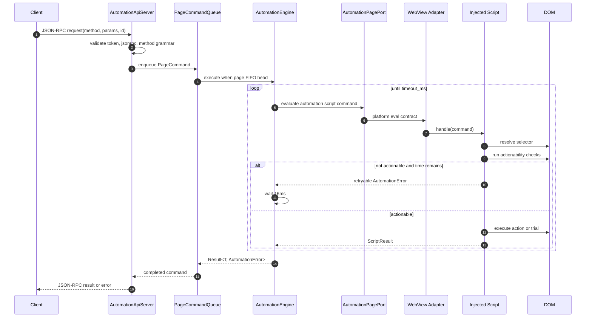
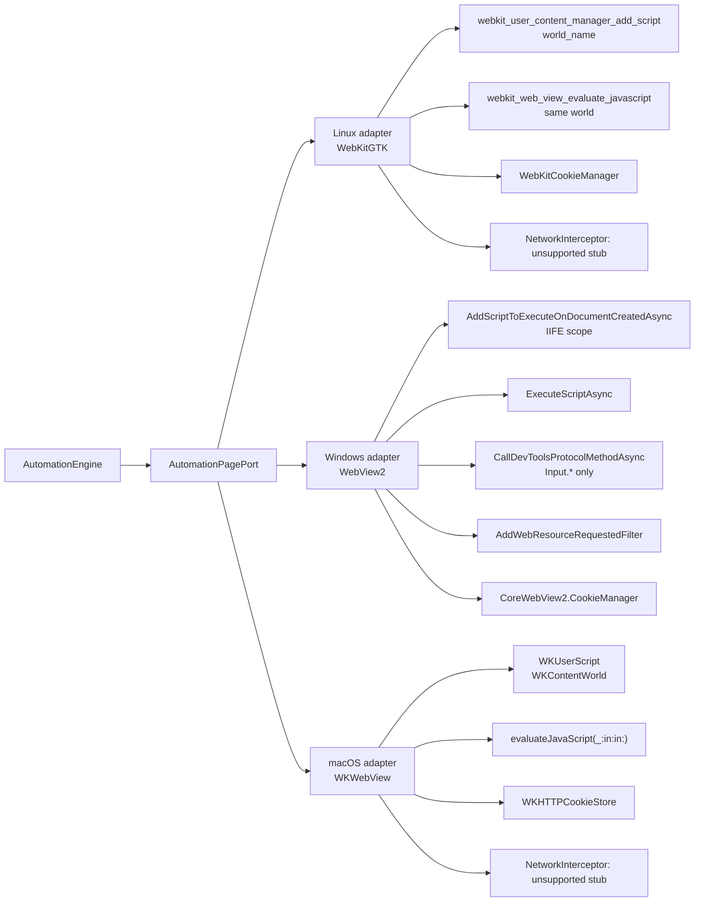

# zigBrowser Automation API — Product Requirements Document

**Date:** 2026-07-09
**Status:** Draft
**Author:** BronzeDesert (SAI Algorithm)
**Research basis:** `thoughts/searchable/shared/research/2026-07-09-browser-automation-api-contracts.md`
**Context map:** [Bounded Context Map](2026-07-09-browser-automation-api-context-map.html) — 12 DDD bounded contexts, 110 stable IDs (IN/OUT/EV/C/S/G), mermaid diagrams, EBNF grammars, gap register

---

## 1. Executive Summary

This PRD specifies a Playwright-style automation API for zigBrowser that enables programmatic control of web pages loaded in the browser's native WebView. The API provides guaranteed action contracts (auto-wait, actionability checks, typed errors) exposed via a local JSON-RPC 2.0 server, with an injected selector/action engine running in an isolated JavaScript world. The API also emits privacy-aware wide events so failures can be investigated across command, selector, platform, session, and rate-limit dimensions without adding new instrumentation for every incident.

The primary use case is social media automation (LinkedIn, Instagram) with stealth requirements. zigBrowser's structural advantages — real GPU-rendered WebView, no extension telltales, desktop residential IP, native TLS fingerprint — position it as a superior alternative to extension-based tools (PhantomBuster, Dux-Soup) and headless browsers (Puppeteer, Playwright with Chromium).

---

## 2. Problem Statement & Motivation

### Why now

Social media automation tools fall into two categories, both with critical weaknesses:

1. **Browser extensions** (Dux-Soup, PhantomBuster): Inject via `chrome-extension://` origin, detectable by platforms. Subject to Chrome Web Store policy changes. Cannot survive Chrome Manifest V3 restrictions on background scripts.

2. **Headless browsers** (Puppeteer, Playwright): Set `navigator.webdriver = true`, produce datacenter IP fingerprints, have detectable CDP `Runtime.enable` side effects, and generate synthetic TLS/JA3 fingerprints.

zigBrowser occupies a unique position: a real desktop browser with native WebView rendering that produces authentic fingerprints while offering programmatic control through its existing IPC bridge.

### What this unlocks

- Programmatic control of any web page loaded in zigBrowser
- Social media automation with near-zero detection surface
- Scriptable workflows via Python/Node SDKs and CLI tools
- Automated testing of web applications using the same browser users interact with

---

## 3. Architecture Overview

Three layers, extending the existing `zbHost` IPC bridge (`src/ipc.zig` dispatch + platform shims):

```
┌──────────────────────────────────────────────────────────────┐
│  LAYER 3: EXTERNAL API                                        │
│  JSON-RPC 2.0 over Unix domain socket                         │
│  Clients: Python scripts, Node SDK, CLI tools                 │
│  Event push: WebSocket channel on same socket                 │
├──────────────────────────────────────────────────────────────┤
│  LAYER 2: AUTOMATION ENGINE                                   │
│  Zig-side: command queue, timeout/retry logic, state machine  │
│  Extends: src/ipc.zig dispatch table                          │
│  Error taxonomy: 12 typed AutomationError cases               │
│  Observability: wide command/action/platform events            │
├──────────────────────────────────────────────────────────────┤
│  LAYER 1: INJECTED SCRIPT                                     │
│  JS in isolated world: selectors, actionability checks,       │
│  DOM interaction, event synthesis, wait primitives             │
│  Injected via platform-specific isolated-world mechanisms     │
└──────────────────────────────────────────────────────────────┘
```

### Integration with existing architecture

The current `src/ipc.zig` dispatch function uses `std.mem.eql` string matching on `cmd` field, with JSON `args`. Current verbs: `ping`, `add`, `echo`, `os.info`. The automation API adds new verb namespaces (`dom.*`, `page.*`, `cookies.*`, `session.*`) following the same pattern.

The existing `zbHost` script message handler in `webkit_shim.c` (line 530-608) provides the JS-to-native bridge. The automation engine uses the reverse path: Zig evaluates JavaScript in the WebView via platform-specific evaluation APIs.

**⚠️ Phase 1 prerequisite — IPC result buffer ceiling.** The current `zb_ipc_dispatch` C export (`src/ipc.zig:13`) uses a threadlocal `dispatch_result_cstr: [4096]u8` static buffer. Any result exceeding 4095 bytes (before nul terminator) triggers a `BadArgs` error via `copyToCStr` failure (line 66-70). This ceiling will be hit immediately by `dom.query` (multiple elements with bounding boxes), `page.evaluate` (page content), and `page.screenshot` (base64 data). **Fix required before any automation command can ship:** switch from the static threadlocal buffer to dynamic allocation with the result pointer valid until the next call (same lifetime contract, heap-backed). The 64KB scratch allocator (`dispatch_scratch: [65536]u8`, line 12) may also need growth for complex automation results.

### 3.1 System Context Diagram

```mermaid
flowchart LR
    Client["Python SDK / Node SDK / CLI"]
    Socket["UDS JSON-RPC 2.0\n$XDG_RUNTIME_DIR/zigbrowser-*.sock"]
    Server["AutomationApiServer\nnew Zig module"]
    Queue["PageCommandQueue\none FIFO per page"]
    Engine["AutomationEngine\nretry loop + contracts"]
    Port["AutomationPagePort\nZig vtable"]
    Shim["Platform Shim\nC / ObjC / C++"]
    WebView["Native WebView\nWebKitGTK / WebView2 / WKWebView"]
    Script["Injected Automation Script\nisolated world"]
    DOM["Page DOM"]
    Events["Event Stream\nWebSocket notifications"]
    Telemetry["Observability Sink\nwide events / spans"]

    Client -->|JSON-RPC request grammar| Socket
    Socket -->|authenticated frames| Server
    Server -->|method + params grammar| Queue
    Queue -->|serialized command| Engine
    Engine -->|PagePort interface| Port
    Port -->|C ABI contract| Shim
    Shim -->|platform eval/inject APIs| WebView
    WebView --> Script
    Script -->|selector grammar + action contract| DOM
    DOM -->|result or AutomationError| Script
    Script --> WebView
    WebView --> Shim
    Shim --> Port
    Port --> Engine
    Engine --> Server
    Server -->|JSON-RPC result/error| Client
    Engine -.->|navigation/rate/session events| Events
    Events -.-> Client
    Server -.->|rpc/server spans| Telemetry
    Engine -.->|command/action spans| Telemetry
    Port -.->|platform spans| Telemetry
```



### 3.2 Current IPC Path vs. Required Automation Path

The existing production seam is page JavaScript calling native Zig. Automation requires an additional native-to-WebView seam.

```mermaid
flowchart TB
    subgraph Current["Current production path: page JS to Zig"]
        PageJS["Page JS\nwindow.zbHost(cmd,args)"]
        JSBridge["tests/fixtures/app/zbhost.js"]
        MsgHandler["Platform message handler\nwebkit_shim.c / webview2_shim.cpp / wkwebview_shim.m"]
        IpcC["zb_ipc_dispatch\nsrc/ipc.zig C export"]
        IpcZig["ipc.dispatch\ncmd string + args JSON"]
        PageJS --> JSBridge --> MsgHandler --> IpcC --> IpcZig
        IpcZig -->|JSON result or IpcError| MsgHandler --> JSBridge --> PageJS
    end

    subgraph Required["Required automation path: external client to WebView"]
        RpcClient["External client"]
        RpcServer["NEW AutomationApiServer"]
        Router["NEW command router\nsame method grammar as dom.* / page.*"]
        AutoEngine["NEW AutomationEngine"]
        PagePort["NEW AutomationPagePort"]
        EvalAbi["NEW native eval/inject ABI"]
        Injected["NEW injected script handle()"]
        PageDom["Page DOM"]
        RpcClient --> RpcServer --> Router --> AutoEngine --> PagePort --> EvalAbi --> Injected --> PageDom
        PageDom --> Injected --> EvalAbi --> PagePort --> AutoEngine --> RpcServer --> RpcClient
    end
```



The shared seam between both paths is the command grammar (`namespace.verb` plus JSON params), but the direction and lifetime contracts differ:

- Page JS IPC is request/reply inside the loaded page and currently uses `zb_ipc_dispatch`.
- Automation commands originate outside the page, must serialize through a page queue, and require native evaluation into an isolated world.
- Result data for automation must not use the current 4096-byte C string ceiling.

### 3.3 Command Lifecycle Diagram



### 3.4 Seam Map: Grammar, Interfaces, Contracts

| Seam | Current anchor | Boundary | Grammar crossing seam | Interface to add or extend | Contract |
|---|---|---|---|---|---|
| CLI activation | `src/cli.zig` parses `--e2e-protocol`; `src/main.zig` passes to `zb_app_run` | Process args -> Zig command -> shim app run | `OpenArgs ::= URL? Flag*`; add `--automation-api`, optional `--automation-token-file` | Extend `cli.Command.open` and `zb_app_run` app config | Starting with `--automation-api` creates exactly one local socket, writes no TCP listener, and removes socket on clean shutdown. |
| External transport | New module | SDK/CLI process -> zigBrowser process | JSON-RPC frame grammar plus token handshake | `AutomationApiServer` over AF_UNIX | Reject malformed frames before queueing; reject unauthenticated clients; one response per request id; notifications have no id. |
| Method router | New module, shares naming with `src/ipc.zig` command style | JSON-RPC -> typed command | `Method ::= Namespace "." Verb` | `AutomationRouter.dispatch(method, params)` | Unknown method returns JSON-RPC `-32601`; invalid params returns `-32602`; automation failures use `-32001..-32012`. |
| Page command queue | New module | Multi-client RPC -> single page executor | `PageCommand ::= {page_id?, method, params, deadline}` | `PageCommandQueue` per `ZbWindow` or page id | Commands for the same page are strictly FIFO; cancellation removes queued work or interrupts retry loop; different pages may run concurrently. |
| Native page port | New Zig module + `src/webkit_shim.h` additions | Zig engine -> C/ObjC/C++ shims | C ABI strings carrying UTF-8 JSON | `AutomationPagePort` vtable and C ABI wrappers | All async platform calls complete exactly once with result, typed platform error, or cancellation. Result ownership is explicit and not bound to a 4096-byte static buffer. |
| Script injection | Current partial hooks: WebView2 and macOS inject `__zigBrowserBackend`; GTK has IPC handler only | Platform shim -> WebView document | `InjectedSource ::= JS module text + world name` | `injectAutomationScript(page, source, world)` | Inject at document-start for every main frame and subframe where supported; no page-world globals except unavoidable platform bridge artifacts. |
| Script command bridge | New injected script | Native eval -> isolated JS world | `ScriptCommand` JSON grammar | `globalThis.__zbAutomation.handle(json)` in isolated world | Handler is pure request/reply, returns JSON-serializable data, never leaks handles to page world, and cleans observers/timers before resolving. |
| Selector engine | New injected script | Script command -> DOM | Selector grammar in Section 3.5 | `resolveSelector(selector, strict)` | `strict=true` requires exactly one match; default action commands require one actionable element; query commands may return many. |
| Actionability loop | New Zig + JS collaboration | Engine retry loop -> DOM state | `ActionOptions` grammar | `runActionabilityChecks(element, action)` | Mutating actions do not run until required checks pass unless `force=true`; `trial=true` performs checks without side effects. |
| Platform input | New platform adapters | Engine -> native input or JS events | `InputCommand` JSON grammar | `InputDispatcher` optional PagePort capability | WebView2 may use in-process CDP Input; GTK/WKWebView may synthesize JS events; all paths return the same action result grammar. |
| Cookie/session | No current API; implicit platform stores | Engine -> platform cookie store | Cookie command grammar | `CookieStorePort` | Cookie operations are scoped to active browser profile/data store; failures map to `AutomationError` or JSON-RPC invalid params. |
| Network interception | No current API | Platform network stack -> engine events | `NetworkEvent` grammar | `NetworkInterceptor` vtable | WebView2 implementation can emit request/response/rate-limit signals; Linux/macOS stubs must report unsupported capability, not silent success. |
| Event push | Current stdout E2E protocol in `tests/e2e/PROTOCOL.md` | Engine -> external subscribers | `EventNotification` JSON-RPC notification grammar | WebSocket channel on same UDS | Events are ordered per page, best-effort across pages, and never block command completion. |
| Observability export | New module; existing E2E stdout is test-only | Runtime units of work -> local/remote telemetry backend | `TelemetryEvent` wide-event grammar | `TelemetrySink` / OpenTelemetry span exporter | Emit one root wide event per command plus child events for eval/actionability/network/pacing. High-cardinality fields are allowed when hashed/redacted. Metrics and logs are derived views, not the primary diagnostic source. |

### 3.5 Protocol and Selector Grammar

The grammars below are normative for implementation plans. JSON objects are shown as structural grammar rather than a byte-level JSON grammar.

```ebnf
JsonRpcRequest      ::= "{" Version "," Method "," Params? "," Id "}"
JsonRpcResponse     ::= "{" Version "," (Result | RpcError) "," Id "}"
JsonRpcNotification ::= "{" Version "," EventMethod "," Params? "}"
Version             ::= "\"jsonrpc\":\"2.0\""
Id                  ::= "\"id\":" (String | Integer | "null")
Method              ::= "\"method\":\"" CommandMethod "\""
EventMethod         ::= "\"method\":\"" EventName "\""
Params              ::= "\"params\":" JsonObject
Result              ::= "\"result\":" JsonValue
RpcError            ::= "\"error\":{\"code\":" RpcCode ",\"message\":" String (",\"data\":" JsonValue)? "}"

CommandMethod       ::= DomMethod | PageMethod | CookieMethod | SessionMethod | SocialMethod | PlatformMethod
DomMethod           ::= "dom." ("query" | "click" | "fill" | "type" | "getText" | "getAttribute" | "waitFor")
PageMethod          ::= "page." ("navigate" | "reload" | "url" | "title" | "evaluate" | "screenshot")
CookieMethod        ::= "cookies." ("getAll" | "set" | "delete")
SessionMethod       ::= "session.status"
SocialMethod        ::= "social." ("login_check" | "rate_status" | "pause" | "set_pacing")
PlatformMethod      ::= ("linkedin" | "instagram") "." PlatformVerb
PlatformVerb        ::= "connect" | "message" | "like" | "comment" | "visit" | "search" | "extract" | "follow" | "dm" | "story_view"

EventName           ::= "event." ("navigation" | "rate_limit" | "session" | "console" | "network")
RpcCode             ::= "-32700" | "-32600" | "-32601" | "-32602" | "-32603" | AutomationCode
AutomationCode      ::= "-32001" | "-32002" | "-32003" | "-32004" | "-32005" | "-32006"
                      | "-32007" | "-32008" | "-32009" | "-32010" | "-32011" | "-32012"
```

```ebnf
Selector            ::= RoleSelector | TestIdSelector | TextSelector | CssSelector | XPathSelector
RoleSelector        ::= "role=" RoleName RoleAttribute*
RoleAttribute       ::= "[" ("name" | "checked" | "selected" | "expanded" | "level") "=" QuotedValue "]"
TestIdSelector      ::= "testid=" IdentifierOrQuotedText
TextSelector        ::= "text=" TextMatch
CssSelector         ::= "css=" CssText
XPathSelector       ::= "xpath=" XPathText

ActionOptions       ::= "{" Timeout? Force? Trial? Strict? "}"
Timeout             ::= "\"timeout_ms\":" PositiveInteger
Force               ::= "\"force\":" Boolean
Trial               ::= "\"trial\":" Boolean
Strict              ::= "\"strict\":" Boolean
WaitState           ::= "attached" | "visible" | "hidden" | "detached"
WaitUntil           ::= "load" | "domcontentloaded" | "networkidle"
```

```ebnf
ScriptCommand       ::= "{"
                          "\"op\":" ScriptOp ","
                          "\"request_id\":" String ","
                          ("\"selector\":" String ",")?
                          ("\"value\":" JsonValue ",")?
                          ("\"options\":" ActionOptions)?
                        "}"
ScriptOp            ::= "query" | "click" | "fill" | "type" | "getText" | "getAttribute"
                      | "waitFor" | "evaluate" | "observeNavigation" | "rateLimitScan"

ScriptResult        ::= "{" "\"ok\":true" ("," "\"value\":" JsonValue)? "}"
ScriptFailure       ::= "{"
                          "\"ok\":false,"
                          "\"error\":" AutomationErrorName ","
                          "\"retryable\":" Boolean ","
                          "\"data\":" JsonObject
                        "}"

TelemetryEvent      ::= "{"
                          "\"name\":" TelemetryName ","
                          "\"trace_id\":" String ","
                          "\"span_id\":" String ","
                          "\"timestamp\":" IsoTimestamp ","
                          "\"duration_ms\":" Number ","
                          "\"attributes\":" JsonObject
                        "}"
TelemetryName       ::= "automation.command" | "automation.selector.resolve"
                      | "automation.actionability.check" | "automation.platform.eval"
                      | "automation.input.dispatch" | "automation.network.event"
                      | "automation.pacing.decision" | "automation.social.action"
                      | "automation.stealth.assessment" | "automation.behavior.simulation"
                      | "automation.detection.signal"
```

### 3.6 Core Interfaces

The exact Zig file names are implementation-plan details, but these are the required boundaries and ownership contracts.

```zig
const AutomationPagePort = struct {
    ctx: *anyopaque,
    vtable: *const VTable,

    const VTable = struct {
        injectScript: *const fn (ctx: *anyopaque, page_id: PageId, source: []const u8, world: []const u8) AutomationError!void,
        evalScript: *const fn (ctx: *anyopaque, page_id: PageId, source: []const u8, world: []const u8, allocator: std.mem.Allocator) AutomationError![]const u8,
        navigate: *const fn (ctx: *anyopaque, page_id: PageId, url: []const u8, wait_until: WaitUntil, timeout_ms: u32) AutomationError!void,
        reload: *const fn (ctx: *anyopaque, page_id: PageId, wait_until: WaitUntil, timeout_ms: u32) AutomationError!void,
        screenshot: *const fn (ctx: *anyopaque, page_id: PageId, options: ScreenshotOptions, allocator: std.mem.Allocator) AutomationError![]const u8,
        cookies: *const CookieStorePort,
        input: ?*const InputDispatcher,
        network: ?*const NetworkInterceptor,
    };
};
```

```zig
const AutomationApiServer = struct {
    pub fn start(config: AutomationConfig, router: *AutomationRouter) !void;
    pub fn stop() void;
};

const AutomationRouter = struct {
    pub fn dispatch(method: []const u8, params_json: []const u8, id: RpcId) JsonRpcError!JsonValue;
};

const PageCommandQueue = struct {
    pub fn enqueue(page_id: PageId, command: PageCommand) !CommandHandle;
    pub fn cancel(handle: CommandHandle) void;
};

const TelemetrySink = struct {
    ctx: *anyopaque,
    vtable: *const VTable,

    const VTable = struct {
        startSpan: *const fn (ctx: *anyopaque, name: []const u8, attrs: TelemetryAttrs) TelemetrySpan,
        addEvent: *const fn (ctx: *anyopaque, span: TelemetrySpan, name: []const u8, attrs: TelemetryAttrs) void,
        endSpan: *const fn (ctx: *anyopaque, span: TelemetrySpan, status: TelemetryStatus, attrs: TelemetryAttrs) void,
    };
};
```

```zig
const NetworkInterceptor = struct {
    ctx: *anyopaque,
    vtable: *const VTable,

    const VTable = struct {
        capability: *const fn (ctx: *anyopaque) NetworkCapability,
        start: *const fn (ctx: *anyopaque, page_id: PageId) AutomationError!void,
        stop: *const fn (ctx: *anyopaque, page_id: PageId) void,
        pollEvent: *const fn (ctx: *anyopaque, allocator: std.mem.Allocator) ?NetworkEvent,
    };
};
```

**Interface ownership rules:**

- The automation engine owns command deadlines, retries, action contracts, and error mapping.
- Platform shims own WebView object lifetimes and native async callback completion.
- The injected script owns selector parsing, DOM reads, actionability checks that require DOM APIs, and DOM event synthesis.
- The external API server owns authentication, JSON-RPC framing, and client connection lifetimes.
- The telemetry sink owns export buffering, local redaction enforcement, and trace/span correlation across RPC, queue, engine, script, and platform adapters.
- Platform-specific capabilities must be advertised explicitly. Unsupported capabilities return a typed unsupported/capability error instead of silently degrading.

### 3.7 Contract Matrix

| Contract ID | Applies to | Preconditions | Postconditions | Failure mapping |
|---|---|---|---|---|
| C1: JSON-RPC framing | External API | Valid UTF-8 JSON object; `jsonrpc` exactly `"2.0"`; authenticated connection | Exactly one response for request with id; no response for notification | Parse/shape errors use standard JSON-RPC codes; command errors use automation codes. |
| C2: Method dispatch | Router | `method` matches grammar; `params` is object or omitted | Routed to one command type with validated params | Unknown method -> `-32601`; invalid params -> `-32602`. |
| C3: Page serialization | Command queue | Page id resolves to live page/window | Same-page commands execute FIFO; completed command releases queue head | Closed page -> `cancelled` or `navigation_failed` depending on phase. |
| C4: Action retry | Automation engine | Command has deadline; selector command has selector | Retry every 16ms until success, terminal failure, cancellation, or timeout | Timeout with no match -> `element_not_found`; timeout after partial checks -> most specific actionability error or `action_timeout`. |
| C5: Actionability | Injected script | Resolved element candidate exists | Required checks pass before mutating action unless `force=true` | Failing check maps to exact `AutomationError` variant. |
| C6: Trial mode | Mutating DOM actions | Same params as real action; `trial=true` | Runs selector and actionability checks; performs no click, input, selection, scroll, or navigation side effect | Same errors as real action except execution-stage errors cannot occur. |
| C7: Native eval | PagePort + shim | Page is live; script source is UTF-8; world name is valid for platform | Completion callback returns full JSON text or platform error exactly once | Platform async failure -> `navigation_failed` or `action_timeout`; malformed script result -> `BadArgs`/`-32603`. |
| C8: Script isolation | Injection adapter | Automation enabled before navigation or before first document-start hook | Automation script is available in isolated world for each document where platform permits | Missing script -> `action_timeout` with diagnostic data. |
| C9: Result ownership | C ABI + Zig allocator | Caller provides allocator or documented release callback | Results survive until documented release point and may exceed 4096 bytes | Allocation failure -> internal error; static buffer overflow must not be observable. |
| C10: Events | Event channel | Client subscribed via WebSocket upgrade on same authenticated socket | Navigation/rate/session/network events use JSON-RPC notification grammar | Slow clients are disconnected or events are dropped with diagnostics; command path must not block. |
| C11: Cookie/session | CookieStorePort | Browser profile/data store is initialized | Cookie reads/writes apply to active profile, not a separate test store | Unsupported platform op -> capability error; invalid cookie shape -> `-32602`. |
| C12: Network visibility | NetworkInterceptor | Capability reports supported before start | Supported platforms emit request/response/rate-limit signals; stubs report unsupported | Unsupported Linux/macOS stubs must be logged as security debt for social automation. |
| C13: Observability | Automation server, queue, engine, adapters | Telemetry enabled and redaction policy loaded | Every command emits a correlated root wide event with command, platform, backend, timing, result, and error dimensions; child events preserve bottleneck context | Export failure must not fail automation commands. Missing required dimensions fails test fixtures and release gates. |

### 3.8 Platform Adapter Diagram



---

## 4. Layer 1: Injected Automation Script

A single JavaScript file injected at `document-start` in an **isolated script world** — not the page's global context. This is invisible to anti-bot scripts that enumerate `window` properties.

### 4.1 Platform Injection Mechanisms

| Platform | API | Isolation Method |
|---|---|---|
| **Linux** (WebKitGTK) | `webkit_user_content_manager_add_script()` | Named `world_name` parameter |
| **Windows** (WebView2) | `AddScriptToExecuteOnDocumentCreatedAsync()` | IIFE scope (no named worlds) |
| **macOS** (WKWebView) | `WKUserScript` initializer | `WKContentWorld` named world |

All three mechanisms inject before any page script executes and run in a context inaccessible to the page's JavaScript.

### 4.2 Selector Engine

The selector engine resolves elements using prefixed string syntax compatible with Playwright conventions:

| Prefix | Syntax Example | Resolution |
|---|---|---|
| `role=` | `role=button[name="Like"]` | ARIA role + accessible name (most stable for social media) |
| `testid=` | `testid=send-message-btn` | `data-testid` attribute |
| `text=` | `text=Follow` | Visible text content (exact or substring) |
| `css=` | `css=[aria-label="Comment"]` | Standard CSS selector |
| `xpath=` | `xpath=//div[@data-section="messages"]` | XPath expression (last resort) |

**Priority for social media platforms** (obfuscated class names): `role=` > `testid=` > `text=` > `css=` with semantic anchors > `xpath=`.

**Rationale for Playwright-compatible strings over structured JSON:** String selectors are parsed in the injected JS layer (Layer 1), not in Zig (Layer 2). Zig passes the selector string opaquely. This means zero Zig parsing complexity, familiar syntax for Playwright/Puppeteer users, and a trivial JS parser (~50 lines of prefix matching). The JSON-RPC params use JSON for everything except the selector value itself.

### 4.3 Actionability Checks

Before executing any mutating action, the engine verifies the target element passes all applicable checks:

| Check | Definition | Actions requiring it |
|---|---|---|
| **Attached** | Element is connected to the DOM | All |
| **Visible** | Element has non-zero bounding box, `visibility` is not `hidden`, `opacity` > 0 | click, fill, type, hover, select |
| **Stable** | Bounding box identical across 2 consecutive animation frames | click, fill |
| **ReceivesEvents** | Element is the hit-test target at its bbox center (not obscured) | click |
| **Enabled** | Not `disabled` and not `aria-disabled="true"` | click, fill, type, select |
| **Editable** | Not `readonly` and not `aria-readonly="true"` | fill, type |

### 4.4 DOM Actions

| Action | Mechanism | Events Dispatched |
|---|---|---|
| **click** | Compute bbox center → synthesize MouseEvent sequence (mousedown, mouseup, click) | pointerdown, mousedown, pointerup, mouseup, click |
| **fill** | Focus element → clear value → set new value → dispatch events | focus, input (insertText), change |
| **type** | Per-keystroke: focus → for each char: keydown, input (insertText), keyup | keydown, input, keyup per character |
| **select** | Match `<option>` by value/label → set `selectedIndex` → dispatch change | change |
| **check/uncheck** | Click if current state differs from desired state | Same as click |
| **hover** | Move pointer to element bbox center | pointerenter, mouseenter, pointermove, mousemove |
| **scroll** | ScrollIntoView with behavior option | scroll |

### 4.5 Wait Primitives

| Primitive | Behavior |
|---|---|
| **waitForSelector** | Poll DOM until selector matches element in specified state (`attached`, `visible`, `hidden`, `detached`). Reject after `timeout_ms`. |
| **waitForNavigation** | State machine: monitors `readystatechange`, `load`, and network activity. Terminal states: `load` (default), `domcontentloaded`, `networkidle`. |
| **waitForNetworkIdle** | Track in-flight requests. Resolve when 0 requests pending for 500ms (configurable). Uses `PerformanceObserver` with `resource` entry type. |

---

## 5. Layer 2: Automation Engine (Zig IPC)

Extends `src/ipc.zig` with new command verb namespaces. Every command follows the guaranteed contract pattern.

### 5.1 Command Verbs

#### DOM Commands

| Command | Request | Response |
|---|---|---|
| `dom.query` | `{ selector, timeout_ms? }` | `{ elements: [{id, tag, text, bbox}] }` |
| `dom.click` | `{ selector, options? }` | `{ ok: true }` or `AutomationError` |
| `dom.fill` | `{ selector, value, options? }` | `{ ok: true }` or `AutomationError` |
| `dom.type` | `{ selector, text, delay_ms? }` | `{ ok: true }` or `AutomationError` |
| `dom.getText` | `{ selector }` | `{ text: string }` |
| `dom.getAttribute` | `{ selector, name }` | `{ value: string \| null }` |
| `dom.waitFor` | `{ selector, state?, timeout_ms? }` | `{ ok: true }` or `TimeoutError` |

#### Page Commands

| Command | Request | Response |
|---|---|---|
| `page.navigate` | `{ url, waitUntil? }` | `{ ok: true }` or `NavigationError` |
| `page.reload` | `{ waitUntil? }` | `{ ok: true }` |
| `page.url` | `{}` | `{ url: string }` |
| `page.title` | `{}` | `{ title: string }` |
| `page.evaluate` | `{ expression }` | `{ result: any }` |
| `page.screenshot` | `{ path?, fullPage? }` | `{ data: base64 }` |

#### Cookie Commands

| Command | Request | Response |
|---|---|---|
| `cookies.getAll` | `{ url? }` | `{ cookies: [{name, value, domain, path, expires, httpOnly, secure}] }` |
| `cookies.set` | `{ name, value, domain, path?, expires?, httpOnly?, secure? }` | `{ ok: true }` |
| `cookies.delete` | `{ name, domain }` | `{ ok: true }` |

#### Session Commands

| Command | Request | Response |
|---|---|---|
| `session.status` | `{}` | `{ loggedIn: bool, platform: string, user?: string }` |

### 5.2 Guaranteed Contract Pattern

Every mutating action follows this lifecycle:

```
1. Receive command: { selector, timeout_ms (default 30000), force?, trial? }
2. Enter retry loop (poll every 16ms — animation-frame cadence):
   a. Resolve selector → element (or ElementNotFound after timeout)
   b. Run actionability checks for this action type
   c. If all checks pass OR force=true: execute action
   d. If trial=true: return success without executing (dry run)
3. Return Result<T, AutomationError>
```

The 16ms polling interval aligns with requestAnimationFrame cadence (60fps). This ensures actions execute at the earliest possible frame after the element becomes actionable, without busy-waiting.

**`force` option:** Bypasses actionability checks. Use when you know the element state is acceptable despite failing a check (e.g., clicking a partially obscured element).

**`trial` option:** Runs all checks but does not execute the action. Use for pre-validation without side effects.

### 5.3 Error Taxonomy

```zig
const AutomationError = enum {
    element_not_found,        // selector matched 0 elements within timeout
    element_not_visible,      // element matched but not visible
    element_not_stable,       // element bbox changing between frames
    element_obscured,         // another element at hit-test point
    element_disabled,         // disabled or aria-disabled="true"
    element_not_editable,     // readonly or aria-readonly="true"
    navigation_timeout,       // page load exceeded timeout
    navigation_failed,        // DNS, network, or blocked error
    action_timeout,           // generic timeout wrapper
    platform_rate_limited,    // detected rate-limit UI signal or 429
    session_invalid,          // not logged in or session expired
    cancelled,               // caller aborted the command
};
```

Each error variant maps to a specific JSON-RPC error code in the -32001 to -32012 range for programmatic handling by SDK clients.

### 5.4 Command Queue

- One queue per page/tab, strictly serialized
- Commands process one at a time, including their retry loops
- No concurrent actions against the same page
- Commands against different pages may execute in parallel

This serialization prevents race conditions from overlapping DOM mutations and matches the mental model of sequential user interaction.

---

## 6. Layer 3: External API

### 6.1 Transport

**Primary: Unix domain socket with JSON-RPC 2.0.**

Socket path: `$XDG_RUNTIME_DIR/zigbrowser-automation.sock` (Linux/macOS) or `%LOCALAPPDATA%\zigbrowser\automation.sock` (Windows).

UDS provides zero network exposure — the socket is protected by filesystem permissions and is invisible to network scanners. This is critical for a tool handling social media credentials.

**Decision: UDS-only, no TCP fallback.** Council analysis determined that Zig's `std.net` supports AF_UNIX on Windows 10 1803+, eliminating the primary argument for TCP. A single transport means one code path, one security model, and no port-scanning detection vector. A spike to confirm AF_UNIX behavior on Windows in Zig should precede implementation.

**Event push:** WebSocket upgrade on the same Unix socket. Delivers asynchronous notifications:

```json
{"jsonrpc": "2.0", "method": "event.navigation", "params": {"state": "network_idle", "url": "https://linkedin.com/messaging"}}
{"jsonrpc": "2.0", "method": "event.rate_limit", "params": {"platform": "linkedin", "signal": "modal", "text": "You've reached the weekly invitation limit"}}
{"jsonrpc": "2.0", "method": "event.session", "params": {"platform": "linkedin", "loggedIn": false}}
```

### 6.2 Wire Protocol

JSON-RPC 2.0 with standard request/response/notification semantics:

```json
// Request
{
  "jsonrpc": "2.0",
  "method": "dom.click",
  "params": {
    "selector": "role=button[name='Connect']",
    "options": {"timeout_ms": 5000}
  },
  "id": 1
}

// Success
{"jsonrpc": "2.0", "result": {"ok": true}, "id": 1}

// Error
{
  "jsonrpc": "2.0",
  "error": {
    "code": -32001,
    "message": "element_not_found",
    "data": {"selector": "role=button[name='Connect']", "timeout_ms": 5000}
  },
  "id": 1
}
```

### 6.3 Activation

- CLI flag: `zigbrowser --automation-api` starts the UDS listener alongside the browser
- The socket file is created on startup and removed on clean shutdown
- Multiple browser instances use distinct socket paths (append PID or random suffix)
- Socket filename is randomized to avoid enumeration by other local processes

---

## 7. Observability Architecture

Observability is a first-class product requirement for the automation API. The system must let developers explain any command state after the fact without adding new logging for each new failure mode: selector flake, platform timing drift, hidden rate limiting, adapter divergence, session expiry, or anti-bot response.

The primary diagnostic unit is a **wide event**: one flat, queryable record with the full context of a unit of work. In OpenTelemetry terms, each root automation command is a span, and child spans/events capture selector resolution, actionability checks, platform evaluation, input dispatch, network visibility, pacing, and social contract steps.

### 7.1 Observability Goals

The telemetry model must support these investigation questions:

| Question | Required dimensions |
|---|---|
| Which users or sessions are affected? | `session.id_hash`, `profile.id_hash`, `tenant.id_hash?`, `platform.account_hash?` |
| What changed? | `app.version`, `git.sha`, `automation.script.version`, `config.version`, `feature.flags`, `backend.name`, `backend.version` |
| Where is the bottleneck? | `duration_ms`, `queue.wait_ms`, `selector.resolve_ms`, `actionability.wait_ms`, `platform.eval_ms`, `input.dispatch_ms`, `navigation.wait_ms` |
| Which selectors are flaky? | `selector.kind`, `selector.hash`, `selector.strict`, `selector.match_count`, `actionability.failed_check` |
| Is this engine failure or platform defense? | `automation.error`, `rate_limit.signal`, `network.status_code?`, `challenge.detected`, `dom.signal.kind`, `retry.count` |
| Is a failure platform-specific? | `os.name`, `backend.name`, `webview.version`, `network.capability`, `input.mode`, `script.world` |

Metrics are derived from wide events for dashboards and SLOs. Logs are local, human-readable breadcrumbs that include `trace_id` and `command_id`. Neither metrics nor logs replace the wide command events because pre-aggregated counters discard the high-cardinality context needed for root-cause analysis.

### 7.2 Root Command Span

Every JSON-RPC request that reaches the automation router emits exactly one root span named `automation.command`.

Required attributes:

| Attribute | Cardinality | Notes |
|---|---:|---|
| `trace_id`, `span_id`, `command_id` | High | Correlates RPC request, queue execution, platform adapter calls, and event push notifications. |
| `rpc.method`, `rpc.id_hash`, `rpc.client.kind` | Medium/high | `rpc.id_hash` prevents leaking caller-provided ids while preserving correlation. |
| `page.id`, `window.id`, `session.id_hash`, `profile.id_hash` | High | Required for multi-page and session-specific investigations. |
| `platform.name`, `target.host`, `target.origin_hash` | Medium/high | `target.host` may be raw host; full URLs are not logged unless explicitly allowed. |
| `backend.name`, `backend.version`, `os.name`, `os.version`, `arch` | Low/medium | Required for cross-platform parity analysis. |
| `automation.script.version`, `api.version`, `app.version`, `git.sha`, `config.version` | Medium | Required to identify changed code/config. |
| `queue.wait_ms`, `duration_ms`, `timeout_ms`, `retry.count` | Low/high | Numeric fields for latency distributions and timeout analysis. |
| `result.status`, `automation.error`, `jsonrpc.error_code` | Low | `result.status` is `ok`, `error`, or `cancelled`. |
| `selector.kind`, `selector.hash`, `selector.strict`, `selector.match_count` | Medium/high | Raw selector text is redacted by default. |
| `action.name`, `action.force`, `action.trial`, `input.mode` | Low | Distinguishes dry-run validation from real side effects. |

### 7.3 Child Spans and Events

| Span/event name | Emitted by | Purpose | Key attributes |
|---|---|---|---|
| `automation.selector.resolve` | Injected script | Explain selector latency and match failures | `selector.kind`, `selector.hash`, `selector.match_count`, `dom.frame_depth`, `duration_ms` |
| `automation.actionability.check` | Injected script | Identify which check blocked action | `actionability.check`, `actionability.passed`, `actionability.failed_check`, `bbox.width`, `bbox.height`, `obscuring.element_hash?` |
| `automation.platform.eval` | PagePort adapter | Find slow or failing native evaluation | `backend.name`, `script.world`, `payload.bytes`, `result.bytes`, `platform.error`, `duration_ms` |
| `automation.input.dispatch` | InputDispatcher | Compare native input vs JS synthetic input | `input.mode`, `event.count`, `mouse.distance_px?`, `typing.char_count?`, `duration_ms` |
| `automation.network.event` | NetworkInterceptor | Detect HTTP errors and silent throttling where available | `network.capability`, `http.method`, `http.status_code`, `request.host`, `resource.kind`, `rate_limit.signal` |
| `automation.pacing.decision` | Pacing layer | Explain why work was delayed or stopped | `platform.name`, `daily_cap`, `remaining_actions`, `delay_ms`, `cap.reached` |
| `automation.social.action` | Social contract layer | Correlate compound actions with primitive commands | `social.platform`, `social.action`, `social.step`, `profile.id_hash?`, `post.id_hash?` |
| `automation.stealth.assessment` | Anti-detection layer | Explain which detection surfaces were avoided or accepted | `stealth.surface`, `stealth.control`, `stealth.risk_level`, `script.world`, `cdp.runtime_enabled`, `extension.surface_present` |
| `automation.behavior.simulation` | Behavioral layer | Explain generated human-like timing without logging content | `behavior.kind`, `delay_ms`, `distribution.name`, `profile.name`, `distance_px?`, `char_count?`, `scroll.delta_px?` |
| `automation.detection.signal` | Rate-limit/challenge detectors | Preserve platform-defense evidence without raw page data | `signal.kind`, `signal.source`, `signal.confidence`, `platform.name`, `dom.signal_hash?`, `network.status_code?` |

Child spans must share the root `trace_id`. High-cardinality dimensions are expected and useful here; the redaction policy controls sensitivity, not cardinality.

### 7.4 Redaction and Privacy Contract

Telemetry handles social media sessions and must never leak credentials or message content.

Never record:

- Cookie values, bearer tokens, local storage values, passwords, session secrets
- Raw message text, comments, notes, or typed form values
- Full screenshots or DOM snapshots
- Full URLs when query strings may contain tokens or personal data

Record with hashing or normalization:

- `selector.hash` instead of raw selector text by default
- `profile.id_hash`, `post.id_hash`, `conversation.id_hash`, `session.id_hash`
- `target.host` raw, `target.path_hash` hashed, query string omitted
- Text lengths, value classes, and action categories instead of raw text

The redaction layer runs before export and applies equally to local debug sinks, OTLP/Honeycomb-compatible exports, JSON-RPC event notifications, and test fixture telemetry captures.

### 7.5 Analysis Loop

The intended debugging loop is:

1. **Define**: Start from an SLO burn, user report, SDK error, or account restriction.
2. **Visualize**: Query wide events by `rpc.method`, `platform.name`, `backend.name`, `automation.error`, and latency fields to see the shape of the issue.
3. **Investigate**: Compare failing or slow events against successful events across every dimension: version, backend, selector hash, page host, actionability check, pacing state, and network capability.
4. **Evaluate**: Confirm by filtering with and without the suspected dimension, then add missing telemetry dimensions as follow-up work if the data cannot answer the question.

This loop only works if instrumentation is planned with the feature. Each implementation phase must include telemetry review alongside tests.

### 7.6 SLO Candidates

Initial SLOs should be derived from root `automation.command` spans:

| SLO | Candidate objective | Source |
|---|---:|---|
| Command availability | 99% of non-rate-limited commands complete without `AutomationError` | `result.status`, `automation.error` |
| Action latency | 95% of `dom.click` / `dom.fill` commands complete under 2s on fixture pages | `rpc.method`, `duration_ms`, `target.host` |
| Queue delay | 99% of same-page commands start within 100ms unless blocked by an intentional `social.pause` | `queue.wait_ms`, `rpc.method` |
| Telemetry coverage | 100% of automation commands emit required root attributes | release-gate fixture assertions |
| Redaction compliance | 0 telemetry events containing denied sensitive keys or raw secret patterns | telemetry fixture scanner |

---

## 8. Anti-Detection Architecture

### 8.1 Structural Advantages (inherent to zigBrowser)

| Property | Why it matters |
|---|---|
| Real GPU-rendered WebView | Clean `canvas.toDataURL()` and WebGL fingerprint |
| No browser extension | No `chrome-extension://` origin in `performance.getEntries()` |
| Desktop residential IP | Not flagged by datacenter IP blocklists |
| No `navigator.webdriver` | Not controlled via WebDriver protocol |
| Native OS TLS stack | Authentic JA3/JA4 fingerprint matching the OS browser |

### 8.2 Stealth Design Choices

1. **Isolated script world injection** — page scripts cannot enumerate automation globals via `Object.keys(window)` or prototype chain walking
2. **No `Runtime.enable` on WebView2** — use only Input, DOM, and Network CDP domains. `Runtime.enable` has detectable side effects (see rebrowser.net research)
3. **OS-level input dispatch** where available — CDP `Input.dispatchMouseEvent`/`dispatchKeyEvent` on WebView2 produces OS-level input events, harder to distinguish from human input than synthetic JS `MouseEvent`
4. **Minimal injected footprint** — clean up MutationObservers, IntersectionObservers, and PerformanceObservers after each operation. No persistent DOM modifications.

### 8.2.1 Known Risk: Isolated-World Leakage

**⚠️ Open risk (Council, Sentinel R2-R3).** Isolated script worlds share the DOM with the page context. This creates detectable side-channels:

- **Timing artifacts:** Automation operations that touch the DOM (querySelector, setAttribute, event dispatch) produce timing signatures detectable via `PerformanceObserver` or `requestAnimationFrame` cadence analysis from the page context.
- **Prototype pollution detection:** If the injected script modifies DOM prototypes (e.g., overriding `addEventListener`), the page context can detect the modification.
- **Observer interference:** MutationObservers set from the page context will fire on DOM changes made by the injected script, revealing automation activity.

**Mitigation strategy:** Minimize DOM surface touched by the injected script. Prefer reading over writing. Clean up all observers synchronously. Use `requestAnimationFrame`-aligned operations to blend with rendering cadence. This is an ongoing hardening concern — vendors don't currently check for isolated-world leakage, but detection techniques will evolve.

**Revisit trigger:** Any social media platform deploying timing-based or prototype-chain detection should trigger a hardening sprint on the injected script isolation layer.

### 8.3 Behavioral Simulation

The behavioral layer is the most critical for evading social media detection, which increasingly relies on interaction pattern analysis over technical signals.

**Typing simulation:**
- Per-keystroke dispatch with Gaussian-distributed inter-key delays
- Mean: 120ms, standard deviation: 40ms, range clamped to 80-200ms
- Occasional longer pauses (300-600ms) at word boundaries
- Configurable per-platform profiles

**Click simulation:**
- Mouse movement from current position to target using Bezier curve interpolation
- Natural arc with slight overshoot and correction
- Movement duration proportional to distance (Fitts's law)
- Randomized dwell time at target before click (50-150ms)

**Scrolling:**
- Variable scroll speed with momentum simulation
- Pauses at content boundaries (post edges, section breaks)
- Occasional reverse scroll (reading behavior)

**Session behavior:**
- Randomized session duration with configurable mean/deviation
- Scheduled breaks (5-15 minutes) after sustained activity periods
- Warmup period at session start: passive browsing before automation actions

### 8.4 Rate Limiting & Pacing

Per-platform daily action caps, configurable via the `social.set_pacing` command:

| Parameter | Default | Description |
|---|---|---|
| `min_delay_ms` | 3000 | Minimum delay between consecutive actions |
| `max_delay_ms` | 8000 | Maximum delay between consecutive actions |
| `daily_cap` | 100 | Maximum actions per calendar day |

Delay between actions is drawn uniformly from `[min_delay_ms, max_delay_ms]`. The daily cap is tracked per platform and resets at midnight local time.

**Rate-limit detection (DOM-based):** Monitor for platform-specific signals:
- Error modals ("You've reached your weekly invitation limit")
- Toast notifications ("Action blocked")
- Redirect to challenge/captcha pages
- HTTP error pages rendered in the DOM

Network-level 429 detection is deferred (see Decision ADR-3). A `NetworkInterceptor` interface (vtable-style, ~50 lines of Zig) is defined on day one with a stub implementation on Linux/macOS and a functional implementation on WebView2 via `AddWebResourceRequestedFilter`.

### 8.5 Anti-Detection Observability

Anti-detection telemetry exists to answer: **did the automation look like a normal desktop browser/user, and if not, which dimension explains the risk?** It must not become a new detection surface. Collection should happen in the native engine, queue, adapters, and existing injected-script response path. Do not add page-visible instrumentation solely for telemetry.

#### 8.5.1 Wide Events for Stealth Surfaces

Every command that crosses a Section 8 detection surface emits `automation.stealth.assessment` as a child event on the root `automation.command` trace.

| Detection surface | Required dimensions | Why it matters |
|---|---|---|
| Isolated world | `script.world`, `script.injection_time`, `script.page_global_count`, `observer.cleanup_count`, `prototype.modified=false` | Explains whether script isolation held and whether cleanup avoided page-visible residue. |
| CDP usage | `backend.name`, `cdp.runtime_enabled=false`, `cdp.dom_used`, `cdp.input_used`, `remote_debugging_port=false` | Confirms WebView2 did not enable known detectable CDP paths. |
| Extension telltales | `extension.surface_present=false`, `performance.extension_entries=0` | Preserves evidence that no extension-origin artifacts were introduced. |
| Input realism | `input.mode`, `behavior.profile`, `mouse.distance_px?`, `typing.char_count?`, `event.count`, `duration_ms` | Separates native input, JS synthetic input, and behavior simulation choices. |
| Timing artifacts | `raf.aligned`, `poll.interval_ms`, `selector.resolve_ms`, `actionability.wait_ms`, `jitter.profile` | Makes timing anomalies explorable without raw DOM snapshots. |
| Rate limiting | `rate_limit.signal`, `signal.source`, `signal.confidence`, `network.capability`, `daily.remaining` | Differentiates platform defenses from selector/action bugs. |

`stealth.risk_level` is computed locally as `none`, `low`, `medium`, or `high`. It is not a product KPI by itself; it is a query dimension for comparing failures against successful baseline sessions.

#### 8.5.2 Behavioral Simulation Events

Behavioral simulation emits `automation.behavior.simulation` events. These events record the generated shape of an action, not user content.

| Behavior | Required dimensions | Forbidden fields |
|---|---|---|
| Typing | `behavior.kind=typing`, `profile.name`, `distribution.name`, `char_count`, `word_boundary_pause_count`, `delay_min_ms`, `delay_max_ms`, `delay_mean_ms` | Raw typed text, form values, message content |
| Click movement | `behavior.kind=click`, `distance_px`, `duration_ms`, `overshoot_px`, `dwell_ms`, `input.mode` | Element text, raw selector |
| Scrolling | `behavior.kind=scroll`, `delta_px`, `duration_ms`, `pause_count`, `reverse_scroll_count` | Page content, post text |
| Session pacing | `behavior.kind=session`, `warmup_ms`, `break_count`, `session_elapsed_ms`, `daily.remaining` | Account name, raw profile URL |

These events let investigators compare a restricted account against successful accounts across timing and pacing dimensions, without logging social content.

#### 8.5.3 Detection Signal Events

When the engine sees a possible platform defense, it emits `automation.detection.signal` with enough dimensions to compare incidents:

| Signal source | Examples | Required dimensions |
|---|---|---|
| DOM | modal, toast, captcha/challenge page, action-blocked copy | `signal.source=dom`, `signal.kind`, `dom.signal_hash`, `selector.kind`, `platform.name`, `confidence` |
| Network | HTTP 429, 403, GraphQL throttle, WebSocket soft-ban where visible | `signal.source=network`, `http.status_code?`, `resource.kind`, `request.host`, `network.capability`, `confidence` |
| Session | unexpected logout, checkpoint, MFA prompt | `signal.source=session`, `session.state`, `platform.name`, `profile.id_hash`, `confidence` |
| Behavioral | pacing cap hit, abnormal retry burst, repeated obscured clicks | `signal.source=engine`, `automation.error`, `retry.count`, `daily.remaining`, `confidence` |

The event stores a hash of matching DOM text or URL path, not the raw value. A later investigation can group by the hash and inspect the local fixture or controlled reproduction separately.

#### 8.5.4 Core Analysis Loop for Section 8 Incidents

Use the observability loop for anti-detection issues:

1. **Define**: Start from `platform_rate_limited`, `session_invalid`, account restriction, challenge page, or abnormal acceptance-rate drop.
2. **Visualize**: Compare `automation.command` latency/error distributions by `platform.name`, `backend.name`, `input.mode`, `behavior.profile`, and `stealth.risk_level`.
3. **Investigate**: Compare restricted sessions against successful sessions across `automation.stealth.assessment`, `automation.behavior.simulation`, and `automation.detection.signal` dimensions.
4. **Evaluate**: Confirm whether the differentiator is engine behavior, platform adapter behavior, session state, account-specific pacing, or missing network visibility.

If this loop cannot distinguish an engine defect from a platform defense, the missing field becomes an instrumentation gap and must be added before widening rollout.

#### 8.5.5 Non-Interference Contract

Anti-detection observability must obey these constraints:

- Do not enable CDP `Runtime.enable` to collect telemetry.
- Do not add page-world globals, DOM attributes, or prototype patches for telemetry.
- Do not keep persistent MutationObservers, PerformanceObservers, or IntersectionObservers alive after an operation solely for telemetry.
- Do not emit telemetry from the page context to a network endpoint; export happens from the native process only.
- Do not sample away `automation.detection.signal` events. Rare defense signals are more valuable than high-volume success events.
- Do not log raw social content, raw selectors, cookies, tokens, local storage values, screenshots, or DOM snapshots.

---

## 9. Social Media Platform Contracts

Platform-specific command namespaces built on top of the generic automation engine. Each compound action is a sequence of `dom.*` and `page.*` primitives with platform-specific selectors and pacing.

### 9.1 LinkedIn Actions

| Command | Parameters | Behavior |
|---|---|---|
| `linkedin.connect` | `{ profileUrl, note? }` | Navigate to profile → click Connect → optionally add note → confirm |
| `linkedin.message` | `{ conversationUrl \| profileUrl, text }` | Open conversation or profile → compose message → send |
| `linkedin.like` | `{ postUrl }` | Navigate to post → click Like button |
| `linkedin.comment` | `{ postUrl, text }` | Navigate to post → click Comment → type text → submit |
| `linkedin.visit` | `{ profileUrl }` | Navigate to profile (triggers "viewed your profile" notification) |
| `linkedin.search` | `{ query, filters? }` | Execute search with optional filters → return results |
| `linkedin.extract` | `{ profileUrl }` | Navigate to profile → extract structured data (name, headline, company, etc.) |

### 9.2 Instagram Actions

| Command | Parameters | Behavior |
|---|---|---|
| `instagram.follow` | `{ profileUrl }` | Navigate to profile → click Follow |
| `instagram.like` | `{ postUrl }` | Navigate to post → double-click or click heart |
| `instagram.comment` | `{ postUrl, text }` | Navigate to post → click comment field → type → submit |
| `instagram.dm` | `{ username, text }` | Open DM thread → compose → send |
| `instagram.story_view` | `{ username }` | Navigate to user's story → view sequentially |

### 9.3 Generic Platform Commands

Base contract available for all platforms:

| Command | Request | Response |
|---|---|---|
| `social.login_check` | `{}` | `{ loggedIn: bool, platform: string, username?: string }` |
| `social.rate_status` | `{}` | `{ remaining_actions: int, reset_at: string, daily_cap: int }` |
| `social.pause` | `{ duration_ms }` | `{ ok: true }` (blocks command queue for duration) |
| `social.set_pacing` | `{ min_delay_ms, max_delay_ms, daily_cap }` | `{ ok: true }` |

---

## 10. Platform-Specific Implementation

### 10.1 Linux (WebKitGTK)

**Approach: Custom JS injection** (not WebKitAutomationSession).

WebKitAutomationSession sets `navigator.webdriver = true` — a hard blocker for social media automation. Custom JS injection via `webkit_user_content_manager_add_script()` with a named `world_name` provides full control without detection signals.

| Capability | Implementation |
|---|---|
| Script injection | `webkit_user_content_manager_add_script()` with named world |
| JS evaluation | `webkit_web_view_evaluate_javascript()` with same world name |
| Cookie management | `WebKitCookieManager` via `webkit_web_context_get_cookie_manager()` |
| Input dispatch | Synthetic JS events (no CDP available) |
| Network interception | Deferred — requires WebKit Web Extension (shared library in renderer process). `NetworkInterceptor` interface stubbed with "not supported" |

### 10.2 Windows (WebView2)

**Approach: Hybrid — custom JS injection + selective in-process CDP.**

WebView2 offers the richest automation surface. Use CDP domains selectively (Input, DOM, Network) without enabling Runtime (which is detectable).

| Capability | Implementation |
|---|---|
| Script injection | `AddScriptToExecuteOnDocumentCreatedAsync()` in IIFE scope |
| JS evaluation | `ExecuteScriptAsync()` |
| Cookie management | `CoreWebView2.CookieManager` (preferred) or CDP `Network.getAllCookies/setCookie` |
| Input dispatch | CDP `Input.dispatchMouseEvent`/`dispatchKeyEvent` (OS-level, less detectable) |
| Network interception | `AddWebResourceRequestedFilter` — full `NetworkInterceptor` implementation |

**Critical constraints:**
- NEVER open `--remote-debugging-port` (network-visible detection signal)
- NEVER call `Runtime.enable` globally (detectable side effect — see rebrowser.net)
- Use `CallDevToolsProtocolMethodAsync` for in-process CDP only

### 10.3 macOS (WKWebView)

**Approach: Pure JS-based automation** (most limited platform).

WKWebView offers no CDP, no network interception, and no native automation protocol. All automation runs through JavaScript evaluation and message handlers.

| Capability | Implementation |
|---|---|
| Script injection | `WKUserScript` with `WKContentWorld` named world |
| JS evaluation | `evaluateJavaScript(_:in:in:completionHandler:)` in content world |
| Cookie management | `WKHTTPCookieStore` only (NOT `NSHTTPCookieStorage`) |
| Input dispatch | Synthetic JS events only (no CDP alternative) |
| Network interception | Not available — `NetworkInterceptor` stubbed |

**Session sharing:** Must share `WKProcessPool` and `WKWebsiteDataStore` across windows for consistent session state.

---

## 11. Architecture Decision Records

### ADR-1: Transport — UDS Only

**Decision:** Unix domain socket only. No TCP loopback fallback.

**Context:** The automation API handles social media credentials and session tokens. TCP loopback (127.0.0.1) is visible to local port scanners and other applications. UDS is protected by filesystem permissions.

**Trade-offs:**
| Factor | UDS | TCP |
|---|---|---|
| Security | Filesystem permissions, invisible to network | Visible to local processes, needs auth token |
| Windows support | AF_UNIX available in Win10 1803+ via Zig's `std.net` | Universal |
| Client compatibility | Python/Node/Go/Rust all support UDS | Universal |
| Complexity | Single code path | Dual transport, dual auth |

**Action required:** Spike AF_UNIX on Windows in Zig to confirm behavior before implementation commitment. If AF_UNIX proves unreliable on Windows, revisit with TCP + per-session bearer token as fallback.

**Consequence:** Randomize socket filename to prevent enumeration by other local processes. Require a per-session token handshake on connect — even with UDS filesystem permissions, a token prevents accidental cross-process attachment.

**Council consensus (4/4 agents, R3):** TCP was unanimously rejected as a detection surface. Port-scanning browser extensions, local AV/EDR, and forensic tooling can enumerate listening TCP sockets. AF_UNIX on Windows via Zig `std.net` eliminates the only argument for TCP.

### ADR-2: WebKitGTK Backend — Custom JS Injection

**Decision:** Custom JS injection via isolated script world. Do not use WebKitAutomationSession.

**Context:** `WebKitAutomationSession` sets `navigator.webdriver = true` in WebCore with no configuration override. This is an instant detection signal on every social media platform.

**Consequence:** Same architectural approach (custom JS) on all three platforms, improving consistency and reducing divergence in the automation engine. Higher initial implementation effort, but the stealth requirement is non-negotiable.

**Council consensus (4/4 agents, R1):** Unanimous from round 1. Sentinel deepened the analysis: `WebKitAutomationSession` doesn't just set `navigator.webdriver` — it flips WebKit's internal "automation mode" IPC flag, changes accessibility-tree exposure, alters process spawn behavior, and shifts event-dispatch timing. These are all fingerprintable server-side or via JS timing probes, independent of the `navigator.webdriver` property.

### ADR-3: Network Interception — Deferred with Interface

**Decision:** Define a `NetworkInterceptor` interface (Zig vtable-style, ~50 lines) on day one. Implement on WebView2 via `AddWebResourceRequestedFilter`. Stub on Linux and macOS.

**Context:** Network interception on WebKitGTK requires a separate shared library (Web Extension) loaded into the renderer process — significant complexity. On macOS WKWebView, it's impossible. DOM-based rate-limit detection (watching for error modals, toast notifications, challenge pages) covers 90%+ of social media rate-limit scenarios.

**Trade-off:** May miss server-side 429s that don't surface in DOM. Mitigated by conservative pacing defaults that make hitting rate limits unlikely. The interface allows platform-specific implementations to be added later without architectural changes.

**⚠️ Tracked security debt (Council, Sentinel R3):** Silent throttling — 429s on background XHR/GraphQL, WebSocket-delivered soft-bans, and shadow-rate-limiting — is the primary failure mode for LinkedIn-class targets. Accounts get burned invisibly because shadowbans don't change the user's own UI. DOM-based detection cannot see this. The Linux/macOS `NetworkInterceptor` stubs must be logged as tracked security debt with a revisit trigger, not treated as parity with the WebView2 implementation. LinkedIn messaging uses WebSockets; silent throttling on that channel is undetectable without network-level visibility.

### ADR-4: Selector Syntax — Playwright-Compatible Strings

**Decision:** Playwright-compatible prefix strings (`role=`, `text=`, `css=`, `testid=`, `xpath=`), parsed in the injected JS layer.

**Context:** String selectors are parsed in JavaScript (Layer 1), not Zig (Layer 2). Zig passes the selector string opaquely through IPC. This eliminates Zig-side parsing complexity. Playwright/Puppeteer users already know this syntax. No structured JSON alternative — it doubles API surface for zero benefit.

### ADR-5: Initial Scope — Generic Core + LinkedIn First + Test Fixture

**Decision:** Build the generic automation engine (Layers 1-3) first. Validate with LinkedIn as the first platform-specific contract. Develop a static test fixture server in parallel for CI and cross-platform testing.

**Context:** The three-layer architecture is inherently platform-agnostic — `dom.click`, `page.navigate` don't know about LinkedIn. LinkedIn shapes the platform contract layer, but a deterministic test fixture (complex enough for dynamic DOM patterns — modals, lazy loading, infinite scroll) enables testing without credentials and across all three platforms.

**Validation sequence (Council consensus, R3):** Static test fixture first → LinkedIn second. The fixture establishes a clean baseline so that failures against LinkedIn can be attributed to platform defenses vs. engine bugs. Without this separation, debugging is ambiguous — you can't tell if a failure is your selector engine or LinkedIn's detection.

**Consequence:** Detection vs. behavioral diagnostic logging added from day one to diagnose anti-bot responses during LinkedIn development.

---

## 12. Implementation Roadmap

### Phase 1: Core Automation Engine
**Scope:** Generic Layer 1 + Layer 2
**Dependencies:** None (extends existing `src/ipc.zig`)

- Extend `src/ipc.zig` dispatch with `dom.*` and `page.*` command namespaces
- Build the injected selector/action script (single JS file)
- Implement the actionability check loop with 16ms polling and configurable timeout
- Define the `AutomationError` enum with all 12 error cases
- Implement command queue (one-per-page serialization)
- Build the test fixture server for deterministic validation
- Implement `TelemetrySink` with in-memory test sink, root `automation.command` spans, and child spans for selector/actionability/eval
- Add telemetry fixture assertions for required root attributes and redaction denylist scanning

### Phase 2: External API
**Scope:** Layer 3
**Dependencies:** Phase 1 (needs commands to expose)

- JSON-RPC 2.0 server over Unix domain socket
- WebSocket event push channel on the same socket
- CLI flag activation (`--automation-api`)
- Socket lifecycle management (create on start, remove on shutdown)
- AF_UNIX Windows spike (prerequisite from ADR-1)
- Include `trace_id` and `command_id` in JSON-RPC error `data` for automation failures
- Add optional OTLP-compatible telemetry export config; default remains local/no remote export

### Phase 3: Platform-Specific Input
**Scope:** Platform optimizations
**Dependencies:** Phase 1 (needs basic automation working)

- WebView2: In-process CDP `Input.dispatchMouseEvent`/`dispatchKeyEvent`
- WebView2: `AddWebResourceRequestedFilter` (full `NetworkInterceptor`)
- WebKitGTK: JS-based synthetic events (baseline from Phase 1)
- WKWebView: JS-based synthetic events (baseline from Phase 1)
- `NetworkInterceptor` interface definition + platform stubs
- Platform adapter spans for `automation.platform.eval`, `automation.input.dispatch`, and network capability reporting

### Phase 4: Anti-Detection & Pacing
**Scope:** Behavioral simulation layer
**Dependencies:** Phase 3 (needs input dispatch working)

- Gaussian typing delay distribution
- Bezier mouse movement curves
- Per-platform rate limiting with daily caps
- Session behavior simulation (warmup, breaks, duration randomization)
- DOM-based rate-limit detection
- Detection diagnostics as wide events: rate-limit signals, challenge detection, pacing decisions, and silent-throttling capability gaps
- Section 8 anti-detection telemetry fixtures for `automation.stealth.assessment`, `automation.behavior.simulation`, and `automation.detection.signal`

### Phase 5: Platform SDKs & Social Contracts
**Scope:** Client libraries + social media contracts
**Dependencies:** Phase 2 (needs external API) + Phase 4 (needs pacing)

- Python SDK (primary — social media automation community uses Python)
- Node.js SDK
- CLI tool for scripting and debugging
- LinkedIn platform contract (first social media target)
- Instagram platform contract
- Generic `social.*` base commands
- SDK error objects expose `trace_id`, `command_id`, `automation.error`, and redacted diagnostic fields
- CLI includes a `--trace <trace_id>` helper for local telemetry inspection when a sink is configured

### Phase Dependencies

```
Phase 1 ──→ Phase 2 ──→ Phase 5
   │                       ↑
   └──→ Phase 3 ──→ Phase 4 ┘
```

Phases 2 and 3 can proceed in parallel after Phase 1. Phase 4 depends on Phase 3. Phase 5 depends on both Phase 2 (external API) and Phase 4 (pacing/anti-detection).

---

## 13. Success Metrics

| Metric | Target | Measurement |
|---|---|---|
| LinkedIn connection acceptance rate | >90% (matching manual) | A/B test: automated vs. manual |
| Detection rate | <1% account restrictions per 1000 actions | Track restriction events over time |
| Cross-platform parity | All `dom.*`/`page.*` commands work on 3 platforms | E2E test suite per platform |
| Action reliability | >99% success rate for non-rate-limited actions | Track AutomationError rates |
| Observability coverage | 100% of automation commands emit required root wide-event attributes | Telemetry fixture assertions |
| Redaction compliance | 0 denied sensitive fields or raw secret patterns in telemetry | Redaction scanner over fixture telemetry |
| Investigation readiness | 95% of fixture-induced failures explainable from emitted dimensions without code changes | Failure drills using selector, timeout, network, pacing, and platform scenarios |
| Anti-detection explainability | 95% of fixture-induced stealth/rate-limit/challenge scenarios distinguish engine defect vs. platform defense from telemetry alone | Section 8 detection-signal drills |
| Non-interference compliance | 0 telemetry features introduce page-world globals, persistent observers, CDP `Runtime.enable`, or remote-debugging ports | Anti-detection fixture scan + adapter assertions |
| SDK adoption | Python SDK installable via pip, <5 min to first script | User testing |

---

## 14. Open Questions

1. **Cookie encryption at rest:** Should automation sessions encrypt stored cookies? Social media session tokens are high-value targets.
2. **Multi-tab orchestration:** Should the API support coordinating actions across multiple tabs (e.g., monitoring a feed in one tab while messaging in another)?
3. **Proxy integration:** Should zigBrowser support SOCKS5/HTTP proxy configuration for IP rotation? This would extend anti-detection beyond residential IP.
4. **TikTok and Facebook contracts:** Deferred from initial scope. What priority relative to LinkedIn and Instagram?
5. **Headless mode:** Should zigBrowser support a headless rendering mode for server-side automation? This would sacrifice the "desktop context" advantage but enable scaling.
6. **Telemetry export default:** Should telemetry be local-only by default with opt-in OTLP export, or should SDK workflows prompt for a sink during setup?
7. **Retention and sampling:** Should successful command spans be sampled in long-running social automation sessions, or retained fully to support behavioral investigations?
8. **Selector redaction policy:** Should raw selectors ever be exportable behind an explicit debug flag, or should PRD scope require hashes only?

---

## Appendix A: Error Code Mapping

| AutomationError | JSON-RPC Code | HTTP Analogy |
|---|---|---|
| `element_not_found` | -32001 | 404 |
| `element_not_visible` | -32002 | 409 |
| `element_not_stable` | -32003 | 409 |
| `element_obscured` | -32004 | 409 |
| `element_disabled` | -32005 | 403 |
| `element_not_editable` | -32006 | 403 |
| `navigation_timeout` | -32007 | 504 |
| `navigation_failed` | -32008 | 502 |
| `action_timeout` | -32009 | 504 |
| `platform_rate_limited` | -32010 | 429 |
| `session_invalid` | -32011 | 401 |
| `cancelled` | -32012 | 499 |

## Appendix B: References

- Playwright actionability: https://playwright.dev/docs/actionability
- WebView2 CDP in-process: https://learn.microsoft.com/en-us/microsoft-edge/webview2/how-to/chromium-devtools-protocol
- WebKitGTK automation: https://blogs.igalia.com/carlosgc/2017/09/09/webdriver-support-in-webkitgtk-2-18/
- CDP detection research: https://rebrowser.net/blog/how-to-fix-runtime-enable-cdp-detection-of-puppeteer-playwright-and-other-automation-libraries
- Tauri WebDriver (WKWebView reference): https://github.com/danielraffel/tauri-webdriver
